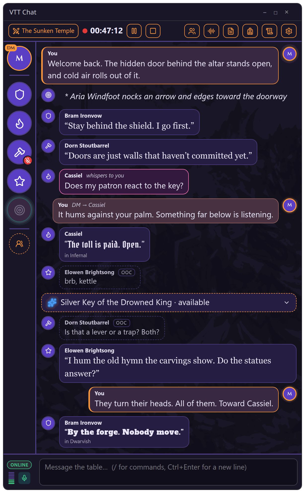
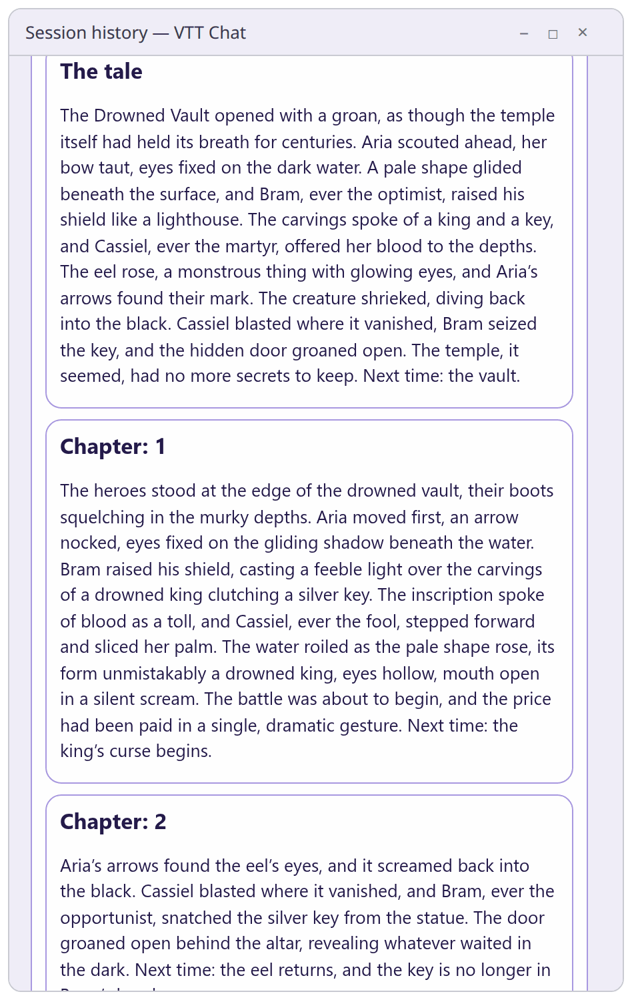
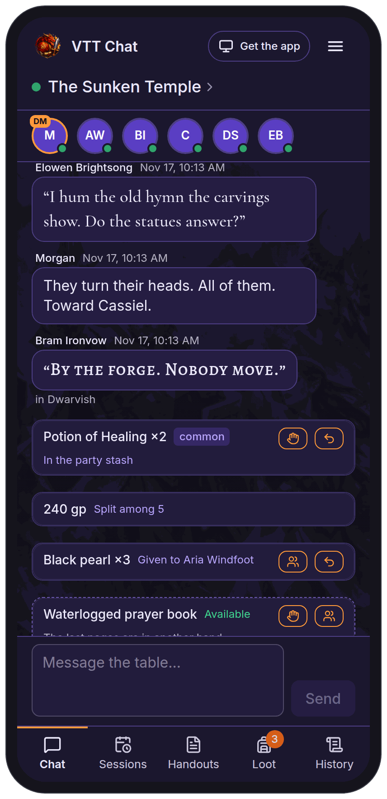
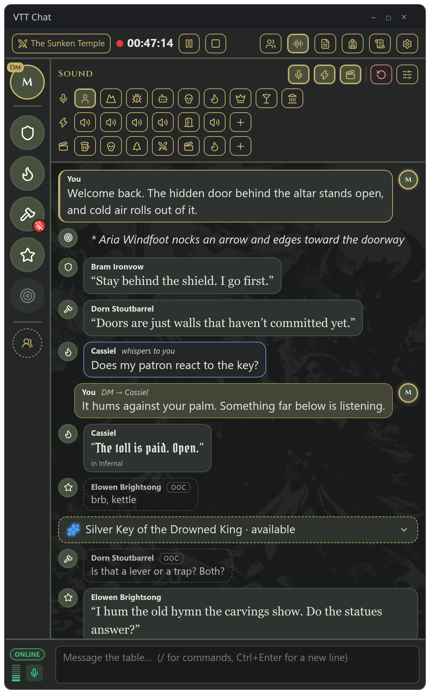
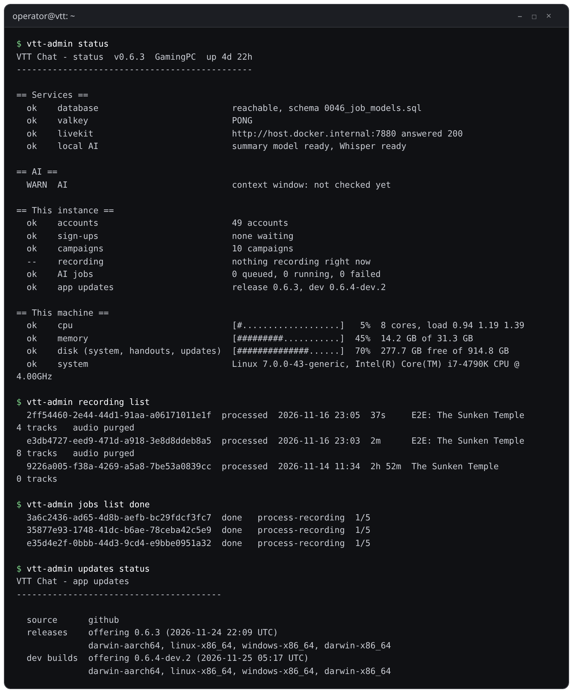

# VTT Chat App

> Self-hosted voice, chat and **session records with AI summaries** for tabletop groups. A tiny tray app for players, a mobile web app, and a server you run yourself — no cloud account required.

## Why this exists

A tabletop story is told once, out loud, and then it is gone. Online groups have it worse: the game is on one screen, the dice and sheets on others, and everyone talks over an open Discord channel that forgets the evening the moment it ends. Whoever kept notes (usually the DM, after a long night of running the game) is the only memory the campaign has.

VTT Chat App is the missing piece that sits **beside** whatever virtual tabletop you already use (D&D Beyond Maps, Foundry, Roll20, even paper) and pulls the table together: open-mic voice that stays out of the way, a little chat, handouts and loot, a DM soundboard, and your characters' sheets a glance away. It runs on a server **you** own, so your group's voices and stories stay yours.

### And then the Bard tells the tale

The part nothing else gives a table: **it remembers the session for you.** The server records each speaker on their own track, turns the talk into text on your own hardware, and then two AI storytellers go to work. A **scribe** keeps the facts: what happened, who did what, what was left hanging. A **bard** retells the evening as a short tale of the party's adventure, the fumbles told as proudly as the feats, so that on the morning after, everyone gets to read how legendary (or ridiculous) they were.

- **Players read the tale.** The DM also gets a private brief: the open threads and what to prepare next.
- **Pick your storyteller.** Each campaign chooses its bard: the grandiose Tavern Bard, the exact Dry Historian, the unreliable Drunken Bard, the Sarcastic Bard or the Bored Court Scribe. Choosing one is built; teaching each its own voice is the work in progress.
- **Recording is never a secret.** Every recording starts with a visible and audible cue, and private talk is never recorded.

Where the project stands is in the [roadmap](ROADMAP.md), the [changelog](CHANGELOG.md) and [what is built and verified](docs/BUILD-STATUS.md). The rest of this page is how to run it.

<p align="center">
  
  
  
</p>
<p align="center">
  
  
</p>

<sub>Simulated screenshots: the real screens, drawn from a test table and set in a plain frame; the tale is real output of the local AI. More in the <a href="docs/guides/USER-GUIDE.md">user guide</a>; how they are made: <a href="scripts/screenshots/README.md">scripts/screenshots</a>.</sub>

---

## Quick Start (for a DM)

You need a small Ubuntu Server (a VM is fine: 4 vCPU and 8 GB of memory is plenty, even with recording), a domain name, and the
ability to open a few ports. About half an hour.

1. **Point a domain at the server.** Add a DNS "A" record (for example `vtt.example.com`) pointing at the server's public IP. The
   website may sit behind Cloudflare's proxy; voice goes straight to the server.
2. **Open the ports** at your router or cloud firewall: `80/tcp`, `443/tcp`, `7881/tcp` and `50000-50200/udp` (the last two carry voice).
3. **SSH in and run one command.** On a minimal Ubuntu install `curl` may be missing: `sudo apt-get update && sudo apt-get install -y curl` first (the installer then adds anything else it needs, such as `nano`). It asks for your domain and email, installs everything (Docker included) and prints a sign-in code:

   ```bash
   curl -fsSL https://raw.githubusercontent.com/AndyProsser/vtt-chat-app/main/infra/get.sh | sudo bash
   ```

4. **Sign in** at `https://your-domain`, choose "I have a sign-in code", and you are in with a starter campaign where you are the DM.
5. **Invite your players** from the app (a link or a short code). They can use the web chat straight away, or install the desktop app
   from `https://your-domain/download` for voice.
6. **Record a session** (optional): re-run the installer with `--with-records`, or see
   [turning on recording](docs/guides/OPERATOR-GUIDE.md#6-turn-on-recording-and-ai-summaries). A recording is always announced to the table.

Afterwards `vtt-admin` works from any directory: `vtt-admin status`, `vtt-admin user code <email> signin`, `vtt-admin logs`,
`vtt-admin backup`, `vtt-admin update`. Everything else is in the **[operator guide](docs/guides/OPERATOR-GUIDE.md)**.

## What Is This?

The usual way a group plays online: everyone joins one Discord channel and leaves their mics open. That works. What it doesn't give you is a record of what happened. VTT Chat App keeps the same open-mic experience and adds that record.

- **Open-mic voice that stays out of the way.** A system-tray app, hidden ~90% of the time, with near-zero idle CPU, auto-rejoin, autostart and a tray icon that always shows whether you're live, muted or being recorded.
- **Session records are core.** The server records each speaker separately, transcribes with Whisper, and then two AI roles write it up: a _scribe_ notes what happened, big and small, and a _bard_ retells it as a short heroic tale with dry wit (the fumbles told as proudly as the feats) for the session, each chapter and each hero. Every recording starts with a visible, audible consent cue.
- **The tale is what the table reads.** Players get the tales. The DM also gets a private brief (key points, open threads, what to prepare next) and can open the scribe's full notes. The word-for-word transcript is a diagnostic view for the DM, not something players see.
- **Runs on modest hardware.** No GPU needed: on a 2010 Xeon without AVX, transcription takes about 1.7 times the length of the audio, and summaries come from a 4 GB local model. A GPU, yours or one on your LAN, makes it much faster.
- **Self-host first.** One VM or server, **Docker Compose** (or a native install for advanced users), **no cloud account**. LiveKit, recording, Whisper and an LLM run on your box — or Whisper/the LLM can point at a GPU machine you own. Anyone can deploy their own instance.
- **Cloud is optional.** Cloudflare (TURN, SFU, Workers AI, Pages) and cloud LLM/transcription are _advanced-user adapters_, off by default and never required.
- **Minimal table tools.** DM/player whispers, handouts and images, loot drops, a DM soundboard, party splits, and session reminders with RSVP.
- **Campaigns are private.** A designated DM and access control per campaign, plus a General channel.
- **Not tied to a VTT.** It works alongside whatever you play on — D&D Beyond, Foundry, Roll20, or paper. (Optional D&D Beyond character import is planned for later.)

## How Light Is It?

You leave a voice app running for a four-hour session, next to a game that is probably in a browser tab. So memory and CPU matter, and this app is built to be small: it is a tray app that serves **only its own pages**, never a web browser or remote content, and **Rust owns the audio** (capture, echo cancellation, mixing and playback never touch a web view). A panel's window is **destroyed when you close it**, not hidden, so nothing runs for a closed panel.

Measured with the scripts in [`scripts/test/`](scripts/test/README.md) (same method on every OS; run them yourself):

| App and state                                         | Processes | Memory                                                                                          | CPU at idle |
| ----------------------------------------------------- | --------: | ----------------------------------------------------------------------------------------------- | ----------- |
| **VTT Chat, Windows, in the tray, panels closed**     |         2 | **about 8 MB** (Task Manager)                                                                   | 0%          |
| **VTT Chat, Windows, window open, no interaction**    |        10 | **189 MB** avg (private working set)                                                            | 0.00%       |
| **VTT Chat, Windows, opening and closing everything** |         8 | **212 MB** avg, 316 MB peak                                                                     | 0.21%       |
| **VTT Chat, Linux, a panel open**                     |         4 | **174 MB** (PSS)                                                                                | 0.01%       |
| Discord, Linux (Flatpak), window open, settled 90 s   |         8 | **780 MB** (PSS)                                                                                | 1.57%       |
| Discord, Windows, as we see it                        |         — | about 400 MB on a good day, over 2 GB on a bad one; about 290 MB for the newer optimised client | —           |
| TeamSpeak, Mumble and other voice apps                |         — | not measured by us                                                                              | —           |

**What this says, and what it does not:**

- **In the tray, where players leave it about 90% of the time, it is a rounding error: single-digit megabytes.** Opening a window starts the system's web view (WebView2 on Windows, WebKitGTK on Linux), and that is where the memory goes: **roughly 190 to 210 MB on Windows and 175 MB on Linux** while a window is open, given back when you close it.
- That is **well under Discord on the same machine (about a fifth of its Linux footprint) and about half of what Discord's newer client is reported to use on Windows**, with next to no idle CPU. We would not call it "tiny" with a window open: it is a web view, and a web view costs that much.
- The Discord figures marked "as we see it" are the maintainer's own observations and the vendor's claims for the newer client, **not** measured with these scripts; the Linux Discord row is measured with them. Do not read the Linux and Windows rows against each other: different systems and web views. The honest comparison is the same script, same state, on your machine.
- We have not measured **macOS**, and have not measured TeamSpeak or Mumble, so the table gives no number for them. Measure the apps you use: it takes a minute per state.

Unlike general voice apps, this one is built for tabletop play: a DM-controlled soundboard, party splits with private talk, loot, and a searchable record of every session with AI summaries.

## Tech Stack

- **Desktop client** — Tauri tray app (Rust + React panels)
- **Audio / WebRTC** — Rust audio engine + LiveKit client, native and in-process (never in a webview)
- **UI** — React 19 + Radix UI + Zustand + TypeScript; light/dark follows the OS
- **Backend** — Node.js + Express + TypeScript
- **Realtime / recording** — LiveKit server + Egress (native binaries)
- **Records pipeline** — ffmpeg, Whisper.cpp (`small.en` on CPU), Ollama (`qwen3.5:4b` on CPU), all local by default
- **Database / cache** — PostgreSQL, Valkey (Redis protocol)
- **Reverse proxy** — Caddy
- **Deployment** — Docker Compose on a VM/server (primary); native Ubuntu services under systemd for advanced users

See [CLAUDE.md §4](.claude/CLAUDE.md) for code conventions.

## Repository Structure

```text
vtt-chat-app/
├── backend/               # Node.js/Express API + WebSocket + system-level CLI admin
├── livekit/               # LiveKit server + Egress config and helpers
├── tauri-client/          # Cross-platform Tauri tray app
│   ├── src-tauri/         # Rust: tray, panels, hotkeys, autostart, updater
│   ├── rust-livekit/      # Rust: audio engine + LiveKit client + cue player
│   └── panels-ui/         # TS/React panels (replaces legacy overlay-ui/)
├── web/                   # Invite page and the phone app (/app)
├── ai/                    # Records pipeline: transcode, Whisper, diarize, summarise
├── ddb/                   # OPTIONAL D&D Beyond character import
├── status/                # Public status page (React + Radix)
├── shared/                # Cross-module TS types, event contracts, validators
├── infra/                 # Ubuntu deployment scripts + systemd units
└── docs/                  # Architecture and setup (docs/archive/ = previous design)
```

Each module has its own `README.md` describing its purpose and current status.

## Documentation

- [docs/guides/OPERATOR-GUIDE.md](docs/guides/OPERATOR-GUIDE.md) — install, configure, operate, back up, update and fix a server (draft)
- [docs/guides/USER-GUIDE.md](docs/guides/USER-GUIDE.md) — joining a table, voice, chat, handouts, loot, recording, the DM's tools (draft)
- [CLAUDE.md](.claude/CLAUDE.md) — full architecture spec and build constraints
- [ROADMAP.md](ROADMAP.md) — staged build order
- [CONTRIBUTING.md](CONTRIBUTING.md) — how to contribute, PR process
- [DEVELOPING.md](DEVELOPING.md) — local dev environment setup
- [docs/architecture/OVERVIEW.md](docs/architecture/OVERVIEW.md) — system diagram + module responsibilities
- [docs/architecture/RECORDING-AND-SUMMARIES.md](docs/architecture/RECORDING-AND-SUMMARIES.md) — recording, consent cue, transcription, summaries
- [docs/architecture/DEPLOYMENT-AND-TRANSPORT.md](docs/architecture/DEPLOYMENT-AND-TRANSPORT.md) — self-host topology, ports, TURN, optional cloud adapters
- [docs/architecture/STATE-AND-RESILIENCE.md](docs/architecture/STATE-AND-RESILIENCE.md) — state boundaries and recovery rules for long sessions
- [docs/CONVENTIONS.md](docs/CONVENTIONS.md) — folder/style conventions in detail
- [docs/archive/](docs/archive/README.md) — the previous (DDB-overlay) design, kept for reference

## Self-Hosting at a Glance

You will need a server you control (VM or host) running Ubuntu, a domain name for TLS, and the ability to open a **UDP port range** for voice. You do not need a Cloudflare account or a cloud LLM. Docker Compose is the recommended install; a native install is available for advanced users. Both installs are in [infra/](infra/README.md) (Compose: [infra/compose](infra/compose/README.md); native: [infra/install.sh](infra/install.sh)); the topology and port table are in [DEPLOYMENT-AND-TRANSPORT.md](docs/architecture/DEPLOYMENT-AND-TRANSPORT.md).

## Recording & Privacy

Recording is server-side and always announced: every client plays a "recording in progress" cue when it starts, late joiners hear it before their audio is captured, and the tray icon shows a recording state. Whispers and private channels are never recorded. Players read the tales; the DM's brief, the scribe's notes and the transcript stay with the DM. Nothing leaves your server unless you explicitly enable a cloud adapter. The server's containers run with minimal privileges, and a site with a real certificate tells browsers to use HTTPS only. Details in [RECORDING-AND-SUMMARIES.md](docs/architecture/RECORDING-AND-SUMMARIES.md).

## Prior Art

This project descends from [vtt-chat](https://github.com/AndyProsser/vtt-chat) and [vtt-chat-extension](https://github.com/AndyProsser/vtt-chat-extension) (both archived), and from its own first design — a Tauri browser that embedded D&D Beyond (see [docs/archive/](docs/archive/README.md)). Each step was a deliberate simplification. See [CLAUDE.md §15–16](.claude/CLAUDE.md).

## Third-Party Notice

VTT Chat App is a fan-built project. It is not affiliated with, endorsed by, or intended to compete with Wizards of the Coast or D&D Beyond. It does not embed or scrape D&D Beyond. If the optional character-import feature is built, it will read only publicly available character pages, and we will happily change or remove it if that ever raises a concern — open an issue any time.

_Dungeons & Dragons and D&D Beyond are trademarks of Wizards of the Coast LLC._

## License

[GNU AGPL v3.0](LICENSE)
