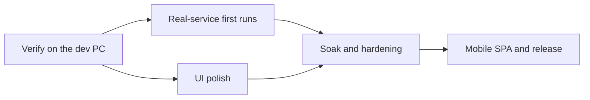

# Roadmap

**Purpose:** Stage-by-stage build order for VTT Chat App, derived from [.claude/CLAUDE.md](.claude/CLAUDE.md). Each stage lists its goal, what it depends on, its deliverables, and what "done" means. Detailed task breakdowns are written per-stage (via a proper implementation plan) when that stage actually starts — this document tracks shape and sequence, not tickets, so it stays accurate instead of going stale.

**Status legend:** 🟢 Done · 🟡 In Progress · ⚪ Not Started · ⚫ Superseded

> **Where things actually stand:** [docs/BUILD-STATUS.md](docs/BUILD-STATUS.md) (built vs verified, and what needs the dev box).
>
> **Rewritten 2026-11-05.** The project changed direction on 2026-10-29: from a Tauri _browser_ that injected a voice overlay into D&D Beyond Maps, to a **self-hosted, audio-first system-tray app with server-side recording and AI summaries**. The old Stages 1–3a are summarised under [Legacy record](#legacy-record-the-ddb-overlay-design) with what carried over. The old stage documents are in [docs/archive/](docs/archive/README.md).
>
> **The design is not signed off.** The architecture sketch is unreviewed, several topics are open ([.claude/intent.md](.claude/intent.md)), and Stage 2 exists precisely to de-risk the hardest unknowns before anything else is built. Treat stages from 3 onward as shape, not commitment.

**Sequencing rule:** prove the riskiest cross-cutting unknowns first — audio quality and recording on real machines — before investing in feature breadth. State discipline ([Stage 0.5](#stage-05--state--resilience-architecture)) is locked in before any stateful UI is built.

**Principles every stage inherits** (from [CLAUDE.md §2](.claude/CLAUDE.md)): self-host first with zero cloud reliance; cloud is an optional advanced adapter; the server is the source of truth; consent is visible; quiet when idle.

---

## Where we are and what is next

**As of 2026-11-09 the player experience is essentially complete:** sign in, join, talk, chat, whisper, loot, RSVP, hear the DM's scenes and stingers, browse past sessions, with recording and consent working end to end. What is left is **verification on real machines** (nothing below has been clicked through in a real window since it was built), a few UI/UX refinements, and release work.

**Built 2026-11-09 (unverified in a real window or against real services):**

- **D&D Beyond character sync** ([DDB-SYNC.md](docs/architecture/DDB-SYNC.md)): link on the Campaign → Character screen, "Sync now", hourly refresh of name, race, class, level and portrait. Off unless `DDB_SYNC=1`. **Never run against the live service**; the parser is the one place to adjust.
- **Session history window**: recordings, summaries (DM-only ones only for the DM), transcript, search, DM delete.
- **Public status page** at `/status` and `/api/status`, built and served in both install tiers.
- **Mixer audio engine** ([AUDIO-MIXER.md](docs/architecture/AUDIO-MIXER.md)): our own capture and playback around WebRTC's echo cancellation, opt-in (Settings → Audio, or `VTT_AUDIO_BACKEND=mixer`). Gives per-person volume, microphone volume, a real level meter, and echo cancellation that still works with a character voice and for sounds the app plays itself. Live-tested against a dev server; **never listened to.**
- **Polish:** four new DM voices (Dragon, God, Drunk, Authoritative: **tuned by tests on synthetic tones, not by ear**), a keyboard way to move people between groups (Enter on a focused person in the rail), `--category` and `ambience/` or `music/` folders in the sound importer, and a daily sweep of portraits nobody uses.
- **Emailed sign-in codes** (`SMTP_URL`), **single sign-on** (OIDC) and a **code sign-in** in the app ([SIGN-IN-OPTIONS.md](docs/architecture/SIGN-IN-OPTIONS.md)). SSO was tested against a fake provider only.

**Guides (started 2026-11-10):** an [Operator guide](docs/guides/OPERATOR-GUIDE.md) (install, first run, configure, operate, back up, update, fix) and a [User guide](docs/guides/USER-GUIDE.md) (players and DMs) are drafted in [docs/guides/](docs/guides/README.md). They describe what is built; the steps nobody but the author has run are marked. **They are kept true in the same commit as any feature that changes them**, and the second-person deploy test (Stage 3) is also the test of the operator guide.

**Build queue (worked through 2026-11-10 onward, one commit each, tests first):**

| #   | Item                                                                                                                                                                                     | Why now                                                                                          | Status                                             |
| --- | ---------------------------------------------------------------------------------------------------------------------------------------------------------------------------------------- | ------------------------------------------------------------------------------------------------ | -------------------------------------------------- |
| A   | **First-run bootstrap:** `vtt-admin user create <email> --name … [--admin]`                                                                                                              | The operator guide needs a way to make the first account; today it takes a hand-written API call | built                                              |
| B   | **Closed-window experience:** unread badge on the tray icon, OS notifications while the window is hidden (whispers only while in voice with a recording active), session reminders shown | Players keep the app hidden ~90% of the time                                                     | built                                              |
| C   | **Storage and purge (disk figures done 2026-11-10; purge done earlier):** disk use on the status page and in `vtt-admin`, and a purge of raw audio once a summary is confirmed           | Recordings fill a disk with no warning                                                           | built                                              |
| D   | **Backup and restore scripts** (Compose and, from 2026-11-10, native: `infra/backup-native.sh`, `infra/restore-native.sh`)                                                               | The guide currently says "use pg_dump by hand"                                                   | built                                              |
| E   | **Handouts:** remove or reorder a picture after creation                                                                                                                                 | Today a set is deleted and rebuilt                                                               | built                                              |
| F   | **Search finds typed chat lines** from recordings                                                                                                                                        | Typed lines are in transcripts but not searchable                                                | built                                              |
| G   | **Away on Windows and macOS:** screen-lock detection (only the idle timer works there)                                                                                                   | Parity with Linux                                                                                | built, unverified on Windows/macOS                 |
| H   | **Noise filter follow-ups:** a hum notch filter; decide the default level after listening; PipeWire/PulseAudio backends                                                                  | Needs your ears first for the default                                                            | built (default level and backends need the dev PC) |

**Next steps, in order:**

0. **Deployment buildout ([Stage 3b](#stage-3b--deployment-buildout-added-2026-11-11)):** published images, version handshake, server-chosen client builds, then web onboarding. This comes first: the goal is a deployable system to test end to end before refining.

1. **On the dev PC:** run the app and try everything listed above plus unmute, rail drag, portrait upload, device switching and the scene editor. Link a real public D&D Beyond sheet and read what comes back. Point SMTP and an Authelia at the backend once.
2. **UI/UX fine-tuning** from what step 1 turns up, starting with **listening to the four new voices** and the importer's ambience and music loops (run `npm run sounds:import -- --from <dir> --category ambience`).
3. **Purge rules (built 2026-11-10):** age-based retention, the DM's "delete the audio" button, and a disk-low rule with a 3-day warning. Not built: purge at the next session start. Then the recorded 4-hour soak (Stage 9). The server-restart-mid-recording drill is done (2026-11-10).
4. **Second-person deploy test** from the docs on a blank VM (Stage 3).
5. **Mobile SPA** (Stage 7): built, with history search, a handout viewer (flip and zoom) and an install manifest added 2026-11-10; open it on a real phone (`/app`) and try it on iOS Safari.
6. **D&D Beyond:** AC, passive perception, max HP and ability scores are built (2026-11-10, worked out by us); one real sheet compared 2026-11-11 (fixed Draconic Resilience HP and AC); compare a Barbarian or Monk next. Later: saves, skills.
7. **Decide the audio engine default** after trying the mixer on the dev PC (latency, CPU, echo with real speakers, Bluetooth and USB headsets, hour-long drift). Flip the default only when it has been better than the platform path for a few real sessions.
8. **Try the optional sound-card backends and RNNoise** once the mixer is validated: cpal 0.18's `pipewire`, `pulseaudio` and `jack` cargo features (off today; Linux uses ALSA, which PipeWire serves; they need the PipeWire/PulseAudio dev libraries in the Docker image and CI), (RNNoise itself is built: [AUDIO-MIXER.md](docs/architecture/AUDIO-MIXER.md); it needs a listening test; the 50/60 Hz hum notch filters are built ahead of it). cpal is now 0.18.2 (decided 2026-11-09); see [AUDIO-MIXER.md](docs/architecture/AUDIO-MIXER.md).
9. **Status (Online, Away, Offline) is built** ([STATUS-AND-PRESENCE.md](docs/architecture/STATUS-AND-PRESENCE.md), 2026-11-10): tray submenu, a dot beside the settings cog, Settings → Profile, automatic Away from screen lock or idle, shared with the table, and no voice join at launch. Still to do: try it on the dev PC, the Windows and macOS screen-lock signals.
10. **Closed-window experience and the full soak.** A 21 h debug-build run with the window open (2026-11-10) held steady memory, threads and file handles, with 0-20% CPU from chat and speaking indicators; that is working load, not idle. The tray unread badge and OS notifications while the window is closed are built, with per-kind switches and quiet hours in Settings (2026-11-10; decided 2026-11-10: whisper notifications fire only while the player is connected to voice and a recording is active, i.e. in-game). Still to do: measure true idle (window closed, chat quiet) in a release build as part of a full soak under varied conditions.

---

## Stage 0 — Foundations

**Status:** 🟢 Done (carried over unchanged)

npm workspaces, root docs, per-module scaffolds, Cargo workspace in `tauri-client/`, CI (ESLint + Prettier + `tsc` for TS; `cargo fmt` + `clippy` for Rust), and the per-module folder convention.

**Note:** `typescript` is pinned to `^6.0.3` because `typescript-eslint` doesn't yet support TypeScript 7's compiler internals. `eslint-plugin-react`/`-hooks` are left out until their peer ranges support the repo's ESLint major; re-add them when real panel components land (Stage 4).

---

## Stage 0.5 — State & Resilience Architecture

**Status:** 🟢 Done (revised 2026-11-05 for the tray app)

The rules every stateful surface follows — leaf isolation, write discipline, bounded retention, the recovery contract, WebSocket reliability — in [docs/architecture/STATE-AND-RESILIENCE.md](docs/architecture/STATE-AND-RESILIENCE.md). The 2026-11-05 revision adds **"hidden is the default"**: tray state is Rust-owned, a panel hydrates from a snapshot every time it opens, and nothing runs while no panel is visible.

---

## Stage 1 — Pivot Cleanup

**Status:** 🟢 Complete 2026-11-05 — docs and code teardown done (v0.2.0)
**Depends on:** —

Make the repo match the new design, so nobody (human or Claude) builds on legacy patterns.

**Deliverables:**

- 🟢 Rewrite `.claude/CLAUDE.md`, `README.md`, `ROADMAP.md`, `DEVELOPING.md`, `CONTRIBUTING.md`, `docs/CONVENTIONS.md`, the architecture docs, and every module README
- 🟢 New design docs: [RECORDING-AND-SUMMARIES.md](docs/architecture/RECORDING-AND-SUMMARIES.md), [DEPLOYMENT-AND-TRANSPORT.md](docs/architecture/DEPLOYMENT-AND-TRANSPORT.md)
- 🟢 Move everything specific to the old design into [docs/archive/](docs/archive/README.md) (WebKitGTK investigation, old specs/plans, DDB-AUTH)
- 🟢 **Remove legacy code** from `tauri-client/src-tauri/`: `allowlist.rs`, `blocked_page.rs`, `homepage_redirect.rs`, `safety_net.rs`, `cobalt.rs`, overlay injection, the `remote-ddb` capability, the DDB URL/domain consts, and the `dev-with-patched-webkitgtk` plumbing
- 🟢 **Replace `tauri-client/overlay-ui/`** with `panels-ui/` — keep the build/test scaffolding, the Radix/Zustand setup and the leaf-isolation helpers; delete the Shadow DOM mount, corner/expand stores, `CompactPanel`/`ExpandedPanel`, and `OverlayCornerMenu`
- 🟢 **Reshape `backend/`**: remove the DDB-identity `POST /api/session` contract (keep LiveKit token issuance); update `shared/` schemas accordingly
- 🟢 **Demote `ddb/`** to the optional character-import module (public pages only); remove the cobalt-cookie/JWT code or move it to `docs/archive/` (moved to `docs/archive/ddb-legacy/`)
- 🟢 Update `scripts/dev.ts`, `package.json` workspaces and CI for the new module set; strip the WebKitGTK/NVIDIA notes from `DEVELOPING.md`'s tooling assumptions (done in prose; confirm in the scripts)
- 🟢 A `tauri.conf.json` with **no remote origins**: strict CSP, local pages only (the tray and panel windows themselves are Stage 4; the shell is windowless until then)

**Done when:** `npm run lint`, `typecheck`, `build`, `test` and `cargo clippy` pass, and `grep -ri "cobalt\|allowlist\|dndbeyond\|overlay"` over `src/` returns nothing but the optional `ddb/` module.

---

## Stage 2 — Audio & Records Spike

**Status:** 🟡 In Progress — first findings logged in [AUDIO-SPIKE-RESULTS.md](docs/architecture/AUDIO-SPIKE-RESULTS.md) (platform audio layer chosen as the base; release-on-mute measured on Windows). Built without a live server: platform-audio client with release-on-mute and auto-rejoin, the `ai/` pipeline library, and the Part B runbook/scripts. **Still needs a live run:** acoustic AEC/CPU/latency, rejoin and sleep/wake, and Part B on a Linux server.
**Depends on:** Stage 1 (the Rust crate part can start immediately; it doesn't need the cleanup)

The riskiest unknowns are all "does this actually work on real machines with open mics?" — answer them with the smallest possible thing before any tray or React work.

**Part A — Headless client.** A headless Rust binary (extends `rust-livekit/examples/`): capture → echo cancellation → noise suppression → LiveKit room join → playback, with per-player gain. No Tauri, no UI.

**Part B — Server records smoke test.** Stand up LiveKit + **Egress** on a dev server; record per-speaker tracks from Part A; run ffmpeg → Whisper.cpp on them; summarise a transcript with Ollama. Throwaway scripts are fine.

**Deliverables:**

- Part A running on **Windows and Linux** with open mics and speakers (no headphones), measured for echo, noise, CPU and latency
- **Capture-device release on mute**: does it work on both OSes, and what is the unmute latency? Decides the hot-mic design (CLAUDE.md §8.1)
- **Auto-rejoin** after network drop and after sleep/wake
- Part B: per-speaker recording end-to-end; Whisper.cpp throughput on the dev server (real-time factor per `small`/`medium` model); a first summary
- Sizing numbers for [DEPLOYMENT-AND-TRANSPORT.md](docs/architecture/DEPLOYMENT-AND-TRANSPORT.md) and [RECORDING-AND-SUMMARIES.md](docs/architecture/RECORDING-AND-SUMMARIES.md)

**Done when:** two machines on different OSes hold a clean open-mic conversation, a server-side recording of it produces a correctly speaker-attributed transcript and a readable summary, and the measured numbers are written into the design docs.

**What carries over:** `rust-livekit` already does capture (`cpal`), `NativeAudioSource`, publish/subscribe and playback; the `loopback` example proved that pipeline against a real server (2026-08-09). This stage adds AEC/NS, gain, rejoin, and everything server-side.

---

## Stage 3 — Server Core

**Status:** 🟢 Nearly done — built and verified against real services: identity/campaign domain, REST, WebSocket hub with a Valkey-backed replay buffer, Postgres store and migrations, recording state and consent acknowledgements, the Admin CLI (`vtt-admin`), and **both install tiers** (Docker Compose; native `infra/install.sh` on Ubuntu 24.04). **Remaining:** chat persistence and the "done when" test — a second person deploying from the docs on a blank VM
**Depends on:** Stage 2 (and the open identity decision, below)

**Decided with Andy (2026-11-05):** the identity & access model ([CLAUDE.md §11](.claude/CLAUDE.md#11-identity--access-model--direction-decided-2026-11-05-details-open)) and the sync protocol ([SYNC-PROTOCOL.md](docs/architecture/SYNC-PROTOCOL.md), draft). Remaining open: Admin quick-access extras, OIDC specifics, and the assumed defaults (invite expiry 7 days, magic-link lifetime 15 minutes, minimum password length 10).

**Deliverables:**

- Identity, instance bootstrap (first DM), campaigns, membership and access control; General channel + private campaign channels
- LiveKit token issuance per channel; room layout (General / Campaign / party splits)
- Postgres schema (campaigns, memberships, channels, messages, recordings, transcripts, summaries); Redis for ephemeral state
- WebSocket layer with a bounded replay buffer and snapshot fallback (per STATE-AND-RESILIENCE)
- **Docker Compose bundle** (primary) + Caddy + systemd + `infra/install.sh` (native, advanced) — voice only to start (records come in Stage 5). Both generate the same config; LiveKit on host networking in Compose
- UDP port documentation and an operator checklist, tested by a **second person** deploying from the docs

**Done when:** someone other than Andy can `docker compose up` on a blank Ubuntu VM (and, separately, run the native install script), bootstrap a campaign, and have two clients join its voice room.

---

## Stage 3b — Deployment Buildout (added 2026-11-11)

**Status:** 🟡 In Progress
**Depends on:** Stage 3 (the Compose bundle), Stage 4 (the tray client and its updater)
**Design:** [VERSIONING-AND-DEPLOYMENT.md](docs/architecture/VERSIONING-AND-DEPLOYMENT.md)

**Goal:** the whole system deploys to a server from published images, so the full system can be tested end to end
(recording, summaries, real players), and only then refined. Versions, updates and onboarding are server-driven.

**Deliverables, in build order:**

| #   | Item                                                                                                                                                                                                                                                             | Status                           |
| --- | ---------------------------------------------------------------------------------------------------------------------------------------------------------------------------------------------------------------------------------------------------------------- | -------------------------------- |
| 1   | **Version rules** (MAJOR/MINOR/PATCH meaning, 0.y as the match tier) in CLAUDE.md, DEVELOPING.md and the design doc                                                                                                                                              | 🟢 Done 2026-11-11               |
| 2   | **Container build workflow:** CI builds the backend and worker images on a release tag and pushes them to GHCR (full version + MAJOR.MINOR tags; dev tags never move `latest`); the Compose bundle pulls them by `VTT_VERSION` instead of building on the server | 🟡 Built, untried (first run on the next tag)                          |
| 3   | **Protocol version handshake:** `PROTOCOL_VERSION` in `shared/`, sent by the client and answered by the server, with "update required" on both sides; a CI test fails if a wire contract changes without it                                                      | 🟡 REST built; WebSocket and CI guard still to do                               |
| 4   | **Server-chosen client builds:** the server offers the newest patch of its own MAJOR.MINOR, patches auto-approved, from GitHub releases (`UPDATES_SOURCE=github`)                                                                                                | ⚪                               |
| 5   | **Update mirror:** `UPDATES_SOURCE=mirror` sync job (verify signatures, newest patch plus one previous, cleanup), `vtt-admin updates sync/status`                                                                                                                | ⚪                               |
| 6   | **Fresh-VM deploy test** from the images and the operator guide (the Stage 3 "done when"), with real LiveKit audio, `wss://` through Caddy and a Let's Encrypt certificate                                                                                       | ⚪ Needs a VM                    |
| 7   | **Web onboarding and app sign-in:** invite link → account → OS-specific install → "Open VTT Chat" hand-off (deep link with PKCE, device-code fallback); the server owns the sign-in methods                                                                      | ⚪ **Needs a design pass first** |
| 8   | **Mobile account and install flow:** security and profile (name, avatar) in the browser; add-to-home-screen steps for Android and iOS, then how to install the desktop app                                                                                       | ⚪ After 7                       |

**Done when:** an operator on a blank Ubuntu VM pulls the images, starts the stack, and a new player goes from an
invite link to a signed-in, preconfigured app without typing a server address; a client of the wrong MAJOR.MINOR is
told clearly to update; and a recorded session runs through to its summary.

---

## Stage 4 — Tray Client

**Status:** 🟢 Feature-complete for players as of 2026-11-09; 🟡 fine-tuning and verification remain. One compact RPG-themed main window (avatar rail with speaking glow, quality-coloured connection sparkline, group sections and hover cards; themed chat with whispers; record state and consent; mute and level meter; voice connect), Settings as a popover (Profile, Campaign, Sessions, General with audio devices and themes), Handouts and Party-inventory windows, the DM **Scene Deck** (Voice, Stinger and Scene panels with favourites, custom scenes and per-type levels), loot with the SRD catalogue and treasure generator, scheduling with RSVP, account and character avatars, sound through the call, signed auto-update, start-with-computer, crash recovery and the DM connection screen. Voice runs on **LiveKit Rust SDK 0.10.1** (Linux builds need `clang`; see [DEVELOPING.md](DEVELOPING.md)). **Built since, unverified in a real window:** the session history window, the keyboard way to move people between groups, four more DM voices, and the opt-in mixer audio engine (per-person volume, microphone volume, a real level meter). **Not built:** a recorded 4-hour soak (`tauri-client/scripts/soak.sh` is ready), and checking the D&D Beyond sync's extra stats against real sheets. **Needs a human:** listen-tests of effects, character voices and the mixer engine, and a pass through the real window (unmute, rail drag, portrait upload, device switching, scene editor). Back up the updater key (`~/.tauri/vtt-chat-updater.key`) and give it a password before real releases. Detail of what is built vs verified: [docs/BUILD-STATUS.md](docs/BUILD-STATUS.md). Design: [main-window spec](docs/superpowers/specs/2026-11-08-main-window-design.md).
**Depends on:** Stage 2 (audio engine), Stage 3 (server to connect to)

**Deliverables:**

- Tray icon with live / muted / recording / disconnected states, driven from the Rust core
- Floating panels (`panels-ui/`), position/size remembered; **no panel needed for audio to work**
- Hotkeys (PTT, mute, panel toggle) with the platform limits documented — bare-modifier PTT is app-focused only; Wayland global shortcuts no-op
- Autostart, auto-update, crash recovery, auto-rejoin; near-zero idle CPU verified
- First panels: connection/roster, mute/PTT, channel switcher
- Light/dark follows the OS; simple but stylish

**Done when:** a player installs the app, signs in, joins the campaign, hides it, and plays a 4-hour session without touching it again — surviving a Wi-Fi drop and a laptop sleep — with idle CPU at ~0 and the tray icon always telling the truth.

---

## Stage 5 — Records & AI Summaries (Core)

**Status:** 🟡 In Progress — the processing half is built and verified live (Egress files → durable job queue → worker → Whisper/LLM, local or remote with fallback → transcripts and summaries in Postgres; Admin CLI `jobs` / `recording`). **Records API built** (read, search, DM-only enforced at the API, DM delete). **History window built 2026-11-09 (unverified in a real window).** **Built 2026-11-10:** the DM confirms → purge raw audio, and a disk-low purge rule with a 3-day warning (the next-session rule is not built). **Not built:** the cloud-adapter extras. The recording loop itself — DM start/stop → per-speaker capture gated on the consent acknowledgement → processing — is closed and verified live. See [docs/BUILD-STATUS.md](docs/BUILD-STATUS.md)
**Depends on:** Stage 3, Stage 4 (Stage 2 Part B already proved the pipeline shape)

**Deliverables:**

- Recording control from the DM's panel; recording state in server metadata
- **Consent cue**: local start/stop cues, late-joiner gating, rejoin suppression, per-player acknowledgement with expiry, persistent indicator (tray + panel)
- Egress per-speaker recording; private/whisper audio excluded at the routing layer
- `ai/` pipeline: transcode → Whisper.cpp per track → merge by timestamp → Ollama summaries (session, chapter, character-specific, DM-only), with a retryable job queue
- Records API + a history/summary panel; search across a campaign's history
- Optional cloud adapters (OpenAI Whisper, cloud LLM) behind explicit operator config
- Resolve the open records questions: markers vs. topic shifts, pause/resume, retention default

**Done when:** a real session is recorded with every player hearing the cue, produces a speaker-attributed transcript and summaries entirely on the self-hosted box, DM-only summaries are verifiably DM-only, and nothing from a whisper appears in any artifact.

---

## Stage 6 — Table Features

**Status:** 🟢 Built end to end for players (server 2026-11-07, client 2026-11-08 to 09); 🟡 the full-session test below is not yet run. Server: chat and private whispers, handouts/maps/images/text snippets, loot with atomic claims, the DM soundboard (a mini thaumaturgy.app), session schedule + RSVP + reminders + stored notifications, and party split — see [TABLE-FEATURES.md](docs/architecture/TABLE-FEATURES.md). Client: chat and whispers, handouts, loot and party inventory, the Scene Deck, scheduling and RSVP, and party split in the rail (Stage 4). **Not built:** voice whispers and the end-to-end "full session" test below.
**Depends on:** Stage 5

**Deliverables:**

- Chat, DM/player whispers, handouts/maps/images, text snippets (bounded retention, per STATE-AND-RESILIENCE)
- Loot drops with pickers
- DM soundboard: own and per-player audio, instant and background effects
- Party split: DM in all groups, players isolated; DM drag between groups
- Session scheduling in the tray: reminders and RSVP (can make it / late / can't)
- In-session and post-session history access

**Done when:** a full session runs with whispers, a handout, a loot drop, a party split and soundboard effects, all surviving a reconnect without duplicates.

---

## Stage 7 — Mobile SPA

**Status:** 🟡 First cut built 2026-11-10 ([MOBILE-WEB-APP.md](docs/architecture/MOBILE-WEB-APP.md)): sign-in, chat with whispers, sessions with RSVP, handouts, history with summaries, transcripts and search, a handout viewer, and an install manifest. Exercised in a phone-sized headless browser; **not tried on a real phone**. No voice, by decision (the tray app owns audio)
**Depends on:** Stage 3 (API), Stage 6 (content)

`web/`: a basic mobile-first SPA designed more for messages than gaming — messages, RSVP, handouts, history/summaries, and possibly basic listen/talk (open question). Served by the box by default; Cloudflare Pages is an optional adapter.

**Done when:** a player on a phone can read the chat and summaries, RSVP, and open a handout. (Met in the headless run; confirm on a real phone, including iOS Safari.)

---

## Stage 8 — Operations: Admin CLI & Status Page

**Status:** 🟢 The Admin CLI (`vtt-admin`) is built and in use (Stage 3); the public status page (`status/`, `/status` and `/api/status`) is built 2026-11-09, unverified on a real deployment
**Depends on:** Stage 5

**Deliverables:**

- **Admin CLI** (system-level only): backup/restore/delete campaigns, recordings, transcripts, summaries; reprocess a recording; health checks; service restart; log inspection; storage cleanup and retention; AI job-queue inspection; LiveKit/Egress/backend/Redis/Postgres status; instance bootstrap
- **Public status page** (`status/`): service health incl. the records pipeline, connected players, recording-active flag, client download links

**Explicitly out of scope for the CLI:** campaign contents, channels, markers, soundboard — those are DM-managed in the app (CLAUDE.md §7).

**Done when:** an operator can back up and restore a campaign, reprocess a recording, and see every service's health, without a browser or a password.

---

## Stage 9 — Cross-Platform Hardening & Production Readiness

**Status:** ⚪ Not Started
**Depends on:** Stage 5 (can overlap Stages 6–8)

**Deliverables:**

- Verified audio parity on Windows, Linux (GNOME + KDE) and, if a player appears, macOS
- Tray behaviour documented per desktop (GNOME AppIndicator, Wayland limits) with graceful degradation
- Real 8+ hour soak with churn, memory profiled against the Stage 0.5 rules
- A real server-restart-mid-recording drill: recording recovers or fails loudly, never silently — **built and drilled 2026-11-10** (`infra/records-smoke/restart-drill.sh`; recovery stops the leftover egresses and keeps the audio; see [RECORDING-AND-SUMMARIES.md](docs/architecture/RECORDING-AND-SUMMARIES.md)); a `kill -9` of the packaged backend is still to try
- Security pass: consent-cue bypass attempts, private-audio leakage into records, token/session expiry, ACL checks on every records endpoint — **done 2026-11-10** for the REST surface and live sockets (access matrix; found and fixed a player who left still receiving chat and voice); the Egress capture and whisper paths were already covered by tests
- Packaging: installers per OS, signed where practical, updater verified

**Done when:** a full real campaign session runs on all supported platforms without manual intervention.

---

## Stage 10 — Optional Integrations (Advanced Users)

**Status:** ⚪ Not Started
**Depends on:** Stage 5; none of it is on the critical path

Each item is independent, off by default, and must never be assumed by application code:

- **Release pipeline** (`.github/workflows/release.yml`, [RELEASING.md](docs/guides/RELEASING.md)): a `v*` tag builds signed installers for Linux, Windows and macOS (Apple silicon) into a draft release; `infra/fetch-release.sh` hands them to `vtt-admin updates publish`. **Never run;** no OS code signing yet.
- **Package-manager distribution** (winget, AUR, Homebrew tap, signed APT/DNF repos): **a future idea, not started or decided**. Options, effort and the questions to settle first are in [PACKAGE-DISTRIBUTION.md](docs/architecture/PACKAGE-DISTRIBUTION.md)
- D&D Beyond character sync from public pages (`ddb/`) — **built, unverified** ([DDB-SYNC.md](docs/architecture/DDB-SYNC.md)); extra stats built 2026-11-10, also unverified
- Cloudflare TURN (extra ICE server); Cloudflare Realtime SFU as an alternative to LiveKit (a large design of its own); Cloudflare Pages for static hosting
- Cloud transcription / LLM providers beyond Stage 5's first adapters
- OIDC/Authelia SSO — **built, tested against a fake provider only** ([SIGN-IN-OPTIONS.md](docs/architecture/SIGN-IN-OPTIONS.md))
- Remote AI backends (Whisper/LLM on another machine, e.g. a GPU PC) are a Stage 5 provider-interface concern, not Stage 10

---

## Legacy record: the DDB-overlay design

For anyone wondering what happened to the first four stages. Details are in [docs/archive/](docs/archive/README.md).

| Old stage                                                 | Outcome                       | What carried over                                                                                                                                                                                                      |
| --------------------------------------------------------- | ----------------------------- | ---------------------------------------------------------------------------------------------------------------------------------------------------------------------------------------------------------------------- |
| 0 — Foundations                                           | 🟢 kept                       | Everything                                                                                                                                                                                                             |
| 0.5 — State & resilience                                  | 🟢 kept, revised              | Everything; added "hidden is the default"                                                                                                                                                                              |
| 1 — Walking skeleton: DDB auth + voice                    | ⚫ superseded                 | `rust-livekit` audio capture/publish/subscribe/playback and the `loopback` harness; LiveKit token issuance in `backend/`. The DDB-auth half was never verified against live traffic (no second account) and is dropped |
| 2 — Hotkeys, page restriction, ad-block                   | ⚫ superseded                 | The **hotkey findings**: bare-modifier PTT can't be a global shortcut; Wayland global shortcuts silently no-op. Page restriction and ad-block are gone with the embedded browser                                       |
| 3a — Overlay UI (Plans A/B/C)                             | ⚫ superseded                 | Plan B's Rust-owned WebSocket model with a bounded replay buffer is the candidate for client↔server sync. Plan A (overlay) and Plan C (D&D conditions) are obsolete                                                    |
| 3b — DDB DOM extraction                                   | ⚫ dropped                    | —                                                                                                                                                                                                                      |
| 3.5 — Text chat                                           | ⚫ folded into Stage 6        | —                                                                                                                                                                                                                      |
| 4 — Multi-window & DM controls                            | ⚫ replaced by Stages 4 and 6 | Group/party model                                                                                                                                                                                                      |
| 5–8 — Persistence, status page, CLI, AI plugin, hardening | ⚫ reshaped                   | Became Stages 3, 5, 8, 9. **The AI plugin is no longer "optional, future" — it is core (Stage 5).**                                                                                                                    |

Two other things that ended with the old design, deliberately recorded so they aren't rediscovered:

- **The WebKitGTK/NVIDIA EGL crash** (a null-pointer path in WebKitGTK's accelerated backing store, then NVIDIA's proprietary EGL driver) and the blank-render follow-on were investigated at length and are archived. They affected only the embedded DDB browser. Panels are local React pages, so they should not matter to the tray app; if a panel ever shows a blank render on Linux+NVIDIA, start from the archive.
- **The animated-Maps-background blank render** was never root-caused and is moot.

## Out of Scope

Per [CLAUDE.md §13](.claude/CLAUDE.md) — not planned at any stage: an embedded browser or any page injection, browser extensions, a Docker-only deployment (native stays supported), an admin web UI, VTT features (maps, tokens, dice, sheets), video, Rust backend services, a hard dependency on any cloud service, a Spectator role, or a formal session state machine.

## See Also

- [.claude/CLAUDE.md](.claude/CLAUDE.md) — full architecture spec and constraints
- [.claude/intent.md](.claude/intent.md) — current threads and the open design topics
- [docs/architecture/OVERVIEW.md](docs/architecture/OVERVIEW.md) — system diagram and module responsibilities
- [docs/architecture/RECORDING-AND-SUMMARIES.md](docs/architecture/RECORDING-AND-SUMMARIES.md)
- [docs/architecture/DEPLOYMENT-AND-TRANSPORT.md](docs/architecture/DEPLOYMENT-AND-TRANSPORT.md)
- [docs/architecture/STATE-AND-RESILIENCE.md](docs/architecture/STATE-AND-RESILIENCE.md)
- [docs/architecture/PACKAGE-DISTRIBUTION.md](docs/architecture/PACKAGE-DISTRIBUTION.md) — package-manager distribution (future idea)
