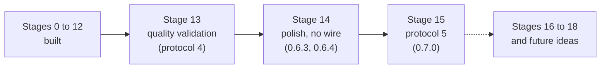

# Roadmap

**Purpose:** The plan for VTT Chat App, derived from [.claude/CLAUDE.md](.claude/CLAUDE.md): what was delivered, in order, and what is next. **This file is a summary on purpose.** The design, the decisions and who made them, and the build record for every closed stage are in the [build tracker](docs/tracker/README.md); what has really run, as opposed to what is built, is in [BUILD-STATUS.md](docs/BUILD-STATUS.md). Detailed task breakdowns are written per stage when it starts.

**Status legend:** 🟢 Done · 🟡 In Progress · ⚪ Not Started · ⚫ Superseded

> **Rewritten 2026-11-05, slimmed 2026-11-21.** The project changed direction on 2026-10-29: from a Tauri _browser_ that injected a voice overlay into D&D Beyond Maps, to a **self-hosted, audio-first system-tray app with server-side recording and AI summaries**. What carried over from the old design is in the [legacy record](docs/archive/LEGACY-DDB-OVERLAY-DESIGN.md).

**Sequencing rule:** prove the riskiest cross-cutting unknowns first, before investing in feature breadth. State discipline ([Stage 0.5](docs/tracker/STAGES-0-TO-8.md#stage-05--state--resilience-architecture)) is locked in before any stateful UI is built.

**Principles every stage inherits** (from [CLAUDE.md §2](.claude/CLAUDE.md)): self-host first with zero cloud reliance; cloud is an optional advanced adapter; the server is the source of truth; consent is visible; quiet when idle.

---

## Where we are (2026-11-24)

**Stages 0 to 13 are built and closed.** From here, a problem found in any of them is a **bug** (fixed in a patch release), and new work belongs to a later stage. The latest release is **0.6.2** (2026-11-22, protocol 4, published); **0.6.3-dev.1** (2026-11-24, with chunking) is on the dev channel and the test VM. The releases and what each changed are in [CHANGELOG.md](CHANGELOG.md).

**Stage 13 was closed by Andy on 2026-11-24.** Session 4 validated the records pipeline end to end on a real, full-length session, and the manual sweep accepted the cloud connectors, OIDC and the cross-platform clients. Chunking for long sessions is built and merged (in 0.6.3-dev.1) but was not re-run on a real session; that is accepted, and a problem there is a bug. What is still a loose end is in the [stocktake](docs/BUILD-STATUS.md#stocktake-2026-11-21-what-is-built-and-what-is-not-yet-proven), none of it blocking. **Next is Stage 14** (0.6.3 and 0.6.4).

| Stage                          | State | What was delivered                                                                                                                                                                                                                                                 | Detail                                                                                                                                         |
| ------------------------------ | ----- | ------------------------------------------------------------------------------------------------------------------------------------------------------------------------------------------------------------------------------------------------------------------ | ---------------------------------------------------------------------------------------------------------------------------------------------- |
| 0 Foundations                  | 🟢    | Monorepo (npm and Cargo workspaces), lint, format, CI and conventions.                                                                                                                                                                                             | [detail](docs/tracker/STAGES-0-TO-8.md#stage-0--foundations)                                                                                   |
| 0.5 State and resilience       | 🟢    | The rules for client state on long sessions (leaf isolation, no-op guards, hidden is the default).                                                                                                                                                                 | [detail](docs/tracker/STAGES-0-TO-8.md#stage-05--state--resilience-architecture)                                                               |
| 1 Pivot cleanup                | 🟢    | The old browser-overlay design removed and the repo rewritten (v0.2.0).                                                                                                                                                                                            | [detail](docs/tracker/STAGES-0-TO-8.md#stage-1--pivot-cleanup)                                                                                 |
| 2 Audio and records spike      | 🟢    | The Rust audio and LiveKit client, echo cancellation, the cue player and Egress recording, measured on real machines.                                                                                                                                              | [detail](docs/tracker/STAGES-0-TO-8.md#stage-2--audio--records-spike)                                                                          |
| 3 Server core                  | 🟢    | Accounts, campaigns, invites, DM swap, the REST and WebSocket layer with replay, Postgres and Valkey, recording consent and the Admin CLI, in both install tiers.                                                                                                  | [detail](docs/tracker/STAGES-0-TO-8.md#stage-3--server-core)                                                                                   |
| 3b Deployment buildout         | 🟢    | Published images, the one-command installer, the protocol handshake, server-chosen client builds, web onboarding and Devices.                                                                                                                                      | [detail](docs/tracker/STAGES-0-TO-8.md#stage-3b--deployment-buildout-added-2026-11-11)                                                         |
| 4 Tray client                  | 🟢    | The system-tray app: main window, voice and mixer, status, notifications, auto-rejoin, autostart and the updater.                                                                                                                                                  | [detail](docs/tracker/STAGES-0-TO-8.md#stage-4--tray-client)                                                                                   |
| 5 Records and AI summaries     | 🟢    | Per-speaker recording, Whisper, and a scribe then a bard, on the operator's own hardware (or a remote one, with fallback); search; DM-only summaries.                                                                                                              | [detail](docs/tracker/STAGES-0-TO-8.md#stage-5--records--ai-summaries-core)                                                                    |
| 6 Table features               | 🟢    | Chat and whispers, handouts, loot, party splits, the soundboard, schedule and RSVP. Voice whispers were dropped.                                                                                                                                                   | [detail](docs/tracker/STAGES-0-TO-8.md#stage-6--table-features)                                                                                |
| 7 Web app                      | 🟢    | The same app on any device at `/app`, with chat commands, history and handouts.                                                                                                                                                                                    | [detail](docs/tracker/STAGES-0-TO-8.md#stage-7--mobile-spa)                                                                                    |
| 8 Operations                   | 🟢    | `vtt-admin`, the public status page, backup and restore.                                                                                                                                                                                                           | [detail](docs/tracker/STAGES-0-TO-8.md#stage-8--operations-admin-cli--status-page)                                                             |
| 9 Hardening                    | 🟢    | The idle-CPU cause found and fixed, container hardening, records a CPU-only server can keep up with, updates that clean up after themselves.                                                                                                                       | [detail](docs/tracker/STAGE-09-HARDENING.md#stage-9--cross-platform-hardening--production-readiness)                                           |
| 10 Integrations and loot       | 🟢    | D&D Beyond sync, single sign-on, the release pipeline, loot management and chat history. The rest of its list is ideas.                                                                                                                                            | [detail](docs/tracker/STAGE-10-INTEGRATIONS-AND-LOOT.md#stage-10--optional-integrations-advanced-users)                                        |
| 11 Protocol 4 and verification | 🟢    | 0.6.0 (protocol 4): loot re-drop and confirm, the soundboard, GM Notes, the glossary, the storyteller setting, the off-site notice, sheet details. 0.6.1: the sound deck, the phone table page, macOS Intel.                                                       | [detail](docs/tracker/STAGE-11-PROTOCOL-4.md#stage-11--protocol-4-and-verification-060-and-061-planned-2026-11-18)                             |
| 12 Storytelling                | 🟢    | The Claude and OpenAI connectors, a glossary into Whisper and corrections, a structured scribe, the Chronicler, campaign memory and five storytellers. **Unit-tested only; none has met a real session.**                                                          | [detail](docs/tracker/STAGE-12-STORYTELLING.md#stage-12--storytelling-roles-personas-and-campaign-memory-idea-2026-11-17-scheduled-2026-11-18) |
| 13 Quality validation          | 🟢    | Closed 2026-11-24 (Andy). The demo campaign run end to end on real hardware, the manual sweep accepted, chunking built; problems from here are bugs.                                                                                                               | [detail](docs/tracker/STAGE-13-QUALITY-VALIDATION.md)                                                                                          |
| 14 Polish on protocol 4        | 🟡    | **Planned 2026-11-24.** No wire change, so patch releases: **0.6.3** (small: a font for every language, one icon set for both apps) and **0.6.4** (larger: language spans, history tabs, ops tooling; built, released 2026-11-25, closed by Andy's session 4 run). | [below](#stage-14--polish-on-protocol-4-063-and-064-planned-2026-11-24)                                                                        |
| 15 Protocol 5 (0.7.0)          | ⚪    | **Planned, not fully designed.** The next wire bump, led by campaign memory (the glossary, lore import and a knowledge graph) and the loose ends that need the wire.                                                                                               | [below](#stage-15--protocol-5-and-070-planned-2026-11-21)                                                                                      |
| 16 to 18                       | ⚪    | Ideas, not scheduled: signed Linux package repositories; a self-signed certificate the app can pin; several workers.                                                                                                                                               | [below](#stage-16--linux-package-repositories-served-by-the-server-idea-2026-11-19-not-scheduled)                                              |
| Future ideas                   | ⚪    | Parked, undesigned.                                                                                                                                                                                                                                                | [below](#future-ideas)                                                                                                                         |

---

## Stage 13 — Quality validation (closed 2026-11-24)

**Status:** 🟢 Closed by Andy, 2026-11-24. The demo campaign and its four sessions ran end to end, Andy's manual sweep accepted the cloud connectors, OIDC and the cross-platform clients, and chunking for long sessions was built and merged (0.6.3-dev.1). **Chunking's real-session re-run was not done; it is accepted as is, and a long session that misbehaves is a bug to catch when it occurs.** The detail, results and decisions are in [STAGE-13-QUALITY-VALIDATION.md](docs/tracker/STAGE-13-QUALITY-VALIDATION.md); what the tests found is in [QUALITY-VALIDATION.md](docs/architecture/QUALITY-VALIDATION.md), [READINESS.md](docs/READINESS.md) and [BUILD-STATUS.md](docs/BUILD-STATUS.md).

---

## Stage 14 — Polish on protocol 4: 0.6.3 and 0.6.4 (planned 2026-11-24)

**Status:** 🟡 In progress (planned with Andy, 2026-11-24). **0.6.3 (the font and icon work) was seen in the real apps by Andy and tagged on 2026-11-24; 0.6.4 (the larger items below) was tagged on 2026-11-25. The stage closes when Andy's full session 4 run on 0.6.4 passes.** **Depends on:** [Stage 13](#stage-13--quality-validation-closed-2026-11-24), which Andy closed on 2026-11-24, so its "bug fixes only" rule has ended and this stage may add features.
**The rule:** **no wire change.** Everything here ships as a patch on protocol 4, so a 0.6.3 or 0.6.4 app and server mix freely with 0.6.2 (they must match on MAJOR.MINOR only). Anything that turns out to need the wire moves to [Stage 15](#stage-15--protocol-5-and-070-planned-2026-11-21).
**Andy, 2026-11-24:** build the font work in 0.6.3 as far as possible; then everything else that needs no bump, **small things in 0.6.3 and larger in 0.6.4**; the items that need a bump come after (Stage 15); the ideas move down.

### 0.6.3: small things

| #   | Item                                                                                                                                                                                                                                                                                                                                                                                                                                                                  |
| --- | --------------------------------------------------------------------------------------------------------------------------------------------------------------------------------------------------------------------------------------------------------------------------------------------------------------------------------------------------------------------------------------------------------------------------------------------------------------------- |
| 1   | **Typography and icons, the foundation.** A shared `ui-kit/` package; Inter for the body and Cinzel for headings in both apps; **a font for each of the 18 chat languages** (chosen by the client from the language key, so no wire change); the web app moves from hand-copied icon paths to `lucide-react`, with one shared meaning for each stat and sense icon; three reading switches (language fonts, document fonts, force readable). Plan tasks 1 to 7 and 10 |
| 2   | **The small fixes already built since 0.6.2** ship with it: the wider compact handout window, and the diagnostic logging for the automatic Away that does not clear (it needs a real build running to catch it)                                                                                                                                                                                                                                                       |

Design: [ICONOLOGY.md](docs/architecture/ICONOLOGY.md). Plan: [2026-11-24-typography-and-icons.md](docs/superpowers/plans/2026-11-24-typography-and-icons.md).

### 0.6.4: larger things

| #   | Item                                                                                                                                                                                                                                                                                                                                                                                                                                                                                                                                                                                                                     |
| --- | ------------------------------------------------------------------------------------------------------------------------------------------------------------------------------------------------------------------------------------------------------------------------------------------------------------------------------------------------------------------------------------------------------------------------------------------------------------------------------------------------------------------------------------------------------------------------------------------------------------------------ |
| 1   | **The icon audit (done 2026-11-25), faint ability-score icons behind the stat tiles, and a livelier campaign chooser (Andy, 2026-11-25).** The audit found lucide covers what the apps show, and fixed the mapping rules it found wrong; **Game Icons is not adopted and moved to [Future ideas](#future-ideas)** (findings in [ICONOLOGY.md](docs/architecture/ICONOLOGY.md#layer-2-rpg-domain-icons-game-icons-only-where-needed)). The ability tiles now carry a lucide watermark each; the campaign chooser has cards with the storyteller's badge, the crown for a DM, and a dry one-liner from a made-up character |
| 2   | **Language spans in handouts and tales (built 2026-11-25, in 0.6.4-dev):** `[Khazad ul barak](lang:dwarvish)` and a fenced block named for the language, drawn in that language's font; plain Markdown that reads fine anywhere else. Plan task 11. Design: [RPG-MARKDOWN-EXTENSION.md](docs/architecture/RPG-MARKDOWN-EXTENSION.md)                                                                                                                                                                                                                                                                                     |
| 3   | **A tabbed History view with a popout (built 2026-11-25, in 0.6.4-dev)** (Andy, 2026-11-23; the tab row and the popout moved here from Stage 15). The tale, heroes, story and notes are already fetched, so this is client-only; **check first**. The other half, search results that name their session and open at the match, **does** need a new field and stays in Stage 15                                                                                                                                                                                                                                          |
| 4   | **The phone app's storyteller picker and GM Notes (built 2026-11-25, in 0.6.4-dev)** (from the ideas list), on the endpoints the desktop app already uses (**check** that none needs a new field)                                                                                                                                                                                                                                                                                                                                                                                                                        |
| 5   | **`vtt-admin status` and `jobs` name the model a job used (built 2026-11-25, in 0.6.4-dev; needs migration 0046)** (from the ideas list; moved here from 0.6.3 on 2026-11-24 so 0.6.3 could ship): so a tale's quality can be traced to the model that wrote it                                                                                                                                                                                                                                                                                                                                                          |
| 6   | **Operator tooling (built 2026-11-25, in 0.6.4-dev):** `vtt-admin test ai\|voice\|full` (a validation command) and **external connectivity checking** (reachable from outside the network), both from the ideas list                                                                                                                                                                                                                                                                                                                                                                                                     |

**Done when:** a line in each of the 18 languages looks the same in the desktop and phone apps, in light and dark; the web app has no copied icon data; force readable turns every language into Inter in both; the build-size change is measured and recorded; a handout and a tale each show a `lang:` span in the right font and read as plain text in a viewer that does not know it; the audit's verdict on Game Icons is written down; and each 0.6.4 item has shipped or been moved to Stage 15 with the reason. **The stage closes with two things (Andy, 2026-11-24): new documentation screenshots of every changed screen ([scripts/screenshots/](scripts/screenshots/README.md)), and a full run of the session 4 test to prove the system is stable and usable.**

### 0.6.6: the voice (Andy, 2026-11-27; dev builds out, not yet released)

The first real mini-session (2026-11-27) found the voice clean but flat and dull next to Discord, and the group **kept using Discord for voice that evening**. That makes voice quality the top bar for switching over ([READINESS.md](docs/READINESS.md), area D), so 0.6.6 is audio only, no wire change: **voice tone presets** (Natural, Warm, Broadcast; sender side) and a **64 kbps** microphone track; **Settings → Audio → Test your voice** (record 5 or 10 seconds, play it back in each tone), which Andy rated "great", with the voice "much better" after it; and the **Linux device list** fix. Retuned deeper after a first listen on dev.2 (Natural "high-pitched", Broadcast best), shipped as dev.3. Detail: [AUDIO-MIXER.md](docs/architecture/AUDIO-MIXER.md#voice-tone-and-bitrate-066). Still open: how close it gets to Discord's richness (next levers: compressor, a higher bitrate, the stacked noise filters), the faint echo, and the DM character voices (below).

---

## Stage 15 — Protocol 5 and 0.7.0 (planned 2026-11-21)

**Status:** ⚪ Not Started (planned with Andy, 2026-11-21). **Not completely designed (Andy, 2026-11-21):** items here may be dropped, or moved to [Future ideas](#future-ideas), as the design firms up. Step H is the only item that is designed. **Renumbered 2026-11-24:** this was Stage 14 until the no-wire polish stage was put ahead of it. **What it is (Andy, 2026-11-24): mostly campaign-memory work (Step H and the knowledge graph) plus the loose ends that need the wire.** **Depends on:** [Stage 13](#stage-13--quality-validation-closed-2026-11-24) and [Stage 14](#stage-14--polish-on-protocol-4-063-and-064-planned-2026-11-24), so the bump carries what they show is needed and is built on behaviour that has been seen.

**The rule from Stage 11 applies again: every wire change goes into one bump.** `PROTOCOL_VERSION` goes to 5 (`shared/src/consts/index.ts`, `consts.rs`, guarded by `backend/src/lib/wire/contract.ts`), the version to **0.7.0** (`tauri-client/scripts/set-version.sh 0.7.0`), a 0.6 app cannot join a 0.7 server, and the whole stack updates together as the operator's deliberate step ([VERSIONING-AND-DEPLOYMENT.md](docs/architecture/VERSIONING-AND-DEPLOYMENT.md)). Dev builds (`0.7.0-dev.N`) ship along the way. The release needs its full CHANGELOG section and a tag only when Andy asks.

### Campaign memory as a knowledge graph (Andy's draft specs, parked 2026-11-24; needs a full design pass first)

Moved here from the ideas list: it is the main candidate for this bump, with Step H. The idea is a campaign knowledge graph as the core memory (events, entities, relationships, story threads), so each AI call gets a small pre-resolved "story package" and cost stays flat as a campaign grows, instead of re-reading and condensing growing notes (the problem chunking patched). Andy's specs and the two tensions already flagged against this project's homelab scale are in [CAMPAIGN-GRAPH-MEMORY.md](docs/architecture/proposals/CAMPAIGN-GRAPH-MEMORY.md); the current memory is `ai/src/lib/memory.ts`. **Step H and the graph overlap (both reshape what the glossary and memory hold), so design them together before building either.** Wire need: probably, for whatever the apps show of it.

### Session history read and unread (Andy, 2026-11-25; needs the server, so it rides this bump)

Mark each session in the history as **read or unread**, like email. It is **per player**, stored on the server (a player's phone and desktop share it): a session counts as read when the player has it **open for more than 5 seconds**, so a glance while scrolling does not. A **count of unread sessions** shows on the history icon of the panel (desktop) and the page (phone). A **Read all** button sits at the top of the panel, and a player can mark one session unread again. **Check first:** the read marks are one small table (player, recording, read-at) and one new endpoint pair, so a wire change; the count can ride the existing campaign snapshot.

### Step H: memory in the glossary, and the lore pipeline (Andy, 2026-11-21; extended 2026-11-24; designed in outline, not built)

Moved here from Stage 12. It needs a wire change, so it rides this bump.

1. **The glossary tab becomes the one place for names, places and lore.** A memory entry is a glossary term with a kind and a gist; session-learned entries appear there beside the Game Master's own terms and the suggested terms, editable and deletable. There is **no separate Memory page** (Andy: a Game Master needs one reference point, not another layer of data).
2. **Import lore is an AI processing pipeline, not a file upload (Andy, 2026-11-24).** The Game Master gives the system what happened before the story began, in whatever form is easiest, as often as they like (usually at the start, and again to widen the lore, or to paint the background of a brand-new campaign):
   - **Structured notes:** Markdown or text with headings and lists (`## NPCs`, `- Mother Tidewarden: runs the harbour`). A plain reader takes the clearly structured parts with **no AI call** (cheap, predictable); the AI fills the gaps.
   - **Unstructured text:** prose, a setting document, a backstory. The AI extracts from it.
   - **Optional audio narration:** the Game Master **tells the campaign story** in their own voice, over as long as it takes. It is a subset of the session system: one voice, no room, no consent cue, no recording flag, spread over a long stretch of in-world time. It can come in **two ways (Andy, 2026-11-24): uploaded as an audio file** (a voice memo from a phone works) **or recorded in the desktop app**; the desktop recorder comes first, because the recording pipeline and the audio engine are already there. Either way it is transcribed by the same Whisper path with **no speaker separation** (one speaker), and then treated as unstructured text. **Recording in the web app is a future idea** ([Future ideas](#future-ideas)); the phone can upload a file in the meantime.
3. **The pipeline reuses the session pipeline** (a new job kind, `import-lore`, in the same queue with the same one-worker and per-table order rules): **ingest** (audio: transcode and transcribe) → **chunk by token budget** (the chunking built for long sessions) → **extract** entities, events, relationships and open story threads, each placed **before the story began** on the campaign timeline (and in order, where the Game Master says so) → **reconcile** with what memory already holds (merge aliases and duplicates; never overwrite an entry the Game Master wrote) → **propose** → the Game Master **previews and ticks** what to keep → **commit** into campaign memory, each entry carrying its source and the passage or audio timestamp it came from. Nothing is saved before the Game Master approves it.
4. **Where it lands: the campaign knowledge graph** (below). Until that design exists the target is today's memory entries (`ai/src/lib/memory.ts`), and the extractor's output format should **be** the graph's event and entity contract, so **design the lore pipeline and the graph together, before building either.**
5. **Imported entries are Game Master-only by default.** They reach the Chronicler's brief and the glossary, never the bard; the Game Master may mark one "the table can know".
6. **Glossary suggestions are filled from memory entries**, so Whisper learns them (vocabulary learning, the part of Stage 12 C that was not built).

**Parked (Andy, 2026-11-24): character backstories from D&D Beyond.** They need a D&D Beyond login, which the project's rule forbids ([DDB-SYNC.md](docs/architecture/DDB-SYNC.md)). A player's backstory can still come in through the lore pipeline as pasted text, or as the Game Master's own notes. See [Future ideas](#future-ideas).

**Likely wire shape (my reading, to confirm when it is built):** a glossary entry gains `kind`, `gist`, `source` (`gm`, `session`, `import-text`, `import-audio`) and a `tableKnows` flag; the memory entries the server keeps today are served through the glossary routes instead of the CLI alone (`vtt-admin memory` stays); a lore route accepts text or an audio file and returns a job, a status route reports it, a **preview** route returns the proposals and an **apply** route saves the ticked ones (Game Master only, like the glossary). **Decided (Andy, 2026-11-24): the narration audio is deleted once it has been transcribed**, and the operator can set a retention policy (like recordings, via the CLI) for how long it is kept first or whether it is kept at all. A cloud AI backend still sends the narration's text off the server, so the usual explicit operator setting and in-app notice apply. The tests that matter: structured lore imports with no AI call; unstructured prose yields proposals; an audio narration gives the same proposals as its transcript pasted as text; importing the same lore twice proposes nothing new; a Game Master-written entry is never overwritten; an hour-long narration is chunked within the model's window; and **no Game Master-only entry ever shows in a tale** (except the Tipsy Minstrel's, by the Game Master's choice).

### Activity on the tables you are not in (Andy, 2026-11-21; wanted, not designed)

Andy now plays in two tables and has to remember to switch. He wants **some sign of activity on the tables he is not connected to**, so he knows to switch (a dot or count in the campaign switcher, and perhaps an optional notification). It needs the server to count or push chat for a person's other tables, which is a wire change (today the socket carries one table at a time), so it belongs in this bump. Open: what counts as activity (any chat, only whispers and the Game Master's lines, a recording starting), whether a count or a dot, and how it stays quiet (the project's rule that playing comes first). Needs a short design with Andy first.

### Who the Game Master is, on every table (Andy, 2026-11-21; wanted)

The campaign switcher in both apps should say **who the DM is** for each table (the crown only says that _you_ are the DM). The server does not send it: `GET /api/campaigns` returns the campaign and the caller's role, and `GET /api/campaigns/:id/members` returns user ids and roles without display names. Adding the Game Master's name to the campaign list is a small additive response field, but it is an API change, so it rides this bump with the activity indicator. The rest of the switcher work (long names, next session, quick answer) needed no wire change and was built as a 0.6.x patch.

### Service upgrades: Valkey 9.1 and Postgres 18 (decided by Andy, 2026-11-21)

Both ride this bump, so the upgrade and the protocol change are tested together. **Valkey 8.1.12 to 9.1.4** (9.2 needs time): run LiveKit, the live-chat replay buffer and the demo campaign on it. **Postgres 17 to 18**: a major upgrade, done by **dump and restore into a new volume**, because the official 18 image keeps its data in a version-specific directory and mounts `/var/lib/postgresql` instead of `/var/lib/postgresql/data` (changing only the tag fails or starts on an empty directory). What has to be designed: how `vtt-admin update` carries an existing install across automatically (a backup first, the restore into the new volume, the old volume kept until the operator confirms), what the native install does (it uses Ubuntu's packages), and how it is rehearsed (the demo campaign on a restored copy). Review and sources: [DEPENDENCY-VERSIONS.md](docs/architecture/DEPENDENCY-VERSIONS.md).

### The History list shows the session's title (Andy, 2026-11-21; built as far as it can go without the wire)

The storyteller now opens each tale with a short title, and the History screens show it as the tale's heading. Showing it **in the list** (the in-world title with the date beneath, in both apps) needs the recordings list to carry that title, a new field on a response, so it is part of this bump. Until then the list title stays the date. See [QUALITY-VALIDATION.md](docs/architecture/QUALITY-VALIDATION.md#decisions-on-what-players-see-andy-2026-11-21).

### Search results that name their session and open at the match (Andy, 2026-11-23; wanted, not designed)

**The tab row and the popout moved to [Stage 14, 0.6.4](#064-larger-things) (no wire needed).** What stays here is the search half below.

The original note, kept for the reasoning:

After reading real session-4 output, Andy wants the History detail reworked: instead of the tale with chapters and heroes folding open together under "More detail", a **tab row** — `The Tale | The Heroes | The Story | The Notes` — one section visible at a time (`The Notes` shown only to the Game Master), with a **popout button** at the end of the row to open the same tabbed view in its own window (reusing the per-window mechanism built for handouts, 2026-11-22). **Search needs the same treatment:** a result should say which session it is from, and clicking it should open straight to that snippet, in the tab it belongs to. Likely needs a wire change (which session a search hit belongs to is not in today's response), so it rides this bump rather than landing as a 0.6.x patch; parked here, not designed yet.

### `/npc`: the DM speaks as a character (Andy, 2026-11-24; designed, not built)

**Revised by Andy, 2026-11-25** (to match the simpler `/say`, which has one command and a language picker): `/npc <language> <name> "message"` with **the same language picker** (Tab confirms it; no language means Common), and **names of more than one word in quotes**, `"Mother Tidewarden"`. A second form, **`/npc do <name> "action"`**, is the NPC's `/do`. When the **campaign knowledge graph** exists, the name step **picks from the NPCs met so far** (the same list as the `/take` item list), so the Game Master can use the graph during a session. DM only. The `/npc-<language>` shorthand, like `/say-<language>`, stays out of the command list until its dash is typed. It needs an optional `speaker` on the chat `send` message and on `ChatMessage`, which the server accepts only from the campaign's DM, so it is a **wire change** and rides this bump. Design: [CHAT-COMMANDS.md](docs/architecture/CHAT-COMMANDS.md#planned-npc-the-dm-speaks-as-a-character-stage-15-designed-2026-11-24-not-built) (written for the earlier `/npc-<language>` form; to be updated with the build). Both clients' composers and renderers learn it; the storyteller sees the NPC as the speaker.

### Handout tags and filtering for the Game Master (Andy, 2026-11-25; not designed)

The handout list will grow, so a Game Master needs `#tag`s on a handout and a filter by tag. Tags are stored with the handout and sent with it, so this is a **wire change** and rides this bump. (Newest first was the no-wire part of the same worry, and is in 0.6.5.)

### Longer audio slices for a remote Whisper (Andy, 2026-11-25; not designed, no wire change)

Found while session 4 was processing on 0.6.4: the remote GPU Whisper sat at 0% while the work crawled, because the VM cuts each speaker's track into **short speech windows** (10 to 20 seconds each; the cap is `DEFAULT_MAX_WINDOW_MS`, 60 s, in `ai/src/consts/index.ts`, found with ffmpeg `silencedetect` in `ai/src/lib/ffmpeg.ts` and `speechWindows.ts`) and sends one request per window. The VM's old CPU spends the time slicing, and each round trip carries little audio. A GPU can take **minutes of audio at once** with ease. So: let the window size depend on the backend (**minutes for a remote GPU Whisper**, short for local CPU, where a long request blocks everything), keep the silence-split boundaries so timestamps and speaker attribution stay right, and respect an endpoint's upload limit (an OpenAI-compatible server often caps a file near 25 MB). **Measure first** on a real session: time per track and the transcript's accuracy against the demo campaign's facts at 60 s, 3 min and 10 min windows, because longer windows can lose word-level timestamps and shift where a line is placed. The result belongs in [QUALITY-VALIDATION.md](docs/architecture/QUALITY-VALIDATION.md).

**Parallel requests (Andy, 2026-11-25; measured the same day).** Today everything is one at a time: the windows of a track in turn (`transcribeWindows`), and the tracks in turn (`processRecording`). Windows are independent (offsets are added afterwards and the result is sorted), so they can be sliced and sent concurrently, and so can tracks. **What it buys depends on the server.** On the GTX 1080 running `whisper.cpp`'s server, a 25-second clip took 0.35 s alone, and 2 and 4 requests sent together finished at 0.36 and 0.73 s, and at 0.36, 0.72, 1.08 and 1.43 s: **the server answers one request at a time**, so concurrent requests queue and do not run side by side on the GPU. That is still worth doing: the GPU needs well under a second per window, so the time goes in the VM's ffmpeg slicing and the round trips, and a few requests in flight keep the GPU fed while the VM prepares the next windows (**pipelining**). True parallel work on one GPU needs **more than one Whisper server** (about 1 GB of VRAM each, so 3 or 4 fit in 8 GB) or a batching server; the setting would be a **concurrency per backend** (a few for a remote GPU, 1 for the local CPU, a polite number for a cloud API) rather than a global one. Measure first, with the window-size test above.

**Preparing the audio in parallel, ahead of the GPU (Andy, 2026-11-25).** The slicing is the slow part and it is CPU work on the VM (8 cores), so it can be done as a **batch before and alongside transcription**: (1) the silence scan and the cutting of every track run at the same time, one track per core, as tracks are independent (11 tracks on an 8-core VM); (2) within a track, cut all the windows in **one ffmpeg pass** (the segment muxer, or one decode with several outputs) instead of starting an ffmpeg per window, which decodes from the seek point each time; (3) a **queue of ready clips** that the transcriber drains, so the GPU never waits for a slice. Order is kept by the window index, as now. Disk is the limit to watch: ready clips are temporary files, so the queue has a size cap.

**Part (1) is built, 2026-11-26**, and scaled by how busy the instance actually is rather than a
fixed core count: see [BUILD-STATUS.md](docs/BUILD-STATUS.md#adaptive-audio-pipeline-concurrency-2026-11-26).
Whisper itself stays one request at a time, closing the "GPU answers one at a time anyway" finding
above by never opening more than one. **Parts (2) and (3) (one ffmpeg pass per track; a disk-capped
ready-clip queue) turned out unnecessary once (1) was built this way** — each track only ever has
one clip sliced-but-not-yet-transcribed at a time, so there is no backlog to cap or batch.

**Summarisation reliability on local CPU (interim fix), built 2026-11-26**: a real CPU-only job
died with "fetch failed" at almost exactly the one-hour mark, repeatedly — a hardcoded timeout,
not infrastructure flakiness. A local call now gets its own (45-minute) liveness timeout rather
than relying on that one; a job is never refused up front for being long (CLAUDE.md §5's "never
lost" upheld, by Andy's explicit direction — 8+ hours overnight is fine), only a genuinely stuck
call fails, and that just costs one attempt, resumed from already-done chapters on retry. A
repeat-limit abort is reported distinctly instead of triggering a silent fallback, and note-taking
chunks are smaller. Interim only; a few hints this turned up for the Campaign Graph (below) are in
[CAMPAIGN-GRAPH-MEMORY.md](docs/architecture/proposals/CAMPAIGN-GRAPH-MEMORY.md#hints-noticed-while-fixing-the-pipelines-reliability-065-2026-11-26).
See [BUILD-STATUS.md](docs/BUILD-STATUS.md#ai-summary-pipeline-reliability-interim-2026-11-26).

**Real progress-watching for a local LLM call (Andy, 2026-11-26; for 0.7 to catch, not 0.6.5).**
Asked directly while fixing the above: can a long local call's _actual_ progress be checked, so a
genuinely slow-but-working call is extended rather than bounded by a flat timeout? Not with
today's client: every local and remote generate call uses `stream: false` (`ollama.ts`,
`openaiCompat.ts`) — the job queue is written around "one prompt in, one whole answer out," so
there is nothing to watch mid-call. The real fix is switching to `stream: true` and reading
Ollama's token stream as it arrives: a call that is still producing tokens is live, however slow,
and only a call that has gone quiet (no new tokens for some window) is actually stuck — a much
better signal than "has this calendar-clock timeout elapsed yet," especially across wildly
different hardware (the same 6,000-char chunk measured close to 20 minutes on the project's own
no-AVX Xeon and plausibly a tenth of that on a modern CPU). This is a real architecture change,
not a tweak — `takeNotes`/`writeFromNotes` and the whole `GenerateText` interface would need a
streaming-aware shape — so 0.6.5 ships with a generous flat per-call timeout (45 minutes,
`LOCAL_GENERATE_TIMEOUT_MS`) instead and no overall job-duration limit, which is a cruder but
buildable-today approximation of the same goal. Worth real design time in 0.7, likely alongside
whatever the Campaign Graph's own call shape ends up being (shorter, schema'd calls may make this
less urgent than it looks today).

### Findings from the first real group session (Andy, 2026-11-27; wanted, none designed)

The first real mini-session showed what a table needs from a system built for it, which Discord does not give. Each item says what it would take and what is still open; Andy confirms the shape before any is built (project rule: ask, do not guess).

1. **Handouts to specific players.** The Game Master shows a handout to chosen players, not the whole table (a note passed to one rogue, a map only the ranger sees). A handout would carry who may see it, and the server would send it only to them, so it is a **wire change** and rides this bump. Open: choose who at show time or save it on the handout; whether a hidden handout is visible to the others as "something was shown"; whether History keeps it for the people it was shown to.
2. **A Game Master taking someone aside, quietly.** A private voice channel between the Game Master and one player, for a private word while the table carries on. **Clarified by Andy, 2026-11-27:** the party split does not do this, because **in a split everyone still hears the Game Master** (the Game Master is in every group by design), so a player cannot be taken aside without the rest hearing the Game Master's half. Tonight's session had a moment where a quiet Game-Master-and-player exchange would have helped. Private whispers (chat, `/w`) exist but are text; voice whispers were dropped on 2026-11-14 on the strength of the split, which this finding undercuts. What it needs: the Game Master's microphone goes **only to the chosen player** (and the player's only to the Game Master) while the aside is on, and everyone else hears neither side. In LiveKit terms that is per-track subscription control on the server, not the room routing the split uses, so it needs a server action and a visible state, likely a **wire change**. It must be **unmistakable to everyone** that an aside is happening (the rest see "the Game Master is speaking privately with X", consent is visible) and the privacy rule holds: **an aside is never recorded, transcribed or summarised into a shared artifact** (the whisper rule, principle 4 and the pipeline's private-audio exclusion). Open: one key and one click to start and end; whether the player can end it; whether the rest of the table can still hear the Game Master's soundboard and scene effects during it; whether it should be a timed aside that ends itself; and a private **text** thread as well, or voice only.

3. **The Game Master mutes a player for everyone** ("Dude, shut up!"). A server-enforced mute: the player's microphone stops reaching the table and they cannot unmute themselves until the Game Master lets them. It must be **visible to the muted player** (consent is visible, principle 4: they are told, and their tray icon shows it) and to the table (the rail shows them muted by the Game Master), and what they say while muted is not recorded (their track is stopped at the server). It needs a server action (LiveKit's `MutePublishedTrack`, or removing their publish permission), a state the clients show, and a Game Master control, so it is a **wire change**. Open: a timed mute or until undone; whether a muted player can still type; whether the mute ends when the recording stops.
4. **Open a player's character sheet from the app.** From a character's card, open its D&D Beyond sheet in the browser. The link is the public sheet address the player already gave for the sync ([DDB-SYNC.md](docs/architecture/DDB-SYNC.md)), and the desktop already has `open_external_link`, so this may need **no wire change**, if the address is sent to the other members of the table, which has to be checked (it may only be held server-side). Public sheets only; this opens D&D Beyond's page in the browser and shows nothing itself, so it does not touch the "no character sheets" rule. Open: who may open whose (anyone at the table, or the Game Master only); the phone app too.
5. **The Game Master's character voices need tuning.** Andy found them in need of tweaking at the table; what exactly was not said. They were built before the mixer engine and tuned by ear on the dev PC. A first step with no wire change: extend the new **voice test** to the character voices, so each can be recorded once and compared as it is adjusted. Open: what was wrong (too robotic, too quiet, too much delay, tiring, or one voice in particular).

### Anything else

Anything Stage 13 finds that cannot be fixed without a wire change is added here when found. The wire-change ideas that are not decided (polyglot masking, web push, the Admin quick-access screen) are parked in [Future ideas](#future-ideas), not in 0.7.0.

**Done when:** server and both apps speak protocol 5, the contract guard passes, step H works end to end in the desktop app (including the lore pipeline from text and from a narration) (the phone app reads, as for the glossary today, unless Andy says otherwise), and a 0.6 app is told to update.

---

## Stage 16 — Linux package repositories, served by the server (idea, 2026-11-19; not scheduled)

**Status:** ⚪ Not Started, **not scheduled**. The manual route works for now: `.deb` and `.rpm` users install the newer file when a version is announced, and the AppImage updates itself. Andy, 2026-11-19: add it as a future stage, for both formats, with an operator switch, because some operators have no Linux players.
**Depends on:** release 0.6.0 (a stable protocol), the release pipeline having run for real (Stage 11), and the update mirror ([VERSIONING-AND-DEPLOYMENT.md](docs/architecture/VERSIONING-AND-DEPLOYMENT.md)). Design and reasoning: [PACKAGE-DISTRIBUTION.md](docs/architecture/PACKAGE-DISTRIBUTION.md#server-hosted-linux-repositories-designed-2026-11-19).

| #   | Item                                                                                                                                                                                                                                                                                                                                                                                                    |
| --- | ------------------------------------------------------------------------------------------------------------------------------------------------------------------------------------------------------------------------------------------------------------------------------------------------------------------------------------------------------------------------------------------------------- |
| 1   | **CI builds and signs the repositories at release time**, one per MAJOR.MINOR line (`0.5/`, `0.6/`), for APT (`.deb`, `InRelease`) and for DNF/zypper (`.rpm`, signed `repodata`), with one GPG key kept as a repository secret, like the updater key. **The server never holds the key**: apt installs as root, so a server that could sign would be a way to run code on every Linux player's machine |
| 2   | **The server mirrors and serves only its own line** from its updates folder as static files (`/apt/`, `/rpm/`), keeping the newest two patches. A 0.5 server can only offer 0.5.x, which keeps the app and server in step. Not a wire change                                                                                                                                                            |
| 3   | **Operator switch `LINUX_REPOS`**: `off` (the default, nothing mirrored or served) or `on`. With it off the download page shows today's file links. It needs `UPDATES_SOURCE` set to `mirror`, and `vtt-admin config show` says so if not                                                                                                                                                               |
| 4   | **A one-line setup from the download page, specific to that server** (`curl https://<server>/apt/setup.sh \| sudo bash`, and the `dnf`/`zypper` equivalent): it adds the source and the repository key, then installs the app. Only shown when the switch is on                                                                                                                                         |
| 5   | **The app says when it is behind**: when the server is on a newer MAJOR.MINOR than the app, say "run `sudo apt upgrade`" (or `dnf upgrade`) for a package install, as the app cannot update itself there                                                                                                                                                                                                |

**Known limits, decided in the design:** one apt source means one server per machine; if the server is offline `apt update` warns about that source only and everything else carries on, and updates resume when it is back; a repository signed in CI cannot be re-signed by the operator, so a self-built release needs its own key.

**Done when:** an Ubuntu and a Fedora machine each add the server's source, install, and receive a patch with `apt upgrade` / `dnf upgrade`, and with `LINUX_REPOS=off` the server serves none of it.

---

## Stage 17 — A self-signed certificate the app can pin (idea, 2026-11-19; not scheduled)

**Status:** ⚪ Not Started, **not scheduled**. Andy, 2026-11-19: operators with no domain, or a non-standard port, can use plain HTTP (`get.sh --http`, built in 0.6.0) on a network they trust. This is the encrypted alternative for the same operators, which needs real work in the apps.

**The problem.** Caddy can make its own certificate (`tls internal`), but nothing trusts it by default: browsers show a warning each person must click through (hard on some phones), and the desktop app, which trusts the system's certificate store, refuses it.

**The idea: pin it, never switch checking off.** The installer prints the server's certificate **fingerprint**; the desktop app, on first connect to a server it cannot verify, shows that fingerprint and asks the player to confirm it once (or the invite link carries it, so a player who trusts the link needs no step). The app then accepts only that exact certificate for that server, and refuses with a clear message if it ever changes.

| #   | Item                                                                                                                                                                    |
| --- | ----------------------------------------------------------------------------------------------------------------------------------------------------------------------- |
| 1   | **`get.sh --self-signed`**: Caddy's internal CA for the site, the fingerprint printed and shown by `vtt-admin`, kept across renewals                                    |
| 2   | **Pinning in the desktop app**: a custom certificate check for the HTTP client and the WebSocket (`rustls`), a trust prompt, and the pin stored with the server address |
| 3   | **Invite links carry the fingerprint** so joining is one step                                                                                                           |
| 4   | **The voice library**: check whether it takes a custom trust setting; if it does not, voice over a pinned server needs its own answer                                   |
| 5   | **The web app**: the browser warning cannot be removed by us; the guide says what to expect, and that an operator who wants no warnings needs a real domain             |

**Open questions (Andy's to decide):** whether the voice library can pin; whether browsers on phones are worth supporting in this mode at all.

---

## Stage 18 — Several workers: scaling processing (idea, 2026-11-21; not scheduled)

**Status:** ⚪ Not Started, **not scheduled**. Andy, 2026-11-21: most tables are fine with one job at a time in order, and scaling processing is best done with **several workers**. This version enforces **one worker per database** (a second stands by), keeps the queue first in, first out, and keeps **one table's sessions in the order they were recorded** (a failed job holds the table's later sessions until the operator retries or releases it). Several tables may still **record** at once (`recording.max-tables`, default 2); that only limits recording.

What this stage would add: letting an operator who has the hardware run more than one worker (a setting and a supported install, replacing the single-worker lock); making the model servers take it (Whisper and Ollama each serve one request at a time today; more VRAM or a second GPU, or a remote backend per worker); a fair share between tables so one long job does not hold the rest (the queue is FIFO); and measuring it (the demo campaign run on two tables at once is the test). The order rule already stops two sessions of one table running out of order, which is the correctness problem that blocked this. Open: whether a worker should be tied to one backend (a GPU box and the local CPU as two workers), and what the operator sees (`vtt-admin status` per worker).

---

## Future ideas

Parked on 2026-11-21 (Andy). **None is scheduled, and none is designed well enough to build**; each needs a design conversation with Andy before it becomes a stage. Those marked _wire_ would need a protocol bump, so they would ride a bump after 0.7.0.

| Idea                                                                                                                                                                                                                                                                                                                                                                                                                                                                             | Needs                                         | Where it is written down                                                                                                                                                                                  |
| -------------------------------------------------------------------------------------------------------------------------------------------------------------------------------------------------------------------------------------------------------------------------------------------------------------------------------------------------------------------------------------------------------------------------------------------------------------------------------- | --------------------------------------------- | --------------------------------------------------------------------------------------------------------------------------------------------------------------------------------------------------------- |
| Per-character languages and polyglot masking                                                                                                                                                                                                                                                                                                                                                                                                                                     | _wire_                                        | [CHAT-COMMANDS.md](docs/architecture/CHAT-COMMANDS.md) ("Future: polyglots", a seam only); the server would mask what a character cannot understand, per reader                                           |
| Game Icons (game-icons.net, CC BY 3.0) for RPG pictures lucide says weakly: ability scores, a dragon, damage types, conditions, class badges. Audited 2026-11-25 and **not adopted yet** (Andy): nothing on a screen needs it today; revisit when a screen does. It would need an import script, a credits screen and per-icon attribution                                                                                                                                       | _no wire_                                     | [ICONOLOGY.md](docs/architecture/ICONOLOGY.md#layer-2-rpg-domain-icons-game-icons-only-where-needed); the audit sheet is `npm run icons:audit`                                                            |
| A soundboard that pops out into a mixing-deck window: a larger view, more controls and a choice of layouts and designs, perhaps a vertical one. Andy, 2026-11-25, after showing the app to other DMs and players, who called the soundboard the killer feature; they also found the AI world graph and storyteller interesting but need to see them                                                                                                                              | client only, if the sound data stays as it is | the desktop sound drawer ([USER-GUIDE.md](docs/guides/USER-GUIDE.md#11-for-the-dm))                                                                                                                       |
| Web push for the phone web app                                                                                                                                                                                                                                                                                                                                                                                                                                                   | _wire_                                        | [Stage 10](docs/tracker/STAGE-10-INTEGRATIONS-AND-LOOT.md); [MOBILE-WEB-APP.md](docs/architecture/MOBILE-WEB-APP.md). Opt-in per operator: a third party sits in the path                                 |
| The Admin quick-access screen (connection status, devices)                                                                                                                                                                                                                                                                                                                                                                                                                       | _wire_                                        | [.claude/intent.md](.claude/intent.md), design topic 1                                                                                                                                                    |
| Package-manager distribution (winget, AUR, Homebrew tap)                                                                                                                                                                                                                                                                                                                                                                                                                         | no wire                                       | [PACKAGE-DISTRIBUTION.md](docs/architecture/PACKAGE-DISTRIBUTION.md) (signed Linux repositories are [Stage 16](#stage-16--linux-package-repositories-served-by-the-server-idea-2026-11-19-not-scheduled)) |
| Cloudflare TURN, Realtime SFU and Pages                                                                                                                                                                                                                                                                                                                                                                                                                                          | no wire                                       | [DEPLOYMENT-AND-TRANSPORT.md](docs/architecture/DEPLOYMENT-AND-TRANSPORT.md)                                                                                                                              |
| Cloud transcription providers beyond a remote Whisper                                                                                                                                                                                                                                                                                                                                                                                                                            | no wire                                       | [Stage 10](docs/tracker/STAGE-10-INTEGRATIONS-AND-LOOT.md)                                                                                                                                                |
| Portrait art for the five storytellers; a shouts clip                                                                                                                                                                                                                                                                                                                                                                                                                            | no wire                                       | Asked 2026-11-20, [Stage 11](docs/tracker/STAGE-11-PROTOCOL-4.md)                                                                                                                                         |
| A spoken consent cue (the cues are synthesised tones)                                                                                                                                                                                                                                                                                                                                                                                                                            | no wire                                       | [BUILD-STATUS.md](docs/BUILD-STATUS.md), assumptions                                                                                                                                                      |
| The Anthropic Batch API (the model-naming half moved to Stage 14)                                                                                                                                                                                                                                                                                                                                                                                                                | no wire                                       | [RECORDING-AND-SUMMARIES.md](docs/architecture/RECORDING-AND-SUMMARIES.md)                                                                                                                                |
| Recording a lore narration in the **web app** (the desktop app records it first in Stage 15; the phone uploads a file until then) (Andy, 2026-11-24)                                                                                                                                                                                                                                                                                                                             | _wire_ (none beyond the lore route)           | Step H, [Stage 15](#stage-15--protocol-5-and-070-planned-2026-11-21)                                                                                                                                      |
| **Parked (Andy, 2026-11-24): D&D Beyond game log sync and character backstories.** Both need a logged-in D&D Beyond connection, which today's rule (public sheets only, no cookie; [DDB-SYNC.md](docs/architecture/DDB-SYNC.md)) forbids. The game log (dice rolls and actions) would be **session metadata** for the scribe, the Chronicler and a collapsed log view, **never in the chat stream**; backstories would feed the lore pipeline. Revisit only if that rule changes | _wire_ (probably)                             | [DDB-SYNC.md](docs/architecture/DDB-SYNC.md)                                                                                                                                                              |

---

## Out of Scope

Per [CLAUDE.md §13](.claude/CLAUDE.md) — not planned at any stage: an embedded browser or any page injection, browser extensions, a Docker-only deployment (native stays supported), an admin web UI, VTT features (maps, tokens, dice, sheets), video, Rust backend services, a hard dependency on any cloud service, a Spectator role, or a formal session state machine.

## See Also

- [.claude/CLAUDE.md](.claude/CLAUDE.md) — full architecture spec and constraints
- [docs/tracker/README.md](docs/tracker/README.md) — the build tracker: design, decisions and build record per stage
- [docs/BUILD-STATUS.md](docs/BUILD-STATUS.md) — what is built against what has really run
- [.claude/intent.md](.claude/intent.md) — current threads and the open design topics
- [docs/architecture/OVERVIEW.md](docs/architecture/OVERVIEW.md) — system diagram and module responsibilities
- [docs/architecture/RECORDING-AND-SUMMARIES.md](docs/architecture/RECORDING-AND-SUMMARIES.md)
- [docs/architecture/DEPLOYMENT-AND-TRANSPORT.md](docs/architecture/DEPLOYMENT-AND-TRANSPORT.md)
- [docs/architecture/STATE-AND-RESILIENCE.md](docs/architecture/STATE-AND-RESILIENCE.md)
- [docs/architecture/PACKAGE-DISTRIBUTION.md](docs/architecture/PACKAGE-DISTRIBUTION.md) — package-manager distribution (future idea)
