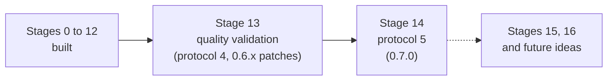

# Roadmap

**Purpose:** The plan for VTT Chat App, derived from [.claude/CLAUDE.md](.claude/CLAUDE.md): what was delivered, in order, and what is next. **This file is a summary on purpose.** The design, the decisions and who made them, and the build record for every closed stage are in the [build tracker](docs/tracker/README.md); what has really run, as opposed to what is built, is in [BUILD-STATUS.md](docs/BUILD-STATUS.md). Detailed task breakdowns are written per stage when it starts.

**Status legend:** 🟢 Done · 🟡 In Progress · ⚪ Not Started · ⚫ Superseded

> **Rewritten 2026-11-05, slimmed 2026-11-21.** The project changed direction on 2026-10-29: from a Tauri _browser_ that injected a voice overlay into D&D Beyond Maps, to a **self-hosted, audio-first system-tray app with server-side recording and AI summaries**. What carried over from the old design is in the [legacy record](docs/archive/LEGACY-DDB-OVERLAY-DESIGN.md).

**Sequencing rule:** prove the riskiest cross-cutting unknowns first, before investing in feature breadth. State discipline ([Stage 0.5](docs/tracker/STAGES-0-TO-8.md#stage-05--state--resilience-architecture)) is locked in before any stateful UI is built.

**Principles every stage inherits** (from [CLAUDE.md §2](.claude/CLAUDE.md)): self-host first with zero cloud reliance; cloud is an optional advanced adapter; the server is the source of truth; consent is visible; quiet when idle.

---

## Where we are (2026-11-21)

**Stages 0 to 12 are built and closed for building.** From here, a problem found in any of them is a **bug** (fixed in a patch release), and new work belongs to a later stage. The latest release is **0.6.1** (2026-11-20, protocol 4); the latest dev build is `0.6.2-dev.3`, which carries the Claude and OpenAI connectors, campaign memory in the export and the Stage 12 AI work. The releases and what each changed are in [CHANGELOG.md](CHANGELOG.md).

**What is not yet proven** is the point of the next stage: almost everything built since 0.6.0 has met unit tests and fakes, not a real session, a real cloud API or real hardware. The one-page list is the stocktake in [BUILD-STATUS.md](docs/BUILD-STATUS.md#stocktake-2026-11-21-what-is-built-and-what-is-not-yet-proven). Stage 13 closes it.

| Stage                          | State | What was delivered                                                                                                                                                                                           | Detail                                                                                                                                         |
| ------------------------------ | ----- | ------------------------------------------------------------------------------------------------------------------------------------------------------------------------------------------------------------ | ---------------------------------------------------------------------------------------------------------------------------------------------- |
| 0 Foundations                  | 🟢    | Monorepo (npm and Cargo workspaces), lint, format, CI and conventions.                                                                                                                                       | [detail](docs/tracker/STAGES-0-TO-8.md#stage-0--foundations)                                                                                   |
| 0.5 State and resilience       | 🟢    | The rules for client state on long sessions (leaf isolation, no-op guards, hidden is the default).                                                                                                           | [detail](docs/tracker/STAGES-0-TO-8.md#stage-05--state--resilience-architecture)                                                               |
| 1 Pivot cleanup                | 🟢    | The old browser-overlay design removed and the repo rewritten (v0.2.0).                                                                                                                                      | [detail](docs/tracker/STAGES-0-TO-8.md#stage-1--pivot-cleanup)                                                                                 |
| 2 Audio and records spike      | 🟢    | The Rust audio and LiveKit client, echo cancellation, the cue player and Egress recording, measured on real machines.                                                                                        | [detail](docs/tracker/STAGES-0-TO-8.md#stage-2--audio--records-spike)                                                                          |
| 3 Server core                  | 🟢    | Accounts, campaigns, invites, DM swap, the REST and WebSocket layer with replay, Postgres and Valkey, recording consent and the Admin CLI, in both install tiers.                                            | [detail](docs/tracker/STAGES-0-TO-8.md#stage-3--server-core)                                                                                   |
| 3b Deployment buildout         | 🟢    | Published images, the one-command installer, the protocol handshake, server-chosen client builds, web onboarding and Devices.                                                                                | [detail](docs/tracker/STAGES-0-TO-8.md#stage-3b--deployment-buildout-added-2026-11-11)                                                         |
| 4 Tray client                  | 🟢    | The system-tray app: main window, voice and mixer, status, notifications, auto-rejoin, autostart and the updater.                                                                                            | [detail](docs/tracker/STAGES-0-TO-8.md#stage-4--tray-client)                                                                                   |
| 5 Records and AI summaries     | 🟢    | Per-speaker recording, Whisper, and a scribe then a bard, on the operator's own hardware (or a remote one, with fallback); search; DM-only summaries.                                                        | [detail](docs/tracker/STAGES-0-TO-8.md#stage-5--records--ai-summaries-core)                                                                    |
| 6 Table features               | 🟢    | Chat and whispers, handouts, loot, party splits, the soundboard, schedule and RSVP. Voice whispers were dropped.                                                                                             | [detail](docs/tracker/STAGES-0-TO-8.md#stage-6--table-features)                                                                                |
| 7 Web app                      | 🟢    | The same app on any device at `/app`, with chat commands, history and handouts.                                                                                                                              | [detail](docs/tracker/STAGES-0-TO-8.md#stage-7--mobile-spa)                                                                                    |
| 8 Operations                   | 🟢    | `vtt-admin`, the public status page, backup and restore.                                                                                                                                                     | [detail](docs/tracker/STAGES-0-TO-8.md#stage-8--operations-admin-cli--status-page)                                                             |
| 9 Hardening                    | 🟢    | The idle-CPU cause found and fixed, container hardening, records a CPU-only server can keep up with, updates that clean up after themselves.                                                                 | [detail](docs/tracker/STAGE-09-HARDENING.md#stage-9--cross-platform-hardening--production-readiness)                                           |
| 10 Integrations and loot       | 🟢    | D&D Beyond sync, single sign-on, the release pipeline, loot management and chat history. The rest of its list is ideas.                                                                                      | [detail](docs/tracker/STAGE-10-INTEGRATIONS-AND-LOOT.md#stage-10--optional-integrations-advanced-users)                                        |
| 11 Protocol 4 and verification | 🟢    | 0.6.0 (protocol 4): loot re-drop and confirm, the soundboard, GM Notes, the glossary, the storyteller setting, the off-site notice, sheet details. 0.6.1: the sound deck, the phone table page, macOS Intel. | [detail](docs/tracker/STAGE-11-PROTOCOL-4.md#stage-11--protocol-4-and-verification-060-and-061-planned-2026-11-18)                             |
| 12 Storytelling                | 🟢    | The Claude and OpenAI connectors, a glossary into Whisper and corrections, a structured scribe, the Chronicler, campaign memory and five storytellers. **Unit-tested only; none has met a real session.**    | [detail](docs/tracker/STAGE-12-STORYTELLING.md#stage-12--storytelling-roles-personas-and-campaign-memory-idea-2026-11-17-scheduled-2026-11-18) |
| 13 Quality validation          | ⚪    | **Planned.** Everything built and never run for real, tested end to end, led by a reusable three-session demo campaign played through the real system, with a monitor.                                       | [below](#stage-13--quality-validation-end-to-end-testing-planned-2026-11-21)                                                                   |
| 14 Protocol 5 (0.7.0)          | ⚪    | **Planned, not fully designed.** The next wire bump, led by memory in the glossary and lore import.                                                                                                          | [below](#stage-14--protocol-5-and-070-planned-2026-11-21)                                                                                      |
| 15, 16                         | ⚪    | Ideas, not scheduled: signed Linux package repositories; a self-signed certificate the app can pin.                                                                                                          | [below](#stage-15--linux-package-repositories-served-by-the-server-idea-2026-11-19-not-scheduled)                                              |
| Future ideas                   | ⚪    | Parked, undesigned.                                                                                                                                                                                          | [below](#future-ideas)                                                                                                                         |

---

## Stage 13 — Quality Validation: end-to-end testing (planned 2026-11-21)

**Status:** ⚪ Not Started (planned with Andy, 2026-11-21; the approach is written, the details are not). **Depends on:** Stages 11 and 12 closed for building, and a dev build of everything built so far running on the test VM. Design and reasoning: [QUALITY-VALIDATION.md](docs/architecture/QUALITY-VALIDATION.md).

**Why.** Stages 9 to 12 built a lot that has only met unit tests, fakes and a few short recordings. The records pipeline in particular (Whisper, the scribe, the Chronicler, memory, five storytellers, two cloud connectors) has been exercised by a 12-minute written fixture and a 2-minute spoken scene. This stage is where the whole system is tested for real, as far as it can be tested without a table of people, so that what Stage 14's protocol bump carries is built on behaviour that has been seen.

**Rules.** Nothing new is built here except **test tooling** and **bug fixes**. The stage runs on protocol 4, so every fix ships as a 0.6.x patch; the wire changes wait for [Stage 14](#stage-14--protocol-5-and-070-planned-2026-11-21). Every result goes in [BUILD-STATUS.md](docs/BUILD-STATUS.md) with the date, the build and the numbers; a failure becomes a bug with a test.

### A. The demo campaign and the long-session test (the main test)

**Lanterns of Saltmarrow** (built 2026-11-21): a reusable demo campaign of **three connected sessions, about 80 minutes in all**, committed in [`infra/records-smoke/fixtures/campaign/`](infra/records-smoke/fixtures/campaign/README.md). D&D 5e with only the SRD 5.1 rules in an original fantasy setting, written to sound like real play and full of invented names for the glossary. One Game Master and four voice players speak through text-to-speech into the real LiveKit room; **player 5 is the developer's own client, silent, listening and monitoring**. It carries typed chat of every kind, light soundboard use, loot, a pause, a late joiner and a dropped connection, and the sessions plant callbacks (a throwaway ferrywoman, a debt, two Tobiases) so campaign memory and the bard can be scored on connecting later sessions to earlier ones. The script is the ground truth, so every output is scored; a validator and its tests keep the fixtures honest. It is a **reusable tool**: replayed on the dev PC and the VM, with a **monitor** recording CPU, memory, disk, network, latency and errors by phase. The rendered audio is throwaway and never committed. Decided with Andy: the harness is built on the dev PC and the baseline and soak run on the VM, and the Claude and OpenAI runs wait until he says go. Built 2026-11-21: the runner (dry and live) and the monitor. Still to do: a full live run of the three sessions on the dev PC and the VM.

What it stresses, and what is scored, is in [QUALITY-VALIDATION.md](docs/architecture/QUALITY-VALIDATION.md): word accuracy and speaker attribution against the script, whether planted facts and names survive Whisper, the scribe, the Chronicler and memory, whether anything private leaks, and the cost (time, CPU, memory, cloud tokens) of a real-length session on the VM's CPU defaults, on the GPU PC and on Claude.

### B. Everything else that moves here

Besides the demo campaign, Stage 13 holds every check that Stages 9 to 12 built and never ran for real, **split by who can validate it**: the harness (automated), the harness plus a person's judgement, and manual or external. The full tables are in [QUALITY-VALIDATION.md](docs/architecture/QUALITY-VALIDATION.md#the-other-checks-that-moved-into-stage-13). In groups:

- **The AI workflow on real sessions:** Whisper name accuracy (glossary prompt against corrections), the scribe and the Chronicler on a long session, campaign memory across two sessions, each storyteller, cost on the default CPU install, and tuning the prompts from reading real output.
- **The cloud connectors and the database:** Claude and OpenAI against the real APIs, and the Postgres side of Stage 12 (migrations 0042 and 0043, the memory queries, the export round trip).
- **Built in 0.6.x and never seen in a real window or on a phone:** GM Notes attachments and the PDF preview, the 400 % volume, the sound deck and its new sounds, the storyteller dropdown, the off-site notice, loot To confirm, the phone's table page, Invite and QR, the old-browser notice, the macOS Intel app, and redoing the user guide's screenshots.
- **Measuring on real machines:** the Windows microphone clipping retest, latency, CPU and drift, Bluetooth and USB headsets, Linux and macOS parity, the 8+ hour soak with churn, and a `kill -9` of the packaged backend.
- **Sign-in, devices and reachability:** OIDC against a real provider, Android and iOS Safari, deep links, the AppImage, and a pass over every earlier stage for features built but with no way in.

### Done when

The demo campaign has run end to end, all three sessions in order, on the VM's CPU defaults, on a GPU backend and on Claude, with the scores recorded and every failure fixed or consciously accepted; each row in the table above is either checked (with the result in BUILD-STATUS), fixed, or dropped by Andy; and the quality of the tales and briefs has been read by Andy, who has said whether they beat the table's memory and are fun (the test from Stage 12).

---

## Stage 14 — Protocol 5 and 0.7.0 (planned 2026-11-21)

**Status:** ⚪ Not Started (planned with Andy, 2026-11-21). **Not completely designed (Andy, 2026-11-21):** items here may be dropped, or moved to [Future ideas](#future-ideas), as the design firms up. Step H is the only item that is designed. **Depends on:** [Stage 13](#stage-13--quality-validation-end-to-end-testing-planned-2026-11-21), so the bump carries what Stage 13 shows is needed and is built on behaviour that has been seen.

**The rule from Stage 11 applies again: every wire change goes into one bump.** `PROTOCOL_VERSION` goes to 5 (`shared/src/consts/index.ts`, `consts.rs`, guarded by `backend/src/lib/wire/contract.ts`), the version to **0.7.0** (`tauri-client/scripts/set-version.sh 0.7.0`), a 0.6 app cannot join a 0.7 server, and the whole stack updates together as the operator's deliberate step ([VERSIONING-AND-DEPLOYMENT.md](docs/architecture/VERSIONING-AND-DEPLOYMENT.md)). Dev builds (`0.7.0-dev.N`) ship along the way. The release needs its full CHANGELOG section and a tag only when Andy asks.

### Step H: memory in the glossary, and importing lore (Andy, 2026-11-21; designed, not built)

Moved here from Stage 12. It needs a wire change, so it rides this bump.

1. **The glossary tab becomes the one place for names, places and lore.** A memory entry is a glossary term with a kind and a gist; session-learned entries appear there beside the Game Master's own terms and the suggested terms, editable and deletable. There is **no separate Memory page** (Andy: a Game Master needs one reference point, not another layer of data).
2. **Import lore.** A button in the glossary: upload a Markdown or text file (the campaign setting, NPC lists, a backstory); the AI proposes entries; the Game Master **previews and ticks** what to keep before anything is saved. It can be run many times in a campaign, usually at the start, and again to widen the lore.
3. **Imported entries are Game Master-only by default.** They reach the Chronicler's brief and the glossary, never the bard; the Game Master may mark one "the table can know".
4. **Character backstories from D&D Beyond** go through the same import (`ddb/` learns to read the backstory field from the public page; to verify against a live sheet first). They are memory from before the campaign began, and the brief can point out a new person who shares a name with a backstory figure ("a non-player character who shares a name with the villain in a player's backstory").
5. **Glossary suggestions are filled from memory entries**, so Whisper learns them (vocabulary learning, the part of Stage 12 C that was not built).

**Likely wire shape (my reading, to confirm when it is built):** a glossary entry gains `kind`, `gist`, `source` (`gm`, `session`, `import`, `backstory`) and a `tableKnows` flag; the memory entries the server keeps today are served through the glossary routes instead of the CLI alone (`vtt-admin memory` stays); an import route that returns a **preview** and an apply route that saves the ticked entries (Game Master only, like the glossary); and `CharacterSheet` gains the backstory. The tests that matter: a short lore file imports, a backstory villain is flagged when a like-named non-player character appears, and **no Game Master-only entry ever shows in a tale** (except the Tipsy Minstrel's, by the Game Master's choice).

### Activity on the tables you are not in (Andy, 2026-11-21; wanted, not designed)

Andy now plays in two tables and has to remember to switch. He wants **some sign of activity on the tables he is not connected to**, so he knows to switch (a dot or count in the campaign switcher, and perhaps an optional notification). It needs the server to count or push chat for a person's other tables, which is a wire change (today the socket carries one table at a time), so it belongs in this bump. Open: what counts as activity (any chat, only whispers and the Game Master's lines, a recording starting), whether a count or a dot, and how it stays quiet (the project's rule that playing comes first). Needs a short design with Andy first.

### Who the Game Master is, on every table (Andy, 2026-11-21; wanted)

The campaign switcher in both apps should say **who the DM is** for each table (the crown only says that _you_ are the DM). The server does not send it: `GET /api/campaigns` returns the campaign and the caller's role, and `GET /api/campaigns/:id/members` returns user ids and roles without display names. Adding the Game Master's name to the campaign list is a small additive response field, but it is an API change, so it rides this bump with the activity indicator. The rest of the switcher work (long names, next session, quick answer) needed no wire change and was built as a 0.6.x patch.

### Service upgrades: Valkey 9.1 and Postgres 18 (decided by Andy, 2026-11-21)

Both ride this bump, so the upgrade and the protocol change are tested together. **Valkey 8.1.12 to 9.1.4** (9.2 needs time): run LiveKit, the live-chat replay buffer and the demo campaign on it. **Postgres 17 to 18**: a major upgrade, done by **dump and restore into a new volume**, because the official 18 image keeps its data in a version-specific directory and mounts `/var/lib/postgresql` instead of `/var/lib/postgresql/data` (changing only the tag fails or starts on an empty directory). What has to be designed: how `vtt-admin update` carries an existing install across automatically (a backup first, the restore into the new volume, the old volume kept until the operator confirms), what the native install does (it uses Ubuntu's packages), and how it is rehearsed (the demo campaign on a restored copy). Review and sources: [DEPENDENCY-VERSIONS.md](docs/architecture/DEPENDENCY-VERSIONS.md).

### Anything else

Anything Stage 13 finds that cannot be fixed without a wire change is added here when found. The wire-change ideas that are not decided (polyglot masking, web push, the Admin quick-access screen) are parked in [Future ideas](#future-ideas), not in 0.7.0.

**Done when:** server and both apps speak protocol 5, the contract guard passes, step H works end to end in the desktop app (the phone app reads, as for the glossary today, unless Andy says otherwise), and a 0.6 app is told to update.

---

## Stage 15 — Linux package repositories, served by the server (idea, 2026-11-19; not scheduled)

**Status:** ⚪ Not Started, **not scheduled**. The manual route works for now: `.deb` and `.rpm` users install the newer file when a version is announced, and the AppImage updates itself. Andy, 2026-11-19: add it as a future stage, for both formats, with an operator switch, because some operators have no Linux players.
**Depends on:** release 0.6.0 (a stable protocol), the release pipeline having run for real (Stage 11), and the update mirror ([VERSIONING-AND-DEPLOYMENT.md](docs/architecture/VERSIONING-AND-DEPLOYMENT.md)). Design and reasoning: [PACKAGE-DISTRIBUTION.md](docs/architecture/PACKAGE-DISTRIBUTION.md#server-hosted-linux-repositories-designed-2026-11-19).

| #   | Item                                                                                                                                                                                                                                                                                                                                                                                                    |
| --- | ------------------------------------------------------------------------------------------------------------------------------------------------------------------------------------------------------------------------------------------------------------------------------------------------------------------------------------------------------------------------------------------------------- |
| 1   | **CI builds and signs the repositories at release time**, one per MAJOR.MINOR line (`0.5/`, `0.6/`), for APT (`.deb`, `InRelease`) and for DNF/zypper (`.rpm`, signed `repodata`), with one GPG key kept as a repository secret, like the updater key. **The server never holds the key**: apt installs as root, so a server that could sign would be a way to run code on every Linux player's machine |
| 2   | **The server mirrors and serves only its own line** from its updates folder as static files (`/apt/`, `/rpm/`), keeping the newest two patches. A 0.5 server can only offer 0.5.x, which keeps the app and server in step. Not a wire change                                                                                                                                                            |
| 3   | **Operator switch `LINUX_REPOS`**: `off` (the default, nothing mirrored or served) or `on`. With it off the download page shows today's file links. It needs `UPDATES_SOURCE` set to `mirror`, and `vtt-admin config show` says so if not                                                                                                                                                               |
| 4   | **A one-line setup from the download page, specific to that server** (`curl https://<server>/apt/setup.sh \| sudo bash`, and the `dnf`/`zypper` equivalent): it adds the source and the repository key, then installs the app. Only shown when the switch is on                                                                                                                                         |
| 5   | **The app says when it is behind**: when the server is on a newer MAJOR.MINOR than the app, say "run `sudo apt upgrade`" (or `dnf upgrade`) for a package install, as the app cannot update itself there                                                                                                                                                                                                |

**Known limits, decided in the design:** one apt source means one server per machine; if the server is offline `apt update` warns about that source only and everything else carries on, and updates resume when it is back; a repository signed in CI cannot be re-signed by the operator, so a self-built release needs its own key.

**Done when:** an Ubuntu and a Fedora machine each add the server's source, install, and receive a patch with `apt upgrade` / `dnf upgrade`, and with `LINUX_REPOS=off` the server serves none of it.

---

## Stage 16 — A self-signed certificate the app can pin (idea, 2026-11-19; not scheduled)

**Status:** ⚪ Not Started, **not scheduled**. Andy, 2026-11-19: operators with no domain, or a non-standard port, can use plain HTTP (`get.sh --http`, built in 0.6.0) on a network they trust. This is the encrypted alternative for the same operators, which needs real work in the apps.

**The problem.** Caddy can make its own certificate (`tls internal`), but nothing trusts it by default: browsers show a warning each person must click through (hard on some phones), and the desktop app, which trusts the system's certificate store, refuses it.

**The idea: pin it, never switch checking off.** The installer prints the server's certificate **fingerprint**; the desktop app, on first connect to a server it cannot verify, shows that fingerprint and asks the player to confirm it once (or the invite link carries it, so a player who trusts the link needs no step). The app then accepts only that exact certificate for that server, and refuses with a clear message if it ever changes.

| #   | Item                                                                                                                                                                    |
| --- | ----------------------------------------------------------------------------------------------------------------------------------------------------------------------- |
| 1   | **`get.sh --self-signed`**: Caddy's internal CA for the site, the fingerprint printed and shown by `vtt-admin`, kept across renewals                                    |
| 2   | **Pinning in the desktop app**: a custom certificate check for the HTTP client and the WebSocket (`rustls`), a trust prompt, and the pin stored with the server address |
| 3   | **Invite links carry the fingerprint** so joining is one step                                                                                                           |
| 4   | **The voice library**: check whether it takes a custom trust setting; if it does not, voice over a pinned server needs its own answer                                   |
| 5   | **The web app**: the browser warning cannot be removed by us; the guide says what to expect, and that an operator who wants no warnings needs a real domain             |

**Open questions (Andy's to decide):** whether the voice library can pin; whether browsers on phones are worth supporting in this mode at all.

---

## Stage 17 — Several workers: scaling processing (idea, 2026-11-21; not scheduled)

**Status:** ⚪ Not Started, **not scheduled**. Andy, 2026-11-21: most tables are fine with one job at a time in order, and scaling processing is best done with **several workers**. This version enforces **one worker per database** (a second stands by), keeps the queue first in, first out, and keeps **one table's sessions in the order they were recorded** (a failed job holds the table's later sessions until the operator retries or releases it). Several tables may still **record** at once (`recording.max-tables`, default 2); that only limits recording.

What this stage would add: letting an operator who has the hardware run more than one worker (a setting and a supported install, replacing the single-worker lock); making the model servers take it (Whisper and Ollama each serve one request at a time today; more VRAM or a second GPU, or a remote backend per worker); a fair share between tables so one long job does not hold the rest (the queue is FIFO); and measuring it (the demo campaign run on two tables at once is the test). The order rule already stops two sessions of one table running out of order, which is the correctness problem that blocked this. Open: whether a worker should be tied to one backend (a GPU box and the local CPU as two workers), and what the operator sees (`vtt-admin status` per worker).

---

## Future ideas

Parked on 2026-11-21 (Andy). **None is scheduled, and none is designed well enough to build**; each needs a design conversation with Andy before it becomes a stage. Those marked _wire_ would need a protocol bump, so they would ride a bump after 0.7.0.

| Idea                                                                    | Needs   | Where it is written down                                                                                                                                                                                  |
| ----------------------------------------------------------------------- | ------- | --------------------------------------------------------------------------------------------------------------------------------------------------------------------------------------------------------- |
| Per-character languages and polyglot masking                            | _wire_  | [CHAT-COMMANDS.md](docs/architecture/CHAT-COMMANDS.md) ("Future: polyglots", a seam only); the server would mask what a character cannot understand, per reader                                           |
| Web push for the phone web app                                          | _wire_  | [Stage 10](docs/tracker/STAGE-10-INTEGRATIONS-AND-LOOT.md); [MOBILE-WEB-APP.md](docs/architecture/MOBILE-WEB-APP.md). Opt-in per operator: a third party sits in the path                                 |
| The Admin quick-access screen (connection status, devices)              | _wire_  | [.claude/intent.md](.claude/intent.md), design topic 1                                                                                                                                                    |
| Package-manager distribution (winget, AUR, Homebrew tap)                | no wire | [PACKAGE-DISTRIBUTION.md](docs/architecture/PACKAGE-DISTRIBUTION.md) (signed Linux repositories are [Stage 15](#stage-15--linux-package-repositories-served-by-the-server-idea-2026-11-19-not-scheduled)) |
| Cloudflare TURN, Realtime SFU and Pages                                 | no wire | [DEPLOYMENT-AND-TRANSPORT.md](docs/architecture/DEPLOYMENT-AND-TRANSPORT.md)                                                                                                                              |
| Cloud transcription providers beyond a remote Whisper                   | no wire | [Stage 10](docs/tracker/STAGE-10-INTEGRATIONS-AND-LOOT.md)                                                                                                                                                |
| Portrait art for the five storytellers; a shouts clip                   | no wire | Asked 2026-11-20, [Stage 11](docs/tracker/STAGE-11-PROTOCOL-4.md)                                                                                                                                         |
| The phone app's storyteller picker and GM Notes                         | no wire | The routes exist; the phone has no screen for them                                                                                                                                                        |
| A spoken consent cue (the cues are synthesised tones)                   | no wire | [BUILD-STATUS.md](docs/BUILD-STATUS.md), assumptions                                                                                                                                                      |
| `vtt-admin status` naming the model a job used; the Anthropic Batch API | no wire | [RECORDING-AND-SUMMARIES.md](docs/architecture/RECORDING-AND-SUMMARIES.md)                                                                                                                                |

---

## Out of Scope

Per [CLAUDE.md §13](.claude/CLAUDE.md) — not planned at any stage: an embedded browser or any page injection, browser extensions, a Docker-only deployment (native stays supported), an admin web UI, VTT features (maps, tokens, dice, sheets), video, Rust backend services, a hard dependency on any cloud service, a Spectator role, or a formal session state machine.

## See Also

- [.claude/CLAUDE.md](.claude/CLAUDE.md) — full architecture spec and constraints
- [docs/tracker/README.md](docs/tracker/README.md) — the build tracker: design, decisions and build record per stage
- [docs/BUILD-STATUS.md](docs/BUILD-STATUS.md) — what is built against what has really run
- [.claude/intent.md](.claude/intent.md) — current threads and the open design topics
- [docs/architecture/OVERVIEW.md](docs/architecture/OVERVIEW.md) — system diagram and module responsibilities
- [docs/architecture/RECORDING-AND-SUMMARIES.md](docs/architecture/RECORDING-AND-SUMMARIES.md)
- [docs/architecture/DEPLOYMENT-AND-TRANSPORT.md](docs/architecture/DEPLOYMENT-AND-TRANSPORT.md)
- [docs/architecture/STATE-AND-RESILIENCE.md](docs/architecture/STATE-AND-RESILIENCE.md)
- [docs/architecture/PACKAGE-DISTRIBUTION.md](docs/architecture/PACKAGE-DISTRIBUTION.md) — package-manager distribution (future idea)
