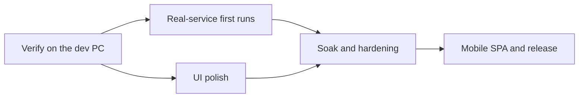
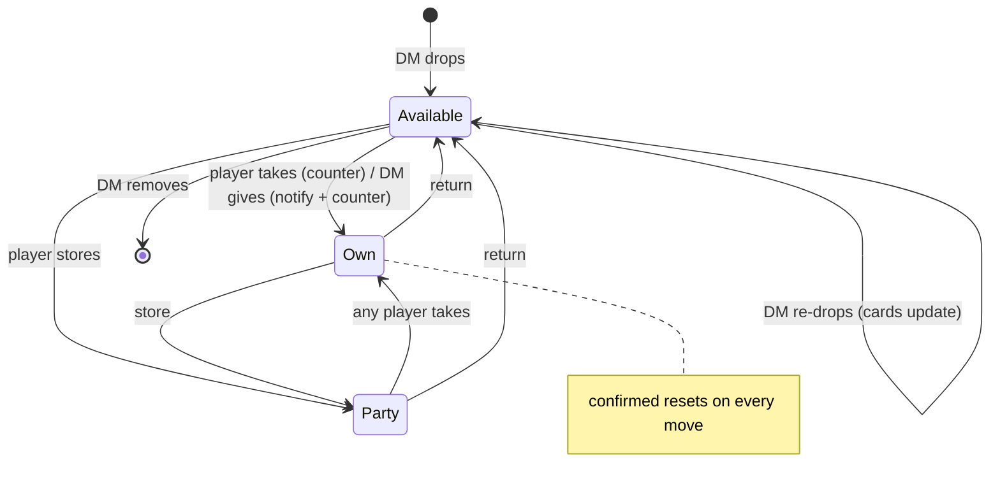
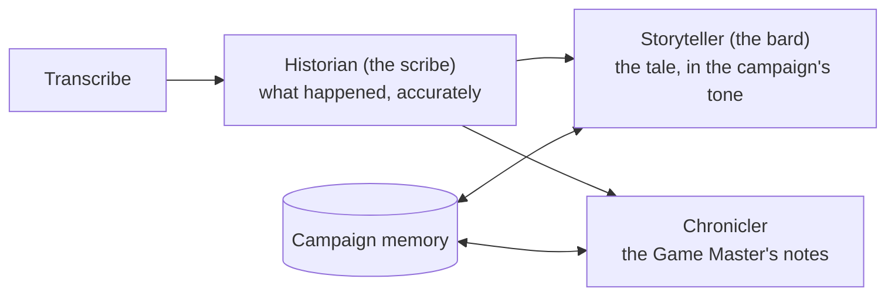

# Roadmap

**Purpose:** Stage-by-stage build order for VTT Chat App, derived from [.claude/CLAUDE.md](.claude/CLAUDE.md). Each stage lists its goal, what it depends on, its deliverables, and what "done" means. Detailed task breakdowns are written per-stage (via a proper implementation plan) when that stage actually starts — this document tracks shape and sequence, not tickets, so it stays accurate instead of going stale.

**Status legend:** 🟢 Done · 🟡 In Progress · ⚪ Not Started · ⚫ Superseded

> **Where things actually stand:** [docs/BUILD-STATUS.md](docs/BUILD-STATUS.md) (built vs verified, and what needs the dev box).
>
> **Rewritten 2026-11-05.** The project changed direction on 2026-10-29: from a Tauri _browser_ that injected a voice overlay into D&D Beyond Maps, to a **self-hosted, audio-first system-tray app with server-side recording and AI summaries**. The old Stages 1–3a are summarised under [Legacy record](#legacy-record-the-ddb-overlay-design) with what carried over. The old stage documents are in [docs/archive/](docs/archive/README.md).
>
> **The design is not signed off.** The architecture sketch is unreviewed, several topics are open ([.claude/intent.md](.claude/intent.md)), and Stage 2 exists precisely to de-risk the hardest unknowns before anything else is built. Treat stages from 3 onward as shape, not commitment.

**Sequencing rule:** prove the riskiest cross-cutting unknowns first — audio quality and recording on real machines — before investing in feature breadth. State discipline ([Stage 0.5](#stage-05--state--resilience-architecture)) is locked in before any stateful UI is built.

**Principles every stage inherits** (from [CLAUDE.md §2](.claude/CLAUDE.md)): self-host first with zero cloud reliance; cloud is an optional advanced adapter; the server is the source of truth; consent is visible; quiet when idle.

---

## Where we are and what is next

### Stages 0 to 8 are closed (2026-11-15)

Everything through Stage 8 is built and has been used for real: the one-command install on a real Ubuntu VM behind Cloudflare, the
desktop app and an iPhone against it, a recording with human voices through the local AI, the update feed against live GitHub,
and two clients' voice. From here, a problem found in any of these stages is a **bug** (fixed in a patch release), and new work
belongs to a future stage (9 onwards). A few checks were never run on their own hardware (Windows, macOS, Android, a second person's
install); if one fails it is a bug report, not an open stage.

| Stage                  | State                                                                                                                                  |
| ---------------------- | -------------------------------------------------------------------------------------------------------------------------------------- |
| 0, 0.5, 1              | 🟢 Closed                                                                                                                              |
| 2 Audio spike          | 🟢 Closed; measured on the dev PC                                                                                                      |
| 3 Server core          | 🟢 Closed; both install tiers, chat persistence                                                                                        |
| 3b Deployment buildout | 🟢 Closed; images, handshake, updates (including the live GitHub feed), web onboarding, Devices, the real-VM run                       |
| 4 Tray client          | 🟢 Closed; used on Linux against the real server                                                                                       |
| 5 Records and AI       | 🟢 Closed; a real recording with human voices on the VM's CPU AI works (slow; the GPU PC is the fast path)                             |
| 6 Table features       | 🟢 Closed. **Voice whispers are dropped** (decided 2026-11-14): players whisper by text; the DM speaks to one player in a private talk |
| 7 Web app              | 🟢 Closed; checked in a headless browser and on an iPhone                                                                              |
| 8 Operations           | 🟢 Closed; Admin CLI, status page, backup and restore                                                                                  |

**Done 2026-11-12 to 14 (since the last stock-take):** the browser Account page (profile, recording notice, collapsed password,
Devices with revoke); **request to join** a campaign (opt-in directory, DM approves); the DM's notes and schedule in the web
chat; a typeface for each `/say-<language>` line; Enter sends and Ctrl+Enter makes a new line in both apps; web layout that
scales; **scene changes start chapters** and the summaries are told what the table heard (`RECORD_CUES`, names only, scene
changes by default); a recommended CPU-only setup with a gaming PC as the fast path; the blank-install rehearsal, backup and
restore, and a 90-minute soak; a graceful server shutdown; `.rpm` for real releases; and the **one-command operator install**
(`infra/get.sh`) with `vtt-admin logs/restart/ps/backup/restore/update`.

**Releases:** 0.4.1 to 0.4.5 shipped from what the real VM and real use found (0.4.0 and 0.4.4 were tagged but never published as
releases; the 0.4.5 changelog covers both).

**Next** (re-planned 2026-11-18, after 0.5.3):

0. **0.5.4 (built, to test and release):** no wire change. The DM can no longer delete audio and may delete only a short (under 30 minute) test session, with dev builds on; operators get `vtt-admin campaign delete` and `recording delete`, and handout files are swept; a character linked to D&D Beyond keeps what the sheet says; the desktop shows the D&D Beyond box when sync is off; the phone web app has **My characters**; the audio mixer has **My sounds** (upload, takes, rename, delete); the web login form offers single sign-on when the server has it. See [BUILD-STATUS](docs/BUILD-STATUS.md#built-2026-11-18-for-054-clean-up-rules-characters-your-own-sounds-on-main).
1. **Bug fixes** as they turn up, in 0.5.x patch releases.
2. **Stages 9 and 10 are closed for building.** Their unfinished parts (what needs Windows, a real recorded session on the VM, soak, signing, the release pipeline, a second person's install) are checks, and move to Stage 11.
3. **[Stage 11](#stage-11--protocol-4-and-verification-060-and-061):** **0.6.0** is the one bump to protocol 4 (loot re-drop and the confirmed flag, the soundboard, and the wire for the AI work: persona setting, GM Notes, glossary, off-site notice); **0.6.1** is verification and the end-to-end test.
4. **[Stage 12](#stage-12--storytelling-roles-personas-and-campaign-memory-idea-2026-11-17-scheduled-2026-11-18):** the AI workflow (the Claude connector, a glossary for Whisper, a scribe that picks out what happened, the Chronicler, campaign memory, personas), **0.6.2 onwards**.
5. The open design topics in [.claude/intent.md](.claude/intent.md).

--------------------------- | ------------------------------------------------------------------------------------------------------------------------------------------------------------------------------------------------------------------------- |
| **One web app** | A landing page at `/`, `/download` (per-OS steps, sign-in required), `/full-app`, and the chat web app at `/app` as the same product on phones and desktops; one 640px column, the Default look, light/dark |
| **Sessions in the browser** | A secure, long-lived cookie (HttpOnly, SameSite, `__Host-`) that slides with the operator's offline limit; Origin checks on cookie writes and the WebSocket; OIDC fits later without rework |
| **Getting an account** | Visitor sign-up requests (off by default, approved in `vtt-admin signup`), short typeable `ABCD-EFGH` codes, a starter campaign for the first Admin |
| **Chat commands** | `/say`, `/say-<language>`, `/do`, `/ooc`, `/tell`, `/w`, `/dm`, `/late`, `/cant`, `/work`, `/brb`, `/afk`, `/back` with autocomplete in **both** apps; OOC never recorded; one shared parser |
| **Web chat** | Members rail with status and hover/tap details, burger menu and "Get the app" promo, icon tabs matching the desktop |
| **Desktop app** | New Default theme (violet, ember, teal) matched in the web; connect screen in the web look; system certificate store trusted; Settings reorganised (Profile with theme, photo, version and updates; Audio; Notifications) |
| **Design and tooling** | Artwork banners and a faint chat watermark; `npm run app`; `trust-local-ca.sh`; a headless-browser layout check; a palette drift test between web and desktop |

**Still to do, in the order I would take it:**

1. **A second person, on a blank VM** (Stage 3b #6 and the Stage 3 "done when"): the real test of the images, the operator
   guide, `wss://` through Caddy with a real certificate, LiveKit audio over UDP, and the new landing and download pages.
2. **See it running.** The web screens were exercised in a real headless browser on 2026-11-12 (about 330 checks, seven bugs
   fixed; `web/e2e/ui-smoke.mjs`). Still unseen in a real window: the desktop app's new screens (connect, Settings, rail,
   chat commands, join requests). On the list: a real phone and iOS Safari, deep links on
   Windows and macOS and the Linux AppImage, voice over `https://localhost` with the trusted CA, the Windows and macOS builds.
3. **Close the version and sign-in gaps:** done 2026-11-12 are the WebSocket protocol check, the CI guard that fails an
   unrecorded wire change, and signing out an expired `/app` tab (Stage 3b #3). The web **Account page** (profile, password, devices
   with revoke, recording notice) is built 2026-11-13 (#8) but not yet seen in a real browser.
4. **Decide the undecided:** how a signed-in person with **no campaign** gets into one (request-to-join from an opt-in list,
   DM approves in the app); whether quick-reply commands should be customisable; per-character languages and polyglot
   masking (needs server-side masking; only designed as a seam).
5. **Recording and AI: proven end to end on 2026-11-12** on the Compose stack with synthetic speech (66 of 66 checks: consent, per-speaker
   attribution, typed lines in, OOC and whispers out, DM-only summaries, search, a killed worker, the remote-AI fallback;
   [BUILD-STATUS.md](docs/BUILD-STATUS.md)). Still to do there: real human voices and room noise, a multi-hour session, a CPU-only
   server, and the second-person deploy.
6. **The old list below** (listening tests, the 4-hour soak, D&D Beyond on
   real sheets, Windows and macOS away detection) still stands and is unchanged.

**As of 2026-11-09 the player experience was essentially complete:** sign in, join, talk, chat, whisper, loot, RSVP, hear the DM's scenes and stingers, browse past sessions, with recording and consent working end to end. What was left then, and still is, is **verification on real machines**, a few UI/UX refinements, and release work.

**Built 2026-11-09 (unverified in a real window or against real services):**

- **D&D Beyond character sync** ([DDB-SYNC.md](docs/architecture/DDB-SYNC.md)): link on the Campaign → Character screen, "Sync now", hourly refresh of name, race, class, level and portrait. Off unless `DDB_SYNC=1`. **Never run against the live service**; the parser is the one place to adjust.
- **Session history window**: recordings, summaries (DM-only ones only for the DM), transcript, search, DM delete.
- **Public status page** at `/status` and `/api/status`, built and served in both install tiers.
- **Mixer audio engine** ([AUDIO-MIXER.md](docs/architecture/AUDIO-MIXER.md)): our own capture and playback around WebRTC's echo cancellation, **the default since 0.5.2** (the platform path is the fallback: Settings → Audio → Compatibility audio, or `VTT_AUDIO_BACKEND=platform`). Gives per-person volume, microphone volume, a real level meter, and echo cancellation that still works with a character voice and for sounds the app plays itself. Used on Linux and Windows; latency, drift, CPU and Bluetooth/USB headsets are not measured.
- **Polish:** four new DM voices (Dragon, God, Drunk, Authoritative: **tuned by tests on synthetic tones, not by ear**), a keyboard way to move people between groups (Enter on a focused person in the rail), `--category` and `ambience/` or `music/` folders in the sound importer, and a daily sweep of portraits nobody uses.
- **Emailed sign-in codes** (`SMTP_URL`), **single sign-on** (OIDC) and a **code sign-in** in the app ([SIGN-IN-OPTIONS.md](docs/architecture/SIGN-IN-OPTIONS.md)). SSO was tested against a fake provider only.

**Guides (started 2026-11-10):** an [Operator guide](docs/guides/OPERATOR-GUIDE.md) (install, first run, configure, operate, back up, update, fix) and a [User guide](docs/guides/USER-GUIDE.md) (players and DMs) are drafted in [docs/guides/](docs/guides/README.md). They describe what is built; the steps nobody but the author has run are marked. **They are kept true in the same commit as any feature that changes them**, and the second-person deploy test (Stage 3) is also the test of the operator guide.

**Build queue (worked through 2026-11-10 onward, one commit each, tests first):**

| #   | Item                                                                                                                                                                                     | Why now                                                                                          | Status                                             |
| --- | ---------------------------------------------------------------------------------------------------------------------------------------------------------------------------------------- | ------------------------------------------------------------------------------------------------ | -------------------------------------------------- |
| A   | **First-run bootstrap:** `vtt-admin user create <email> --name … [--admin]`                                                                                                              | The operator guide needs a way to make the first account; today it takes a hand-written API call | built                                              |
| B   | **Closed-window experience:** unread badge on the tray icon, OS notifications while the window is hidden (whispers only while in voice with a recording active), session reminders shown | Players keep the app hidden ~90% of the time                                                     | built                                              |
| C   | **Storage and purge (disk figures done 2026-11-10; purge done earlier):** disk use on the status page and in `vtt-admin`, and a purge of raw audio once a summary is confirmed           | Recordings fill a disk with no warning                                                           | built                                              |
| D   | **Backup and restore scripts** (Compose and, from 2026-11-10, native: `infra/backup-native.sh`, `infra/restore-native.sh`)                                                               | The guide currently says "use pg_dump by hand"                                                   | built                                              |
| E   | **Handouts:** remove or reorder a picture after creation                                                                                                                                 | Today a set is deleted and rebuilt                                                               | built                                              |
| F   | **Search finds typed chat lines** from recordings                                                                                                                                        | Typed lines are in transcripts but not searchable                                                | built                                              |
| G   | **Away on Windows and macOS:** screen-lock detection (only the idle timer works there)                                                                                                   | Parity with Linux                                                                                | built, unverified on Windows/macOS                 |
| H   | **Noise filter follow-ups:** a hum notch filter; decide the default level after listening; PipeWire/PulseAudio backends                                                                  | Needs your ears first for the default                                                            | built (default level and backends need the dev PC) |

**Next steps, in order:**

0. **Deployment buildout ([Stage 3b](#stage-3b--deployment-buildout-added-2026-11-11)):** published images, version handshake, server-chosen client builds, then web onboarding. This comes first: the goal is a deployable system to test end to end before refining.

1. **On the dev PC:** run the app and try everything listed above plus unmute, rail drag, portrait upload, device switching and the scene editor. Link a real public D&D Beyond sheet and read what comes back. Point SMTP and an Authelia at the backend once.
2. **UI/UX fine-tuning** from what step 1 turns up, starting with **listening to the four new voices** and the importer's ambience and music loops (run `npm run sounds:import -- --from <dir> --category ambience`).
3. **Purge rules (built 2026-11-10):** age-based retention, the DM's "delete the audio" button, and a disk-low rule with a 3-day warning. Purge at the next session start built 2026-11-13 (operator setting, off by default). Then the recorded 4-hour soak (Stage 9). The server-restart-mid-recording drill is done (2026-11-10).
4. **Second-person deploy test** from the docs on a blank VM (Stage 3).
5. **Mobile SPA** (Stage 7): built, with history search, a handout viewer (flip and zoom) and an install manifest added 2026-11-10; open it on a real phone (`/app`) and try it on iOS Safari.
6. **D&D Beyond:** AC, passive perception, max HP and ability scores are built (2026-11-10, worked out by us); one real sheet compared 2026-11-11 (fixed Draconic Resilience HP and AC); compare a Barbarian or Monk next. Later: saves, skills.
7. **Audio engine default: decided 2026-11-17, the mixer** (used on Linux and Windows). The platform path stays as "Compatibility audio". Still to do: measure latency, CPU, hour-long drift, Bluetooth and USB headsets; remove the platform path once a few real sessions have not needed it.
8. **Try the optional sound-card backends and RNNoise** once the mixer is validated: cpal 0.18's `pipewire`, `pulseaudio` and `jack` cargo features (off today; Linux uses ALSA, which PipeWire serves; they need the PipeWire/PulseAudio dev libraries in the Docker image and CI), (RNNoise itself is built: [AUDIO-MIXER.md](docs/architecture/AUDIO-MIXER.md); it needs a listening test; the 50/60 Hz hum notch filters are built ahead of it). cpal is now 0.18.2 (decided 2026-11-09); see [AUDIO-MIXER.md](docs/architecture/AUDIO-MIXER.md).
9. **Status (Online, Away, Offline) is built** ([STATUS-AND-PRESENCE.md](docs/architecture/STATUS-AND-PRESENCE.md), 2026-11-10): tray submenu, a dot beside the settings cog, Settings → Profile, automatic Away from screen lock or idle, shared with the table, and no voice join at launch. Still to do: try it on the dev PC, the Windows and macOS screen-lock signals.
10. **Closed-window experience and the full soak.** A 21 h debug-build run with the window open (2026-11-10) held steady memory, threads and file handles, with 0-20% CPU from chat and speaking indicators; that is working load, not idle. The tray unread badge and OS notifications while the window is closed are built, with per-kind switches and quiet hours in Settings (2026-11-10; decided 2026-11-10: whisper notifications fire only while the player is connected to voice and a recording is active, i.e. in-game). Still to do: measure true idle (window closed, chat quiet) in a release build as part of a full soak under varied conditions.

---

## Stage 0 — Foundations

**Status:** 🟢 Done (carried over unchanged)

npm workspaces, root docs, per-module scaffolds, Cargo workspace in `tauri-client/`, CI (ESLint + Prettier + `tsc` for TS; `cargo fmt` + `clippy` for Rust), and the per-module folder convention.

**Note:** `typescript` is pinned to `^6.0.3` because `typescript-eslint` doesn't yet support TypeScript 7's compiler internals. `eslint-plugin-react`/`-hooks` are left out until their peer ranges support the repo's ESLint major; re-add them when real panel components land (Stage 4).

---

## Stage 0.5 — State & Resilience Architecture

**Status:** 🟢 Done (revised 2026-11-05 for the tray app)

The rules every stateful surface follows — leaf isolation, write discipline, bounded retention, the recovery contract, WebSocket reliability — in [docs/architecture/STATE-AND-RESILIENCE.md](docs/architecture/STATE-AND-RESILIENCE.md). The 2026-11-05 revision adds **"hidden is the default"**: tray state is Rust-owned, a panel hydrates from a snapshot every time it opens, and nothing runs while no panel is visible.

---

## Stage 1 — Pivot Cleanup

**Status:** 🟢 Complete 2026-11-05 — docs and code teardown done (v0.2.0)
**Depends on:** —

Make the repo match the new design, so nobody (human or Claude) builds on legacy patterns.

**Deliverables:**

- 🟢 Rewrite `.claude/CLAUDE.md`, `README.md`, `ROADMAP.md`, `DEVELOPING.md`, `CONTRIBUTING.md`, `docs/CONVENTIONS.md`, the architecture docs, and every module README
- 🟢 New design docs: [RECORDING-AND-SUMMARIES.md](docs/architecture/RECORDING-AND-SUMMARIES.md), [DEPLOYMENT-AND-TRANSPORT.md](docs/architecture/DEPLOYMENT-AND-TRANSPORT.md)
- 🟢 Move everything specific to the old design into [docs/archive/](docs/archive/README.md) (WebKitGTK investigation, old specs/plans, DDB-AUTH)
- 🟢 **Remove legacy code** from `tauri-client/src-tauri/`: `allowlist.rs`, `blocked_page.rs`, `homepage_redirect.rs`, `safety_net.rs`, `cobalt.rs`, overlay injection, the `remote-ddb` capability, the DDB URL/domain consts, and the `dev-with-patched-webkitgtk` plumbing
- 🟢 **Replace `tauri-client/overlay-ui/`** with `panels-ui/` — keep the build/test scaffolding, the Radix/Zustand setup and the leaf-isolation helpers; delete the Shadow DOM mount, corner/expand stores, `CompactPanel`/`ExpandedPanel`, and `OverlayCornerMenu`
- 🟢 **Reshape `backend/`**: remove the DDB-identity `POST /api/session` contract (keep LiveKit token issuance); update `shared/` schemas accordingly
- 🟢 **Demote `ddb/`** to the optional character-import module (public pages only); remove the cobalt-cookie/JWT code or move it to `docs/archive/` (moved to `docs/archive/ddb-legacy/`)
- 🟢 Update `scripts/dev.ts`, `package.json` workspaces and CI for the new module set; strip the WebKitGTK/NVIDIA notes from `DEVELOPING.md`'s tooling assumptions (done in prose; confirm in the scripts)
- 🟢 A `tauri.conf.json` with **no remote origins**: strict CSP, local pages only (the tray and panel windows themselves are Stage 4; the shell is windowless until then)

**Done when:** `npm run lint`, `typecheck`, `build`, `test` and `cargo clippy` pass, and `grep -ri "cobalt\|allowlist\|dndbeyond\|overlay"` over `src/` returns nothing but the optional `ddb/` module.

---

## Stage 2 — Audio & Records Spike

**Status:** 🟢 **Closed 2026-11-15.** Anything found from here is a bug fix, not stage work. _History:_ In Progress — first findings logged in [AUDIO-SPIKE-RESULTS.md](docs/architecture/AUDIO-SPIKE-RESULTS.md) (platform audio layer chosen as the base; release-on-mute measured on Windows). Built without a live server: platform-audio client with release-on-mute and auto-rejoin, the `ai/` pipeline library, and the Part B runbook/scripts. **Still needs a live run:** acoustic AEC/CPU/latency, rejoin and sleep/wake, and Part B on a Linux server.
**Depends on:** Stage 1 (the Rust crate part can start immediately; it doesn't need the cleanup)

The riskiest unknowns are all "does this actually work on real machines with open mics?" — answer them with the smallest possible thing before any tray or React work.

**Part A — Headless client.** A headless Rust binary (extends `rust-livekit/examples/`): capture → echo cancellation → noise suppression → LiveKit room join → playback, with per-player gain. No Tauri, no UI.

**Part B — Server records smoke test.** Stand up LiveKit + **Egress** on a dev server; record per-speaker tracks from Part A; run ffmpeg → Whisper.cpp on them; summarise a transcript with Ollama. Throwaway scripts are fine.

**Deliverables:**

- Part A running on **Windows and Linux** with open mics and speakers (no headphones), measured for echo, noise, CPU and latency
- **Capture-device release on mute**: does it work on both OSes, and what is the unmute latency? Decides the hot-mic design (CLAUDE.md §8.1)
- **Auto-rejoin** after network drop and after sleep/wake
- Part B: per-speaker recording end-to-end; Whisper.cpp throughput on the dev server (real-time factor per `small`/`medium` model); a first summary
- Sizing numbers for [DEPLOYMENT-AND-TRANSPORT.md](docs/architecture/DEPLOYMENT-AND-TRANSPORT.md) and [RECORDING-AND-SUMMARIES.md](docs/architecture/RECORDING-AND-SUMMARIES.md)

**Done when:** two machines on different OSes hold a clean open-mic conversation, a server-side recording of it produces a correctly speaker-attributed transcript and a readable summary, and the measured numbers are written into the design docs.

**What carries over:** `rust-livekit` already does capture (`cpal`), `NativeAudioSource`, publish/subscribe and playback; the `loopback` example proved that pipeline against a real server (2026-08-09). This stage adds AEC/NS, gain, rejoin, and everything server-side.

---

## Stage 3 — Server Core

**Status:** 🟢 **Closed 2026-11-15.** Anything found from here is a bug fix, not stage work. _History:_ Nearly done — built and verified against real services: identity/campaign domain, REST, WebSocket hub with a Valkey-backed replay buffer, Postgres store and migrations, recording state and consent acknowledgements, the Admin CLI (`vtt-admin`), and **both install tiers** (Docker Compose; native `infra/install.sh` on Ubuntu 24.04). **Remaining:** the "done when" test — a second person deploying from the docs on a blank VM
**Depends on:** Stage 2 (and the open identity decision, below)

**Decided with Andy (2026-11-05):** the identity & access model ([CLAUDE.md §11](.claude/CLAUDE.md#11-identity--access-model--direction-decided-2026-11-05-details-open)) and the sync protocol ([SYNC-PROTOCOL.md](docs/architecture/SYNC-PROTOCOL.md), draft). Remaining open: Admin quick-access extras, OIDC specifics, and the assumed defaults (invite expiry 7 days, magic-link lifetime 15 minutes, minimum password length 10).

**Deliverables:**

- Identity, instance bootstrap (first DM), campaigns, membership and access control; General channel + private campaign channels
- LiveKit token issuance per channel; room layout (General / Campaign / party splits)
- Postgres schema (campaigns, memberships, channels, messages, recordings, transcripts, summaries); Redis for ephemeral state
- WebSocket layer with a bounded replay buffer and snapshot fallback (per STATE-AND-RESILIENCE)
- **Docker Compose bundle** (primary) + Caddy + systemd + `infra/install.sh` (native, advanced) — voice only to start (records come in Stage 5). Both generate the same config; LiveKit on host networking in Compose
- UDP port documentation and an operator checklist, tested by a **second person** deploying from the docs

**Done when:** someone other than Andy can `docker compose up` on a blank Ubuntu VM (and, separately, run the native install script), bootstrap a campaign, and have two clients join its voice room.

---

## Stage 3b — Deployment Buildout (added 2026-11-11)

**Status:** 🟢 **Closed 2026-11-15.** Anything found from here is a bug fix, not stage work. _History:_ Built; the real-VM run (#6) is the gate. The one-command installer `infra/get.sh` was added 2026-11-14
**Depends on:** Stage 3 (the Compose bundle), Stage 4 (the tray client and its updater)
**Design:** [VERSIONING-AND-DEPLOYMENT.md](docs/architecture/VERSIONING-AND-DEPLOYMENT.md)

**Goal:** the whole system deploys to a server from published images, so the full system can be tested end to end
(recording, summaries, real players), and only then refined. Versions, updates and onboarding are server-driven.

**Deliverables, in build order:**

| #   | Item                                                                                                                                                                                                                                                                    | Status                                                                                                                                                           |
| --- | ----------------------------------------------------------------------------------------------------------------------------------------------------------------------------------------------------------------------------------------------------------------------- | ---------------------------------------------------------------------------------------------------------------------------------------------------------------- |
| 1   | **Version rules** (MAJOR/MINOR/PATCH meaning, 0.y as the match tier) in CLAUDE.md, DEVELOPING.md and the design doc                                                                                                                                                     | 🟢 Done 2026-11-11                                                                                                                                               |
| 2   | **Container build workflow:** CI builds the backend and worker images on a release tag and pushes them to GHCR (full version + MAJOR.MINOR tags; dev tags never move `latest`); the Compose bundle pulls them by `VTT_VERSION` instead of building on the server        | 🟢 Run for dev.1 to dev.4; brought up locally from the images (2026-11-11), four bugs found and fixed                                                            |
| 3   | **Protocol version handshake:** `PROTOCOL_VERSION` in `shared/`, sent by the client and answered by the server, with "update required" on both sides; a CI test fails if a wire contract changes without it                                                             | 🟢 Done 2026-11-12: REST, WebSocket, and a CI guard that fails an unrecorded wire change                                                                         |
| 4   | **Server-chosen client builds:** the server offers the newest patch of its own MAJOR.MINOR, patches auto-approved, from GitHub releases (`UPDATES_SOURCE=github`)                                                                                                       | 🟢 Run against live GitHub (dev builds); waits for all three installers before offering a release                                                                |
| 5   | **Update mirror:** `UPDATES_SOURCE=mirror` sync job (verify signatures, newest patch plus one previous, cleanup), `vtt-admin updates sync/status`                                                                                                                       | 🟢 Done: tested against live GitHub (2026-11-15)                                                                                                                 |
| 6   | **Fresh-VM deploy test** from the images and the operator guide (the Stage 3 "done when"), with real LiveKit audio, `wss://` through Caddy and a Let's Encrypt certificate                                                                                              | 🟢 **Done on a real VM 2026-11-14 and tested since** (one-line install, real certificate, firewall, first Admin, voice and a recorded session)                   |
| 7   | **Web onboarding and app sign-in:** invite link → account → OS-specific install → "Open VTT Chat" hand-off (deep link, typed code, device code approved by scanning the app's QR or opening its link; no PKCE, see APP-SIGN-IN.md); the server owns the sign-in methods | 🟢 Built 2026-11-11 and tried locally by Andy: landing, sign-in (code, password), long link, the app connects with no prompt; other OSes and a phone untried     |
| 8   | **Mobile account and install flow:** security and profile (name, avatar) in the browser; the **Devices list with revoke** (`GET`/`DELETE /api/auth/sessions` already exist); add-to-home-screen steps for Android and iOS, then how to install the desktop app          | 🟢 Built 2026-11-13: the browser Account page (profile, recording notice, password, Devices with revoke); add-to-home-screen steps; not yet seen on a real phone |

**Done when:** an operator on a blank Ubuntu VM pulls the images, starts the stack, and a new player goes from an
invite link to a signed-in, preconfigured app without typing a server address; a client of the wrong MAJOR.MINOR is
told clearly to update; and a recorded session runs through to its summary.

---

## Stage 4 — Tray Client

**Status:** 🟢 **Closed 2026-11-15.** Anything found from here is a bug fix, not stage work. _History:_ Feature-complete for players as of 2026-11-09; 🟡 fine-tuning and verification remain. One compact RPG-themed main window (avatar rail with speaking glow, quality-coloured connection sparkline, group sections and hover cards; themed chat with whispers; record state and consent; mute and level meter; voice connect), Settings as a popover (Profile with theme, photo, version and updates; Campaign; Sessions; Audio; Notifications; reorganised 2026-11-11), Handouts and Party-inventory windows, the DM **Scene Deck** (Voice, Stinger and Scene panels with favourites, custom scenes and per-type levels), loot with the SRD catalogue and treasure generator, scheduling with RSVP, account and character avatars, sound through the call, signed auto-update, start-with-computer, crash recovery and the DM connection screen. Voice runs on **LiveKit Rust SDK 0.10.1** (Linux builds need `clang`; see [DEVELOPING.md](DEVELOPING.md)). **Built since, unverified in a real window:** the session history window, the keyboard way to move people between groups, four more DM voices, and the opt-in mixer audio engine (per-person volume, microphone volume, a real level meter). **Not built:** a recorded 4-hour soak (`tauri-client/scripts/soak.sh` is ready), and checking the D&D Beyond sync's extra stats against real sheets. **Needs a human:** listen-tests of effects, character voices and the mixer engine, and a pass through the real window (unmute, rail drag, portrait upload, device switching, scene editor). Back up the updater key (`~/.tauri/vtt-chat-updater.key`) and give it a password before real releases. Detail of what is built vs verified: [docs/BUILD-STATUS.md](docs/BUILD-STATUS.md). Design: [main-window spec](docs/superpowers/specs/2026-11-08-main-window-design.md).
**Depends on:** Stage 2 (audio engine), Stage 3 (server to connect to)

**Deliverables:**

- Tray icon with live / muted / recording / disconnected states, driven from the Rust core
- Floating panels (`panels-ui/`), position/size remembered; **no panel needed for audio to work**
- Hotkeys (PTT, mute, panel toggle) with the platform limits documented — bare-modifier PTT is app-focused only; Wayland global shortcuts no-op
- Autostart, auto-update, crash recovery, auto-rejoin; near-zero idle CPU verified
- First panels: connection/roster, mute/PTT, channel switcher
- Light/dark follows the OS; simple but stylish

**Done when:** a player installs the app, signs in, joins the campaign, hides it, and plays a 4-hour session without touching it again — surviving a Wi-Fi drop and a laptop sleep — with idle CPU at ~0 and the tray icon always telling the truth.

---

## Stage 5 — Records & AI Summaries (Core)

**Status:** 🟢 **Closed 2026-11-15.** Anything found from here is a bug fix, not stage work. _History:_ In Progress — the processing half is built and verified live (Egress files → durable job queue → worker → Whisper/LLM, local or remote with fallback → transcripts and summaries in Postgres; Admin CLI `jobs` / `recording`). **Records API built** (read, search, DM-only enforced at the API, DM delete). **History window built 2026-11-09 (unverified in a real window).** **Built 2026-11-10:** the DM confirms → purge raw audio, and a disk-low purge rule with a 3-day warning (the next-session rule is not built). **Not built:** extra cloud providers (Stage 10). Scene cues and chapters built 2026-11-14. The recording loop itself — DM start/stop → per-speaker capture gated on the consent acknowledgement → processing — is closed and verified live. See [docs/BUILD-STATUS.md](docs/BUILD-STATUS.md)
**Depends on:** Stage 3, Stage 4 (Stage 2 Part B already proved the pipeline shape)

**Deliverables:**

- Recording control from the DM's panel; recording state in server metadata
- **Consent cue**: local start/stop cues, late-joiner gating, rejoin suppression, per-player acknowledgement with expiry, persistent indicator (tray + panel)
- Egress per-speaker recording; private/whisper audio excluded at the routing layer
- `ai/` pipeline: transcode → Whisper.cpp per track → merge by timestamp → Ollama summaries (session, chapter, character-specific, DM-only), with a retryable job queue
- Records API + a history/summary panel; search across a campaign's history
- Optional cloud adapters (OpenAI Whisper, cloud LLM) behind explicit operator config
- Resolve the open records questions: markers vs. topic shifts, pause/resume, retention default

**Done when:** a real session is recorded with every player hearing the cue, produces a speaker-attributed transcript and summaries entirely on the self-hosted box, DM-only summaries are verifiably DM-only, and nothing from a whisper appears in any artifact.

---

## Stage 6 — Table Features

**Status:** 🟢 **Closed 2026-11-15.** Anything found from here is a bug fix, not stage work. _History:_ Built end to end for players (server 2026-11-07, client 2026-11-08 to 09); 🟡 the full-session test below is not yet run. Server: chat and private whispers, handouts/maps/images/text snippets, loot with atomic claims, the DM soundboard (a mini thaumaturgy.app), session schedule + RSVP + reminders + stored notifications, and party split — see [TABLE-FEATURES.md](docs/architecture/TABLE-FEATURES.md). Client: chat and whispers, handouts, loot and party inventory, the Scene Deck, scheduling and RSVP, and party split in the rail (Stage 4). **Built 2026-11-11:** chat commands (in character, out of character, language styles, whispers by name, quick late/can't). **Dropped by decision (2026-11-14):** voice whispers; the party split already isolates one player with the DM. **Not built:** the end-to-end "full session" test below.
**Depends on:** Stage 5

**Deliverables:**

- Chat, DM/player whispers, handouts/maps/images, text snippets (bounded retention, per STATE-AND-RESILIENCE)
- Loot drops with pickers
- DM soundboard: own and per-player audio, instant and background effects
- Party split: DM in all groups, players isolated; DM drag between groups
- Session scheduling in the tray: reminders and RSVP (can make it / late / can't)
- In-session and post-session history access

**Done when:** a full session runs with whispers, a handout, a loot drop, a party split and soundboard effects, all surviving a reconnect without duplicates.

---

## Stage 7 — Mobile SPA

**Status:** 🟢 **Closed 2026-11-15.** Anything found from here is a bug fix, not stage work. _History:_ Now **the web app on any device** (2026-11-11): the same app on phones and in desktop browsers, reached from the site's Chat link, sharing the Home look and the desktop's Default palette, with a members rail, chat commands and a secure cookie session. First cut built 2026-11-10 ([MOBILE-WEB-APP.md](docs/architecture/MOBILE-WEB-APP.md)): sign-in, chat with whispers, sessions with RSVP, handouts, history with summaries, transcripts and search, a handout viewer, and an install manifest. Exercised in a phone-sized headless browser; **not tried on a real phone**. No voice, by decision (the tray app owns audio)
**Depends on:** Stage 3 (API), Stage 6 (content)

`web/`: a basic mobile-first SPA designed more for messages than gaming — messages, RSVP, handouts, history/summaries, and possibly basic listen/talk (open question). Served by the box by default; Cloudflare Pages is an optional adapter.

**Done when:** a player on a phone can read the chat and summaries, RSVP, and open a handout. (Met in the headless run and on an iPhone, 2026-11-15.)

---

## Stage 8 — Operations: Admin CLI & Status Page

**Status:** 🟢 **Closed 2026-11-15.** Anything found from here is a bug fix, not stage work. _History:_ Closed in code 2026-11-14. The Admin CLI (`vtt-admin`) is built and in use (Stage 3), with machine commands `logs`, `restart`, `ps`, `backup`, `restore`, `update` added; the public status page (`status/`, `/status` and `/api/status`) is built 2026-11-09, unverified on a real deployment
**Depends on:** Stage 5

**Deliverables:**

- **Admin CLI** (system-level only): backup/restore/delete campaigns, recordings, transcripts, summaries; reprocess a recording; health checks; service restart; log inspection; storage cleanup and retention; AI job-queue inspection; LiveKit/Egress/backend/Redis/Postgres status; instance bootstrap
- **Public status page** (`status/`): service health incl. the records pipeline, connected players, recording-active flag, client download links

**Explicitly out of scope for the CLI:** campaign contents, channels, markers, soundboard — those are DM-managed in the app (CLAUDE.md §7).

**Done when:** an operator can back up and restore a campaign, reprocess a recording, and see every service's health, without a browser or a password.

---

## Stage 9 — Cross-Platform Hardening & Production Readiness

**Status:** 🟢 **Closed for building, 2026-11-18** (Andy). Started 2026-11-16 on the `stage-9-hardening` branch; its first part shipped in **0.5.2** and the rest in **0.5.3**. What is built is listed below. **What still needs real hardware or real people moved to [Stage 11](#stage-11--protocol-4-and-verification-060-and-061)**, so a bug found there is a bug, not an open stage.
**Depends on:** Stage 5 (can overlap Stages 6–8)

**Deliverables:**

- Verified audio parity on Windows, Linux (GNOME + KDE) and, if a player appears, macOS
- Tray behaviour documented per desktop (GNOME AppIndicator, Wayland limits) with graceful degradation
- Real 8+ hour soak with churn, memory profiled against the Stage 0.5 rules
- A real server-restart-mid-recording drill: recording recovers or fails loudly, never silently — **built and drilled 2026-11-10** (`infra/records-smoke/restart-drill.sh`; recovery stops the leftover egresses and keeps the audio; see [RECORDING-AND-SUMMARIES.md](docs/architecture/RECORDING-AND-SUMMARIES.md)); a `kill -9` of the packaged backend is still to try
- Security pass: consent-cue bypass attempts, private-audio leakage into records, token/session expiry, ACL checks on every records endpoint — **done 2026-11-10** for the REST surface and live sockets (access matrix; found and fixed a player who left still receiving chat and voice); the Egress capture and whisper paths were already covered by tests
- Packaging: installers per OS, signed where practical, updater verified
- **Records that a CPU-only server can keep up with, and that people want to read** — **built 2026-11-16 and 17** for 0.5.2.
  Whisper works only on the part of each clip that holds sound, and the no-AVX image uses OpenBLAS (a 2010 Xeon: 19.3×
  the audio's length down to 1.68×). Summaries are two passes, a scribe's notes then a bard's tale, with the notes taken
  once per stretch of recording (about a quarter of the model time on a long session). New CPU defaults: `small.en` and
  `qwen3.5:4b`. Players read the tales; the DM also has a key-points brief and the scribe's notes behind a toggle; the
  transcript is DM-only at the API and shown by the desktop app only with dev builds on. End-to-end test 49/49 on the dev
  PC (GPU). **Not yet run:** a real session on the VM's CPU defaults, and a transcript long enough to need several
  pieces of notes. Design: [RECORDING-AND-SUMMARIES.md](docs/architecture/RECORDING-AND-SUMMARIES.md).
- **Container hardening** — **built 2026-11-17** for 0.5.2, running on the test VM: every Compose service drops all
  capabilities but the few it needs and cannot gain privileges; Whisper, Ollama and cloudflared are pinned to tested
  versions; the installer turns on HSTS once it has seen a valid certificate. Left alone on purpose: the `ufw` rule that
  lets Docker's ranges reach LiveKit's signalling port, and Valkey without a password on loopback
  ([DEPLOYMENT-AND-TRANSPORT.md](docs/architecture/DEPLOYMENT-AND-TRANSPORT.md)).
- **Updates clean up after themselves** — **built 2026-11-16**: an update removes VTT Chat images older than the
  previous version (the test VM had collected 19 GB).
- **Fewer moving parts at start-up: the one-shot containers are folded into the services that need them** (Andy's idea,
  2026-11-15) — **built 2026-11-16** on the `stage-9-hardening` branch for 0.5.2. `media-init`, `recordings-init`, `models-init` and
  `ollama-pull` are gone: volume ownership comes from the images, the Whisper container fetches its own model
  (`whisper-start.sh`), and the worker pulls the summary model in the background and reports it to `vtt-admin status` and the
  status page. Checked on the dev PC: a fresh stack is healthy in 6 s, an in-place upgrade of the dev stack (GPU override)
  removes the old one-shots and comes up clean, failed downloads show as `FAIL local AI`, backup and restore still work. It
  also found and fixed a real bug: on a Compose install the worker could not delete raw audio (wrong user). Design, rules and
  the before/after: [DEPLOYMENT-AND-TRANSPORT.md](docs/architecture/DEPLOYMENT-AND-TRANSPORT.md#start-up-and-idle-cost).
  The Compose end-to-end records test passes on the new images (46 of 46), after it found and we fixed a shipped bug: since
  0.4.3 no audio reached Whisper over HTTP (see the changelog). **Not yet run:** the compatibility Whisper image, and the real VM.
- **Idle CPU on the server** (added 2026-11-16, Andy saw about 15% on the test VM) — **cause found and fixed 2026-11-16** on
  the same branch. It was not our code (backend 0.17% of a core, worker 0.10%): it was Docker running 43 health-check
  commands a minute, two of them expensive, about a quarter of a core of a 2010 Xeon. Health checks now poll every 2 s only while a container starts and once a minute after that, with cheap
  commands (needs Docker Engine 25+). On the dev PC: 43 → 6 commands a minute. On `main` since `v0.5.1-dev.2`. **Measured on the VM 2026-11-16:**
  the containers fell from 26.7% to 6.4% of a core and the machine from 52.8% to about 35%. The rest is the Docker daemon
  (27%), which a profile traces to a host monitoring agent listing 52 images every 30 s, not to this stack; with the images pruned and the agent at 5 min the machine idles at 8.8% of one core.
- **Old images after updates** (found 2026-11-16) — the VM held 52 images, 19 GB, eight past versions of each of ours. **Built
  2026-11-16** (Andy: yes, automatically): an update removes VTT Chat's own images older than the version it replaced, once
  the new one is healthy; `--keep-images` skips it.

**Moved to Stage 11 (0.6.1), not done:** the Windows popup-fix check, a real recorded session through the new records pipeline on the VM, the audio engine measured (headsets, latency, CPU), macOS and Linux-desktop parity, the 8+ hour soak, packaging and signing, the compatibility Whisper image on the real VM.

**Done when:** a full real campaign session runs on all supported platforms without manual intervention. (Checked in Stage 11.)

---

## Stage 10 — Optional Integrations (Advanced Users)

**Status:** 🟢 **Closed for building, 2026-11-18** (Andy). What was built is marked below; the unverified parts move to [Stage 11](#stage-11--protocol-4-and-verification-060-and-061). The rest is a **list of ideas, not scheduled**.
**Depends on:** Stage 5; none of it is on the critical path

**Moved to Stage 11 (0.6.1) for testing:** the release pipeline (never run), D&D Beyond sync against live pages, OIDC against a real provider.

**Reachability audit, 2026-11-18 (Andy: "many items not built or deployed in Stage 10 that we have missed").** Two of the built items could not be reached by a player: **D&D Beyond** was hidden in the desktop unless the operator had set `DDB_SYNC=1` (off by default) and there was no screen at all in the phone web app; **single sign-on** had no button on the browser login. Both are fixed for 0.5.4 (the box now says it is off; a character screen and an SSO button on the web). Still not reachable or not run: DDB's worked-out numbers cannot be corrected by the player (needs the protocol, Stage 11 item 9); the DDB sync and OIDC have never met a real service; SSO ends in a code to paste rather than a direct sign-in. The other items on this list are ideas, not built, so there is nothing to reach; the release pipeline is built and never run. **This audit looked at DDB and OIDC only**: the rest of Stage 10 and the earlier stages were not re-checked for the same fault (built, but no way in), which is worth a pass in 0.6.1.

Each item is independent, off by default, and must never be assumed by application code:

- **Release pipeline** (`.github/workflows/release.yml`, [RELEASING.md](docs/guides/RELEASING.md)): a `v*` tag builds signed installers for Linux, Windows and macOS (Apple silicon) into a draft release; `infra/fetch-release.sh` hands them to `vtt-admin updates publish`. **Never run;** no OS code signing yet.
- **Package-manager distribution** (winget, AUR, Homebrew tap, signed APT/DNF repos): **a future idea, not started or decided**. Options, effort and the questions to settle first are in [PACKAGE-DISTRIBUTION.md](docs/architecture/PACKAGE-DISTRIBUTION.md)
- D&D Beyond character sync from public pages (`ddb/`) — **built, unverified** ([DDB-SYNC.md](docs/architecture/DDB-SYNC.md)); extra stats built 2026-11-10, also unverified
- Cloudflare TURN (extra ICE server); Cloudflare Realtime SFU as an alternative to LiveKit (a large design of its own); Cloudflare Pages for static hosting
- Cloud transcription / LLM providers beyond Stage 5's first adapters
- **Web push for the phone web app (Apple Push and the other browsers' push services)**: **a future idea, not started.** Notifications while the web app is closed, for players who have added it to their home screen (iOS 16.4 or later needs the home-screen install; Android and desktop browsers can do it from a tab). It needs a service worker, server-side VAPID keys, a subscription store and a permission prompt, and it reuses the notification kinds the server already stores (session reminders, join decisions, whispers). The catch to settle first: delivery goes through Apple's and Google's push services, a third party in the path, so it must be opt-in per operator and never assumed (principle 2); the tray app stays the no-third-party answer. See [MOBILE-WEB-APP.md](docs/architecture/MOBILE-WEB-APP.md).
- OIDC/Authelia SSO — **built, tested against a fake provider only** ([SIGN-IN-OPTIONS.md](docs/architecture/SIGN-IN-OPTIONS.md))
- Remote AI backends (Whisper/LLM on another machine, e.g. a GPU PC) are a Stage 5 provider-interface concern, not Stage 10

### Loot management and chat history (asked by Andy, 2026-11-17)

**Status:** 🟢 Parts 1 to 3 and 6 **released in 0.5.3** (2026-11-18). **Parts 4 and 5 move to [Stage 11](#stage-11--protocol-4-and-verification-060-and-061), built as 0.6.0** (they change the wire). Andy's requests from real use of the 0.5.2 loot panel and chat; written up, and Andy answered the open questions the same day (listed at the end). It sits here rather than in a new stage, and unlike the rest of Stage 10 it is **not optional**: it fixes and extends Stage 6 table features. Next step: a build plan.

#### 1. Chat survives a server restart, and older chat loads on scroll

**What happens now:** after a server restart the desktop chat is empty. **Why (found 2026-11-17):** the server already keeps chat in Postgres (`chat_messages`, trimmed to `CHAT_RETENTION_MESSAGES` = 5000 per campaign) and has a paged `GET /api/campaigns/:id/chat?before=…`, which the phone web app uses. But the desktop fills its chat from the WebSocket snapshot's `recentChat`, which is read from the **replay buffer** (`hub.ts` `snapshot()`, last 50 events), and the replay buffer is short-lived by design. The loot and handout cards in chat come from the same buffer, so they vanish too.

- The snapshot's recent chat comes from **Postgres**, not the replay buffer: the last **50** messages the viewer may see.
- Scrolling up asks for older messages **50 at a time** (the existing `before` cursor), until there are no more.
- Loot and handout cards are rebuilt from their own tables with the chat they sit in, so a restart keeps them in place.
- **Done when:** restart the server mid-session; every client shows the same recent chat and cards afterwards, and can scroll back past 24 hours.

#### 2. Give: a simple picker, not an inline list

- **Give** opens a small drop-down menu of the campaign's players: avatar, then character name with the player's name beside it. Picking one gives the item. It does not unfold a list inside the row (today it does, first screenshot).
- The **same Give control** is on the loot card in chat, and it shows on the **collapsed** card, to the left of the expand arrow (today it shows only when the card is expanded).

#### 3. Filters and what each person sees

| Who    | Filters, in order                                 | Default       | Sees                                                                        |
| ------ | ------------------------------------------------- | ------------- | --------------------------------------------------------------------------- |
| DM     | Available \| Taken \| All                         | Available     | everything, but **not** the confirmed flags (part 5)                        |
| Player | Not confirmed \| All \| Own \| Party \| Available | Not confirmed | **only** available, party-stash and their own items; never another player's |

- Give, take, store, split and return update the open list straight away, with no manual refresh. On the DM's Available view an item that was just given or split **fades out** (rather than vanishing at once) so the DM can see it went.
- **Players can take from the party stash.** Today only the player who stored an item can move it again; any player of the campaign may take a party item for themselves.
- **Players are in charge of loot.** The DM gives only to a **named player**, never to the party stash, and only for the items that must go to one person. The DM can still **remove** unclaimed loot.
- The player's **Not confirmed** view lists their own and the party's items not yet ticked (part 5). If it is empty the panel says so and points to Available.

#### 4. Re-drop available loot into chat

- The DM can **re-drop** an item that is still **Available**, posting its card into chat again for anyone who missed it. An item that is held (by a player or the party) **cannot** be re-dropped.
- An item is one thing however many times it is dropped: when it is given, taken or returned, **every** card for it in chat updates.

#### 5. "Added to my sheet": notification and confirmed flag

The confirmed flag means **"I've added this to the real game sheet"** (e.g. the D&D Beyond character sheet, or the party inventory sheet most tables keep). It is the players' tool, not the DM's: a player who never adds an item cannot use it in the game (an attuned item's bonuses and feats only appear on a DDB sheet once it is added), and that is between them and their sheet. The DM needs to know only that something was claimed.

- **Every held item has a confirmed flag:** a player's own items, **each player's share of split coin**, and **party-stash items** (ticked by any player once it is on the party's shared sheet).
- **The flag resets whenever the item moves:** own → party, party → own, or back to available (returned or dropped).
- **The DM never sees the flags.** They add nothing to the DM's load.
- **An unconfirmed counter** sits on the loot icon, as a small badge, in **both** the desktop app and the phone web app: the number of the player's own and party items not yet confirmed. It is the main reminder, for the player who forgot or was away.
- **Given by the DM:** a notification ("The DM gave you …, add it to your sheet"), stored like the other notifications so a player who was not in the session sees it next time, **plus** the counter.
- **Taken, stored or split by a player:** **no notification**; the counter going up is the only sign (the player did it themselves).

#### 6. Loot on the recording timeline, for the AI (asked by Andy, 2026-11-17)

**Built 2026-11-17 for `0.5.3-dev.2`** ([RECORDING-AND-SUMMARIES.md](docs/architecture/RECORDING-AND-SUMMARIES.md#loot-on-the-timeline-built-2026-11-17)). Andy decided: the GM's brief gets every detail, the players' tale only notable items.

While a recording is open, every loot event goes into the recording's timeline (`recording_events`), the way
typed chat, scene changes and sound cues already do (`capture.ts`): **dropped** (what, how many), **given** by
the DM to a player, **taken** by a player (for themselves or the party stash), **stored**, **returned**,
**split** (who got how much) and **removed**. The worker turns them into cues the scribe and the bard can use
("The DM gave the Black pearl ×3 to Aria Windfoot"; "Bram, Cassiel and Dorn split 240 gp"), so story events
and the Game Master's summary sheets can say who got what. The DM always keeps the full record of who holds
what in the inventory window; players' chats may not (part 1's known limit), and Andy accepted that.

- Server and worker only: a migration adds `loot` to the event check, one `onLoot` hook beside `onChat`, and
  the worker's cue builder learns it. No change between server and app, so it fits a **0.5.x** patch.

#### Release fit

Parts 1 to 3 change no wire contract (the server reads chat from a different place; the paged REST call exists; filters and the picker are client-side; letting any player take from the party is a server rule) and can ship in a **0.5.x** patch. Parts 4 and 5 add to the wire (a re-drop event, a confirmed field and its call, a new notification kind), and the Not confirmed filter and the counter need that field, so they are a `shared/` contract change and ride the **0.6.0 / protocol 4** bump Stage 11 already plans. Both apps (desktop and phone web) get the same behaviour. [LOOT.md](docs/architecture/LOOT.md) and [TABLE-FEATURES.md](docs/architecture/TABLE-FEATURES.md) are updated with the build.

#### Loot decisions (Andy, 2026-11-17)

1. **Party-stash items are confirmed too.** Most tables keep a shared party inventory sheet (DDB has one); the flag says it has been copied there.
2. **Each share of split coin has its own flag**, for the same reason: "I've added this to my sheet".
3. **The DM gives to named players only**, never to the party stash. Players are in charge of loot most of the time; the DM gives the specific items that must go to one player, and can remove unclaimed loot.
4. **The DM does not see the flags.** The DM has enough to manage; all they need to know is that something was claimed. Players get a **Not confirmed** filter (their default) and an **unconfirmed counter** on the loot icon in both apps.
5. **A player who takes an item gets no notification**; the counter is the only sign. A DM give notifies.
6. **Chat loads 50 messages, then 50 per scroll-up.**

## Stage 11 — Protocol 4 and Verification (0.6.0 and 0.6.1; planned 2026-11-18)

**Status:** ⚪ Not Started
**Depends on:** Stages 9 and 10 (closed for building), release 0.5.3

Andy, 2026-11-18: the AI workflow is a large change, so close Stages 9 and 10 as far as building goes, move what needs real testing here, and **put every wire change into one bump first**, so the AI work (Stage 12, 0.6.2 onwards) is built on a settled protocol. Two releases:

### 0.6.0: protocol 4, one bump

`PROTOCOL_VERSION` goes to 4 (`shared/src/consts/index.ts` and `consts.rs`, guarded by `backend/src/lib/wire/contract.ts`). Client and server must match on MAJOR.MINOR ([VERSIONING-AND-DEPLOYMENT.md](docs/architecture/VERSIONING-AND-DEPLOYMENT.md)), so a 0.5 app cannot join a 0.6 server: the whole stack updates together, as the operator's deliberate step. Dev builds (`0.6.0-dev.N`) ship along the way.

| #   | What                                                                                                                                                                                                                                                                                                                                       | What changes on the wire                 |
| --- | ------------------------------------------------------------------------------------------------------------------------------------------------------------------------------------------------------------------------------------------------------------------------------------------------------------------------------------------ | ---------------------------------------- |
| 1   | **Loot part 4: re-drop** available loot into chat; every card for an item updates ([the spec](#4-re-drop-available-loot-into-chat))                                                                                                                                                                                                        | An event and a route                     |
| 2   | **Loot part 5: "added to my sheet"**: a confirmed flag, the Not confirmed filter, the unconfirmed counter on the loot icon in both apps, and the notification when the DM gives ([the spec](#5-added-to-my-sheet-notification-and-confirmed-flag))                                                                                         | A field, a route and a notification kind |
| 3   | **The soundboard work** that was waiting for this bump (see `.claude/intent.md`)                                                                                                                                                                                                                                                           | As designed there                        |
| 4   | **Bard persona, per campaign**: the Game Master picks one of the five preset bards for the campaign, with the drunkard's warning where it is chosen. The same bard tells every session, as if following the party around. Stored and shown now; Stage 12 makes it do something. Default: the Tavern Bard                                   | A campaign setting                       |
| 5   | **GM Notes window**: one freeform Markdown page per campaign, the Game Master's alone, with picture and PDF attachments. View and edit modes; see the spec below                                                                                                                                                                           | New routes                               |
| 6   | **Glossary the Game Master can edit** (names, places, spells, aliases), with room for suggested terms waiting for approval, which vocabulary learning fills in Stage 12                                                                                                                                                                    | New routes                               |
| 7   | **The off-site notice in the apps**: a field saying whether session content is processed locally (including a gaming PC on the operator's own network) or off-site; shown to everyone, as CLAUDE.md requires. Always "local only" until the Claude connector (0.6.2)                                                                       | A field on the recording state           |
| 8   | **Records API tidy-up**: the `notes` kind and the transcript rule that 0.5.2 added without a bump                                                                                                                                                                                                                                          | As designed in the records doc           |
| 9   | **Override the worked-out D&D Beyond numbers** (HP, AC, passive perception, ability scores) for a linked character: the update body gains a field. Which numbers, and whether a sync keeps the override, is for Andy                                                                                                                       | A field on the character update          |
| 10  | **The character sheet on the roster**: the table roster's `character` gains the linked sheet's numbers, so the hover card in the left rail shows AC, HP, abilities and the rest of a synced character to everyone at the table (Andy, 2026-11-18: everyone, not the DM alone). The 0.5.5 hover card shows only name, race, class and level | A field on the roster's character        |
| 11  | **More from the D&D Beyond sheet**: initiative, speed, and the senses (passive Investigation and Insight, Darkvision) join `characters.sheet`, shown as tiles on the character screens in both apps. Saving throws and skills were offered and not chosen. Current HP stays out: it changes every fight and would go stale                 | New fields in `CharacterSheet`           |
| 12  | **Characters: delete, and create from a D&D Beyond link.** There is no way to delete a character today, and 0.5.5 creates a linked one in two steps (create, then link) because a one-call route would be an API change. Add `DELETE` for a character and let the create route take a sheet link, so a failed link leaves nothing behind   | A route and a field on character create  |

**Done when:** server and both apps speak protocol 4, the contract guard passes, and each item works end to end in the apps it touches. This is a big bump: loot and the soundboard (already designed) go first, the AI preparation after.

### 0.6.1: verification, and the end-to-end test

What real hardware, a real platform or a second person has not yet shown. Each item is checked or consciously dropped, the result goes in [BUILD-STATUS.md](docs/BUILD-STATUS.md), and a failure becomes a bug.

| From           | To check                                                                                                                                                           |
| -------------- | ------------------------------------------------------------------------------------------------------------------------------------------------------------------ |
| Stage 9        | The Windows Handouts, Loot and History popup fix (built, never confirmed on Windows)                                                                               |
| Stage 9        | A **real recorded session through the new records pipeline** on the VM's CPU defaults, including a transcript long enough to need several pieces of notes          |
| Stage 9        | The **compatibility Whisper image** (OpenBLAS) published and run on the real VM; the Compose end-to-end records test on it                                         |
| Stage 9        | **The audio engine measured**: headsets, latency, CPU; audio parity on Windows, Linux (GNOME and KDE) and macOS if a player appears                                |
| Stage 9        | The **8+ hour soak** with churn, memory against the Stage 0.5 rules                                                                                                |
| Stage 9        | **Packaging and signing**: installers per OS, the updater verified on each                                                                                         |
| Stage 10       | The **release pipeline's first real run** (`release.yml`; never run) and `vtt-admin updates publish` from its output                                               |
| Stage 10       | **D&D Beyond sync** against live pages; **OIDC** against a real provider                                                                                           |
| Stages 3b to 8 | A **second person's install** on a blank Ubuntu Server (the one check never run on hardware that is not Andy's)                                                    |
| 0.6.0          | The **end-to-end test extended for protocol 4**: re-drop, the confirmed flag and counter, GM Notes, the glossary, the persona setting and the notice, on both apps |

**Done when:** the list above is cleared or accepted, and a full real campaign session runs on the supported platforms without manual intervention.

### Decided by Andy, 2026-11-18

1. **The persona is the Bard's, a preset list, per campaign.** One bard per campaign tells each session's tale as if following the intrepid adventurers around (the five presets in Stage 12). No free text, no per-session choice.
2. **Campaign memory the Game Master can read and correct waits for a later bump.** It is not in 0.6.0; how corrections should work is undecided.
3. **GM Notes is deliberately basic:** a single freeform Markdown notes area, not a full Game Master's folder. Most Game Masters will ignore it, but it can be a powerful tool.

#### GM Notes: the spec

- **One page per campaign.** Freeform Markdown, starter headings to prompt a novice (the content stays unstructured). **No real limits on content or attachments**; attachments are **PDFs and images only**.
- **View and edit modes.** In **view** mode a **sidebar on the right** lists every heading in the Markdown, for quick navigation (the lightweight organisation); the **attachments are listed below those links** and open in a **preview window**. **Links in the content open in the system's default browser**, never inside the app.
- **A top-bar button** opens the window (to be added; Andy: "we may add").
- Read by the Chronicler, and by the bard only for the drunkard (Stage 12). Visible to the Game Master alone.
- **Engineering notes (mine, to confirm):** a large file still needs a technical ceiling so one upload cannot fill the server's disk, set generously and in the operator's hands rather than as a product limit; and the notes and their attachments belong in a campaign backup and restore, since they are campaign data.

---

## Stage 12 — Storytelling: Roles, Personas and Campaign Memory (idea, 2026-11-17; scheduled 2026-11-18)

**Status:** ⚪ Not Started. **Scheduled for 0.6.2 onwards** (Andy, 2026-11-18): the AI workflow changes are large, so they come after the protocol bump and the verification pass. The design is still Andy's to finish: ask before designing or building any of it.
**Depends on:** Stage 11 (0.6.0 carries every wire change this stage needs); Stage 5 (the records pipeline); builds on the scribe and bard split of 0.5.2 ([RECORDING-AND-SUMMARIES.md](docs/architecture/RECORDING-AND-SUMMARIES.md))

The pipeline becomes a line of named roles, each with its own job and its own persona, each reading the one before it:

- **Historian (today's scribe):** the accurate record of the session. Accuracy lives here, as now.
- **Storyteller (today's bard):** tells the tale. **Its persona is chosen by the Game Master** to suit the tone of the campaign (today there is one fixed voice: heroic, dryly funny).
- **Chronicler:** writes the Game Master's notes (today's GM brief is the nearest thing).
- **Persistent campaign memory:** what the campaign has already met (places, non-player characters, creatures) is kept between sessions, so the Storyteller can notice that the party has been here or met this person before, and refer back to it.

### What this is for (Andy, 2026-11-17): the test every part of it must pass

**Playing the game comes first.** The summaries add flavour, humour and texture; they are not a second job. Three things follow, and any feature here that fails them is cut or hidden:

- **Do not overwhelm the Game Master or the players** with options or with content. Few choices, good defaults, one tale. More output is not better output.
- **Keep the table connected to the story.** Many tables go weeks between sessions; the tale and the memory are what carry everyone back in.
- **Give the Game Master superpowers of recall.** The obscure fact, the name and trade of the throwaway NPC: "Gary the Grumpy Gnome", invented on the spot, whom the players go looking for five sessions later. Finding Gary is the measure of the campaign memory.

### Andy's notes (two memos, 2026-11-17)

More detail from Andy's own notes ("VTT Chat Chronicler" and "VTT Chat Transcription Tweaks"). Still ideas, recorded so the design starts from them.

**The roles, and what each hands on**

| Role                               | Job                                                                                                                          | Hands on                                                                                                                                            |
| ---------------------------------- | ---------------------------------------------------------------------------------------------------------------------------- | --------------------------------------------------------------------------------------------------------------------------------------------------- |
| **Listener** (Whisper)             | Capture what was said, accurately and neutrally. Never interprets.                                                           | The timed transcript                                                                                                                                |
| **Scribe, the campaign historian** | Work out what actually happened. "Arguably the most important AI in the chain." Dry and factual: no story, no embellishment. | **Structured facts**: events, decisions, combat outcomes, NPC interactions, new locations, loot, quests, secrets revealed, character development    |
| **Bard, the storyteller**          | Retell it. Reads the scribe's facts, never the transcript (as today).                                                        | The tale, in a chosen persona                                                                                                                       |
| **Chronicler**                     | What the Game Master needs to run the next session. A role of its own, not a bard.                                           | NPCs, open plot threads, items obtained, locations discovered, future hooks, **continuity warnings** ("the party promised to return within 7 days") |

**Bard personas** (several may retell the same session): the Tavern Bard (grandiose, makes the heroes legendary), the Dry Historian (accurate, like a record), the Drunken Bard (an unreliable narrator: forgets, jokes, credits the wrong hero), the Sarcastic Bard (dry, pokes fun at the players' decisions), the Bored Court Scribe (understates everything).

**Campaign memory:** one store per campaign of characters, NPCs, locations, factions, quests and magic items. The scribe updates it after every session; the bard is given the relevant parts before it writes, so weeks later it can say "once again the party crossed paths with Lord Ravenshade".

**Better hearing of fantasy words, without fine-tuning Whisper** (CPU-only, low overhead):

- A **glossary per campaign**: characters, NPCs, locations, spells, monsters, deities, homebrew terms, with aliases.
- **Whisper's starting prompt built from the glossary**: short, relevant, most-used terms first.
- **Vocabulary learning**: recurring names found in transcripts are offered for the glossary, and added only when a person approves.
- **Corrections after transcription**: dictionary replacements and fuzzy matching for misheard terms.
- **`small.en` against `medium.en`** for accuracy and CPU cost on old Xeons.

**Andy's order of work:** (1) better Whisper terminology, (2) a strong scribe extraction step, (3) persistent campaign memory, (4) several bard personas. A larger model comes last: "the architecture will improve the storytelling far more than moving from a 4B model to an 8B or 14B".

**Where this meets what is built** (Claude's reading, 2026-11-17; to check when the work starts):

- Half of the chain exists since 0.5.2: one reading of the transcript by a scribe, tales by a bard from the notes only, a Game Master brief from the same notes. The notes are **plain lines today, not structured facts**.
- Whisper is given **no vocabulary today**. The server already knows each campaign's character names, player names, scene titles, loot and handout titles, so a first glossary costs nothing to collect. Whether the Whisper server takes a starting prompt per request has to be checked before promising it.
- The scribe already receives who the Game Master is and the scene cues; the prompts already tell it to keep names as spoken.

### Decided by Andy, 2026-11-17

1. **A persona never changes the facts; it may embellish them.** The Drunken Bard bends this a little further and may make up a few things to make events sound more interesting, but **the essence of the truth is always there**.
2. **The scribe's output does not have to be strict**, only readable by the next step; the more structured the better. Worth testing with it: Whisper `medium.en` and the summary model `qwen3.5:8b` (the test VM was raised to 8 vCPU and 24 GB of memory for this).
3. **Game Master secrets are kept from the table, unless the Game Master picks the Drunken Bard.** With every other persona nothing Game-Master-only reaches a tale. With the drunkard **any secret may slip**: the Game Master chose that persona, so they have decided it is fine. It decides who reads the tales and how closely: what did the drunkard let slip, and what did they make up? "The drunkard is an agent of chaos with an insider's view." The persona picker must say this plainly where it is chosen.
4. **GM Notes: a plain Markdown notebook for the Game Master** (optional). A background notebook and ideas board: plot hooks, key NPCs and events. **Unstructured by design**, so each Game Master makes it their own, with some **starter headings** to prompt a novice. **Attachments allowed: pictures and PDFs.** It is where the secrets live.
5. **One tale per session, one bard.** Most sessions end with the party back at the tavern: "The Bard" is telling the tale of mighty adventures, and the heroes just happen to be sitting at one of the tables.

6. **GM Notes waits for 0.6.** No stop-gap view over private handouts in 0.5.x.
7. **When the scribe's output cannot be read by the next step, retry**, up to making the scribe read the transcript again. The scribe's data is what makes the rest of the pipeline rich, so it is worth the model time; a weaker fallback is not.

### Build order (re-planned 2026-11-18)

Andy's rule (2026-11-17) was to do everything with no wire change in 0.5.x first. On 2026-11-18 he moved the whole AI workflow after the protocol bump: **every wire change this stage needs is built first, as 0.6.0 in [Stage 11](#stage-11--protocol-4-and-verification-060-and-061)** (the persona setting, GM Notes, the glossary, the off-site notice), so the work below is **server and worker only**, ships in patches from **0.6.2**, and builds on a settled protocol. The 0.5.x line carries bug fixes only.

| Release | Step | What                                                                                                                                                                                                                                                                                                                                                                                                                                                                   | Done when                                                                                                                                                      |
| ------- | ---- | ---------------------------------------------------------------------------------------------------------------------------------------------------------------------------------------------------------------------------------------------------------------------------------------------------------------------------------------------------------------------------------------------------------------------------------------------------------------------- | -------------------------------------------------------------------------------------------------------------------------------------------------------------- |
| (0.5.3) | A    | ✅ **Measured `medium.en` and `qwen3.5:9b`** (2026-11-17): neither earns the default. Found and fixed instead: the summary model ran on its own sampling defaults, which wrecked long notes; Whisper used only 4 cores. A CPU without AVX needs a remote LLM. Released in 0.5.3.                                                                                                                                                                                       | Done                                                                                                                                                           |
| 0.6.2   | CL   | **Claude connector** (Andy, 2026-11-17): `ai.llm.kind claude`, Sonnet 5.5 suggested, key in `.env`, failover to local as for any remote. Each job's tokens and estimated cost in `vtt-admin jobs list`. The off-site notice (built in 0.6.0) switches on when Claude or a public-host remote is configured; a gaming PC on the LAN stays "local only". Design: [RECORDING-AND-SUMMARIES.md](docs/architecture/RECORDING-AND-SUMMARIES.md#the-claude-connector-design). | A real recording summarised by Sonnet on the VM; the cost in `jobs list` matches the Anthropic console; with no key or no network, the job falls back to local |
| 0.6.2   | B    | **Glossary into Whisper**: the names the server already holds (characters, players, scene titles, loot and handout titles) plus the Game Master's own glossary from 0.6.0, as Whisper's starting prompt. First check the Whisper server takes one per request. **Kept only if it helps:** an earlier name prompt made accuracy worse (93% against 98%).                                                                                                                | Measured on the spoken test scene: names right more often, accuracy not lower                                                                                  |
| 0.6.2   | C    | **Corrections after transcription** from the same glossary (dictionary, then fuzzy matching). Likely the bigger win of the two.                                                                                                                                                                                                                                                                                                                                        | Misheard names in the test transcript corrected, nothing else changed                                                                                          |
| 0.6.3   | D    | **A scribe that picks out what happened**: notes under headings (events, decisions, combat, NPCs, locations, loot, quests, secrets, character moments) plus **memorable quotes**, at most about 3,000 words for a whole session. Unreadable output is retried, up to re-reading the transcript (decision 7).                                                                                                                                                           | The vault session and a long one: notes under the headings, within the size, the key facts kept                                                                |
| 0.6.3   | E    | **Chronicler replaces the GM brief's content**: 200 to 300 words under headings (NPCs, open threads, items, locations, hooks, continuity warnings), reading the GM Notes. The tale stays one, 300 to 500 words.                                                                                                                                                                                                                                                        | Gary, the three nights and Pim's lantern are in the brief                                                                                                      |
| 0.6.4   | F    | **Campaign memory, kept by the server**: the scribe updates it, the bard and the Chronicler read it.                                                                                                                                                                                                                                                                                                                                                                   | Two sessions in a row: the second tale knows the party has met Gary before                                                                                     |
| 0.6.4   | G    | **Personas**: the five voices written and tested, used through the per-campaign setting from 0.6.0 (an operator default for campaigns that have not chosen).                                                                                                                                                                                                                                                                                                           | Each persona tells the vault session in its own voice, facts intact (the drunkard: the essence intact, and it may slip what is in the GM Notes)                |

**Why this order:** hearing first (B, C), then the scribe that everything else reads (D, E), then memory, then voices, as Andy ordered. The Claude connector leads 0.6.2 because it is the lever a CPU-only server needs today. Steps can move between patches; each ships by itself. A correction screen for campaign memory is not here: see Stage 11's open point.

**The drunkard has secrets to leak from the start:** GM Notes exists from 0.6.0, so when the persona work arrives (G) the drunkard's "insider's view" is real, not limited to the Chronicler's guesses and private handouts.

Still open (ask Andy before designing):

- ~~What a persona is~~ Decided 2026-11-18: the Bard's persona, a preset list, per campaign, one bard following the party around (Stage 11).
- What campaign memory holds, who can read and correct it (the models will get names wrong), and how it stays small enough for a CPU-only server.
- Whether memory is written by the Historian, the Chronicler, or a step of its own, and how it treats private audio and whispers (never recorded today; that rule stays).
- How the Chronicler differs from today's GM brief, and what happens to the brief and the scribe's notes.
- Cost on the default CPU install: every extra role is more model time per session.

---

## Legacy record: the DDB-overlay design

For anyone wondering what happened to the first four stages. Details are in [docs/archive/](docs/archive/README.md).

| Old stage                                                 | Outcome                       | What carried over                                                                                                                                                                                                      |
| --------------------------------------------------------- | ----------------------------- | ---------------------------------------------------------------------------------------------------------------------------------------------------------------------------------------------------------------------- |
| 0 — Foundations                                           | 🟢 kept                       | Everything                                                                                                                                                                                                             |
| 0.5 — State & resilience                                  | 🟢 kept, revised              | Everything; added "hidden is the default"                                                                                                                                                                              |
| 1 — Walking skeleton: DDB auth + voice                    | ⚫ superseded                 | `rust-livekit` audio capture/publish/subscribe/playback and the `loopback` harness; LiveKit token issuance in `backend/`. The DDB-auth half was never verified against live traffic (no second account) and is dropped |
| 2 — Hotkeys, page restriction, ad-block                   | ⚫ superseded                 | The **hotkey findings**: bare-modifier PTT can't be a global shortcut; Wayland global shortcuts silently no-op. Page restriction and ad-block are gone with the embedded browser                                       |
| 3a — Overlay UI (Plans A/B/C)                             | ⚫ superseded                 | Plan B's Rust-owned WebSocket model with a bounded replay buffer is the candidate for client↔server sync. Plan A (overlay) and Plan C (D&D conditions) are obsolete                                                    |
| 3b — DDB DOM extraction                                   | ⚫ dropped                    | —                                                                                                                                                                                                                      |
| 3.5 — Text chat                                           | ⚫ folded into Stage 6        | —                                                                                                                                                                                                                      |
| 4 — Multi-window & DM controls                            | ⚫ replaced by Stages 4 and 6 | Group/party model                                                                                                                                                                                                      |
| 5–8 — Persistence, status page, CLI, AI plugin, hardening | ⚫ reshaped                   | Became Stages 3, 5, 8, 9. **The AI plugin is no longer "optional, future" — it is core (Stage 5).**                                                                                                                    |

Two other things that ended with the old design, deliberately recorded so they aren't rediscovered:

- **The WebKitGTK/NVIDIA EGL crash** (a null-pointer path in WebKitGTK's accelerated backing store, then NVIDIA's proprietary EGL driver) and the blank-render follow-on were investigated at length and are archived. They affected only the embedded DDB browser. Panels are local React pages, so they should not matter to the tray app; if a panel ever shows a blank render on Linux+NVIDIA, start from the archive.
- **The animated-Maps-background blank render** was never root-caused and is moot.

## Out of Scope

Per [CLAUDE.md §13](.claude/CLAUDE.md) — not planned at any stage: an embedded browser or any page injection, browser extensions, a Docker-only deployment (native stays supported), an admin web UI, VTT features (maps, tokens, dice, sheets), video, Rust backend services, a hard dependency on any cloud service, a Spectator role, or a formal session state machine.

## See Also

- [.claude/CLAUDE.md](.claude/CLAUDE.md) — full architecture spec and constraints
- [.claude/intent.md](.claude/intent.md) — current threads and the open design topics
- [docs/architecture/OVERVIEW.md](docs/architecture/OVERVIEW.md) — system diagram and module responsibilities
- [docs/architecture/RECORDING-AND-SUMMARIES.md](docs/architecture/RECORDING-AND-SUMMARIES.md)
- [docs/architecture/DEPLOYMENT-AND-TRANSPORT.md](docs/architecture/DEPLOYMENT-AND-TRANSPORT.md)
- [docs/architecture/STATE-AND-RESILIENCE.md](docs/architecture/STATE-AND-RESILIENCE.md)
- [docs/architecture/PACKAGE-DISTRIBUTION.md](docs/architecture/PACKAGE-DISTRIBUTION.md) — package-manager distribution (future idea)
