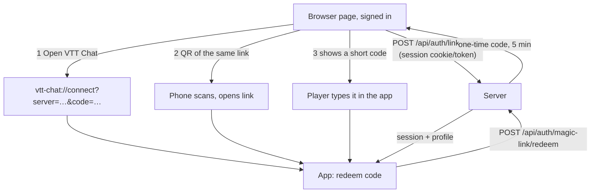
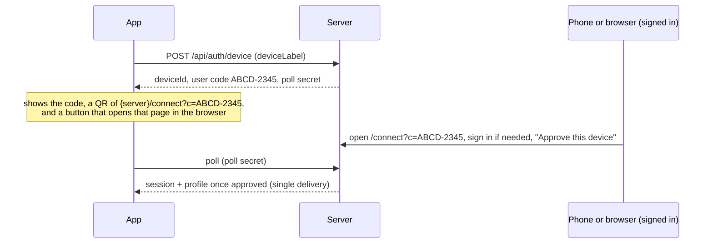

# Signing the desktop app in through the browser

Decided with Andy 2026-11-11 (the principle); **the details below are a proposal awaiting approval. Nothing is built.**
Supersedes the "app signs in with the same email and password" step of [JOIN-FLOW.md](JOIN-FLOW.md).

## Decision

**The desktop app has no sign-in form.** It never sees a password, an emailed code or an SSO redirect. The only
thing it does is *connect*: it is handed a one-time **link code** by a browser page the player is already signed
in on, and trades it for its own long-lived, revocable session.

Why this is acceptable: the app cannot sign in without its server anyway, so an in-app form buys nothing offline.
And it means the server can add or change sign-in methods (password, emailed code, OIDC) with no client release
([SIGN-IN-OPTIONS.md](SIGN-IN-OPTIONS.md)), and there is one sign-in UI to build and keep accessible.

## What already exists (so this is small)

- `POST /api/auth/magic-link/redeem` already trades a single-use, 15-minute code for a session
  (`account.rs::redeem_code`). A *link code* is the same mechanism, issued to an already signed-in browser session
  instead of an email.
- `vtt-chat://connect?server=…` already opens the app with the server pre-filled (`deeplink.rs`).

## Three ways to connect, one server-side primitive

1. **Open VTT Chat button** on the page (deep link). The common case on Windows and macOS.
2. **QR code** on the page. Scanned by a phone that is already signed in, it asks "Connect VTT Chat on your
   computer?"; approving issues the code to the app (see below). This is the path for a PC where the browser has
   no session, and for Linux AppImage where deep links are unreliable.
3. **Typed short code** as the last resort (`ABCD-2345`, grouped, no look-alike characters). Works on every OS
   with no OS integration at all.

All three end in the same redeem call, so every OS has at least one path that works without OS-specific code.

### The app with no code yet (first run, or signed out)

The app shows one screen: the server address (pre-filled by a deep link, or typed) and a **Connect** button. That
starts a *device request*:

This is the standard device-authorisation pattern (as `gh auth login` and TV apps do). It needs a **configured
server** on the app, as Andy noted, and nothing else: no deep link, no clipboard, no OS registration. The phone
sign-in is the human proof.

## Security rules

- Codes are single-use, expire in 5 minutes, are stored hashed, rate-limited, and never logged. The poll secret
  is separate from the user code, so someone who sees the code on a screen cannot collect the session.
- **Approval always names the device** ("Linux, Andy-PC, from 203.0.113.4") and the player must press Approve. A
  stranger's link can therefore never sign the app in as someone else: the code is issued to *their own* signed-in
  session, and the approval screen is explicit.
- A deep-link code is bound to the server it names; the app refuses a code for a server other than the one shown.
- The session the app receives is the existing long-lived, remotely revocable one, listed in the account page's
  "Devices" with a revoke button (new, small).
- Consent-version changes (`needsConsent`) are accepted on the web page before a code can be issued.

## What changes

| Area | Change |
| --- | --- |
| Backend | `POST /api/auth/link-codes` (signed in); `POST /api/auth/device`, `POST /api/auth/device/poll`, `POST /api/auth/device/approve`; reuse redeem. A small table (or Valkey keys with TTL) for pending codes. |
| Web | Last join step becomes "Open VTT Chat" + QR + short code; a `/connect` approval page; account page lists devices. |
| App | Remove the email/password and email-code forms; add the Connect screen, code entry, deep-link `code` param, QR render. Keep session storage and refresh as is. |
| Protocol | New endpoints and a removed client path: a **MINOR** bump and `PROTOCOL_VERSION` 2, per [VERSIONING-AND-DEPLOYMENT.md](VERSIONING-AND-DEPLOYMENT.md). |
| Admin | `vtt-admin user code <email>` stays: it is how an operator signs in someone with no mail and no browser access. |

## My calls (change any of these)

- Link code lifetime 5 minutes (shorter than the 15-minute emailed code, because it is handed over on screen).
- Typed code format: 8 characters from an unambiguous alphabet, shown as two groups of four.
- QR rendered in the app by a small pure-JS library in the panel UI (no Rust or native dependency).
- No PKCE on the deep link: the code is single-use, short, and bound to the server; the device flow has its own
  poll secret. (Adding PKCE later does not change the wire shape much.)

## Not decided

- Whether the existing in-app forms are removed in the same release or after one release of overlap. Since this is
  a MINOR bump and the app and server must match anyway, I recommend removing them at once.
- Mobile account and profile pages ([MOBILE-WEB-APP.md](MOBILE-WEB-APP.md)) are roadmap item 8 and stay separate.
