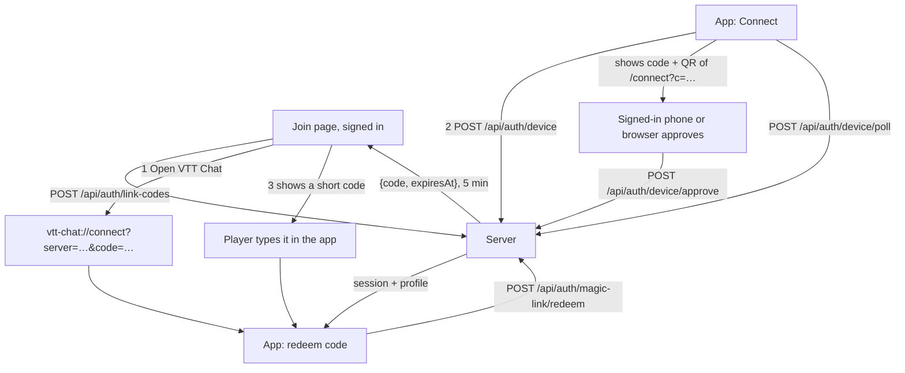
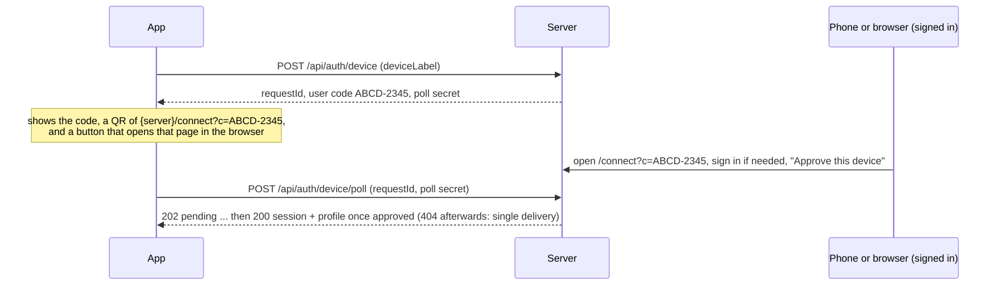

# Signing the desktop app in through the browser

Decided with Andy 2026-11-11. **Status: built 2026-11-11 (server, join page, `/connect` page, app commands, Connect screen) and tested piece by piece; not yet run end to end in a real app window.** See [BUILD-STATUS.md](../BUILD-STATUS.md) for what is unverified. Ships as 0.4 with `PROTOCOL_VERSION` 2.
Supersedes the "app signs in with the same email and password" step of [JOIN-FLOW.md](JOIN-FLOW.md).

## Decision

**The desktop app has no sign-in form.** It never sees a password, an emailed code or an SSO redirect. The only
thing it does is _connect_: it is handed a one-time **link code** by a browser page the player is already signed
in on, and trades it for its own long-lived, revocable session.

Why this is acceptable: the app cannot sign in without its server anyway, so an in-app form buys nothing offline.
And it means the server can add or change sign-in methods (password, emailed code, OIDC) with no client release
([SIGN-IN-OPTIONS.md](SIGN-IN-OPTIONS.md)), and there is one sign-in UI to build and keep accessible.

## What it reused (so this stayed small)

- `POST /api/auth/magic-link/redeem` already traded a single-use code for a session
  (`account.rs::redeem_code`). A _link code_ is the same mechanism (migration `0024_link_purpose` adds a purpose
  to the stored code), issued to an already signed-in browser session instead of an email.
- `vtt-chat://connect?server=…` already opened the app with the server pre-filled (`deeplink.rs`); it now also
  carries `code`, and the app emits `deeplink:connect {server, code}`.

## Three ways to connect

1. **Open VTT Chat button** on the join page (deep link carrying a link code). The common case on Windows and
   macOS.
2. **The app's own device flow.** The app's Connect button starts a device request and shows a code, a QR of
   `{server}/connect?c=…` and an Open in browser button. A phone or browser that is signed in (or signs in there)
   scans the QR or opens the link and approves. This is the path for a PC whose browser has no session, and for
   the Linux AppImage where deep links are unreliable.
3. **Typed code** (`ABCD-2345`, grouped, no look-alike characters) from the join page, into the app's "Have a
   code? Type it here" box. Works on every OS with no OS integration at all. The box also takes any other
   one-time sign-in code (emailed, `vtt-admin user code`, the SSO page's).

The join page has **no QR**: its link is a `vtt-chat://` deep link, which a phone has no app to open, and the app
has no scanner. Every OS has at least one path that works without OS-specific code (2 and 3).

### The app with no code yet (first run, or signed out)

The app shows one screen: the server address (pre-filled by a deep link, or typed) and a **Connect** button. That
starts a _device request_:

This is the standard device-authorisation pattern (as `gh auth login` and TV apps do). It needs a **configured
server** on the app, as Andy noted, and nothing else: no deep link, no clipboard, no OS registration. The phone
sign-in is the human proof.

## Security rules

- Codes are single-use, expire in 5 minutes, are stored hashed, rate-limited, and never logged. The poll secret
  is separate from the user code, so someone who sees the code on a screen cannot collect the session.
- **Approval always names the device** ("Linux, Andy-PC, from 203.0.113.4") and the player must press Approve. A
  stranger's link can therefore never sign the app in as someone else: the code is issued to _their own_ signed-in
  session, and the approval screen is explicit.
- A deep-link code is bound to the server it names; the app refuses a code for a server other than the one shown.
- The session the app receives is the existing long-lived, remotely revocable one. `GET /api/auth/sessions` and
  `DELETE /api/auth/sessions/:id` already exist; the Devices list that uses them waits for the web account page
  ([ROADMAP.md](../../ROADMAP.md) item 8). Until then `vtt-admin user revoke-sessions <email>` is the revoke.
- **Consent.** The app has no consent screen, so the browser takes it before anything reaches the app. The
  `/connect` sign-in shows a changed recording notice and accepts it (version from `/api/auth/providers`, posted
  to `/api/auth/consent`) before the approval screen, as the join and phone pages do. The server enforces it:
  `POST /api/auth/link-codes` and `POST /api/auth/device/approve` answer `403 consent_required` for an account
  whose accepted version is stale. If the notice changes in the seconds between approval and collection, the
  poll still reports `needsConsent`; the app then stops with "the recording notice has changed — sign in on the
  web page to accept it, then connect again" (final, because the delivery is spent). The consent wording
  therefore lives only in the web page.

## What was built (final names)

| Area         | What exists                                                                                                                                                                                                                                                                                                                                                                                                                                                                                                                                                    |
| ------------ | -------------------------------------------------------------------------------------------------------------------------------------------------------------------------------------------------------------------------------------------------------------------------------------------------------------------------------------------------------------------------------------------------------------------------------------------------------------------------------------------------------------------------------------------------------------- |
| Backend      | `POST /api/auth/link-codes` (signed in) returns `{code, expiresAt}`, 5 minutes, 8 characters shown as `ABCD-2345`, redeemed at the existing `/magic-link/redeem`. `POST /api/auth/device` (public, returns `requestId`, `userCode`, `pollSecret`, expiry), `POST /api/auth/device/poll`, `GET /api/auth/device/:userCode` (signed in; describes the device for the approval screen), `POST /api/auth/device/approve` (signed in, 204). Migration `0025_device_requests`. Code in `backend/src/lib/auth/deviceFlow.ts`, `deviceLabel.ts`, `http/authRoutes.ts`. |
| Web          | The last join step is **Connect**: Open VTT Chat (deep link), the typed code and a countdown (no QR, see above). `/connect?c=…` is the approval page, served by the backend's join routes, usable from a phone.                                                                                                                                                                                                                                                                                                                                                |
| App (Rust)   | `account_device_start`, `account_device_poll`, `account_connect_with_code`, `account_open_connect`, `dev_signin_enabled`, `take_pending_connect`; event `deeplink:connect {server, code}`.                                                                                                                                                                                                                                                                                                                                                                     |
| App (panels) | A **Connect** screen replaces the sign-in form, with a "paste a connect link" box and a collapsed Developer sign-in block.                                                                                                                                                                                                                                                                                                                                                                                                                                     |
| Protocol     | `PROTOCOL_VERSION` 2 and a MINOR bump (0.4), per [VERSIONING-AND-DEPLOYMENT.md](VERSIONING-AND-DEPLOYMENT.md). From 0.4 on, apps send `x-vtt-protocol` and are stopped with `426 update_required` when the protocol differs. Releases before it (0.3.2 and earlier) never sent the header, so a 0.4 server does not stop them (their old sign-in calls keep working server-side); a 0.4 app on a 0.3 server gets a 404 from `POST /api/auth/device` and tells the player the server is too old (`server_too_old`).                                             |
| Admin        | `vtt-admin user code <email>` stays: it signs in someone with no mail and no browser access, and a `signin` code works in the app's typed-code box too (the box takes any one-time code).                                                                                                                                                                                                                                                                                                                                                                      |

## The dev switch: `VTT_DEV_SIGNIN`

Started with `VTT_DEV_SIGNIN=1`, the app also honours the old password, emailed-code and SSO commands and shows
the collapsed Developer sign-in block. Without it those Rust commands return `dev_only`, so a normal build has
no password path at all, not merely a hidden one. It exists so development against a scratch server does not need
a browser round trip every time. See [DEVELOPING.md](../../DEVELOPING.md).

## Decisions made while building (and why)

- **Expiry is judged by the client's own deadline**, computed from the remaining lifetime the server reports, not
  by comparing the server's timestamp to the local clock, so a skewed PC clock cannot show a code as expired
  (or alive) wrongly.
- **`account_open_connect` is a narrow command**: it opens only the server's own `/connect` page for the current
  request, never an arbitrary URL, so the panel cannot be turned into a link launcher.
- **Polling has its own limiter** (200 per 5 minutes per request id and IP) so a waiting app polling every couple
  of seconds is never locked out by the stricter budget that guards code guessing. Polling rides out short
  network drops instead of failing the request.
- **Approval is atomic**: one request is approved once, by one user, and delivered once, even if two browsers
  race.
- **Device labels are capped at 80 characters and stripped of control characters** before storage and display,
  because the label is attacker-influenced text shown on the approval screen.
- **A waiting Connect screen stays bound to the server it started on**; a deep link for a different server
  never silently redirects it, and a deep link never signs in by itself: it fills the screen and the player
  confirms.
- **Known gap:** bidirectional-text control characters (U+202A to U+202E, U+2066 to U+2069) are not stripped from
  device labels, so a label can render oddly on the approval page. It cannot change what is approved.

## Security rules

- Codes are single-use, expire in 5 minutes, are stored hashed, rate-limited, and never logged. The poll secret
  is separate from the user code, so someone who sees the code on a screen cannot collect the session.
- **Approval always names the device** and the player must press Approve. A stranger's link can therefore never
  sign the app in as someone else: the code is issued to _their own_ signed-in session, and the approval screen
  is explicit.
- A deep-link code is bound to the server it names; the app refuses a code for a server other than the one shown.
- The join page's browser session is held in memory only and signed out when the page closes.

## My calls (kept)

- Link code lifetime 5 minutes (shorter than the 15-minute emailed code, because it is handed over on screen);
  device requests share it.
- Typed code: 8 characters from an unambiguous alphabet, two groups of four; the typed code and the device user
  code share one alphabet and format.
- The app's QR is rendered by the panel with a small pure-JS library (no Rust or native dependency). The join
  page had one too and dropped it (nothing could use it).
- No PKCE on the deep link: the code is single-use, short and bound to the server; the device flow has its own
  poll secret.
- The in-app forms were removed at once, not after an overlap release, since app and server must match on
  MAJOR.MINOR anyway.

## Not done

- The Devices list with revoke on the web (needs the web account page, roadmap item 8).
- Real-app verification: see [BUILD-STATUS.md](../BUILD-STATUS.md).
