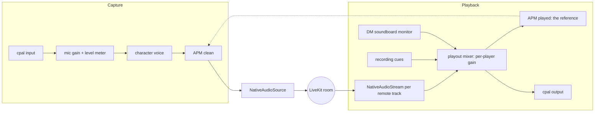

# The mixer engine: our own capture and playback

**Status:** built and wired into calls (2026-11-09), **opt-in and never listened to.** Unit-tested without a sound card, and live-tested against a dev LiveKit server (remote voice reaches the playout mixer, the processed microphone reaches another participant, mute and leave work). The platform audio path stays the default until the mixer has been tried on the dev PC.

**To try it:** Settings → General → Audio → "New audio engine (experimental)", then leave and join voice again. Or start the app with `VTT_AUDIO_BACKEND=mixer`. Switch it off the same way if anything sounds wrong.

**What you get with it:** a microphone volume with a real level meter (Settings, and the meter in the main window), a volume slider for each person (their hover card), echo cancellation that still works while a character voice is on, and the soundboard monitor and recording cues playing through the same mixer so the canceller knows about them.

## Why

Today WebRTC's `PlatformAudio` owns the sound card: it captures the microphone, plays every remote voice, and runs echo cancellation between the two. That is simple and echo-safe for plain voice, but it is a closed box:

| Want                                                                                   | Why the platform path cannot                                                                                          |
| -------------------------------------------------------------------------------------- | --------------------------------------------------------------------------------------------------------------------- |
| Echo cancellation for the DM's **character voices**                                    | The effect path captures the microphone itself, so WebRTC never sees what was played: AEC is off while a voice is on. |
| Echo cancellation for **sound we play ourselves** (soundboard monitor, recording cues) | These use a second output stream WebRTC cannot see, so the microphone hears them and nothing cancels them.            |
| **Per-player volume**                                                                  | No playout volume API in the SDK (checked in 0.10.1's source).                                                        |
| **Microphone gain** and a **real level meter**                                         | No capture gain or level API on that path.                                                                            |

All four come from the same thing: if one piece of our code owns both the input and the output, it can tell the echo canceller exactly what left the speakers.

## The finding that makes it practical

The earlier note ([DM-VOICE-EFFECT.md](DM-VOICE-EFFECT.md)) assumed WebRTC's audio processing was not exposed to Rust. It is: the SDK's WebRTC crate ships `AudioProcessingModule` (echo cancellation, noise suppression, high-pass, gain control) taking plain 10 ms blocks, plus an `AudioMixer` and a resampler. So our own engine keeps WebRTC's AEC3, with the speaker reference supplied by us.

Proof, headless (`engine/processing.rs` tests): a talker plays through a simulated room (50 ms delay, half level) into the microphone; with the canceller on, the echo drops **45.8 dB** after a few seconds; with it off, it stays; and a second person speaking next to the microphone is not silenced. The room is ideal, so a real one will do worse; the point is that the mechanism works in our build.

## Shape

- **One 48 kHz mono, 10 ms world** inside the engine (what WebRTC wants). Device rates and channel counts are converted at the edges only.
- **Layers, each testable without hardware:** `processing` (APM wrapper), `playout` (the mixer: streams, gains, limiter), `capture` (gain, meter, voice, cleaning), `io` (cpal behind small traits, with fakes for tests), then the LiveKit wiring.
- **Mute still releases the microphone** (stop the input stream), as now.
- **The soundboard track and the cues** keep working as they do; their local monitor simply plays _through_ the playout mixer, so the canceller knows about it.

## Decisions and why

- **Opt-in, platform path stays default.** The mixer replaces the part of the app that most needs ears and hardware. It is switched by `VTT_AUDIO_BACKEND=mixer` until it has been listened to on the dev PC, then the default can flip. If it misbehaves, unset the variable.
- **WebRTC's own processing, not a new canceller.** Writing AEC is out of scope for a homelab app; AEC3 is the one browsers use.
- **Delay is estimated, then trimmed.** The canceller is told the output-plus-input latency; a wrong value slows convergence rather than breaking it. Measured on the dev PC, not guessed.
- **No hardware AEC.** The platform path can use a device's built-in canceller where one exists. The mixer does not. Cost: a few percent of one core for AEC3.
- **Clock drift** between the microphone and speakers (separate devices have separate clocks) is handled by the canceller up to a point; the playout buffer absorbs the rest by dropping or repeating a block, never growing without bound.

## How the pieces map to the code

`rust-livekit/src/engine/`: `processing` (APM wrapper), `playout` (the mixer), `capture` (gain, meter, cleaning, then the voice), `rate` (streaming resampler), `duplex` (the two sound-card callbacks as plain functions), `io` (cpal), `mixer_audio` (LiveKit glue), `local` (cues and the soundboard monitor routed into the mixer). `LiveKitClient::connect_with_backend` picks the engine; the app stores the choice in `audio.json` (with microphone volume and each person's volume).

Order inside the microphone path is gain, level, **cleaning, then the character voice**. The reverse would pitch-shift the echo and the canceller could no longer recognise it.

## Sound card library: cpal 0.18

Decided 2026-11-09 after comparing cpal with cubeb-rs (no evidence favoured cubeb; LiveKit's own
`local_audio` example also uses cpal, with a simpler shape than ours: one mutex-guarded sample queue
as the "mixer", a fixed 50 ms echo delay guess, and the reference signal sent over a channel).
We moved from 0.15 to 0.18.2 for the Windows fixes (USB headset mics, default-device recovery) and
stable device ids. The PipeWire, PulseAudio and JACK backends are opt-in cargo features and are
**not** enabled yet (to play with later, on the dev PC): Linux goes through ALSA (which PipeWire serves). Enabling them means adding `features = ["pipewire"]` (or `pulseaudio`, `jack`) to cpal in `rust-livekit/Cargo.toml`, installing the matching dev libraries in the Docker image and CI, and choosing the host at startup instead of `default_host()`. The device list is cached for
5 seconds because repeated enumeration leaks on some Windows backends (cpal#802). Device ids are
still device names, so saved choices keep working.

## Background-noise filter: RNNoise (built 2026-11-10)

RNNoise, as the pure-Rust `nnnoiseless` crate (BSD-3, no native library, a few hundred KB of model weights
inside the binary, about 1% of a core), runs on the mixer engine's 10 ms blocks **after** WebRTC's echo
cancellation and **before** the character voice. The level meter reads what it leaves. Settings, Audio:

| Level    | What it does                                                                                                          | Measured on a real recording of speech*   |
| -------- | --------------------------------------------------------------------------------------------------------------------- | ----------------------------------------- |
| Off      | Nothing (WebRTC's own noise suppression runs as before).                                                              | n/a                                       |
| Light    | 60% filtered, 40% original: gentler, keeps more of the room.                                                          | voice -2.7 dB, room -8 dB                 |
| Standard | Full RNNoise. WebRTC's noise suppression is turned off so the two do not stack.                                       | voice -0.1 dB, room -58 dB                |
| Strong   | Standard plus a **gate**: a block counts as speech only if RNNoise rates three in a row as speech; others drop 20 dB. | voice -0.1 dB, room -77 dB, typing -16 dB |

\*One public-domain sample (the JFK clip shipped with whisper.cpp) scaled to ordinary talking level, mixed with
a synthetic fan (about -34 dBFS, low-frequency noise) and synthetic key clicks. Re-run it on your own
recording: `VTT_SPEECH_RAW=speech.raw cargo test -p rust-livekit real_speech -- --ignored --nocapture`
(`VTT_DENOISE_OUT=<folder>` also writes the mixed input and each level as `.raw` to listen to).

What it is good and bad at, found while measuring:

- **Fans, air conditioning, rumble, room hiss:** very good (50 dB and more on low-frequency noise).
- **A pure steady hum** (one pitch, like 100 or 120 Hz mains hum) is passed as if it were a voice; WebRTC's
  high-pass filter, which stays on, handles the lowest of it. A hum above 150 Hz would need a notch filter.
- **White noise**, unlike any real fan, is also passed (it looks like a fricative to the network).
- **Typing and mouse clicks:** RNNoise alone only softens loud ones (a click looks like speech for a block or
  two). The **Strong** gate is what removes them, because speech keeps looking like speech and a click does
  not. The cost is 20 ms of delay, and a gate can clip a very soft word start; if Strong clips you, use
  Standard.
- **Latency:** Standard and Light add RNNoise's own block (10 ms, already inside our block size); Strong adds
  20 ms more for the look-ahead.
- The filter level is live; WebRTC's noise suppression is chosen when the call starts, so turning the
  filter on mid-call runs both until the next join. Not available on the platform engine (the SDK has no
  hook for it).
- **Not verified by ear:** the numbers above are energy measurements; only listening says how natural it
  sounds, how Strong treats quiet speech, and how it copes with a real keyboard and mouse.

## Automatic microphone volume

WebRTC's gain controller was always on; 2026-11-10 it became a setting (Settings, Audio; default on,
`autoGain` in audio.json). It is fixed when a call starts, so a change applies at the next join. It
applies to both engines. Off means the microphone-volume slider is the only gain. A noise gate with an
automatic threshold (for table noise on open mics) is deliberately separate and not built; it goes
with RNNoise (ROADMAP step 8). The level meter is green, amber from about -15 dB and red on the last
bar; the platform engine can only show on/off because the SDK exposes no level.

## Not verified (needs the dev PC)

Everything past the unit tests: real device behaviour on Windows and Linux (including USB headsets and Bluetooth), measured latency, drift over an hour, CPU, and what it sounds like. `docs/BUILD-STATUS.md` tracks it.
