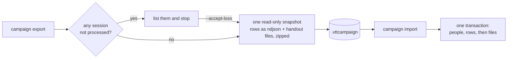

# Exporting and importing one campaign

`vtt-admin campaign export <id> <file>` writes one campaign to a file; `campaign import <file>` brings it back, on the same
server (after a delete) or on another. It is the operator's tool, **not a server backup**: the backup of the database and
the recordings folder is still what protects a whole instance. Decided with Andy, 2026-11-18. Built the same day;
see [BUILD-STATUS](../BUILD-STATUS.md) for what has been run for real.

## What is in the file, and what is not

**Text only.** The audio is the server backup's job (and the operator's, see the retention rules), so a file stays small.

| In the file                                                                   | Left out, and why                                                                          |
| ----------------------------------------------------------------------------- | ------------------------------------------------------------------------------------------ |
| the campaign, its members and roles, characters (with their D&D Beyond sheet) | invite codes (a secret; the DM makes a new one), join requests, notifications, queued jobs |
| chat, whispers included                                                       | sound libraries, soundboards and scenes (they belong to a person, not a campaign)          |
| handouts and their picture/PDF files (the bytes are inside the file)          | portraits (the picture files are not carried; the character's link stays)                  |
| loot, scheduled sessions with RSVPs and reminders                             | the raw audio                                                                              |
| every recording's tracks, timeline, transcript, notes and summaries           |                                                                                            |

## The file: `.vttcampaign`, a zip

```text
Strahd.vttcampaign
├── manifest.json            format, version, the newest migration the exporting server had, campaign name and id,
│                            the members (email, display name), row counts per table, the list of handout files
├── data/<table>.ndjson      one row per line, compressed (chat, transcript segments and the rest)
└── files/<media-id>         each handout picture or PDF exactly as it is, stored, not recompressed
```

Any zip tool opens it (rename to `.zip` if the tool insists), so an operator can read the manifest or take a handout out
without the server. `export` adds the `.vttcampaign` extension if the name lacks it. A server **older** than the file
refuses it. The file contains whispers and transcripts: keep it as private as the database (it is written mode `0600`,
to a `.partial` file that is renamed when complete, so a failed export never leaves a half file under the real name).



## The unprocessed-audio warning

A session that has not been transcribed yet (status other than `processed`: still recording, stopped and waiting, being
processed, or failed) has **no text to export**, and its audio is not in the file. Exporting would lose it from the file.
So the command lists those sessions and stops. The operator either **waits** (`jobs list`) or runs it again with
`--accept-loss` to export without them. Nothing is deleted either way.

## Import

- **Same ids by default.** A restored recording keeps its id, so its audio, restored from the server backup, is found
  again where it was. If the campaign id is still on this server the import refuses; `--as-new` makes a **copy** with fresh
  ids (named "… (copy)"), whose recordings have their audio marked as gone because a copy has none.
- **People are matched by email.** A member with an account here keeps their seat. One without gets a **placeholder account
  with no password**: they sign in by emailed link or single sign-on, or the operator hands them a code. The command lists
  who. Accounts are never overwritten.
- **A session cut off by the export** (still `recording` or `processing`) comes back as `failed`, so nothing looks stuck;
  `recording reprocess` works if the audio was restored.
- **All or nothing.** The database part is one transaction; handout files are written after it and removed again if it fails.

## Why this shape

- **Rows as JSON, driven by a table list** (`TABLES` in `backend/src/lib/campaigns/campaignArchive.ts`): a new column on an
  existing table is carried with no change. A **new table** is not, so a test walks the schema's foreign keys and fails until
  the table is listed or named in `NOT_EXPORTED` with a reason.
- **CLI only, no route**, in line with CLAUDE.md §7 (system operations are the CLI's): no wire change, no protocol bump.
- **A zip, with [fflate](https://github.com/101arrowz/fflate)** (pure JavaScript, no dependencies, about 30 KB). Chosen over
  a gzipped JSON blob by Andy on 2026-11-18 for portability and for a very long-running campaign, which grows: handout files
  are written as real files with no base64 (a third larger before compression, and gzip only gets part of it back), the
  export writes the zip as a stream and reads one handout file at a time, and the import decompresses one table or file
  at a time instead of one whole string. What is still in memory at once: the campaign's rows on export (a transcript is
  text, megabytes even for a long campaign) and the compressed file on import.
