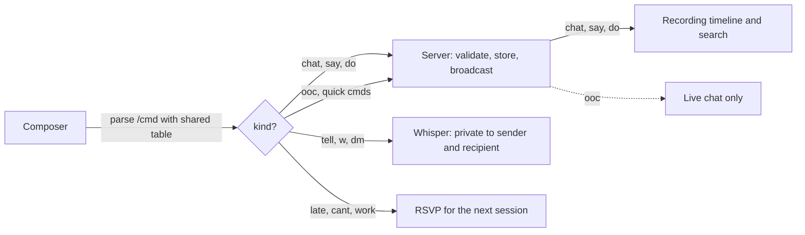

# Chat commands: in character, out of character, whispers and quick messages

Decided with Andy 2026-11-11. **Status: built 2026-11-11** (shared parser, server, web app and desktop app; unit-tested, **not yet seen in a browser or a running window**). Items marked _(my call)_ are my choices, made where
Andy's decisions left a gap; they are the first things to correct. This is the "power of the chat system": one
composer, in the desktop app and in the web app (`/app`), where a leading `/` opens an autocompleting list of commands.

## Why

Table chat has two jobs that fight each other. It is where the table _plays_ (what a character says and does) and
where people _coordinate_ ("running late", "my mic is dead"). Mixing them pollutes the record: the session summary
should not mention that someone was ten minutes late. So every line carries a **kind**, the kind decides how it
looks and whether it reaches the recording, and slash commands are the fast way to choose one.

**An ordinary line, typed with no command, is in character (IC).** Most table chat is the character talking; only
the exceptions need a command.

## The kinds

| Kind    | Typed as                                 | Means                                          | In the recording transcript and summaries? |
| ------- | ---------------------------------------- | ---------------------------------------------- | ------------------------------------------ |
| `chat`  | a plain line                             | in character, ordinary                         | yes                                        |
| `say`   | `/say …` or `/say-<language> …`          | what the character actually says, aloud        | yes                                        |
| `do`    | `/do …` (alias `/me`)                    | what the character does                        | yes                                        |
| `ooc`   | `/ooc …` and the quick commands          | out of character: the people, not the roles    | **no, never**                              |
| whisper | `/tell <name> …`, `/w <name> …`, `/dm …` | private line to one person (existing whispers) | **no, never** (as today)                   |

OOC lines stay visible in the live chat and its scrollback for the table, but are excluded from the transcript, the
summaries and search. _(my call: "stay out" read as out of the **record**, not hidden from the table.)_

## Commands

| Command                       | Does                                                                                              |
| ----------------------------- | ------------------------------------------------------------------------------------------------- |
| `/say <text>`                 | The character speaks. Quoted, with its own style (below).                                         |
| `/say-<language> <text>`      | Speaks in a language, for example `/say-elvish Hi`, `/say-dwarvish Drinks on me!`.                |
| `/do <text>`, `/me <text>`    | An action: _Thorin raises his axe._                                                               |
| `/ooc <text>`                 | Out of character.                                                                                 |
| `/tell <name> <text>`, `/w …` | Whisper to one person at the table. **The name autocompletes** (members only).                    |
| `/dm <text>`                  | Whisper to the DM, no name needed. If you are the DM, it says so instead.                         |
| `/late [note]`                | OOC "running late" (with the note, e.g. `/late 20 min`) **and** RSVP "late" for the next session. |
| `/cant [note]`                | OOC "can't make it" **and** RSVP "no" for the next session.                                       |
| `/work`                       | OOC "still at work" and RSVP "late".                                                              |
| `/brb`, `/afk`, `/back`       | OOC presence notes. No RSVP change.                                                               |

The quick commands post a ready-made line ("Sam is running late: 20 min") so nobody has to type it. With no upcoming
scheduled session they post the chat line only. RSVP values are the existing `yes | late | no`.

`/say-dwarven` is accepted as well as `/say-dwarvish` (a short alias table), because people type what they say.

## Autocomplete

- Typing `/` at the start of the composer opens a list, filtered as you type: the command, a one-line description
  and its usage. **Up/Down** move, **Tab or Enter** complete, **Escape** closes. Typing `/say-` lists the languages.
- After `/tell ` or `/w `, the list becomes the table's members (display or character name), without yourself.
  The inserted name is matched longest-first against the real member list on send, so names with spaces work
  _(my call: no quoting syntax to learn)_.
- A line that merely starts with `/` but names no known command is **sent as plain text**, not rejected, so a
  stray slash never loses a message; the composer warns "no such command" before sending when it is clearly a typo
  of one _(my call)_.
- One shared command table and parser, in `shared/` (TypeScript), used by both composers, so the two never
  disagree. The desktop app's Rust sync client only carries the result; it does not parse.

## Style

Kinds must be told apart without relying on colour alone (accessibility), and must follow the theme and light/dark.

- **`chat`** (IC): the normal bubble, with the character's name. Some theme colour on the name, no decoration.
- **`say`**: set in quotation marks with a serif, slightly larger face, so speech reads as speech.
  _(my call: Andy asked for "a different text decoration or similar".)_
- **`do`**: italic, prefixed with the name, no bubble background, like a stage direction.
- **`ooc`**: smaller, muted, a dashed edge and a small "OOC" tag. A screen reader hears "out of character".
- **Whispers**: as today.

### Languages

`/say-<language>` **does not change the text**. It changes how it is _set_ and adds a small inscription so
everyone knows what was spoken: a per-language style preset (a font stack and letter-spacing, chosen to suggest the
tongue: flowing for Elvish, blocky for Dwarvish, angular for Infernal) and a caption such as _"in Elvish"_ under the
line. The caption is real text, so it is read by assistive technology and copied with the message. _(my call:
bundled web fonts, fetched only when used (see below); a language falls back to a system stack if a font cannot load.)_

Built-in languages (the D&D 5e set, one table in `shared/`): Common, Dwarvish, Elvish, Giant, Gnomish, Goblin,
Halfling, Orc, Abyssal, Celestial, Draconic, Deep Speech, Infernal, Primordial, Sylvan, Undercommon, Thieves' cant,
Druidic. The `lang` sent over the wire is a key from this table; the server rejects anything else.

### Fonts

Each style has its own typeface: Cormorant Garamond (flowing: Elvish, Sylvan, Celestial), Alfa Slab One (blocky: Dwarvish,
Giant), Pirata One (angular: Infernal, Abyssal and similar), Fredoka (rounded: Halfling, Gnomish), Caveat (scratchy: Goblin,
Orc), Cinzel Decorative (arcane) and Share Tech Mono (mono). They are **bundled with each client, never loaded from the
internet**, and an `@font-face` file is downloaded by the browser only the first time a line in that style is shown, so a
table that never speaks Goblin never fetches the Goblin font. All seven add up to about 150 KB in the build (the largest is
51 KB), and nothing loads at startup. The table lives once in `shared/` (`LANGUAGE_STYLE_CSS`) and both clients import the
font files from `languageFonts.ts`. The fonts are SIL Open Font Licence 1.1 and come from the Fontsource npm packages, which
carry their licence files into the build. A font that cannot load falls back to a system stack, and the "in {language}"
caption keeps the meaning either way. The first use of a style can flash the fallback face for an instant (`font-display:
swap`).

### Future: polyglots (not designed in detail, not built)

Masking a language for people who do not speak it needs the server to know each character's languages and to send
each recipient either the text or a masked version, so the original never reaches someone who cannot read it
(masking in the client would leak it). The wire model keeps that open: the language travels as its own `lang` field
and the **text is never altered by the speaker's client**. Open questions for then: what the recording keeps (the
original, or only what an average listener would understand) and how a DM sees everything.

## Wire and storage

- `ChatMessage` (backend/src/types) gains `kind: 'chat' | 'say' | 'do' | 'ooc'` (default `chat`) and an optional
  `lang` (only valid on `say`). Whispers keep `recipientId` and are always `chat`-styled.
- Client to server: the existing chat-send message carries `kind` and `lang`. Server to clients: the existing
  chat-line event carries them back. The server validates `kind` and `lang` against fixed lists and applies the
  existing length limits to `text`.
- OOC is the rare case, so the model is "everything is IC unless marked": the new `kind` column defaults to `chat`
  (existing rows and old clients need no migration), and keeping OOC out of the record is one filter on
  `kind !== 'ooc'` where chat reaches the recording and search, not a rule spread across the system.
- The recording timeline's `onChat` hook (`backend/src/lib/recording/capture.ts`) skips `ooc`, so OOC never
  reaches the transcript, summaries or search. A test pins this.
- Old clients that ignore the new fields show every line as plain `chat`, which fails safe (OOC just looks like
  normal text on screen) but **would not** be kept out of the record by them: that exclusion is on the server, so it
  holds for every client.
- **Version:** these are additive fields on the `chat` messages. The 0.4 line is unreleased, so no extra bump is
  needed _(my call)_; once 0.4 ships, a change like this bumps MINOR and `PROTOCOL_VERSION` as usual
  ([VERSIONING-AND-DEPLOYMENT.md](VERSIONING-AND-DEPLOYMENT.md)).
- **Recording notice:** the wording promises less than before for OOC (typed OOC is no longer recorded), so the notice
  needs no change.

## Build order (when approved)

1. `shared/`: the command table, the language table and aliases, the parser, with tests.
2. Backend: `kind` and `lang` on chat messages (both stores), validation, the `onChat` OOC skip, RSVP side effect
   for `/late` `/cant` `/work`, tests.
3. Web app (`/app`): composer with autocomplete, the kind styles and language captions.
4. Desktop app: the same composer behaviour and styles in the panels (Rust only carries the fields).
5. Docs: RECORDING-AND-SUMMARIES.md (OOC is not recorded), SYNC-PROTOCOL.md (the fields), USER-GUIDE.md (the commands).
