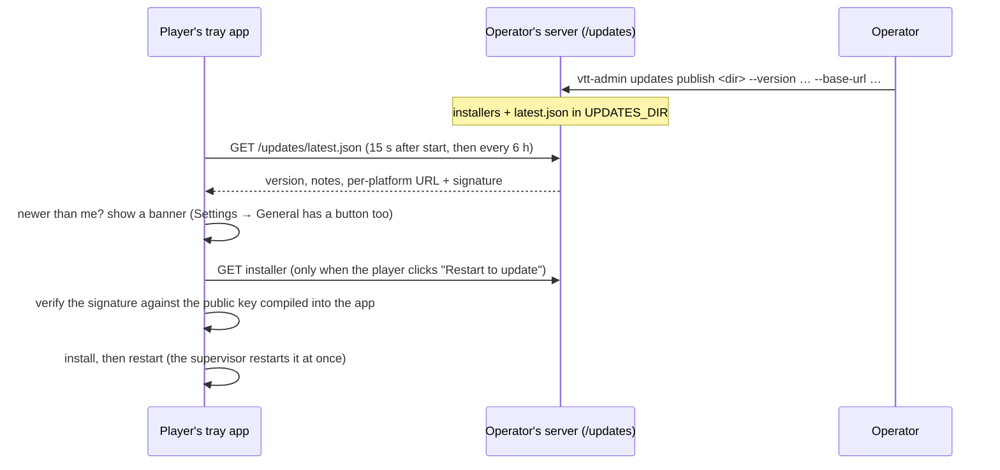

# Client updates

The tray app updates itself from **the server the player is signed in to** — the same self-hosted
box that runs their table. Decided with Andy 2026-11-08: auto-update **yes**; installs only on a click.



## Why it is shaped this way

- **The signature is the trust, not the server or the transport.** The public key is in
  `tauri.conf.json`; a forged or tampered installer fails verification, so plain `http://` LAN servers
  are allowed (`dangerousInsecureTransportProtocol`) and the endpoint is static files.
- **The endpoint is the player's own server** (set at runtime from the saved server address), because
  every operator hosts their own players. It follows that the operator decides when players move to a
  new build; there is no central update server, in keeping with self-host-first.
- **Never restarts on its own.** A restart drops the player out of the room mid-session, so the app only
  *offers* ("Version 0.3.0 is ready"), and installs on the click. A check that finds nothing, finds no
  server, or hits a server without updates is silent.
- **Cross-platform:** the updater is Tauri's own (`tauri-plugin-updater`), one code path for Windows,
  macOS and Linux.
- **With crash recovery:** after installing, the app exits with code 75; the supervisor
  (`supervisor.rs`) treats that as "start the new build now", not a crash.

## Keys (do this once; do not lose it)

```bash
npx tauri signer generate --ci -p "" -w ~/.tauri/vtt-chat-updater.key   # private key + .pub
```

- The **public** key (`~/.tauri/vtt-chat-updater.key.pub`) is already in `tauri-client/src-tauri/tauri.conf.json`.
- The **private** key signs every release. **Back it up somewhere safe and never commit it.** If it is
  lost, installed apps can never update again (they only trust the old public key) and every player must
  reinstall by hand. The current key was generated **without a password** for convenience on the dev
  machine; generate one with a password (`-p`) before real releases and keep it in your password manager.
- Anyone with the private key can push code to every player's machine. Treat it like a production secret.

## Releasing

1. Bump the version in `tauri-client/src-tauri/tauri.conf.json` (and `Cargo.toml`).
2. Build the signed installers (needs `bundle.active: true`, the signing key in the environment):
   `TAURI_SIGNING_PRIVATE_KEY_PATH=~/.tauri/vtt-chat-updater.key npx tauri build` in `tauri-client/`.
   Do this on each OS you ship for (Windows, macOS, Linux); the bundler writes an installer plus a
   `.sig` file beside it.
3. Gather the installers and `.sig` files from the OSes into one folder and publish on the server:
   `vtt-admin updates publish <folder> --version 0.3.0 --base-url https://play.example.com/updates --notes "…"`
   (Compose: `docker compose cp <folder> backend:/tmp/rel && docker compose exec backend node backend/dist/cli/main.js updates publish /tmp/rel …`).
   An installer without a `.sig` is refused, not skipped.
4. `vtt-admin updates status` shows what players are being offered. Players see the banner within hours,
   or immediately via Settings → General → Check for updates.

## Status

Built and unit-tested: the `/updates` endpoint (incl. no directory listing, no path escape, no-cache),
`latest.json` generation and `updates publish/status`, the endpoint URL, the exit-75 restart rule, the
banner and the Settings button. **Not verified end to end**: a real signed installer being downloaded,
verified and installed (see BUILD-STATUS.md).
