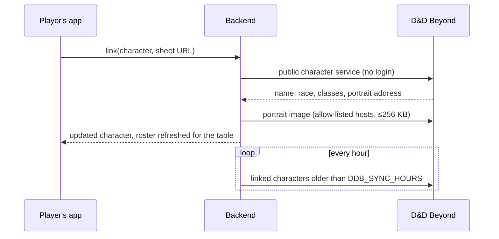

# D&D Beyond character sync

**Optional, off by default.** Nothing in the default install contacts D&D Beyond. The operator turns the sync on with `DDB_SYNC=1` (Compose: in `.env`; native: in the backend's env file). `DDB_SYNC_HOURS` (default 12) is how stale a linked character may get before the server refreshes it.

## What it does

A player links one of their characters, on the **Campaign → Character** screen, to the public sheet address. The server reads the sheet and keeps these fields in step: **name, race, class (a multiclass reads "Fighter 3 / Wizard 2"), total level, portrait**. "Sync now" refreshes on demand; a server timer (hourly check) refreshes anything older than the interval. Unlinking leaves the character exactly as it was.

## Decisions and why

- **Server-side, not in the client.** One place talks to a third party, the operator controls it, and the timer works while nobody's app is open.
- **Public sheets only, no login or cookie.** The sheet must be shared publicly on D&D Beyond; a private one answers "set its sharing to public". The previous design's cobalt-cookie flow is archived and not used.
- **The link is server-controlled.** A character's source link can only be set through the sync (which checks the sheet), never by editing the character, so a stored link is always a real D&D Beyond sheet.
- **A failed sync changes nothing.** D&D Beyond being down or the sheet going private keeps the last good data and tries again on the next tick.
- **A portrait you chose yourself is kept** until D&D Beyond's own portrait changes (the last imported address is remembered). The image is fetched into our own storage, only from `dndbeyond.com` / `cursecdn.com`, only as a real image (checked from its bytes), and only if it fits the avatar size limit; otherwise the existing portrait stays.
- **Honest request identity.** The server identifies itself as this app; it does not imitate a browser.
- **Unofficial endpoint.** D&D Beyond has no public API. The character service the sheet itself uses can change shape; the parser reads only the few fields above and treats anything unexpected as "unreadable" rather than failing. **This has not been run against the live service** (no network check was possible from the build box): the first real link is the test, and `ddb/src/lib/parseCharacter.ts` is the one place to adjust.

## Later (not built)

Stats, AC, passive perception and max HP. They need a place in the character screen first; the parser and stored model are built to grow.
