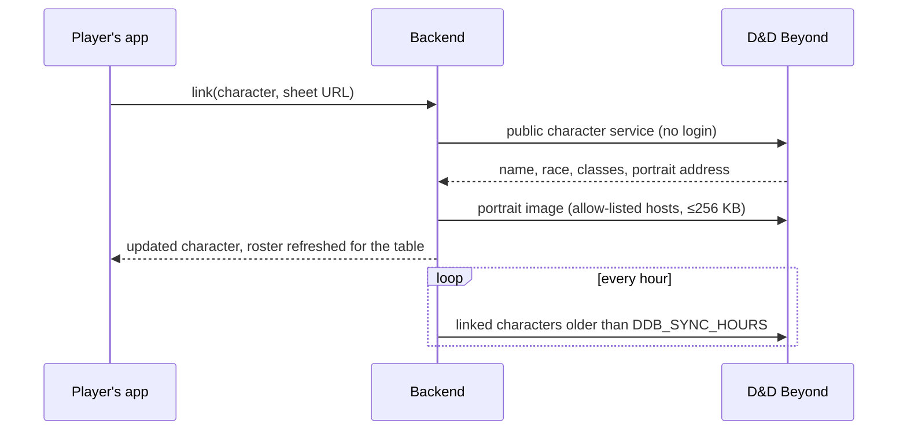

# D&D Beyond character sync

**Optional, off by default.** Nothing in the default install contacts D&D Beyond. The operator turns the sync on with `DDB_SYNC=1` (Compose: in `.env`; native: in the backend's env file). `DDB_SYNC_HOURS` (default 12) is how stale a linked character may get before the server refreshes it.

## What it does

A player links one of their characters, on the **Campaign → Character** screen, to the public sheet address. The server reads the sheet and keeps these fields in step: **name, race, class (a multiclass reads "Fighter 3 / Wizard 2"), total level, portrait**. "Sync now" refreshes on demand; a server timer (hourly check) refreshes anything older than the interval. Unlinking leaves the character exactly as it was.

## Decisions and why

- **Server-side, not in the client.** One place talks to a third party, the operator controls it, and the timer works while nobody's app is open.
- **Public sheets only, no login or cookie.** The sheet must be shared publicly on D&D Beyond; a private one answers "set its sharing to public". The previous design's cobalt-cookie flow is archived and not used.
- **The link is server-controlled.** A character's source link can only be set through the sync (which checks the sheet), never by editing the character, so a stored link is always a real D&D Beyond sheet.
- **A failed sync changes nothing.** D&D Beyond being down or the sheet going private keeps the last good data and tries again on the next tick.
- **The sheet's portrait wins while a character is linked** (decided 2026-11-18, Andy; before this a picture the player chose was kept). It is imported on link, when the sheet's own portrait changes, and again when the character has no picture (an earlier import failed), so a failure retries on the next sync. The server refuses to change the picture of a linked character (`409`, like the name); unlinking keeps the picture and gives the choice back. The image is fetched into our own storage, only from `dndbeyond.com` / `cursecdn.com`, only as a real image (checked from its bytes), up to 8 MB, and **shrunk to a 256-pixel square (WebP) with `sharp`**. That step was missing at first: D&D Beyond ignores the `?width=` in the address and serves the original upload (the test sheet's was a 1.9 MB PNG), which the 256 KB avatar limit skipped without a word, so no portrait ever imported. `sharp` ships prebuilt for glibc and musl (the Compose image), has no runtime service and adds about 15 MB to the install.
- **Honest request identity.** The server identifies itself as this app; it does not imitate a browser.
- **Unofficial endpoint.** D&D Beyond has no public API. The character service the sheet itself uses can change shape; the parser reads only the few fields above and treats anything unexpected as "unreadable" rather than failing. **This has not been run against the live service** (no network check was possible from the build box): the first real link is the test, and `ddb/src/lib/parseCharacter.ts` is the one place to adjust.

## Editing a linked character (decided 2026-11-18, Andy: option A)

While a character is linked, **the sheet owns its name, race, class and level**: the server refuses a change to any of
them (`409`), and both apps show the fields read-only with a note ("change them on the sheet, then Sync; the picture
stays yours"). Before this, an edit was accepted and silently put back by the next sync (every `DDB_SYNC_HOURS`).
Unlink to take the character back. The portrait is always the player's.

**Where to link:** the desktop app's Settings → Character (expand a character) and the phone web app's menu → **My
characters**. Both say so when the operator has not enabled the sync (`DDB_SYNC=1`), instead of hiding the box.

Not built, and needs a protocol bump (the character update body would change): **overriding the worked-out numbers**
(HP, AC, passive perception, ability scores), which can be wrong for unusual builds. It is planned for 0.6.0
(ROADMAP Stage 11).

## At-a-glance numbers (built 2026-11-10, unverified against a real sheet)

A sync also stores ability scores, max hit points, armor class and passive perception (`characters.sheet`, shown under the character's name in Settings). **D&D Beyond does not send these finished, so `ddb/src/lib/parseSheet.ts` works them out**, and the app says so in a tooltip:

- **Ability scores:** base + bonus stats + `bonus` modifiers for that score; `set` modifiers (a belt that makes Strength 19) only raise it; an override replaces it.
- **Max HP:** the sheet's override if there is one, else base + bonus + Constitution modifier x level.
- **Passive perception:** 10 + Wisdom modifier, plus proficiency (or double for expertise), plus `passive-perception` bonuses (Observant).
- **Armor class:** equipped body armour by type (light + Dexterity, medium + Dexterity up to 2, heavy as is), a shield on top, 10 + Dexterity with none, plus `armor-class` bonuses.

**Modelled:** unarmored AC formulas that add an ability (Unarmored Defense, Draconic Resilience) and per-level hit points (Draconic Resilience, Tough). **Not modelled:** Mage Armor and other spell effects, flat hit-point grants from consumables, and conditional bonuses, so those builds can differ from the sheet. The fixtures are written from the known shape of the reply. One real sheet (a level 5 Draconic Sorcerer, 2026-11-11) was compared by hand and caught the two gaps above; **compare a few more**, ideally a Barbarian or Monk, and adjust `parseSheet.ts`. A later read that has no ability scores keeps the last good numbers.

## Later (not built)

Spell slots, saving throws and skills.
