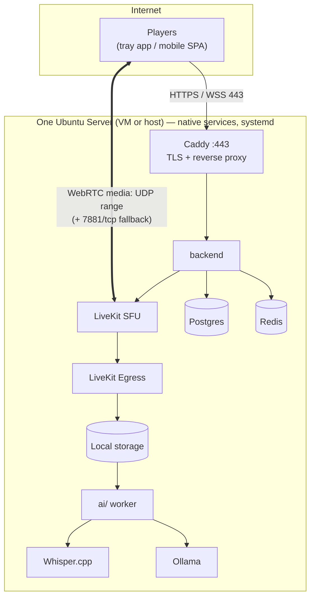
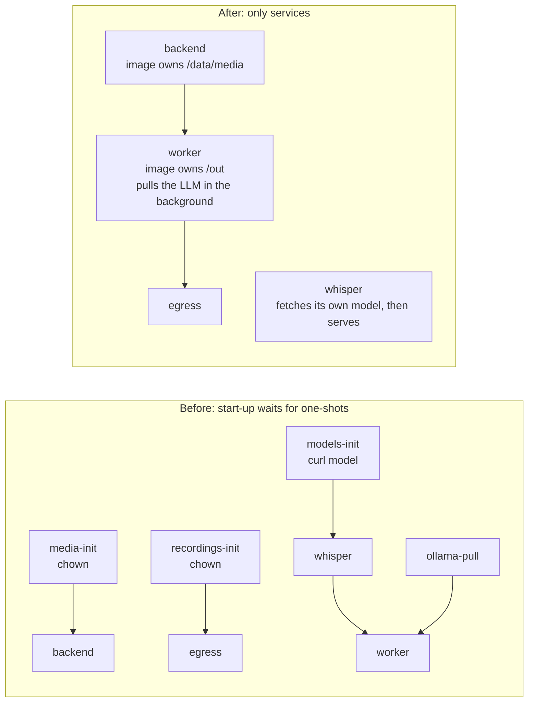

# Deployment & Transport

How an operator stands up their own instance, what network they must provide, and what is optional.

**Principle (decided 2026-11-05): self-host first, zero cloud reliance.** The default install runs
everything on one server the operator controls, with no third-party account. Cloudflare and other
cloud services are **optional adapters for advanced users** and must never be load-bearing. Other
people are expected to deploy their own instance, so every step must be documentable by someone who
is not Andy.

## Default topology

## Ports the operator must provide

Only the operator opens anything; players configure nothing. **Opening UDP for voice is accepted**
(decided 2026-11-05).

| Port                                        | Proto | Required   | Purpose                                                               |
| ------------------------------------------- | ----- | ---------- | --------------------------------------------------------------------- |
| `443`                                       | TCP   | yes        | Caddy: HTTPS API, WebSocket, status page, SPA, client downloads       |
| `80`                                        | TCP   | yes (ACME) | Caddy certificate issuance / http→https redirect                      |
| LiveKit media range (default `50000–60000`) | UDP   | yes        | WebRTC media. The range is configurable — narrow it for a small group |
| `7881`                                      | TCP   | yes        | LiveKit ICE-over-TCP fallback for clients that can't use UDP          |
| `7882`                                      | UDP   | optional   | Single-port UDP mux, an alternative to the range                      |
| `3478/udp`, `5349/tls`                      |       | optional   | LiveKit's **built-in** TURN, for restrictive networks                 |

Signalling (`7880`) sits behind Caddy and is not exposed directly.

### Why STUN alone is usually enough

Players connect to the SFU, never to each other. The SFU is the public-facing side of every
connection, so a client behind NAT (even CGNAT) only needs outbound UDP and its own reflexive
address. That makes STUN plus the TCP fallback sufficient for most networks.

### Restrictive networks (hotel wifi, corporate, school)

Some networks block UDP and every port except 443. Options, in the order we recommend them:

1. **LiveKit built-in TURN/TLS on 443** — native to the LiveKit binary, no extra service, no
   third party. Off by default; an operator toggle. This is the self-host answer.
2. **7881/tcp ICE fallback** — already on, covers networks that allow arbitrary outbound TCP.
3. **Cloud TURN (e.g. Cloudflare TURN)** — _advanced, optional._ Useful when the operator can't
   open a UDP range at all, or wants relays near players. It is configured as an extra ICE server
   in LiveKit/client config. It is a convenience, not a dependency; nothing may require it.

### What does _not_ work

**Cloudflare Tunnel cannot carry WebRTC media** (UDP) or the TCP ICE fallback. It can front the
HTTPS/WSS paths only. An operator who uses a tunnel for the web side still has to expose the media
ports directly, or fall back to option 3.

## Optional adapters (advanced users)

All behind an explicit config switch, all absent from the default install, and none may be assumed
by application code:

| Adapter                          | What it replaces                          | Why someone would want it                                                                                                                                                                      |
| -------------------------------- | ----------------------------------------- | ---------------------------------------------------------------------------------------------------------------------------------------------------------------------------------------------- |
| Cloudflare TURN                  | nothing (adds relays)                     | Can't open UDP; players on hostile networks                                                                                                                                                    |
| Cloudflare Realtime SFU          | self-hosted LiveKit                       | Don't want to run an SFU. Large change: it affects tokens, rooms, egress — treat as a separate, later design. LiveKit and Cloudflare SFU overlap (both SFU + TURN); the system targets LiveKit |
| Cloudflare Pages / Workers       | serving `web/` and `status/` from the box | Offload static hosting                                                                                                                                                                         |
| Workers AI, OpenAI, Claude, etc. | local Whisper.cpp / Ollama                | Underpowered server, or better quality                                                                                                                                                         |
| Authelia / OIDC                  | built-in identity                         | Operator already runs SSO (depends on the identity decision)                                                                                                                                   |

Any adapter that sends session audio or transcripts off the server must be an explicit operator
decision and must be visible to users (see [RECORDING-AND-SUMMARIES.md](RECORDING-AND-SUMMARIES.md) privacy rules).

## Install model

Three tiers, decided 2026-11-07 (rationale: Docker is the lowest-friction way for _other people_
to stand this up, and LiveKit Egress is only officially distributed as a container image):

1. **Docker Compose on a VM or real server — primary.** One compose file for Caddy, Postgres,
   Valkey, the backend, LiveKit, Egress and the `ai/` worker; Whisper.cpp/Ollama containers are
   optional (see "AI backends"). **LiveKit runs with host networking**: a container-NATed UDP port
   range is slow to start and breaks ICE candidates. A VM or bare host is the target.
2. **Native — advanced users.** A **bash install script** on a blank Ubuntu Server installs and
   configures the same services under systemd, generates secrets and config. Optional one-line
   `curl` installer. Kept working; not the quick-start path.
3. **LXC — optional, operator's risk.** The native install inside a container. Known gotchas:
   `net.core.rmem_max`/`wmem_max` must be raised on the _host_; GPU passthrough needs matching
   host/guest drivers; Docker-in-LXC needs `nesting=1,keyctl=1` and is not recommended.

Both tiers must generate the same configuration; application code never branches on the tier.

### Start-up and idle cost

Two things about the Compose bundle were changed in ROADMAP Stage 9, both measured first: the health checks (0.5.1) and
the one-shot containers (0.5.2). Neither changes the protocol, so both are patch releases.

**Health checks were the stack's share of the idle CPU.** Andy saw the test server (4 vCPUs of a 2010 Xeon E5645) sit at about 15% CPU with
nobody connected. Measured over 60 s on 2026-11-16, as a share of **one** core:

| Container | Long-lived processes | Whole container (with health-check commands) |
| --------- | -------------------- | -------------------------------------------- |
| backend   | 0.17%                | 6.65%                                        |
| ollama    | 0.13%                | 5.58%                                        |
| egress    | 1.17%                | 3.89%                                        |
| postgres  | 0.20%                | 2.90%                                        |
| valkey    | 0.67%                | 2.75%                                        |
| whisper   | 0.02%                | 0.99%                                        |
| livekit   | 0.52%                | 0.51% (no health check)                      |
| worker    | 0.10%                | 0.11% (no health check)                      |

Our own code was idle (backend 0.17%, worker 0.10%). The cost was the health checks: **43 commands a minute** launched
inside containers by Docker (every 5 to 15 s per service), two of them expensive (a second Node process to `fetch` the
backend's health; the whole `ollama` binary to run `ollama list`). That was about 20 to 27% of a core spent inside the
containers. `dockerd` and `containerd` used about as much again, which was first put down to launching those commands;
the measurement after the fix (below) showed that part has a different cause. Together: roughly half a core, which is the
13 to 15% of a 4-core machine that was seen.

What changed:

- **Fast only while starting.** Every health check uses `start_interval: 2s` inside a 60 s `start_period`, then
  `interval: 60s`. `up --wait` and `depends_on: service_healthy` are as quick as before (a fresh stack is healthy in about
  6 s on the dev PC); at rest it is 6 commands a minute, not 43. Needs Docker Engine 25 or newer; `get.sh` checks.
- **Cheap commands.** The backend check is busybox `wget` (was `node -e fetch`); Ollama's is a plain HTTP GET from bash
  (was `ollama list`).
- Nothing reads the health state at rest except `vtt-admin ps`; the status page and `vtt-admin status` probe the services
  themselves. A minute's staleness in `ps` is the whole price.

Measured after on the dev PC (a much faster CPU, so the absolute numbers are small): commands 43 → 6 a minute, the
containers' CPU 5.7% → 2.4% of a core.

Measured on the 2010 Xeon, 2026-11-16, before (`0.5.1-dev.1`, 120 s) and after (`0.5.1-dev.2`, 180 s and 60 s), as a
share of one core:

| What                       | Before | After     |
| -------------------------- | ------ | --------- |
| All containers together    | 26.7%  | 6.4%      |
| of which backend           | 5.85%  | 0.6%      |
| of which ollama            | 4.33%  | 0.2%      |
| of which postgres + valkey | 5.2%   | 1.3%      |
| of which egress            | 3.6%   | 3.1%      |
| `dockerd` + `containerd`   | 28.4%  | 27%       |
| Whole machine              | 52.8%  | 34 to 37% |

So the stack itself went from about a quarter of a core to 6%, and half of what is left is Egress (its headless Chrome
and PulseAudio stay up between recordings). The machine as a whole went from about 13% to about 9% of its 4 cores.

**The Docker daemon's 27% is not the health checks and not this stack.** A profile of `dockerd` (`perf`, 60 s) put its
time in listing and inspecting images (`ImageService.Images` → `walkReachableImageManifests`, every manifest read from
containerd over gRPC). The only client on the Docker socket was a host monitoring agent on that VM, which every 30 s asks
for `images/json?all=1`, inspects each image and each container. With Docker 29's containerd image store that walk is
expensive, and the VM held **52 images (19 GB)**: eight past versions of each of our four images, because an update pulls
the new ones and removes nothing. Two lessons for operators, neither a code change in the stack:

- A monitoring agent that lists Docker images on a short interval costs real CPU on an old machine; lengthen its interval
  or turn off its image collection.
- Old images pile up after updates. From 0.5.2 the installer (so `vtt-admin update` too) removes VTT Chat's own images
  from versions older than the one just replaced, after the new version is healthy; the replaced version stays as the
  quick way back, other software's images are never touched, and `--keep-images` turns it off. Third-party images the
  bundle has moved on from (an older LiveKit, say) are left for `docker image prune -a`.

**Confirmed 2026-11-16.** After the old images were pruned (52 → 11) and the agent's interval raised from 30 s to 5 min,
a 10-minute sample on the same VM read: all containers 5.1% of a core, `dockerd` + `containerd` 2.4% (was 27%), the whole
machine **8.8% of one core**, about 2% of its 4 cores (it started at 52.8%). The two changes were made together, so their
separate effects were not measured.

**No one-shot containers.** The bundle used to run four containers that did one job and exited (`media-init`,
`recordings-init`, `models-init`, `ollama-pull`). They added start-up ordering, two extra images, and made the first
`up --wait` take as long as two model downloads. They are gone:

| Was               | Now                                                                                                                                                                                                                                                                                    |
| ----------------- | -------------------------------------------------------------------------------------------------------------------------------------------------------------------------------------------------------------------------------------------------------------------------------------- |
| `media-init`      | The backend image owns `/data/media` as uid 1000. Docker gives a new, empty named volume the ownership of the image directory it is mounted on, so nothing runs.                                                                                                                       |
| `recordings-init` | The worker image owns `/out` as uid 1001 (the user Egress writes as) and the worker **runs as** 1001, and Egress starts after the worker so the worker's image seeds the volume. This also fixed a bug: the worker used to run as uid 1000 and could not delete raw audio (see below). |
| `models-init`     | `whisper-start.sh`, the Whisper container's entrypoint in all three variants (stock, compatibility, CUDA), downloads the model when it is missing (resumable, retried for ever with a growing pause), then becomes `whisper-server`.                                                   |
| `ollama-pull`     | The worker checks Ollama for the summary model at start-up and asks it to pull a missing one (`ai/src/lib/localAi/`), in the background.                                                                                                                                               |

Rules that came out of the design:

- **A download never holds up start-up.** The stack is healthy in seconds. Only the work that needs a model waits: a
  transcription waits for Whisper to answer, a summary for the model, each for up to 30 minutes per attempt before the job
  fails and is retried in the usual way.
- **A download that fails or stalls is visible.** The worker writes what it knows to the database
  (`instance_settings.local_ai`); `vtt-admin status` prints it (`FAIL local AI ...` with the reason) and the public status
  page shows "Summary model: Downloading (43%)", "Download failed" or "Download has stalled" (states only, never the error
  text). The Whisper container's health check passes while a download attempt is running and fails between failed attempts.
- **A remote-only install fetches nothing it will not use.** Under the `records-remote` profile there is no Whisper or
  Ollama container to download into. Under `records` with summaries on a remote server _and_ the local fallback switched
  off, the worker does not pull the model; if the setting changes later, the first job that needs it fetches it.
- **The worker starts after the backend is healthy**, because the backend creates the database schema. (The one-shots used
  to hide this race by being slow.)
- **The native install is unchanged** apart from the worker also pulling a missing Ollama model, which `install.sh` already does.

**The purge bug this found.** With `recordings-init` the volume belonged to uid 1001 with mode 755 and the worker ran as
uid 1000, so in the Compose install every deletion of raw audio (the age rule, the disk rule, `vtt-admin recording purge`,
the DM's "delete the audio") failed with "permission denied". Confirmed on the running dev stack before the change, and
fixed by running the worker as uid 1001. Backups and restores now read and write the volumes through throwaway containers
of the backend and worker images (as root, then `chown`), since the busybox one-shots they borrowed are gone.

### Container privileges, fixed versions and HSTS (2026-11-17)

Three hardening changes for 0.5.2, each chosen so a deployment that worked before still works.

- **Privileges.** Every Compose service has `no-new-privileges` and `cap_drop: [ALL]`, and adds back by name only what it
  needs. Checked on the dev PC by reading `/proc/1/status` in each container and running the end-to-end records test.

  | Service                 | Runs as          | Capabilities added back                   | Why                                                                                  |
  | ----------------------- | ---------------- | ----------------------------------------- | ------------------------------------------------------------------------------------ |
  | backend, worker, egress | uid 1000 / 1001  | none                                      | never root                                                                           |
  | ollama                  | root             | none                                      | only writes its own root-owned volume                                                |
  | postgres, valkey        | root, then drops | `CHOWN DAC_OVERRIDE FOWNER SETGID SETUID` | the image takes ownership of its volume and switches to its own user                 |
  | livekit                 | root             | `DAC_READ_SEARCH NET_BIND_SERVICE`        | `livekit.yaml` is mode 600 and owned by the operator; a low port if TURN moves there |
  | caddy                   | root             | `DAC_READ_SEARCH NET_BIND_SERVICE`        | ports 80 and 443; reads the mounted `Caddyfile` and `tls.d` whatever their mode      |
  | whisper                 | root             | `DAC_READ_SEARCH`                         | reads the mounted `whisper-start.sh` whatever its mode                               |

  Found on the way: without `DAC_READ_SEARCH`, LiveKit restart-looped on `open /etc/livekit.yaml: permission denied`.
  The file is private on purpose (it holds the API secret), so the container gets read access back and nothing else.

- **Fixed versions.** `ollama/ollama:latest` and `cloudflared:latest` are now version tags, and whisper.cpp, which
  publishes only a moving `main`, is pinned by digest to the build tested on 2026-11-14. Each has an override in `.env`.
  The cost is that upstream fixes arrive with our releases, not by themselves; the gain is that an update never changes
  the AI stack under a release that was not tested with it. Still floating: `whisper-cuda.Dockerfile` builds whisper.cpp
  from `master` (the GPU path builds on the operator's machine), and the base images follow their major version
  (`postgres:17-alpine`, `valkey:8-alpine`, `node:26-alpine`, `caddy:2`).

- **HSTS** is the installer's job, not the Caddyfile's, because the Caddyfile serves every kind of install: `localhost`
  with Caddy's own CA, plain HTTP behind a tunnel, and real certificates. Only the last should send it. `get.sh` writes
  `tls.d/hsts.caddy` after it has seen `https://<domain>` answer with a valid certificate, reloads Caddy, and never
  rewrites an existing file. `max-age` is 30 days and covers the one hostname: long enough for a weekly group, short
  enough that a mistake heals, and no claim over the rest of the operator's domain.

- **Not changed.** The `ufw` rule that admits `192.168.0.0/16` to 7880 (a Docker network can be in that range, and
  LiveKit's signalling needs a signed token anyway), and Valkey without a password (loopback only; a password touches
  LiveKit, Egress and every existing install's generated config, for a threat that needs a shell on the server).

### AI backends: local or remote

Decided 2026-11-07. Whisper and the LLM are provider interfaces, each independently **local**,
a **remote instance the operator controls** (e.g. Ollama + a Whisper server on a GPU gaming PC), or
a **cloud adapter**. All remote kinds speak the **OpenAI-compatible API**, so one client covers a
home GPU box and a cloud provider.

- **Local is always configured** and is the fallback. The Compose bundle includes the local
  Whisper/Ollama containers by default (not an opt-in profile). On CPU, Whisper `small`
  (quantised); sessions are ~weekly, so a 4-8 h CPU transcript is acceptable, not a failure.
- **GPU detection:** if the server has a usable GPU, local uses it and the setup/Admin screen says
  a remote backend is probably unnecessary.
- **Remote unavailable** (gaming PC off): jobs wait in the queue, then fall back to local CPU after
  a **configurable timeout**. The fallback itself is configurable (it can be switched off to wait
  indefinitely instead). A recording is never lost either way.
- Anything remote means audio/transcripts leave the server: explicit operator setting, visible in
  the UI. Private/whisper audio is never sent.
- Native tier: records support is best-effort until a native Egress is proven; Docker first.
- `ufw` rules are an operator-time decision (LAN-only for a private group, or open for a public
  one) — the script asks, it doesn't hardcode.

## Sizing guidance (to be firmed up by the Stage 2 spike)

The server runs the SFU, Postgres, Redis, the API, Egress, Whisper.cpp and an LLM. Voice itself is
light; **transcription and summarisation are the heavy parts**, and they can run after the session.
The doc to write once measured: minimum spec for "voice + records on a small group", and what a GPU
buys. Until then, don't promise a spec.
