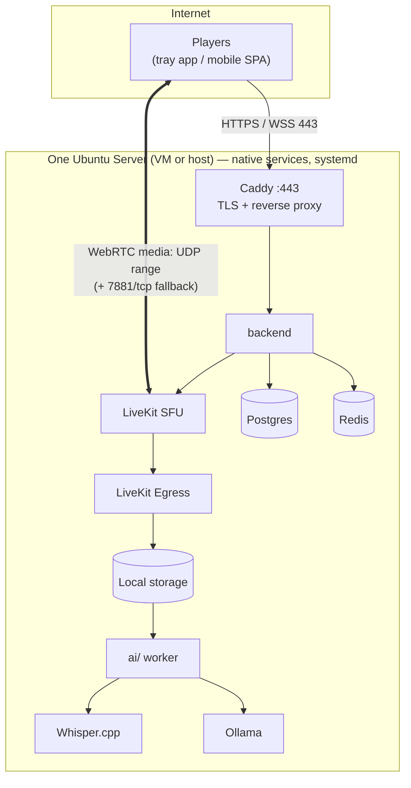

# Deployment & Transport

How an operator stands up their own instance, what network they must provide, and what is optional.

**Principle (decided 2026-11-05): self-host first, zero cloud reliance.** The default install runs
everything on one server the operator controls, with no third-party account. Cloudflare and other
cloud services are **optional adapters for advanced users** and must never be load-bearing. Other
people are expected to deploy their own instance, so every step must be documentable by someone who
is not Andy.

## Default topology

## Ports the operator must provide

Only the operator opens anything; players configure nothing. **Opening UDP for voice is accepted**
(decided 2026-11-05).

| Port                                        | Proto | Required   | Purpose                                                               |
| ------------------------------------------- | ----- | ---------- | --------------------------------------------------------------------- |
| `443`                                       | TCP   | yes        | Caddy: HTTPS API, WebSocket, status page, SPA, client downloads       |
| `80`                                        | TCP   | yes (ACME) | Caddy certificate issuance / http→https redirect                      |
| LiveKit media range (default `50000–60000`) | UDP   | yes        | WebRTC media. The range is configurable — narrow it for a small group |
| `7881`                                      | TCP   | yes        | LiveKit ICE-over-TCP fallback for clients that can't use UDP          |
| `7882`                                      | UDP   | optional   | Single-port UDP mux, an alternative to the range                      |
| `3478/udp`, `5349/tls`                      |       | optional   | LiveKit's **built-in** TURN, for restrictive networks                 |

Signalling (`7880`) sits behind Caddy and is not exposed directly.

### Why STUN alone is usually enough

Players connect to the SFU, never to each other. The SFU is the public-facing side of every
connection, so a client behind NAT (even CGNAT) only needs outbound UDP and its own reflexive
address. That makes STUN plus the TCP fallback sufficient for most networks.

### Restrictive networks (hotel wifi, corporate, school)

Some networks block UDP and every port except 443. Options, in the order we recommend them:

1. **LiveKit built-in TURN/TLS on 443** — native to the LiveKit binary, no extra service, no
   third party. Off by default; an operator toggle. This is the self-host answer.
2. **7881/tcp ICE fallback** — already on, covers networks that allow arbitrary outbound TCP.
3. **Cloud TURN (e.g. Cloudflare TURN)** — _advanced, optional._ Useful when the operator can't
   open a UDP range at all, or wants relays near players. It is configured as an extra ICE server
   in LiveKit/client config. It is a convenience, not a dependency; nothing may require it.

### What does _not_ work

**Cloudflare Tunnel cannot carry WebRTC media** (UDP) or the TCP ICE fallback. It can front the
HTTPS/WSS paths only. An operator who uses a tunnel for the web side still has to expose the media
ports directly, or fall back to option 3.

## Optional adapters (advanced users)

All behind an explicit config switch, all absent from the default install, and none may be assumed
by application code:

| Adapter                          | What it replaces                          | Why someone would want it                                                                                                                                                                      |
| -------------------------------- | ----------------------------------------- | ---------------------------------------------------------------------------------------------------------------------------------------------------------------------------------------------- |
| Cloudflare TURN                  | nothing (adds relays)                     | Can't open UDP; players on hostile networks                                                                                                                                                    |
| Cloudflare Realtime SFU          | self-hosted LiveKit                       | Don't want to run an SFU. Large change: it affects tokens, rooms, egress — treat as a separate, later design. LiveKit and Cloudflare SFU overlap (both SFU + TURN); the system targets LiveKit |
| Cloudflare Pages / Workers       | serving `web/` and `status/` from the box | Offload static hosting                                                                                                                                                                         |
| Workers AI, OpenAI, Claude, etc. | local Whisper.cpp / Ollama                | Underpowered server, or better quality                                                                                                                                                         |
| Authelia / OIDC                  | built-in identity                         | Operator already runs SSO (depends on the identity decision)                                                                                                                                   |

Any adapter that sends session audio or transcripts off the server must be an explicit operator
decision and must be visible to users (see [RECORDING-AND-SUMMARIES.md](RECORDING-AND-SUMMARIES.md) privacy rules).

## Install model

Three tiers, decided 2026-11-07 (rationale: Docker is the lowest-friction way for _other people_
to stand this up, and LiveKit Egress is only officially distributed as a container image):

1. **Docker Compose on a VM or real server — primary.** One compose file for Caddy, Postgres,
   Valkey, the backend, LiveKit, Egress and the `ai/` worker; Whisper.cpp/Ollama containers are
   optional (see "AI backends"). **LiveKit runs with host networking**: a container-NATed UDP port
   range is slow to start and breaks ICE candidates. A VM or bare host is the target.
2. **Native — advanced users.** A **bash install script** on a blank Ubuntu Server installs and
   configures the same services under systemd, generates secrets and config. Optional one-line
   `curl` installer. Kept working; not the quick-start path.
3. **LXC — optional, operator's risk.** The native install inside a container. Known gotchas:
   `net.core.rmem_max`/`wmem_max` must be raised on the _host_; GPU passthrough needs matching
   host/guest drivers; Docker-in-LXC needs `nesting=1,keyctl=1` and is not recommended.

Both tiers must generate the same configuration; application code never branches on the tier.

### AI backends: local or remote

Decided 2026-11-07. Whisper and the LLM are provider interfaces, each independently **local**,
a **remote instance the operator controls** (e.g. Ollama + a Whisper server on a GPU gaming PC), or
a **cloud adapter**. All remote kinds speak the **OpenAI-compatible API**, so one client covers a
home GPU box and a cloud provider.

- **Local is always configured** and is the fallback. The Compose bundle includes the local
  Whisper/Ollama containers by default (not an opt-in profile). On CPU, Whisper `small`
  (quantised); sessions are ~weekly, so a 4-8 h CPU transcript is acceptable, not a failure.
- **GPU detection:** if the server has a usable GPU, local uses it and the setup/Admin screen says
  a remote backend is probably unnecessary.
- **Remote unavailable** (gaming PC off): jobs wait in the queue, then fall back to local CPU after
  a **configurable timeout**. The fallback itself is configurable (it can be switched off to wait
  indefinitely instead). A recording is never lost either way.
- Anything remote means audio/transcripts leave the server: explicit operator setting, visible in
  the UI. Private/whisper audio is never sent.
- Native tier: records support is best-effort until a native Egress is proven; Docker first.
- `ufw` rules are an operator-time decision (LAN-only for a private group, or open for a public
  one) — the script asks, it doesn't hardcode.

## Sizing guidance (to be firmed up by the Stage 2 spike)

The server runs the SFU, Postgres, Redis, the API, Egress, Whisper.cpp and an LLM. Voice itself is
light; **transcription and summarisation are the heavy parts**, and they can run after the session.
The doc to write once measured: minimum spec for "voice + records on a small group", and what a GPU
buys. Until then, don't promise a spec.
