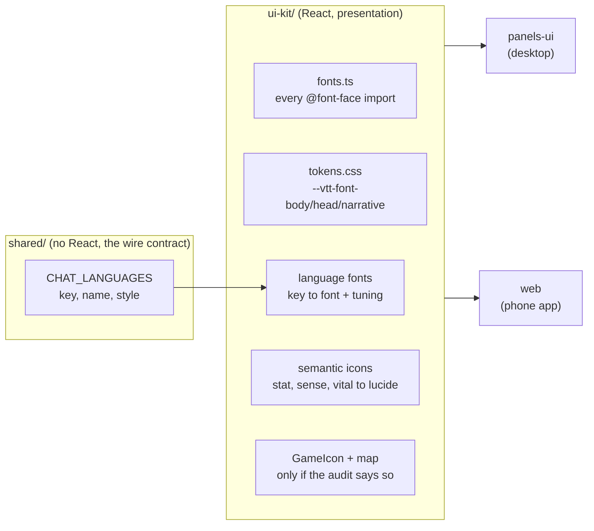

# Typography & Iconography

**Version:** 1.1 (2026-11-24: decisions recorded, aligned with the code as it is)
**Status:** designed, **not built**. Plan: [2026-11-24-typography-and-icons.md](../superpowers/plans/2026-11-24-typography-and-icons.md). Roadmap: [Stage 14](../../ROADMAP.md).
**Applies to:** the desktop app (`tauri-client/panels-ui/`) and the phone web app (`web/`), which must look and read the same.
**Audience:** UI/UX design, front-end development.

---

## Why this exists

The two clients drifted. Today the desktop app uses `lucide-react` in 66 files, while the web app carries a hand-copied
file of lucide path data (`web/src/components/icons/paths.ts`) for the 9 icons it uses. The desktop app sets headings
in Cinzel; the web app has no heading font at all. `languageFonts.ts` exists as two byte-identical copies. Meanwhile
the language fonts are a coarse set: 18 languages share 7 fonts through 8 "styles", so Dwarvish and Giant look alike
and Orc and Abyssal look alike.

This document fixes three things:

1. **One home** for fonts, icon choices and the typography tokens, used by both clients, so they cannot drift.
2. **A font for each language**, so a player can tell Elvish from Dwarvish at a glance, even without reading it.
3. **A rule for when to reach for RPG icons** beyond lucide, so the extra work is only done where it pays off.

### Decisions (Andy, 2026-11-24)

| #   | Decision                                                                                                                                                                                                                  | Consequence                                                                                                |
| --- | ------------------------------------------------------------------------------------------------------------------------------------------------------------------------------------------------------------------------- | ---------------------------------------------------------------------------------------------------------- |
| 1   | **Align the two clients** on one set of fonts and icons.                                                                                                                                                                  | A shared UI package ([below](#where-it-lives)).                                                            |
| 2   | **Every language gets its own font**, even though it costs download size.                                                                                                                                                 | 14 new font families. Fonts load lazily, so the cost is only paid for languages a table actually uses.     |
| 3   | **Game Icons is demand-driven.** Lucide covers most of what is needed. RPG icons are added only where lucide cannot say the thing, and the pressure points are expected to be **character stats** and **sound stingers**. | An audit comes first; the Game Icons machinery is built only if the audit finds gaps Andy agrees are real. |
| 4   | **Polyglot is out of scope.** It stays a future idea ([ROADMAP](../../ROADMAP.md#future-ideas)). This document keeps its design notes so the font system does not block it.                                               | See [Polyglot](#polyglot-future-not-built).                                                                |

### Assumptions (confirmed by Andy, 2026-11-24)

- **Where this doc and the code disagree, the doc wins**, because Andy wants unique fonts: Celestial becomes Cinzel
  Decorative, Giant becomes Uncial Antiqua, and Thieves' Cant becomes styled Inter. The `style` each language has on
  the wire does not change (see [No wire change](#no-wire-change)).
- **Inter is the body font in both clients.** Today neither loads it.
- **Cinzel is the heading font in both clients.** The web app gains it.
- Section numbers and the "layers" below are descriptive, not a license to build every item in one go.

---

## Three typography layers

| Layer                | Purpose                            | Font                                                |
| -------------------- | ---------------------------------- | --------------------------------------------------- |
| UI typography        | Navigation, controls, menus, forms | Inter (body), Cinzel (headings)                     |
| Narrative typography | Dialogue, handouts, journals       | Cormorant Garamond (handouts), Inter (DM narration) |
| Language typography  | In-world language identity         | One font per language ([table](#language-fonts))    |

Readability comes first where players read the most: character sheets, chat, logs, notes, rules and forms. Decoration
is for the things that are about atmosphere, and all of it can be switched off ([Accessibility](#accessibility)).

### Core fonts

| Role     | Font               | Files                                                   | Notes                                                                                     |
| -------- | ------------------ | ------------------------------------------------------- | ----------------------------------------------------------------------------------------- |
| Body     | Inter              | `@fontsource-variable/inter` (latin, one variable file) | General UI, chat, forms, tooltips, character sheets                                       |
| Headings | Cinzel             | `@fontsource/cinzel` 600                                | Section headings, character names, quest names, dialog titles. Already in the desktop app |
| Handouts | Cormorant Garamond | `@fontsource/cormorant-garamond` 500 and 500 italic     | Letters, books, journals, read-aloud text                                                 |

These are CSS custom properties, `--vtt-font-body`, `--vtt-font-head` and `--vtt-font-narrative`, defined once in the
shared package. The hard-coded `Georgia` stacks for `/say` lines in both clients' stylesheets are replaced by them.

---

## Language fonts

Every language has its own font. Not every language optimises for readability equally: some trade readability for
atmosphere on purpose, and that is the point, because real languages carry visual identity independent of whether you
understand them.

| Language      | Key            | Font               | Weights bundled | Theme                                     |
| ------------- | -------------- | ------------------ | --------------- | ----------------------------------------- |
| Common        | `common`       | Inter              | (body font)     | Neutral and readable                      |
| Dwarvish      | `dwarvish`     | Alegreya SC        | 500             | Stonework, clans, craftsmanship           |
| Elvish        | `elvish`       | Cormorant Garamond | 500 italic      | Graceful, poetic, ancient                 |
| Giant         | `giant`        | Uncial Antiqua     | 400             | Monumental and ancient                    |
| Gnomish       | `gnomish`      | Marcellus          | 400             | Inventive and scholarly                   |
| Goblin        | `goblin`       | IM Fell English    | 400             | Chaotic and improvised                    |
| Halfling      | `halfling`     | Quattrocento       | 400             | Friendly and welcoming                    |
| Orc           | `orc`          | Alegreya Sans SC   | 700             | Harsh, direct, tribal                     |
| Draconic      | `draconic`     | Forum              | 400             | Ancient empire and mastery                |
| Celestial     | `celestial`    | Cinzel Decorative  | 700             | Divine scripture                          |
| Infernal      | `infernal`     | IM Fell DW Pica    | 400             | Contracts and infernal law                |
| Abyssal       | `abyssal`      | Black Ops One      | 400             | Corruption and chaos                      |
| Deep Speech   | `deep-speech`  | Metamorphous       | 400             | Alien and unknowable                      |
| Primordial    | `primordial`   | Julius Sans One    | 400             | Elemental power                           |
| Sylvan        | `sylvan`       | Philosopher        | 400             | Fey and natural beauty                    |
| Undercommon   | `undercommon`  | Rosarivo           | 400             | Sophisticated subterranean culture        |
| Druidic       | `druidic`      | Caudex             | 400             | Ancient natural traditions                |
| Thieves' Cant | `thieves-cant` | Inter, styled      | (body font)     | Hidden meaning rather than foreign speech |

Google Fonts pages are `https://fonts.google.com/specimen/<Family+Name>`. Every font is SIL Open Font Licence 1.1 and
comes from the Fontsource npm packages, which carry the licence text into the build.

**Thieves' Cant** deliberately looks like everyday text: Inter in italics with a little letter-spacing. Its identity is
"familiar appearance, meaning concealed", so it must not look foreign.

**Per-language tuning.** Each entry in the table also carries a size nudge and letter-spacing, because these faces have
very different x-heights (Alfa Slab One needed `.92em`, Caveat `1.2em`). The first values are a starting point and are
tuned by eye in the real app, in light and dark, at chat size. That tuning is part of the work, not an afterthought.

### How the cost is kept small

- **Bundled, never fetched from the internet.** Fontsource packages put the font files in each client's build, so the
  strict CSP (no remote origins) and the self-host-first rule are unaffected.
- **Lazy by construction.** Each import only declares an `@font-face`. A browser downloads a font file the first time a
  line in that font is shown, so a table that never speaks Goblin never fetches the Goblin font. Idle cost is zero.
- **Latin subset, one weight per language** (two for Cormorant Garamond). A latin woff2 is typically 15 to 60 KB, so the
  14 new families add roughly 0.4 to 0.7 MB to each client's build, never to a page load. The exact figure is measured
  during the build and recorded in [BUILD-STATUS](../BUILD-STATUS.md).
- **A fallback stack per language** (serif, sans or cursive as fits), used until the file arrives or if it fails. The
  "in {language}" caption under a line keeps the meaning either way.

### No wire change

The font a language uses is **a client concern, keyed by the language's `key`**. The server never needs to know about
fonts. The `style` field on `ChatLanguage` in `shared/` stays exactly as it is, and the client now uses it only as the
fallback for a key it has no font for (for example a language added by a newer server). That keeps this a **no-wire
change**: it ships as a patch (or any minor), with no `PROTOCOL_VERSION` bump, and an older client against a newer
server (or the reverse) still renders every line.

`LANGUAGE_STYLE_CSS` moves out of `shared/` into the shared UI package, since it is presentation, not contract.

### Language families

Grouping the languages gives recognisable patterns across the world. A family sets a default for the per-language
tuning (decorative capitals, tracking, weight), so a new language slots in without a design debate.

| Family    | Members                                     | Characteristics                                                 |
| --------- | ------------------------------------------- | --------------------------------------------------------------- |
| Civilised | Common, Dwarvish, Elvish, Gnomish, Halfling | High readability, classical forms, comfortable for long reading |
| Harsh     | Orc, Goblin                                 | Heavy weight, dense or rough forms                              |
| Ancient   | Giant, Draconic, Celestial                  | Decorative capitals, extra letter-spacing, monumental           |
| Natural   | Sylvan, Druidic, Primordial                 | Organic forms, flowing rhythm                                   |
| Dark      | Infernal, Abyssal, Deep Speech, Undercommon | Reduced readability, atmospheric, distinctive                   |
| Hidden    | Thieves' Cant                               | Familiar appearance, styling communicates secrecy               |

---

## Chat presentation rules

These already exist in both clients and are kept. They are listed here so the font work does not disturb them.

| Kind                        | Presentation                                                  |
| --------------------------- | ------------------------------------------------------------- |
| In-character speech         | The language font, in quotation marks, with an "in X" caption |
| Character actions           | `font-style: italic; opacity: .92`                            |
| Out-of-character            | `opacity: .8; font-size: .95em`                               |
| DM narration                | Inter, weight 500                                             |
| Handouts, letters, journals | Cormorant Garamond                                            |

Kinds are told apart by shape and type, never by colour alone.

---

## Iconography

### Layer 1: UI icons: Lucide

**`lucide-react`**, the same version in both clients. Used for navigation, menus, search, settings, chat controls,
general actions and application chrome. Lucide also covers most of the RPG vocabulary the apps need today: the sound
board (`Swords`, `Skull`, `Flame`, `Bomb`, `WandSparkles`, `Ghost`, `Hammer`, `Pickaxe`, `Gem` and 80 more in
`soundIcons.ts`), scenes (`Castle`, `Anchor`, `Mountain`, `CloudLightning` in `sceneIcons.ts`) and the senses
(`Moon`, `Radar`, `Waves`, `ScanEye`).

What changes is **where the choices are made**. The web app stops carrying copied path data and uses `lucide-react`
like the desktop app, and the _meaning_ of an icon (which icon is "armour class", which is "darkvision") is defined
once in the shared package, so a stat looks the same in both apps.

### Layer 2: RPG domain icons: Game Icons, only where needed

**[Game Icons](https://game-icons.net/)** is a library of thousands of fantasy-themed SVGs, far more expressive than a
UI set. It is **not adopted wholesale**. Andy's call (2026-11-24): lucide already covers most of this, so the question
is only "where does lucide fall short?", and the likely answers are **character stats** (ability scores, saving
throws, damage types, conditions) and **sound stingers**.

The rule:

1. **Audit first.** List every stat and stinger that currently has a lucide stand-in, render the stand-ins next to
   Game Icons candidates, and mark the ones where the stand-in is genuinely unclear or wrong. Andy signs off the list.
2. **Build only for the signed-off list.** If the list is empty, Game Icons is not added at all and nothing below this
   point is built. That is a perfectly good outcome.
3. **Import by script, not by hand.** A `npm run icons:import` script copies named SVGs into a typed `name → path data`
   map. No SVGR component per icon: a few hundred components is heavy, and one `<GameIcon name="fireball" />` over a map
   tree-shakes and lazy-loads better. The web app already uses this "path data" shape.
4. **Attribute.** Game Icons is **CC BY 3.0, not public domain**. Each icon's author must be credited. The import
   script writes the credits file, and the app's About/credits screen shows it. Without that, do not ship the icons.

Candidate areas, for the audit to confirm or drop:

| Area         | Examples                                                                                                   |
| ------------ | ---------------------------------------------------------------------------------------------------------- |
| Damage types | Fire, cold, lightning, acid, poison, psychic, force, radiant, necrotic, thunder                            |
| Conditions   | Blinded, charmed, deafened, grappled, restrained, incapacitated, invisible, petrified, poisoned, exhausted |
| Stats        | The six abilities and the saving throws                                                                    |
| Stingers     | Sound effects with no obvious lucide picture                                                               |
| Classes      | Fighter through Warlock (12 classes)                                                                       |

---

## Where it lives

A new workspace package, **`ui-kit/`** (`@vtt-chat-app/ui-kit`), beside `shared/`.



Why a new package rather than `shared/`: `shared/` is deliberately React-free (types, validators, wire contracts) and
is used by the backend, which must not pull in React or font files. Why not "each client keeps its own": that is how
two byte-identical `languageFonts.ts` files and a hand-copied icon file happened.

`ui-kit` is consumed **as source** (its `exports` point at `src/`), so there is no extra build step: each client's Vite
build compiles it, and each client's `tsc` type-checks it. Folder layout follows the per-module convention
([CONVENTIONS.md](../CONVENTIONS.md)): `components/`, `consts/`, `lib/`, `styles/`, `types/`.

---

## Accessibility

All fantasy typography is optional. Settings, in both the desktop app (Appearance) and the phone app, stored per
device:

```text
☑ Language-specific fonts          (off: every language reads in Inter)
☑ Decorative document fonts        (off: handouts read in Inter)
☐ Force readable mode              (on: everything in Inter, whatever the two above say)
```

Force readable mode replaces every language and document font with Inter while **keeping the language metadata, the
"in X" caption, colours and icons**, so nothing about _what_ was said is lost, only _how it looks_. It exists for
dyslexia, low vision, and anyone who simply finds Black Ops One tiring at midnight. The default is "fonts on"; the OS
"prefers reduced motion" and contrast settings are respected as they are today.

Both light and dark themes must read well in every font; a font that fails contrast or legibility at chat size in
either is tuned or swapped, not shipped.

---

## Language spans in handouts and tales (next, after the fonts)

The DM and the AI storyteller can write a snippet in a language inside Markdown, drawn in that language's font by the
same function chat uses: `[Khazad ul barak](lang:dwarvish)` inline, or a fenced block whose info string is the
language. It is plain Markdown that reads fine anywhere else, needs no wire change, and is designed in
[RPG-MARKDOWN-EXTENSION.md](proposals/RPG-MARKDOWN-EXTENSION.md). It is the last task of the Stage 14 plan.

---

## Polyglot (future, not built)

A future mechanic where a character recognises, partly understands, or fully understands a language. **Not in this
work.** It is parked in the [ROADMAP](../../ROADMAP.md#future-ideas) and needs a wire change (the server would mask
what a character cannot understand, per reader). It is recorded here so the font system leaves room for it.

**Core principle: separate language appearance from language comprehension.** Most RPG systems turn an unknown
language into gibberish and then swap in plain text once understood, which destroys the language's identity. Instead,
the font says what the language looks like and the polyglot level says how much the reader understands. The font stays
the same at every level.

| Level          | What the reader gets                               | Example                                        |
| -------------- | -------------------------------------------------- | ---------------------------------------------- |
| Unknown        | Cannot tell it is a language                       | `⟪spoken Dwarvish⟫`                            |
| Recognition    | Knows the language, understands nothing            | `Khazad ul grum barak thorin.` (Dwarvish font) |
| Partial        | Key words understood                               | `Khazad ul [mountain] barak [gold].`           |
| Conversational | Most translated, rare words left foreign           | `The mountain contains many kharadûn.`         |
| Fluent         | Full translation, still in the language's own font | `The mountain holds great reserves of gold.`   |

Force readable mode (above) overrides the font at every level, as it does today for plain lines.

**Flavour profiles** (for generating plausible foreign text rather than random gibberish) would be language-specific:
Dwarvish dense consonants and compounds; Elvish long vowels and flowing syllables; Gnomish technical compounds; Goblin
abbreviated, clipped phrases; Orc short forceful syllables; Draconic formal, ritual structure; Celestial symmetry and
elegance; Infernal repetition and contractual phrasing; Abyssal corrupted, unstable words; Deep Speech symbols and
impossible punctuation; Primordial elemental imagery; Sylvan musical cadence; Undercommon refined but distant
vocabulary.

---

## Fonts to bundle

```text
Inter (variable)            Cinzel                  Cinzel Decorative       Cormorant Garamond
Alegreya SC                 Alegreya Sans SC        Uncial Antiqua          Marcellus
IM Fell English             IM Fell DW Pica         Quattrocento            Forum
Metamorphous                Black Ops One           Julius Sans One         Philosopher
Rosarivo                    Caudex
```

**Removed** (used today only for the old seven-font language set): Alfa Slab One, Pirata One, Fredoka, Caveat and
Share Tech Mono. The unused `@radix-ui/react-icons` dependency in `panels-ui` is removed too.

---

## Related

- [CHAT-COMMANDS.md](CHAT-COMMANDS.md#fonts): the current seven-font set, which this replaces.
- [CONVENTIONS.md](../CONVENTIONS.md): the per-module folder layout `ui-kit/` follows.
- [OVERVIEW.md](OVERVIEW.md): module responsibilities.
- [Plan](../superpowers/plans/2026-11-24-typography-and-icons.md).
- [RPG-MARKDOWN-EXTENSION.md](proposals/RPG-MARKDOWN-EXTENSION.md): language spans in handouts and tales.
