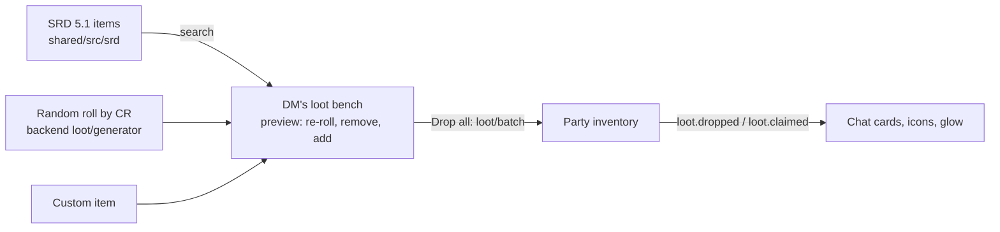

# Loot: the party inventory, the SRD catalog and random treasure

The party inventory is a **shared pool** (see [TABLE-FEATURES.md](TABLE-FEATURES.md)): the DM drops
things, players grab them, and each grab records who took it and whether it was for themselves or the
party. This note covers where items come from.

## Items

Every item has an **item type** (weapon, armor, potion, ring, wondrous item, gem, coin…) that picks its
icon, and magic items have an **SRD rarity** — *common, uncommon, rare, very rare, legendary, artifact* —
that sets the strength of a soft glow in the rarity's colour (stronger for rarer items; mundane items do
not glow). Custom items may be given any type and rarity.

- **SRD catalog:** 240 magic items and ~210 mundane items, searchable by name, type and rarity
  (`POST /api/campaigns/:id/loot/catalog`; a POST only because the tray app's relay refuses query strings).
- **Custom items:** any name, type, rarity, quantity; coin piles are a kind of their own.
- **Batch drop:** `POST …/loot/batch` validates every entry first, so a bad one drops nothing.

## Random treasure — our own generator, not the DMG's

The SRD has **no treasure tables** (they are DMG-only and not open content), so
`backend/src/lib/loot/generator.ts` is original: four challenge-rating bands (0–4, 5–10, 11–16, 17+),
**individual** treasure (coin only) and **hoards** (coin, gems, art objects and magic items), with our
own dice and weights; magic items are drawn from the SRD list by rarity, which rises with the band, and
an artifact never rolls. The numbers are a rough guide and meant to be edited; unit tests pin the shape
(rarity ceilings per band, value growing with CR, determinism for a given dice stream).

The DM sees the result as a **preview** (nothing is stored): re-roll the lot, re-roll one entry (a
different item of the same rarity, a gem or art object of the same value, the same coin again), remove
entries, add SRD or custom ones, then **Drop all**.

## Attribution

See [../LEGAL-SRD.md](../LEGAL-SRD.md).
