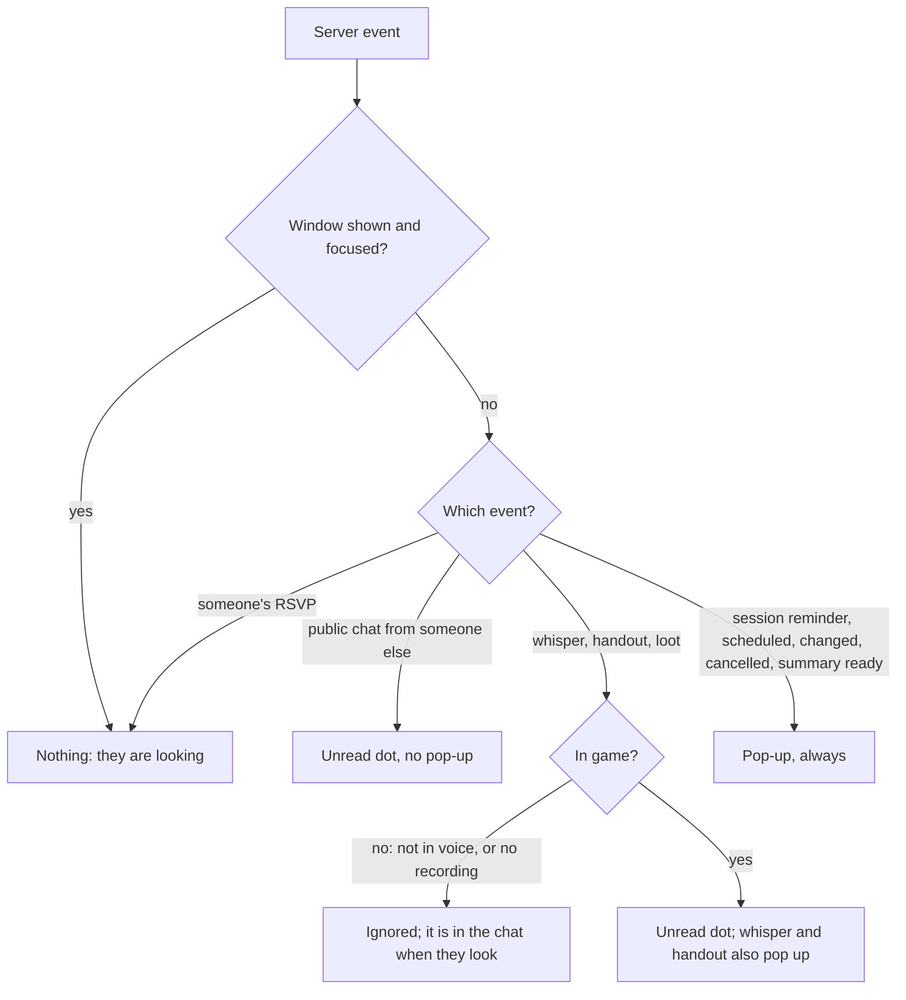

# Getting attention while the window is closed

Decided 2026-11-10. Players keep the app hidden most of the time, so the tray icon and a few desktop
notifications are how the app reaches them. The policy is one pure function (`attention.rs`, `classify`),
tested on its own; the rest only carries it out.

- **In game** means connected to voice with a recording running (open, paused or capturing). The whisper
  rule is Andy's: a whisper is only worth interrupting for during the game.
- **The unread dot** is an orange dot at the top right of the tray icon (the status badge stays bottom
  right), and the tooltip says "· 3 unread". Focusing the main window clears it.
- **Pop-ups** use the operating system's notification service (`tauri-plugin-notification`). At most one every
  3 seconds, so a burst of whispers is one pop-up. Text is cut to one short line.
- **Defaults I chose, easy to change in `classify`:** public chat gives a dot but never a pop-up (it is constant);
  loot gives a dot only; "someone answered an invitation" is silent.
- **Settings → Notifications (built 2026-11-10):** a switch each for chat (the dot), whispers,
  handouts and loot, and sessions (reminders, changes, "summary ready"), plus **quiet hours** (a daily window
  that may cross midnight, 22:00 to 08:00 by default). Quiet hours silence pop-ups only; the dot still shows,
  because it never interrupts. Stored in `notifications.json` beside the account file, read for each event
  (a tiny file, and it means a change applies at once with no restart). `classify` takes the choices and the
  local minute of the day, so the whole policy, quiet hours included, is still one tested pure function.
- **Not built:** clicking a pop-up to open the window (the desktop plugin does not report clicks on every
  platform; clicking the tray icon does it); a count on the Windows taskbar icon.
- **Verified:** the policy and the icon are unit-tested. **Not verified:** a real pop-up on each operating
  system (Windows needs the app installed, not run from a build folder, for its toasts to carry its name).
