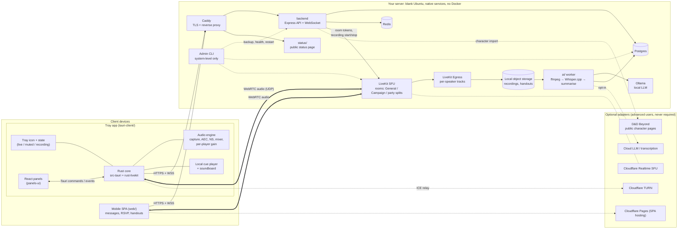

# Architecture Overview

Entry point for how the pieces fit together. It expands [CLAUDE.md §3 (Mono-Repo Structure)](../../.claude/CLAUDE.md)
into a system diagram and per-module responsibilities; CLAUDE.md remains the source of truth for
constraints.

**Status:** design sketch (first drafted 2026-10-29, revised 2026-11-05 with the self-host-first,
server-side-recording and records-are-core decisions). Not every box below exists in code yet — see
[ROADMAP.md](../../ROADMAP.md).

## What changed, and why this doc looks different

The first design was a Tauri _browser_ that loaded D&D Beyond and injected a voice overlay. It was
replaced because the group's real behaviour is "everyone sits in one Discord channel with open
mics", and the valuable missing piece is **records and AI summaries**, not a nicer overlay.
Dropping the embedded browser removes page restriction, ad-blocking, DDB auth, DOM extraction, the
WebKitGTK/NVIDIA crash investigation, and an entire class of platform risk. What is left is a small
audio app plus a server that does real work.

## System Diagram

Solid lines are the default install. Dotted lines into the **Optional** box are adapters an
operator can switch on; the system must work with all of them off.

## Module Responsibilities

- **`tauri-client/src-tauri/`** — the Tauri shell: tray icon and state, floating panel windows,
  global hotkeys, autostart, auto-update, crash recovery, and the Tauri command bridge to
  `rust-livekit`. Loads only local pages; no remote origins.
- **`tauri-client/rust-livekit/`** — the audio engine and LiveKit client: capture, echo
  cancellation, noise suppression, mixing, per-player gain, group routing, the local cue/soundboard
  player, and room connection with auto-rejoin. Runs once per app instance and is independent of
  any window.
- **`tauri-client/panels-ui/`** — React + Radix panels: chat/whispers, handouts, loot, RSVP, history,
  DM soundboard and party controls. Pure UI; talks to the Rust core over Tauri IPC and to the
  backend through the core's connection.
- **`web/`** — mobile-first SPA for messages, RSVP, handouts and basic listen/talk. Planned.
- **`backend/`** — Express API and WebSocket layer: identity and campaign access, LiveKit tokens,
  channels, chat, handouts, loot, scheduling, recording control and state, the records API, the
  status endpoints and client downloads. Also hosts the Admin CLI.
- **`ai/`** — the records pipeline worker: transcode, transcribe (Whisper.cpp), diarize by track,
  summarise (Ollama). Consumes recordings the Egress wrote; writes transcripts and summaries.
  Core, not optional — see [RECORDING-AND-SUMMARIES.md](RECORDING-AND-SUMMARIES.md).
- **`ddb/`** — optional D&D Beyond character import from public pages. Not in the default install's
  critical path.
- **`status/`** — the public, read-only status page.
- **`shared/`** — cross-module TypeScript types and contracts so the backend, panels, SPA and
  status page don't redefine the same shapes.
- **`livekit/`** — LiveKit server and Egress configuration and helper scripts.
- **`infra/`** — Ubuntu deployment: install script, systemd units, config generation.

## Data Flow Notes

- **Audio never routes through the backend or a webview.** `rust-livekit` talks to the LiveKit SFU
  directly over WebRTC. The backend issues tokens and holds metadata.
- **Recording state is server truth.** It lives in room/session metadata owned by the backend;
  clients render it and play the consent cue from it. See [RECORDING-AND-SUMMARIES.md](RECORDING-AND-SUMMARIES.md).
- **Clients are caches.** Domain state is replaced wholesale from snapshots on reconnect — see
  [STATE-AND-RESILIENCE.md](STATE-AND-RESILIENCE.md).
- **Transport and ports** are in [DEPLOYMENT-AND-TRANSPORT.md](DEPLOYMENT-AND-TRANSPORT.md).
- **The Admin CLI never touches gameplay data** — only system-level operations
  ([CLAUDE.md §7](../../.claude/CLAUDE.md)).

## Decided vs. open

| Decided | Source |
| --- | --- |
| Audio only, tray app, Rust owns audio, no injected pages | 2026-10-29 direction |
| Self-host first, zero cloud reliance; Cloudflare / cloud AI are optional advanced adapters | Andy, 2026-11-05 |
| Recording is **server-side** (Egress, per-speaker tracks) | Andy, 2026-11-05 |
| Records + AI summary are **core**, not a plugin | Andy, 2026-11-05 |
| Operator opens UDP for voice traffic | Andy, 2026-11-05 |
| Self-hosted LiveKit as the SFU | follows from the above |
| Local-first Whisper.cpp + Ollama | follows from the above |

| Open (tracked in [.claude/intent.md](../../.claude/intent.md)) | |
| --- | --- |
| Identity and access model without DDB | |
| Whether DM markers stay in scope | |
| Client ↔ server sync protocol (revive archived "Plan B"?) | |
| Container bundle for other self-hosters? | |
| Per-platform audio findings (AEC quality, device release on mute) | |
| Mobile SPA scope: listen/talk, or messages only? | |
