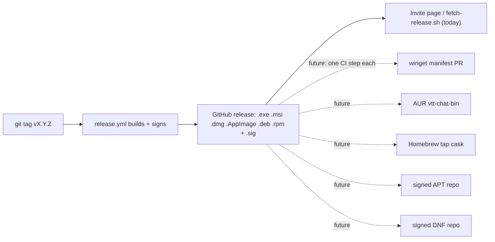

# Package-manager distribution (future capability)

**Status: not started, not decided.** Written 2026-11-11 so the idea is not lost. Nothing here is built, and
none of it is needed for the app to work: players get the installer from the invite page, and the `.deb`,
`.rpm`, `.AppImage`, `.exe`, `.msi` and `.dmg` on the GitHub release are already enough
([INSTALLING-THE-APP.md](../guides/INSTALLING-THE-APP.md)). Package managers would be a convenience for people
who prefer `winget install` or `apt install` over a download, and a way around some first-run warnings.

Scope note (CLAUDE.md §14): this project is sized for a homelab and a group of friends. Treat every option below
as "only if people ask", and prefer the cheap ones.

## Where it would plug in

Every option reads the same release assets, so none of them changes how a release is built. Each would be one more
step or workflow that runs after the release is published (never before: a draft is not public).

## The options

Effort is for the first setup; "per release" is the upkeep afterwards. All of this is from knowledge of each
system and **has not been tried**; check the current rules when picking one up.

| Manager                                                             | What it takes                                                                                                                                                                                                                                                        | First setup         | Per release                                                                 | Catches                                                                                                                                                                                                                                  |
| ------------------------------------------------------------------- | -------------------------------------------------------------------------------------------------------------------------------------------------------------------------------------------------------------------------------------------------------------------- | ------------------- | --------------------------------------------------------------------------- | ---------------------------------------------------------------------------------------------------------------------------------------------------------------------------------------------------------------------------------------- |
| **winget** (Windows)                                                | A small YAML manifest in Microsoft's `microsoft/winget-pkgs` repo: package id, version, installer URL and its SHA-256. The NSIS installer takes `/S` for a silent install, and the manifest can state the install scope (our installer offers just-me or all-users). | Low                 | A pull request, which can be automated (`wingetcreate` or a release action) | Each submission is reviewed by a bot and a person. Unsigned installers can draw extra scrutiny. winget downloads usually avoid the browser's "unknown publisher" prompt, which is the main benefit for us.                               |
| **AUR** / `paru` (Arch)                                             | A `vtt-chat-bin` PKGBUILD in the Arch User Repository that downloads the release `.deb` or AppImage and installs it.                                                                                                                                                 | Low, about an hour  | Bump the version and checksum (can be automated)                            | Community-run: nobody reviews it, and it is your job to keep it working. Users build it with `paru -S vtt-chat-bin`.                                                                                                                     |
| **Homebrew** (macOS)                                                | A **tap** (our own small GitHub repo, `homebrew-vtt-chat`) holding a cask that points at the `.dmg` and its SHA-256. `brew install --cask andyprosser/vtt-chat/vtt-chat`.                                                                                            | Low                 | Bump version and checksum (can be automated)                                | The main Homebrew cask catalogue expects signed, notarised apps, so ours would have to stay in our own tap. Brew does not promise to skip the Gatekeeper warning for an unsigned app. Apple silicon only today.                          |
| **APT** (Debian, Ubuntu)                                            | Our own **signed repository**: the `.deb` files plus an index, signed with a GPG key we keep, served as static files from GitHub Pages or our server. Users add the repo and key once; after that `apt upgrade` updates the app.                                     | Medium, about a day | A CI step adds the new `.deb` and re-signs the index                        | We would own a signing key (see the secrets note below). A Launchpad PPA is impractical (it builds from source and the client needs prebuilt WebRTC binaries); Debian's and Ubuntu's own archives are not realistic for the same reason. |
| **DNF** (Fedora, RHEL)                                              | The same idea for `.rpm`: a signed repository built with `createrepo_c`, served statically.                                                                                                                                                                          | Medium              | A CI step adds the `.rpm` and re-signs                                      | Same key upkeep as APT. COPR (Fedora's build service) builds from source, which does not suit us.                                                                                                                                        |
| **Flathub / Snap Store** (not asked about, listed for completeness) | A store listing, which also fixes the missing icon and "unknown publisher" on the Ubuntu App Center page.                                                                                                                                                            | High                | Moderate                                                                    | Flathub wants a from-source build manifest and a sandbox review; the client's audio and tray access fight a sandbox. Only worth it if the project grows well past a friend group.                                                        |

## Things to decide before building any of it

1. **Who updates the app.** Today only the AppImage, the Windows installer and the macOS app update themselves
   through the operator's server ([CLIENT-UPDATES.md](CLIENT-UPDATES.md)); a `.deb` or `.rpm` is replaced by
   hand. A package-manager install should update through its manager, so those installs should not show the
   in-app update banner, or it would fight the manager. We would need a way to tell how the app was installed
   (for example a marker file the package writes) and the updater would stay quiet when it is present.
2. **Dev builds.** Package managers should carry **releases only** (`vX.Y.Z`), never `-dev.N` builds, which stay
   on GitHub and on the in-app dev channel ([RELEASING.md](../guides/RELEASING.md)).
3. **A stable, permanent download URL** and a published checksum for every asset. GitHub release URLs are stable;
   the file names changed once already (the product was renamed from "VTT Chat App" to "VTT Chat"), so a
   rename later would break every manifest. Treat asset names as an interface from now on.
4. **Signing keys for APT and DNF repositories.** Never print or commit one, as with the updater key (CLAUDE.md
   §17a). Keep it in a repository secret and the owner's password manager, and decide what happens if it is lost
   (every user would have to re-trust a new key by hand).
5. **Trust and warnings.** A package manager does not replace code signing. On Windows and macOS the app is still
   unsigned; package managers only soften the first-run warning. If real code signing is ever bought (a Windows
   certificate, an Apple Developer ID), most of the friction these options remove goes away on its own.

## Suggested order, if it is ever picked up

1. **winget**: it helps the platform with the worst first-run experience, and the upkeep can be automated.
2. **AUR `-bin`** and a **Homebrew tap**: an afternoon each, only if someone asks.
3. **APT and DNF repositories**: only when the group is large enough that "download the file" is a real burden.

## Triggers to revisit

- More than a handful of players ask for `winget` or `apt`.
- Real code signing gets bought (re-assess everything above).
- A second operator wants to host the app for a group that will not download files by hand.

## Not decided

Nothing in this document is a commitment. Update it, or move it into the roadmap as a stage, when a decision is
made.
