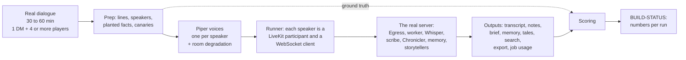

# Quality validation: testing the whole system with a long synthetic session

**Roadmap:** [Stage 13](../../ROADMAP.md). **Status:** planned 2026-11-21 with Andy; the approach is decided, the details are not (see [Open questions](#open-questions)). Nothing here is built yet.

## Why this exists

Most of what Stages 9 to 12 built has met unit tests, fakes, and a few short recordings: a two-minute spoken scene, a four-minute Compose end-to-end test, and a 12-minute _written_ session used to compare summary models. The records pipeline is the largest untested surface: Whisper with a glossary, the scribe's structured notes, the Chronicler, campaign memory, five storytellers and two cloud connectors, none of which has seen a session of real length with real-sounding voices. A bug in any of them shows up as a wrong tale or a lost fact weeks after the session that caused it, which is the worst time to find it.

A real table session is the best test and the slowest and least repeatable one. So this stage builds a **repeatable stand-in**: a long, real multi-person dialogue, spoken by synthetic voices into the real system, with a script that tells us exactly what every output should contain. It does not replace a real session (see [What it cannot show](#what-it-cannot-show)); it finds most of the problems before one is spent on them.

## The idea in one picture

Everything between the runner and the outputs is the production code and the production services. Only the people are fake.

## The source dialogue

- **Real, not written for the test.** The existing vault fixture is hand-written, 12 minutes, and tidy. A real dialogue has the mess the pipeline must cope with: interruptions, jokes that go nowhere, rules arguments, a player who is away from the table, names that are invented on the spot and used again an hour later, and in-character and out-of-character talk in the same breath.
- **30 to 60 minutes**, roughly 4,500 to 9,000 spoken words at 150 words a minute. Long enough to push the records pipeline through several pieces of notes (the map-reduce path), which no real or synthetic session has done yet.
- **At least one Game Master voice and four player voices.** A dialogue that already has a Game Master and a table of players is ideal. Anything with five or more speakers can be reshaped into that.
- **It is throwaway.** Andy's decision (2026-11-21): licensing is not a concern because the text and the audio are used once for this stress test and then deleted, and the repository does not name the source. The repo records only the method and the results. To keep that true, the source text, the prepared script and the rendered audio live **outside the repository** (a scratch directory under `~/.local/share/`), are never committed, and are deleted when Stage 13 closes. The harness code takes the paths as arguments, so no file in the repo points at them.

### Preparing it (once)

A prep script turns the source into the format the vault fixture already uses (`Speaker: words`, one line per utterance, `(typed)` for chat lines) and a facts file in the shape of `session-vault.facts.json`:

1. **Map speakers** to the cast: one Game Master and four to six players, each with a character name, so the glossary and the roster have something to correct against.
2. **Choose the facts to plant and score.** Read the dialogue and pick 25 to 40 facts that a good set of notes must keep: a throwaway non-player character, a promise with a deadline, a secret only the Game Master understands, a loot item, a failed roll, a place visited twice. Each gets a pattern in the facts file. This is the same method that gave the 24 to 26 of 26 recall figures for the 4B model in Stage 12 A.
3. **Add canaries.** A canary is a word that appears nowhere else, put in a line that must never reach a shared artifact: an `/ooc` aside, a whisper, a Game Master private talk, a line spoken while the recording is paused, and a line a late joiner says before acknowledging the cue. The existing end-to-end test already uses this trick ("absent" becomes a plain text check); this reuses it at length.
4. **Mark scene changes and a few table events** (loot dropped, a handout shown, a pause for a break) at the points the dialogue suggests, so the cues, chapters and chat features are exercised in the middle of real conversation instead of in a separate scene.

## The voices

Text-to-speech is enough (Andy, 2026-11-21). The existing harness uses **piper** (a small local TTS, installed user-local, no apt) with `ffmpeg` turning each line into 48 kHz mono PCM, cached by voice and text so a rerun costs nothing ([`infra/records-smoke/e2e/tts.ts`](../../infra/records-smoke/e2e/tts.ts)).

- **Five or six clearly different voices**, one per speaker. Four voices exist today; a multi-speaker piper model gives more distinct voices from one download. Variety in accent and pitch matters for Whisper, not for attribution (see below).
- **Degrade the clean audio so it resembles a table.** Synthetic speech is far cleaner than a microphone in a spare room, so Whisper will look better on it than it will be in life. The runner can add, per speaker and per run, a noise bed, level differences between speakers, a little reverb, now and then a clipped peak, and **bleed**: a quiet copy of one speaker's voice on another's track, as when a player's microphone picks up the room. The degradations are settings, so the same session can be run clean and degraded and the difference measured.
- **Turn-taking is part of the script.** The runner places lines on a clock with natural gaps, lets a fraction of turns **overlap** (interruptions, two people laughing), and keeps a few long monologues (the Game Master describing a scene) so Whisper's handling of long clips is tested.

## What the runner does during the session

The runner extends the Compose end-to-end test ([`compose-e2e.ts`](../../infra/records-smoke/README.md)), which already connects people over the WebSocket and LiveKit and publishes a TTS microphone track for each. The difference is length, cast size, and what happens in the middle:

- **Real time, with a faster mode.** The live run is at real speed (the capture path has to be exercised as it runs). A second, **offline mode** feeds the rendered per-speaker tracks straight to the worker (the way `records-smoke` does today) so Whisper and prompt changes can be iterated in minutes instead of an hour.
- **Typed chat in every kind**, spread through the hour: plain, `/say`, `/do`, `/ooc`, `/late`, `/dm`, `/tell`, whispers.
- **Table activity**: scene changes (they start chapters), loot dropped, split and claimed, a handout, a party split and merge, the soundboard (local, so absent from recordings and checked to be absent).
- **Consent and recording controls**: a pause and resume, a late joiner who joins before and after acknowledging, a stop and a second recording the same evening.
- **Churn and faults**: a player leaves and rejoins; one loses the network for a minute (a `tc netem` drop, or a forced disconnect); a mute and unmute storm; the worker is killed mid-job and the job must finish on a retry; with `--fallback` the remote AI is made unreachable and the job must fall back to local.
- **One real client in the room (optional).** The synthetic players are headless Node participants, not the Tauri app, so they say nothing about the app's audio engine. Andy's real desktop app can join as an extra person (listening, or playing the Game Master) for the whole hour, with the existing measuring scripts ([`scripts/test/`](../../scripts/test/README.md)) recording its CPU, memory and jitter. That is the one part of the run that needs a human and a machine.

## What is scored

Every number is compared with the script, which is the ground truth. **Thresholds are set after the first run, not before**: the first run records what the system does, then we decide which numbers are acceptable. A number invented in advance would be a guess presented as a standard.

| Area           | Measure                                                                                                                                                                                             | How                                                                        |
| -------------- | --------------------------------------------------------------------------------------------------------------------------------------------------------------------------------------------------- | -------------------------------------------------------------------------- |
| Hearing        | Word accuracy per speaker, and **proper-noun accuracy** (character, place and non-player character names) with `ai.transcription.glossary` set to `off`, `corrections`, `prompt` and `both`         | The script against the transcript (the existing scorer, plus a names list) |
| Attribution    | No line under the wrong name; each speaker's lines within a few seconds of where the script put them                                                                                                | Per-speaker tracks make this a mapping check (see the limit below)         |
| The scribe     | Planted facts kept in the notes; notes under the headings; within the size limit; how often the retry ladder was needed                                                                             | The facts file, then Andy reading a sample                                 |
| The Chronicler | Promises, deadlines, open threads and the throwaway character are in the brief; continuity warnings are right                                                                                       | Facts file, then reading                                                   |
| Memory         | An entry for each planted character and place, a sensible gist, no duplicates, a size that stays small; **a second run of the same session recognises the first** ("the party has met Gary before") | Entry list against the facts; two runs back to back                        |
| The five tales | Facts intact; each voice distinct; length follows what happened; nothing Game Master-only in any tale except the Tipsy Minstrel's                                                                   | Facts file, a canary for the Game Master's secret, Andy reading all five   |
| Privacy        | Not one canary in the transcript, notes, brief, memory, tales, search results (as the Game Master and as a player) or a `.vttcampaign` export                                                       | Plain text search of every artifact                                        |
| Cost and time  | Seconds per pipeline stage, Whisper's real-time factor, the model's time, peak CPU and memory of every container, disk used, and the cloud tokens and cost against the provider's console           | `vtt-admin jobs list`, `docker stats`, the existing benches                |
| Reliability    | Recording survives rejoin, a killed worker, a backend restart; the queue finishes the job; idle CPU and memory after the session return to baseline                                                 | The existing restart drill and kill drill, run mid-session                 |

## The run matrix

Not every combination runs every time; the first run is the baseline and each later run changes one thing.

| Run | Backend                                          | Why                                                                                       |
| --- | ------------------------------------------------ | ----------------------------------------------------------------------------------------- |
| 1   | The VM's CPU defaults (`small.en`, the 4B model) | The default install is the one most operators will have; this is the baseline             |
| 2   | The same session again, straight after run 1     | Campaign memory across two sessions                                                       |
| 3   | The GPU PC as a remote backend                   | The fast path; also the remote-with-fallback drill                                        |
| 4   | Claude (`ai.llm.kind claude`)                    | The connector against the real API: tokens, cost against the console, the off-site notice |
| 5   | OpenAI (`ai.llm.kind openai`)                    | The same, with an operator-named model and operator-set prices                            |
| 6   | The session looped for 8 hours with churn        | The soak, the memory rules of Stage 0.5, and the `kill -9` drill                          |

Runs 4 and 5 spend real money and send the (synthetic) session off the server; each needs Andy's say-so first, and a key kept in the `.env`, never in a command or a chat.

## Order of work

1. **A real Postgres first.** Run the backend's Postgres-only tests (27 are skipped without a database) against a throwaway database, and exercise what Stage 12 added that only the in-memory stores have tested: migrations 0042 and 0043, `addJobUsage`, the memory queries and the export round trip. Cheap, and it finds the kind of bug a unit test with a fake store cannot.
2. **Prep the dialogue and the voices**: the prep script, the facts file, the cast, the degradations.
3. **Build the long-session runner** on the existing harness, with the offline mode.
4. **Run 1, then read everything.** Fix what is wrong as bugs, with a test each, in 0.6.x patches.
5. **Runs 2 to 5**, one change at a time. Settle `ai.transcription.glossary`'s default, tune the prompts from reading the output.
6. **The soak** (run 6), and the human-only checks from the roadmap table (the real desktop client in the room, the phone, the Intel Mac, the Windows microphone).
7. **Close**: results in [BUILD-STATUS.md](../BUILD-STATUS.md), the screenshots redone, the throwaway audio and text deleted.

## What it cannot show

- **Voices are not tested by the track layout.** The server records one track per speaker, so "who spoke" comes from which track a sound is on, not from recognising a voice. That is the design, and it means the attribution score checks the mapping, not any acoustic skill. Crosstalk and bleed between microphones are the realistic risk and only the degraded runs approximate them.
- **Synthetic speech flatters Whisper.** It is clean, evenly paced and pronounced the way the model's training data expects. Treat word accuracy as a **regression and comparison** number (this build against the last one, this setting against that one), not a promise of what real players will get. Real human voices still need real sessions; the few short recordings of real voices so far (a 42-second one on Windows came through word-for-word) are the only human data.
- **It does not judge whether the tale is fun.** Facts, canaries and sizes are checked by code; whether the tale beats the table's memory is Andy's call from reading five tales (the test from Stage 12).
- **The synthetic players are not the desktop app.** The app's audio engine, echo cancellation and mixer are exercised only by the optional real client, and by real hardware checks.

## Open questions

Andy's to decide when this stage starts; none blocks writing the harness.

1. **Which dialogue.** Andy picks it; the repo never names it. What matters for the harness: five or more distinct speakers, one of them a Game Master, 30 to 60 minutes, and a text transcript with speaker labels that can be reshaped into the script format.
2. **Where the long runs happen.** The VM is the realistic CPU case and the baseline; the dev PC has a GPU and is faster for building the harness. Probably both, as the run matrix says.
3. **Cloud spend and consent for runs 4 and 5** (the keys, a ceiling on tokens, and that a throwaway synthetic session leaving the server is fine).
4. **Who is the real client** in the room, and on which operating system.
5. **How many facts to plant** (25 to 40 is the starting guess) and whether Andy wants to read all five tales or sample.
