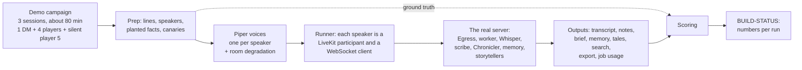
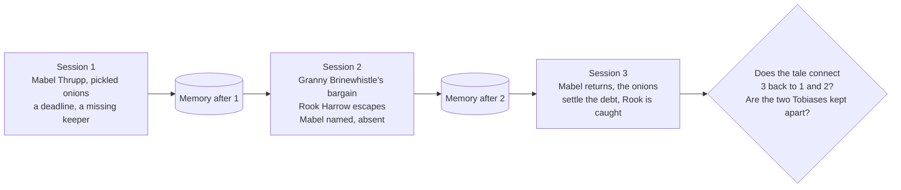

# Quality validation: testing the whole system with a demo campaign

**Roadmap:** [Stage 13](../../ROADMAP.md). **Status:** planned 2026-11-21 with Andy; the approach is decided. **Built so far (2026-11-21):** the demo campaign and its validator ([fixtures](../../infra/records-smoke/fixtures/campaign/README.md)), the monitor, the report, the scoring, the dry-run runner and the live runner ([how to run them](../../infra/records-smoke/README.md)). The dry run has been run against the VM; the live runner has had a 45-line smoke run on the local stack. **Not run yet:** a full live run of the three sessions (see [Decisions and open questions](#decisions-and-open-questions)).

## Why this exists

Most of what Stages 9 to 12 built has met unit tests, fakes, and a few short recordings: a two-minute spoken scene, a four-minute Compose end-to-end test, and a 12-minute _written_ session used to compare summary models. The records pipeline is the largest untested surface: Whisper with a glossary, the scribe's structured notes, the Chronicler, campaign memory, five storytellers and two cloud connectors, none of which has seen a session of real length with real-sounding voices. A bug in any of them shows up as a wrong tale or a lost fact weeks after the session that caused it, which is the worst time to find it.

A real table session is the best test and the slowest and least repeatable one. So this stage builds a **repeatable stand-in**: a long, real multi-person dialogue, spoken by synthetic voices into the real system, with a script that tells us exactly what every output should contain. It does not replace a real session (see [What it cannot show](#what-it-cannot-show)); it finds most of the problems before one is spent on them.

## The idea in one picture

Everything between the runner and the outputs is the production code and the production services. Only the people are fake.

## The demo campaign

**Decided 2026-11-21 (Andy): written for the test, and reusable.** The first plan was one long real dialogue, thrown away afterwards. Andy then asked for something better: a **demo campaign of two or three connected sessions**, D&D with the SRD rules in a generic fantasy setting, full of invented names and game words (to test the glossary), and committed to the repo so the same test can be run again after any change, on the dev PC or on the VM. It is built: [`infra/records-smoke/fixtures/campaign/`](../../infra/records-smoke/fixtures/campaign/README.md).

- **Lanterns of Saltmarrow:** three sessions of about 25 minutes (about 80 minutes in all, 10,500 spoken words). A missing lighthouse keeper and a stolen lens (session 1), a sea hag's bargain and a crypt in the fens (session 2), the Night of Lamps (session 3). The setting and names are original; the rules are D&D 5e from the SRD 5.1 only, with the attribution in [LEGAL-SRD.md](../LEGAL-SRD.md).
- **One Game Master and four voice players, and a silent fifth.** Player 5 is **the developer's own client**, joined to the demo campaign as a real player who never speaks or types, only listens and monitors. The scripts mention Varek (his character) so a silent track and a person with no lines are in every run.
- **Written to sound like real play,** not tidy minutes: interruptions, rules arguments, jokes that go nowhere, a long Game Master description, in-character and out-of-character talk together.
- **Built for three jobs at once.** _Hearing_: 53 glossary terms, mostly invented, with the aliases Whisper is likely to write. _Weaving_: voice, every kind of typed chat, soundboard scenes and stingers (16 scenes and 20 stingers: light use), loot drops, a pause, a late joiner and a dropped connection arrive together and have to come out as one record. _Remembering_: 12 planted **callbacks** across sessions, led by a throwaway ferrywoman paid in pickled onions in session 1 who returns in session 3 (the "find Gary" test from Stage 12), and a trap: two different Tobiases.
- **54 facts, 8 table canaries and 2 GM canaries.** Each fact has a pattern for scoring the notes and a `source` the validator proves is in the script. A canary is a word placed only on lines that must never be recorded (an `/ooc` aside, a whisper, a pause, a late joiner before the cue), or only in the GM notes; finding one anywhere downstream is a leak.
- **A validator keeps it honest.** `node infra/records-smoke/campaign-fixture.ts check` fails if a speaker is not on the cast, a scene or stinger is not in the shipped soundboard catalogue, a canary is on a recorded line, a fact or callback is not in the script it names, or a glossary term is unused. It already caught a canary hidden in a simile in its first draft.
- **Committed, except the audio.** The scripts, notes, facts and callbacks are ours and live in the repo. The **rendered audio is never committed** (it is large and regenerates from the script); it lives in a scratch directory under `~/.local/share/` and can be deleted at any time.

### How the sessions test memory

The scripts are replayed in order against one campaign. After each session's job the harness reads the campaign memory and checks the entries `callbacks.json` says should exist; after session 3 it checks that the tale and the Chronicler's brief connect the payoffs back to where they began. Because the sessions are replayed from a fixed script, a change to the memory step or the storyteller prompts can be compared run against run.

## The voices

Text-to-speech is enough (Andy, 2026-11-21). The existing harness uses **piper** (a small local TTS, installed user-local, no apt) with `ffmpeg` turning each line into 48 kHz mono PCM, cached by voice and text so a rerun costs nothing ([`infra/records-smoke/e2e/tts.ts`](../../infra/records-smoke/e2e/tts.ts)).

- **Five or six clearly different voices**, one per speaker. Four voices exist today; a multi-speaker piper model gives more distinct voices from one download. Variety in accent and pitch matters for Whisper, not for attribution (see below).
- **Degrade the clean audio so it resembles a table.** Synthetic speech is far cleaner than a microphone in a spare room, so Whisper will look better on it than it will be in life. The runner can add, per speaker and per run, a noise bed, level differences between speakers, a little reverb, now and then a clipped peak, and **bleed**: a quiet copy of one speaker's voice on another's track, as when a player's microphone picks up the room. The degradations are settings, so the same session can be run clean and degraded and the difference measured.
- **Turn-taking is part of the script.** The runner places lines on a clock with natural gaps, lets a fraction of turns **overlap** (interruptions, two people laughing), and keeps a few long monologues (the Game Master describing a scene) so Whisper's handling of long clips is tested.

## What the runner does during the session

The runner extends the Compose end-to-end test ([`compose-e2e.ts`](../../infra/records-smoke/README.md)), which already connects people over the WebSocket and LiveKit and publishes a TTS microphone track for each. The difference is length, cast size, and what happens in the middle:

- **Real time, with a faster mode.** The live run is at real speed (the capture path has to be exercised as it runs). A second, **offline mode** feeds the rendered per-speaker tracks straight to the worker (the way `records-smoke` does today) so Whisper and prompt changes can be iterated in minutes instead of an hour.
- **Typed chat in every kind**, spread through the sessions: plain, `/say`, `/do`, `/ooc`, `/late`, `/dm`, `/tell`, whispers.
- **Table activity**: scene changes (they start chapters), loot dropped, split and claimed, a handout, a party split and merge, the soundboard (local, so absent from recordings and checked to be absent).
- **Consent and recording controls**: a pause and resume, a late joiner who joins before and after acknowledging, a stop and a second recording the same evening.
- **Sessions in turn, the last one overlapping (decided 2026-11-21, Andy).** A session is played, then the runner waits for its records before playing the next, so each session's memory is in place for the next (session 2 starts only when session 1 is processed). **The last session starts as soon as the one before it has been stopped**, without waiting for it to finish processing, so a live recording runs while a job is processing: the realistic case for a table that plays weekly and processes slowly. The monitor labels that stretch `session-3-recording+session-2-processing`. Options: `--resume <campaign id>` carries on in an existing campaign, `--collect 1` scores a session that was already played, `--no-overlap` plays strictly in turn.
- **Churn and faults**: a player leaves and rejoins; one loses the network for a minute (a `tc netem` drop, or a forced disconnect); a mute and unmute storm; the worker is killed mid-job and the job must finish on a retry; with `--fallback` the remote AI is made unreachable and the job must fall back to local.
- **Player 5 is a real client (decided).** The four voice players are headless Node participants, not the Tauri app, so they say nothing about the app's audio engine. The developer's own desktop app joins the demo campaign as player 5 for the whole run, silent, listening and monitoring: that is the one part of the run that exercises the real app, and its CPU, memory and jitter are recorded by the monitor below.

## The monitor

Logging and monitoring are not an extra: a long run that only says "passed" cannot show a slow leak, a CPU spike during Whisper, a disk that fills, a latency that creeps or an error that scrolled past. The monitor is built **with the runner**, writes to the same results folder, and runs the same way on the dev PC and on the VM. It is a reusable tool, not a one-off.

**What it samples** (every 5 seconds by default, plus an event line whenever the runner changes phase):

| Area     | Measured                                                                                                                                                               | From                                                                                              |
| -------- | ---------------------------------------------------------------------------------------------------------------------------------------------------------------------- | ------------------------------------------------------------------------------------------------- |
| CPU      | Host CPU, and each container's CPU (backend, worker, Whisper, Ollama, LiveKit, Egress, Postgres, Valkey, Caddy)                                                        | `docker stats` on Compose; `/proc` and `ps` on the host (and for the native install)              |
| Memory   | Host used and available; each container's resident memory and its limit; swap; the number of OOM kills                                                                 | `docker stats`, `/proc/meminfo`, the kernel log                                                   |
| Disk     | The recordings and media volumes' size and free space; Postgres size; write rate during recording; the host's free space                                               | `du` and `df`, `/proc/diskstats`                                                                  |
| Network  | Bytes in and out per container and per interface; LiveKit's media rate; packet loss and retransmits where `ss` and the stats frames report them                        | `docker stats`, `/proc/net/dev`, the server's own 5-second stats frames                           |
| Latency  | HTTP round trip to `/api/health` and an authenticated route; WebSocket ping round trip for each synthetic client; chat send-to-receive time; LiveKit jitter and RTT    | The runner's own clients (it knows when it sent and when each client saw it)                      |
| The jobs | Each pipeline stage's start, end and duration (transcode, Whisper per track, scribe, Chronicler, memory, each tale); Whisper's real-time factor; model tokens and cost | `vtt-admin jobs list --json` and the job tables                                                   |
| Errors   | Every `ERROR`, `WARN`, `panic`, `OOM`, restart and failed health check in every service's log during the run, counted and kept with their lines                        | `docker compose logs --since`, the journal on a native install, and the clients' own error events |
| The app  | The desktop app (player 5): CPU, memory, threads and file handles, from the existing measuring scripts, plus its own connection stats                                  | [`scripts/test/`](../../scripts/test/README.md)                                                   |

**Phases.** Every sample carries the phase the runner was in, so numbers can be compared like with like: `baseline` (60 seconds of idle before anything starts), `session-N-recording`, `session-N-processing`, `idle-after` (five minutes after the last job). A run is judged by phase, not by the whole hour.

**What it writes**, per run, to `~/.local/state/vtt-validation/<date>-<target>-<label>/` (outside the repo, like the rendered audio):

- `samples.jsonl`: one line per sample, every metric, with the phase and the target;
- `events.jsonl`: phase changes, the runner's actions, every error line found, every job's timings;
- `summary.json`: min, mean, p95 and max per metric per phase, the error counts, the scores from [What is scored](#what-is-scored), and the pass or fail of each check;
- `report.md`: the same, readable, with a short table per phase and a list of every error and warning, so a run can be pasted into [BUILD-STATUS.md](../BUILD-STATUS.md) and compared with the last one.

**Where it runs.** The runner and monitor take a **target**: `local` (the stack on this machine, the dev PC) or a remote host (the VM) over SSH, where the sampler runs on the target itself and the runner pulls the results afterwards. The remote host's name and address come from an environment variable and are **never committed** (the dev VM's address is private). The same fixtures, the same sessions and the same report run against both, which is what makes a dev-PC run and a VM run comparable.

**Limits and honesty.** Sampling every 5 seconds misses a spike shorter than that (the report says the sampling interval). A sample is a measurement of this run on this machine; it is a baseline to compare the next run with, not a promise. Thresholds are set after the first runs ([What is scored](#what-is-scored)), and a metric with no threshold is reported, never failed.

**Processing time is judged against a budget, not against the session.** Andy, 2026-11-21: a real session may take **12 to 24 hours** to process, and some tables will prefer fully local processing for that price (the local-first rule, and the reason the cloud option exists as an option). So a slow local run is a result to record, not a failure; the thing to watch is whether the pipeline stays inside that budget and stays healthy while it works (no restarts, no memory growth, the next session's recording unaffected).

## What is scored

Every number is compared with the script, which is the ground truth. **Thresholds are set after the first run, not before**: the first run records what the system does, then we decide which numbers are acceptable. A number invented in advance would be a guess presented as a standard.

| Area           | Measure                                                                                                                                                                                             | How                                                                        |
| -------------- | --------------------------------------------------------------------------------------------------------------------------------------------------------------------------------------------------- | -------------------------------------------------------------------------- |
| Hearing        | Word accuracy per speaker, and **proper-noun accuracy** (character, place and non-player character names) with `ai.transcription.glossary` set to `off`, `corrections`, `prompt` and `both`         | The script against the transcript (the existing scorer, plus a names list) |
| Attribution    | No line under the wrong name; each speaker's lines within a few seconds of where the script put them                                                                                                | Per-speaker tracks make this a mapping check (see the limit below)         |
| The scribe     | Planted facts kept in the notes; notes under the headings; within the size limit; how often the retry ladder was needed                                                                             | The facts file, then Andy reading a sample                                 |
| The Chronicler | Promises, deadlines, open threads and the throwaway character are in the brief; continuity warnings are right                                                                                       | Facts file, then reading                                                   |
| Memory         | An entry for each planted character and place, a sensible gist, no duplicates, a size that stays small; **a second run of the same session recognises the first** ("the party has met Gary before") | Entry list against the facts; two runs back to back                        |
| The five tales | Facts intact; each voice distinct; length follows what happened; nothing Game Master-only in any tale except the Tipsy Minstrel's                                                                   | Facts file, a canary for the Game Master's secret, Andy reading all five   |
| Privacy        | Not one canary in the transcript, notes, brief, memory, tales, search results (as the Game Master and as a player) or a `.vttcampaign` export                                                       | Plain text search of every artifact                                        |
| Cost and time  | Seconds per pipeline stage, Whisper's real-time factor, the model's time, peak CPU and memory of every container, disk used, and the cloud tokens and cost against the provider's console           | `vtt-admin jobs list`, `docker stats`, the existing benches                |
| Reliability    | Recording survives rejoin, a killed worker, a backend restart; the queue finishes the job; idle CPU and memory after the session return to baseline                                                 | The existing restart drill and kill drill, run mid-session                 |

## The run matrix

Not every combination runs every time; the first run is the baseline and each later run changes one thing.

| Run | Backend                                                                        | Why                                                                                                                           |
| --- | ------------------------------------------------------------------------------ | ----------------------------------------------------------------------------------------------------------------------------- |
| 1   | The VM's CPU defaults (`small.en`, the 4B model): sessions 1, 2 and 3 in order | The default install is the one most operators have; this is the baseline, and the three sessions in order are the memory test |
| 2   | The same three sessions on the dev PC (GPU)                                    | The same fixtures on the fast machine: the comparison between the two targets                                                 |
| 3   | The GPU PC as a remote backend                                                 | The fast path; also the remote-with-fallback drill                                                                            |
| 4   | Claude (`ai.llm.kind claude`)                                                  | The connector against the real API: tokens, cost against the console, the off-site notice                                     |
| 5   | OpenAI (`ai.llm.kind openai`)                                                  | The same, with an operator-named model and operator-set prices                                                                |
| 6   | The session looped for 8 hours with churn                                      | The soak, the memory rules of Stage 0.5, and the `kill -9` drill                                                              |

Runs 4 and 5 spend real money and send the (synthetic) session off the server; each needs Andy's say-so first, and a key kept in the `.env`, never in a command or a chat.

## Order of work

1. **A real Postgres first.** Run the backend's Postgres-only tests (27 are skipped without a database) against a throwaway database, and exercise what Stage 12 added that only the in-memory stores have tested: migrations 0042 and 0043, `addJobUsage`, the memory queries and the export round trip. Cheap, and it finds the kind of bug a unit test with a fake store cannot.
2. **The demo campaign and its validator** (**built 2026-11-21**: the scripts, glossary, facts, callbacks, canaries, GM notes and a validator with 9 tests). Still to do: the voices (a fifth piper voice) and the audio degradations.
3. **The runner and the monitor** (**built 2026-11-21**): the script player (speech, typed chat, scenes, stingers, loot, pause, late join, leave and rejoin), the sampler, the phase markers, the report and the scoring; a target that is either the local stack or the VM over SSH. Dry run done against the VM; a 45-line live smoke run done locally. Still to do: the offline mode (rendered tracks straight to the worker), audio degradations, and per-job timings from the job log.
4. **Run 1, then read everything.** Fix what is wrong as bugs, with a test each, in 0.6.x patches.
5. **Runs 2 to 5**, one change at a time. Settle `ai.transcription.glossary`'s default, tune the prompts from reading the output.
6. **The soak** (run 6), and the human-only checks from the roadmap table (the real desktop client in the room, the phone, the Intel Mac, the Windows microphone).
7. **Close**: results in [BUILD-STATUS.md](../BUILD-STATUS.md), the screenshots redone, the throwaway audio and text deleted.

## Where it stands (2026-11-22)

| Step in the order of work              | State | Notes                                                                                                                                                                                                                         |
| -------------------------------------- | ----- | ----------------------------------------------------------------------------------------------------------------------------------------------------------------------------------------------------------------------------- |
| 1. A real Postgres                     | ✅    | The job-queue ordering and all database-only tests pass against a real Postgres 17 (the backend's 855 and the worker's 320 tests).                                                                                            |
| 2. The demo campaign and its validator | ✅    | Four sessions, 61 glossary terms, 16 callbacks, 13 canaries, 84 facts; session 4 is the extended one. The audio degradations (a fifth voice, noise) are still to do.                                                          |
| 3. The runner and the monitor          | ✅    | Plus `[handout: …]`, the pack, the model-window reading and callbacks scored only for the sessions played.                                                                                                                    |
| 4. Run 1, then read everything         | 🟡    | The first full run was on the dev PC (GPU, local AI), not the VM; the tales and the DM-only brief are in the reading pack for Andy to read. The CPU-only baseline is replaced by the offloaded run below.                     |
| 5. Runs 2 to 5, one change at a time   | 🟡    | Run 2 (dev PC, local AI): done. Run 3 (the GPU PC as the remote backend for both Whisper and the model, with the VM doing recording only): set up 2026-11-22, session 4 is its test. Runs 4 and 5 (cloud) need Andy's say-so. |
| 6. The soak, and the human-only checks | ⚪    | Not started.                                                                                                                                                                                                                  |
| 7. Close                               | ⚪    | After the above.                                                                                                                                                                                                              |

### What the runs found beyond the scores

- **Egress's log noise** is harmless (IPv6 link-local candidates and track-close aborts); the monitor ignores it.
- **Recording while processing** did no measurable harm on the dev PC, but the CPU reached 98 %: CPU priority in the Compose file and `ai.pause-while-recording` were built as safeguards. Offloading the AI is the other answer, and run 3 measures it: with Whisper and the model on another machine, does the VM's load during recording differ?
- **Swap** looked alarming (15.9 GiB) and was mostly zram (compressed RAM), 5 GiB of it already in use before the run.
- **A remote reasoning model thinks aloud** unless told not to (297 tokens for a 30-token reply on Qwen3 over the OpenAI-compatible API), and those tokens share the window with the prompt. Fixed in the worker (`reasoning_effort: "none"` for `remote` models).
- **The remote path works**: the VM's worker reached the dev PC's Ollama and Whisper over the LAN (checked 2026-11-22). A ready-made Compose file for the GPU machine is in `infra/compose/remote-ai/`.
- **Updating Ollama to 0.40.17** moves it to a new runner (`llama-server`); the first load of a model after the update is slow (see the next section for the measurement).

## What it cannot show

- **Voices are not tested by the track layout.** The server records one track per speaker, so "who spoke" comes from which track a sound is on, not from recognising a voice. That is the design, and it means the attribution score checks the mapping, not any acoustic skill. Crosstalk and bleed between microphones are the realistic risk and only the degraded runs approximate them.
- **Synthetic speech flatters Whisper.** It is clean, evenly paced and pronounced the way the model's training data expects. Treat word accuracy as a **regression and comparison** number (this build against the last one, this setting against that one), not a promise of what real players will get. Real human voices still need real sessions; the few short recordings of real voices so far (a 42-second one on Windows came through word-for-word) are the only human data.
- **It does not judge whether the tale is fun.** Facts, canaries and sizes are checked by code; whether the tale beats the table's memory is Andy's call from reading five tales (the test from Stage 12).
- **The synthetic players are not the desktop app.** The app's audio engine, echo cancellation and mixer are exercised only by the optional real client, and by real hardware checks.

## The other checks that moved into Stage 13

Everything Stages 9 to 12 built and never ran for real, split by **who can validate it**. Added 2026-11-21 (Andy): the harness covers a lot, but not everything, and a check that needs a person, a device or an outside service should say so instead of hiding in a list of "tests".

### A. The harness validates these (automated, repeatable)

Each is a check in a run's report. Once the runner is live (see [Order of work](#order-of-work)), a run passes or fails them without a person.

| From                           | Check                                                                                                                                                                         | How the harness does it                                                                                                                                                                                                                                                                |
| ------------------------------ | ----------------------------------------------------------------------------------------------------------------------------------------------------------------------------- | -------------------------------------------------------------------------------------------------------------------------------------------------------------------------------------------------------------------------------------------------------------------------------------- |
| Stage 12 (B, C)                | **Whisper name accuracy:** the glossary as Whisper's prompt against corrections after transcription (`ai.transcription.glossary`); settle the default                         | Word accuracy per speaker and per glossary term against the script, run with `off`, `corrections`, `prompt` and `both`; the report lists the forms Whisper actually wrote, to extend the aliases                                                                                       |
| Stage 12 (D, E)                | **The scribe and the Chronicler keep the facts:** headings, size, retries, the map-reduce path on a long session                                                              | The 54 facts scored against the notes and the brief; notes size and the retry count from the job log                                                                                                                                                                                   |
| Stage 12 (F)                   | **Campaign memory across sessions:** entries for the planted people and places, no duplicates, the two Tobiases kept apart, memory stays small                                | The 12 callbacks: entries after each session, and a check that "Tobias Quillfeather" and "Tobias Wick" are separate                                                                                                                                                                    |
| Stage 12 (G)                   | **Each storyteller keeps the facts and the secrets:** nothing Game Master-only in any tale except the Tipsy Minstrel's                                                        | Facts scored against all five tales; the GM canaries (`moonlily`, `gallowglass`) searched for in each                                                                                                                                                                                  |
| Stages 5, 6 (privacy)          | **Nothing private is ever recorded or shared:** `/ooc`, whispers, paused talk, a late joiner before the cue                                                                   | The 8 table canaries searched for in the transcript, notes, brief, memory, tales, search results (as the Game Master and as a player) and an export                                                                                                                                    |
| Stages 5, 6                    | **Chat, soundboard and loot weave into the record:** scenes become chapters, typed lines appear and are marked typed, loot is on the timeline, stingers stay out of the audio | Scene and loot events from the script against the chapters, transcript markers and records the server produced                                                                                                                                                                         |
| Stage 12 (CL)                  | **Connector fallbacks:** no key, no network and a refusal each end on the local model                                                                                         | A run with a key missing and one with the network cut, as in the existing `--fallback` drill (no cloud call needed)                                                                                                                                                                    |
| Stage 12                       | **Cost on the default CPU install:** model time per session with every role on                                                                                                | The monitor's per-phase CPU and memory and each job's duration from the job log                                                                                                                                                                                                        |
| Stage 12 (F, CL)               | **The Postgres side of Stage 12:** migrations 0042 and 0043, `addJobUsage`, the memory queries, the export round trip                                                         | Migrations **done 2026-11-21** (they applied on the VM's real Postgres at the update). The queries run on every live run; the 27 Postgres-only backend tests run against a throwaway database                                                                                          |
| Stage 9                        | **The 8+ hour soak with churn:** memory against the Stage 0.5 rules; people joining, leaving and dropping                                                                     | The three sessions looped with the script's leave, rejoin and late-join actions, and the monitor's memory, handles and disk over hours                                                                                                                                                 |
| Stage 9                        | **Recovery:** a killed worker mid-job, a restart mid-recording, a `kill -9` of the packaged backend                                                                           | The existing kill drill and restart drill, run in the middle of a session                                                                                                                                                                                                              |
| Stage 11                       | **The off-site notice's data:** `processing` on the recording state and the status page                                                                                       | Read from the API in a run with local and with off-site settings                                                                                                                                                                                                                       |
| Stages 3, 5 (asked 2026-11-21) | **Two tables on one server at once:** their rooms, recordings, chat, memory and jobs stay separate, and one table's recording is unaffected by the other's processing         | Two runner processes with different labels at the same time (each makes its own campaign), then the canaries of one table searched for in the other's artifacts, plus the monitor's per-phase CPU, memory and the queue's order. The sessions of one table must still process in order |
| Stage 11                       | **The protocol 4 wire** (loot, GM Notes, glossary, storyteller setting)                                                                                                       | Already automated: `protocol4-e2e.ts` (39 checks)                                                                                                                                                                                                                                      |

### B. The harness measures, a person judges

The harness produces the numbers and the artefacts; whether they are good enough is Andy's call.

| From                                     | Check                                                                    | What the harness gives, and what a person decides                                                                                                                                                    |
| ---------------------------------------- | ------------------------------------------------------------------------ | ---------------------------------------------------------------------------------------------------------------------------------------------------------------------------------------------------- |
| Stage 12 (the test every part must pass) | **Are the tales fun, and do they beat the table's memory?**              | Five tales, the brief and the notes for each session, laid side by side. Andy reads them. Facts and canaries are scored by code; flavour, humour and whether it feels like the party's story are not |
| Stage 12 (open)                          | **Tune the prompts** (tale length signals, memory format, 4B against 8B) | Score and timing for each change, run against run. Deciding what to change is a person's                                                                                                             |
| Stage 12                                 | **Which `ai.transcription.glossary` default**                            | The accuracy and timing for each setting; Andy picks the default                                                                                                                                     |
| Stage 9                                  | **Thresholds:** what CPU, memory and latency is acceptable               | The first runs' numbers per phase. Thresholds are set after reading them                                                                                                                             |
| Stage 9                                  | **The desktop app under load (player 5)**                                | The monitor records the app's CPU, memory and connection stats during the run; Andy joins, listens, and says whether it sounded right                                                                |
| Stage 12 (CL)                            | **Claude and OpenAI on a real recording**                                | Tokens, cost against the provider's console, and the same scores as the local model. Needs an API key and Andy's go; cost is his                                                                     |

### C. Manual, on real devices, or external

The harness cannot do these: they need a person's eyes and ears, a specific device, or a service the harness does not control.

| From                       | Check                                                                                                                                                                                                                                                                                                                                                                                   | Needs                                                                             |
| -------------------------- | --------------------------------------------------------------------------------------------------------------------------------------------------------------------------------------------------------------------------------------------------------------------------------------------------------------------------------------------------------------------------------------- | --------------------------------------------------------------------------------- |
| Stage 11                   | **GM Notes attachments and the PDF preview**, links opening in the browser                                                                                                                                                                                                                                                                                                              | Andy, in the desktop app                                                          |
| Stage 11                   | **The 400 % volume:** listen for clipping                                                                                                                                                                                                                                                                                                                                               | Andy's ears and a headset                                                         |
| Stage 11                   | **The sound deck:** 8 and 8, the Unease board and the new sounds heard, random layer levels, the shouts                                                                                                                                                                                                                                                                                 | Andy's ears                                                                       |
| Stage 11                   | **The storyteller dropdown and operator controls**, the off-site notice and **loot To confirm** seen in a real window                                                                                                                                                                                                                                                                   | Andy, in both apps                                                                |
| Stage 11                   | **The phone's table page, Invite and QR** on a real phone; **the old-browser notice** in a real old Safari                                                                                                                                                                                                                                                                              | A phone; an old iPhone or Mac                                                     |
| Stage 4 (found 2026-11-21) | **A white box at the top-left of the main window's title bar on Linux**, just before the campaign chip (seen by Andy: Wayland, Ubuntu 26.04). **It went away after unlocking the screen, so it was most likely a transient compositor glitch** (Andy, 2026-11-21). Not diagnosed and not reproduced: reopen it if it comes back, and note whether it follows a screen lock or a suspend | Andy's screenshot and answers; a second Linux desktop                             |
| Stage 11                   | **The macOS Intel app** installed and opened on a real Intel Mac (0.6.1 built it; nobody has opened it)                                                                                                                                                                                                                                                                                 | One of the family's Intel Macs                                                    |
| Stage 11                   | **Redo the user guide's screenshots**, all at once                                                                                                                                                                                                                                                                                                                                      | After the checks above                                                            |
| Stage 9                    | **The Windows microphone clipping retest** with auto gain off                                                                                                                                                                                                                                                                                                                           | Andy, on Windows, with a real microphone                                          |
| Stage 9                    | **The audio engine on real hardware:** headsets and Bluetooth, latency, hour-long drift, Linux (GNOME and KDE) and macOS parity, and whether feeding the soundboard to the echo canceller from the first sample shortens its learning                                                                                                                                                   | Real machines and people; the synthetic players do not use the app's audio engine |
| Stage 10                   | **OIDC against a real provider**                                                                                                                                                                                                                                                                                                                                                        | Authelia or another real identity provider                                        |
| Stage 7                    | **Android browsers and iOS Safari**, deep links on Windows and macOS, the Linux AppImage and `.rpm`                                                                                                                                                                                                                                                                                     | Real devices                                                                      |
| Stages 3b to 10 (audit)    | **A reachability pass over every earlier stage:** features built with no way in, in both apps                                                                                                                                                                                                                                                                                           | Reading both apps against the feature list                                        |
| Stage 3b                   | **A second server install on a fresh machine from the docs** (closed 2026-11-19; repeat before any release that changes the installer)                                                                                                                                                                                                                                                  | A blank machine                                                                   |
| Stage 12 (CL)              | **The real Claude and OpenAI APIs themselves** (outages, rate limits, refusals as they really happen)                                                                                                                                                                                                                                                                                   | The providers; not reproducible on demand                                         |

## Early findings from the first live run (2026-11-21; session 1, local `qwen3:8b`; to confirm in the report)

Noted while the run was still processing, from reading session 1's stored summaries. One session, one model: leads for the report and the prompt work, not conclusions.

- **What a session produces, and how long.** The scribe's notes (DM-only) are **4,388 words**; the tale **748** (inside the 300 to 800 target); the Chronicler's brief **236** (inside 200 to 300); and **six chapter summaries of 220 to 363 words each** (about 1,800 words, visible to players), with one per hero still to come. So "long and detailed" is the scribe's notes, or the chapters taken together, not the tale.
- **The notes are longer than the design says.** The design is "at most about 3,000 words for a whole session" (`NOTES_MAX_WORDS`), but the cap is applied **inside each stretch** (`summarise.ts`), and with scene-change chapters the notes are taken **per chapter and concatenated** (`processRecording.ts`), so six chapters can each reach the cap. A whole-session cap is not enforced.
  **Fixed 2026-11-22 (lighter than the token-budget chunking design below, which is still not built):** `takeNotes` takes an optional `maxWords` (`NotesOptions`), and a chaptered session's stored notes now divide `NOTES_MAX_WORDS` by the chapter count before taking each chapter's notes, so the concatenated whole session stays near one cap instead of `chapters.length` of them. Andy also retuned the targets after reading session 1 back: `NOTES_MAX_WORDS` 3,000 → **2,000**, the tale 300–800 → **250–500** (500 for a long or eventful session, not the default), the Chronicler's brief 200–300 → **150–250**. Not yet re-run on a real session; the numbers below are from before this change.
- **The context window is not overflowing yet, but the headroom is thin and shrinks with session length.** First suspected, then checked in Ollama's log: all 48 model calls for session 1 logged `truncated = 0`, and the largest prompt was **5,092 tokens against an 8,192-token window (62 %)**. So the tale's missing late-session beats (Saint Ostren's, Verse Nine, the three-day deadline; and the tale writes "Odaly's Venn" and "Vek" for the glossary's Odalys Venn and Varek) are the model compressing 4,400 words into 750, not a cut prompt. The model itself is trained to 40,960 tokens; **Ollama runs it at 8,192** (`n_ctx_slot`), which is the limit. A 60-minute session would have notes of 8,000+ words and would overflow. Andy's point (2026-11-21): chunk, and allow several summary and scribe passes so that things fit. See [Fitting a long session in the window](#fitting-a-long-session-in-the-models-window).
- **The hero summaries are the slow part, and one was written for a silent observer.** Session 1's six chapter summaries took about 25 to 35 seconds each, but the **hero summaries took about 20 minutes each** (09:35, 09:55, 10:16, and two more to come), so five of them cost about 1 h 40 of the 2 h 30 or so the whole session took. And the five include **"Andy"**: the observer's microphone was on, so he has a track and a transcript and the pipeline wrote him a hero summary, though he has no character. Leads: a hero summary should not be written for a person with no active character (or for a track with almost no speech), and each one rereads the whole notes, which is why it is slow.
- **The tale opens with table chatter.** It begins "The session began with a dice check, a welcome, and a half-Elf Rogue with pink dice claiming they were lucky", out-of-character talk told as the story, and it misreads "slightly out of tune" (a lute) as being about loot. A prompt problem for the storyteller: tell the story in the fiction, leave the table talk out.
- **Time.** Processing session 1 took well over an hour on the dev PC's GTX 1080 with `qwen3:8b` split 20 % CPU and 80 % GPU, inside Andy's 12 to 24 hour budget for a real session.

## Results of the first full run (2026-11-21 to 22, local, 7 h 37 min)

Three sessions played on the dev PC (Core i7-4790K, 32 GiB, GTX 1080, `qwen3:8b`, Whisper on CUDA). Session 2 waited for session 1's processing; session 3 was recorded while session 2 was being processed. The full numbers are in the run's `report.md`; what they mean:

- **Passed:** every start-cue acknowledgement, every processing job, no canary word in any artifact, no GM-notes secret in a tale, both Tobiases kept apart in memory. No restarts and no out-of-memory kills.
- **Scores:** facts in the scribe's notes 17, 16 and 17 of 18; word accuracy per speaker 0.80 to 0.97 (Elise lowest); campaign names heard right 70 to 77 %; memory held 10 of 12 callbacks and a later tale or brief connected 8 of 12 (judgement needed: see the reading pack).
- **Time:** 2.8, 2.6 and 4.4 hours per session (the last overlapped another job), well inside the 12 to 24 hour budget. Hero summaries were the slow part.
- **Silent player 5:** a hot microphone with no speech produced 7 and 8 transcript lines ("Thank you.", "I'll help.") in sessions 1 and 3: some real room sound, some probably Whisper inventing speech on near-silence. A lead for a voice-activity threshold.
- **The window is nearly full.** The longest prompt reached 8,078 of 8,192 tokens (98.6 %), none cut. Chunking (above) is a must before longer sessions.
- **The log errors were all Egress noise.** 131 of 134 lines came from Egress's own track recorders: IPv6 link-local ICE candidates that cannot connect inside Docker (it falls back to IPv4), and the data-channel "User Initiated Abort" when a track closes. The other 3 were the author's own diagnostic queries. The monitor now ignores these patterns so the report shows only new problems.
- **Recording and processing at once did no measurable harm on this machine.** Egress CPU was 14.9 % of a core recording alone and 12.5 % while session 2 was processed; the server's round-trip p95 was 15 ms and session 3 scored like the others. The host CPU still reached 98 % and Ollama used up to about 4 cores. On a weaker machine, or with two live tables, that headroom is not guaranteed, so two safeguards were built (2026-11-22): **CPU priority** in the Compose file (LiveKit, Egress and the backend weighted above the worker, Whisper and Ollama; free when idle), and `ai.pause-while-recording` (off by default), which makes local AI work wait, between calls, while any table is recording. Both still need a before-and-after run under load.
- **Swap looked alarming and mostly is not.** The report showed up to 15.9 GiB of swap on a 32 GiB machine. It was already 5.0 GiB when the run started (idle desktop pages, such as rust-analyzer), and nearly all of it is **zram**: swap held in compressed RAM, not on disk, so it costs CPU rather than disk speed. The AI itself added about 11 GiB: Ollama peaked at 11.4 GiB (the 20 % of `qwen3:8b` that does not fit the 8 GiB GPU, its context, and the loaded second model), with Whisper and the worker on top. It is still a sign that this machine is on the small side for the stack with a desktop running alongside, and a dedicated server would not have the desktop's share. The report now says where swap started and that zram costs CPU.

## The extended session (session 4, added 2026-11-22)

**Why.** The first full run showed the model's window 98.6 % full at 25 minutes ([results](#results-of-the-first-full-run-2026-11-21-to-22-local-7-h-37-min)), and Andy asked for a session of 60 to 90 minutes with a lot of chat, handouts, loot and a mid-session pause, run on the **CPU-only VM**, to push past it. Session 4, "The Bell Under the Waves" (`fixtures/campaign/session-4.txt`), is about **75 minutes and 8,000 spoken words**: three times the text of one ordinary session, roughly the whole first campaign.

**What it checks, beyond the first three sessions.**

- **The window.** `report.md` gains "summary model: how full its window got", read from Ollama's log: the number of requests, the largest (tokens and share of the window), how many were over 90 %, and **how many were cut**. A cut prompt loses text with no error, so any cut is a failure of the chunking design, whatever else passes.
- **Threading over a long text.** Facts are tagged `e-`, `m-`, `l-` by where they fall, so the scribe's notes can be scored by third (a pipeline that loses the thread loses the middle first). Four callbacks test it end to end: the compass (given in the first minutes, offered up in the last), Osric Fennwater (a ledger entry at the start, the ghost at the end), Daniel Winch (missing in the middle, found at the end), and the Marigold (Odalys's brother in session 3, Valmeric's sister in session 4).
- **Chat and handouts under load.** 54 typed lines in bursts (every kind, three of them canaries), five handouts (one runner directive, `[handout: Title | text]`), seven loot drops, eight scenes and thirteen stingers, a pause with a canary spoken in it, a late joiner, and a dropped connection.
- **CPU-only processing time.** On the VM the model is the small CPU one. The report's processing time is the figure to compare with the 12 to 24 hour budget.

**What is NOT built yet.** The chunking design above (a token budget, a whole-session cap on the notes, a map-and-reduce tale, truncation detection) is **designed, not built**. So the first run of session 4 is expected to **show the failure the design is for**: the window reading, and what the tale and brief lose. That is the baseline the chunking work is measured against, and the run is useful before the fix exists. Running it again after chunking is built shows whether it holds.

**How to run it.** `node infra/records-smoke/campaign-run.ts live --target vm --sessions 4` (alone, a clean campaign), or `--sessions 1,2,3,4` (the threading across all four). Dry check: `campaign-run.ts dry --sessions 4`.

### First run of session 4 (2026-11-22, remote Whisper/Ollama on a GPU PC, `v0.6.2-dev.6`)

Played twice: the first attempt crashed 28 minutes in on a fixture bug (the Game Master's `/dm` line should
have been `/tell`, since `/dm` is player-to-DM only; fixed, and the live runner now logs a refused composer
line as a failed check instead of stopping the whole run). The retry completed cleanly end to end: no canary
or Game Master secret leaked, the start cue and the late joiner's unacknowledged state both checked out, and
the retuned tale/brief/notes lengths (RECORDING-AND-SUMMARIES.md) measured right where they were meant to:
a 206-word tale, a ~222-word Chronicler's brief, ~2,300 words of notes (down from session 1's 748, 236 and
4,388 respectively).

**A real transcription problem, not the one this session was built to find.** Word accuracy came back low for
every speaker (0.43 to 0.61, against 0.80 to 0.97 on the first full run) and glossary accuracy at 36 %. The
first guess — a slow remote Whisper track — was wrong: `docker compose logs worker` shows the apparent
27-minute "stall" was the Game Master's own track (`transcribing Rowan` to the next `transcribing …` line),
and a track simply takes time in proportion to how much that person talked; the dev-PC run's own log shows
the same speaker-proportional pattern. The real finding, from comparing the transcript's word count per
speaker against the script: **every speaker's track is missing roughly a third to half its words** (Rowan
4,031 of 6,448; the four players similarly down from 743–866 each), spread fairly evenly rather than
concentrated at one point — so this is not (only) the long-session threading problem the session was built
to test. The leading suspect is `large-v3-turbo`'s documented tendency to repeat itself rather than keep
decoding a long window (`openaiCompat.ts`, found 2026-11-16 for a different reason: a shortened `audio_ctx`
made it loop). `fitAudioContext` is never set for the remote connector (`providers/fromSettings.ts`), so that
exact cause is ruled out, but `DEFAULT_MAX_WINDOW_MS` (60 s, `ai/src/consts/index.ts`) lets a speaker's
nearby lines merge into windows that long, and a narrating Game Master produces many of them. **Not yet
confirmed**: whether shortening the window, trying a non-`turbo` model, or a whisper.cpp setting on the
remote server (temperature fallback, a repetition guard) fixes it. A small script transcribing one known
60-second clip of continuous narration, against `large-v3-turbo` and another model, would confirm or rule
this out quickly.

## Fitting a long session in the model's window

**The problem (Andy, 2026-11-21).** A model reads a fixed number of tokens at once. The scribe already works in pieces (the transcript is split by chapter and by length, notes are merged and condensed within a stretch), but the later steps are not: the **tale**, the **Chronicler's brief** and the **memory** update each read the **whole** set of notes in one prompt, plus instructions, the glossary and the memory. At 25 minutes that is 5,092 of 8,192 tokens. At 60 minutes it would not fit, and the failure is silent: the server drops the oldest tokens, which are the instructions.

**What the evidence says** (session 1, local `qwen3:8b`): no truncation yet; the notes (4,388 words) are longer than the design's whole-session cap (about 3,000) because the cap is applied per chapter, not to the whole session.

**A design to fit any session** (to build and test in this stage; the demo campaign can be lengthened to exercise it):

1. **A token budget, not a word budget.** Estimate each prompt's tokens before the call (characters divided by about 3.5, checked against the model's real count: Ollama's `usage.prompt_tokens`, which the connector already records) and compare with the window with a margin for the output. The window is a setting (`ai.llm.context`), because the OpenAI-compatible API cannot ask Ollama for it. A prompt over about 70 % takes the chunked path; the decision is logged.
2. **A whole-session cap on the notes.** After the chapters are noted, if the joined notes exceed the budget, run a **condense pass** (the prompt exists: `buildCondensePrompt`) over groups of chapters, repeating until they fit. Facts are kept, wording is not.
3. **The tale as a map and a reduce.** For a session that does not fit, write a short **tale of each chapter** (the chapter summaries already exist) and then write the **session's tale from those**, with the condensed notes' key facts, so no single prompt holds the whole session.
4. **The Chronicler and memory the same way:** read the condensed notes (the facts they need are few), not the raw chapter notes.
5. **Detect truncation, never assume.** Compare `prompt_tokens` with the window after every call; a call at or near the window is recorded on the job and flagged in `vtt-admin jobs list` and in the validation report ("prompt used 98 % of the window"). Ollama's own log line `truncated = 1` is the cross-check.
6. **The operator's lever:** `OLLAMA_CONTEXT_LENGTH` raises the window (the model supports 40,960) at a cost in VRAM and speed. On Andy's 8 GB GPU a bigger window pushes more of the model onto the CPU. So fitting in a small window by chunking is the better default for a modest GPU, and a bigger window is for those who have the VRAM.
7. **More passes are acceptable.** Andy's budget is 12 to 24 hours for a real session, so extra passes cost time, not correctness.

Open: where the window setting lives for each backend (Ollama, a remote OpenAI-compatible server, Claude, OpenAI), and whether the chapters stay in the pipeline at all given the player-detail decision below.

## Decisions on what players see (Andy, 2026-11-21)

- **Tale first, the rest folded.** A past session opens on the tale. The chapter and hero summaries sit under "More detail"; nothing is removed. (Built in both apps, 0.6.x, no wire change.)
- **The storyteller names the session.** The tale's first line is a short title in the storyteller's voice (`# The Weeping Anchor`), shown as the tale's heading. The History list shows it only when the server sends it with the list, a new field and so a wire change: **0.7.0** (Stage 14). Until then the list title stays the date.
- **A tidier subtitle:** "27 min · Tale ready · 6 chapters · 4 heroes" in place of a list of kinds, with "processing" shown only while there is no tale yet.

## Decisions and open questions

**Decided with Andy, 2026-11-21:**

1. **The session is written for the test** (see [The source dialogue](#the-demo-campaign)).
2. **The long runs happen on both machines:** the harness is built and iterated on the dev PC (a GPU, so a run takes minutes), and the baseline and the soak run on the VM (the realistic CPU case).
3. **No cloud runs yet.** Runs 4 and 5 (Claude and OpenAI) stay open in Stage 13 until Andy says go, and he supplies the keys himself.
4. **Player 5 is Andy's own Linux desktop app**, joined to the demo campaign as a real player who never speaks or types, listening and monitoring, with the measuring scripts recording its CPU, memory and jitter. The Windows app is a separate check (the microphone clipping retest).
5. **A demo campaign of three sessions, reusable** (2026-11-21, after the first decisions): D&D with only the SRD 5.1 rules in an original fantasy setting, with a glossary-heavy vocabulary, chat, light soundboard use, and callbacks across sessions to test campaign memory and the bard. Committed to the repo, validated by a script, and replayable on the dev PC and the VM.
6. **Logging and monitoring are part of the tool** (CPU, memory, disk, network, latency and errors, by phase, in the same results folder on either target); see [The monitor](#the-monitor).

**Still open (Claude's defaults, change freely):** Andy reads **all five tales from run 1**, then a sample from later runs; the fixtures hold 18 facts a session (54 in all).
