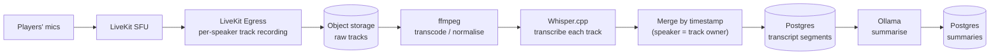

# Recording, Transcription & AI Summaries

Records are a **core** part of the design (decided 2026-11-05), not a plugin. This document is the
design sketch for the whole path: recording → consent cue → transcript → summaries → access.

**Status:** built, and **run end to end on the Docker Compose stack on 2026-11-12** (synthetic voices; see
[Verified on the Compose stack](#verified-on-the-compose-stack-2026-11-12)). The early sections are the design
as sketched; the dated "as built" sections below say what exists. Items marked **(open)** are undecided.

## Why server-side

Recording runs on the server (LiveKit Egress), not on the DM's client, because:

- Whisper.cpp, ffmpeg and the summarising LLM all live on the server anyway — the audio has to get
  there, and recording where it already is avoids an upload step.
- A client recorder dies with the DM's laptop, sleep, or crash. A server recorder doesn't care who
  is online.
- The server sees every participant's track; a client sees only what it is subscribed to.

The cost is that the server needs disk and CPU. That is the same server that already runs the SFU,
so it is a sizing note in [DEPLOYMENT-AND-TRANSPORT.md](DEPLOYMENT-AND-TRANSPORT.md), not a new class of thing.

## Pipeline

1. **Per-speaker tracks, not a mixed file.** Mixing destroys the one thing that makes diarisation
   free: if each track is one person, "who said it" is known without an ML diarisation step. It also
   lets us drop a single participant's audio (e.g. a player who asks not to be recorded, or a
   whisper) without re-processing everyone.
2. **Transcode** to a Whisper-friendly format (16 kHz mono) and keep a compact archival copy. The
   raw tracks are the retention-controlled artifact (see Retention).
3. **Transcribe each track** with Whisper.cpp, then **merge by timestamp** into one transcript with
   speaker = track owner. Overlapping speech is preserved instead of guessed at.
4. **Summarise** with a local LLM (Ollama). Outputs: session summary, chapter summaries,
   character-specific summaries, DM-only summaries (all four built 2026-11-12: a chapter is a stretch between
   pauses or between scenes, see [The table's cues and scene chapters](#the-tables-cues-and-scene-chapters-built-2026-11-13); a character summary is written for each player who spoke or typed, under their transcript name). Long sessions are map-reduce summarised
   (per-chunk, then combined) — local models have small effective context.
5. **Anchors:** summaries reference transcript timestamps. If DM markers stay in scope **(open)**,
   chapter summaries are cut at markers; otherwise at detected topic shifts.

Job orchestration, retries and the queue live in `ai/` (backed by Postgres/Redis). A failed stage
leaves the previous stages' output intact and is retryable from the Admin CLI without re-recording.

## Consent cue

Recording people is a trust matter before it is a technical one. The design is:

- **Start/stop cues.** When recording starts, every client plays "Session recording in progress";
  when it stops, a distinct stop sound.
- **Played locally.** Each client plays the cue itself from the Rust cue player. Consequences, all
  intended: the cue is never in the recording or the transcript; it plays even if the listener is
  muted; and it doesn't depend on the SFU.
- **Late joiners** hear the start cue _before_ their audio is captured — the server holds their
  track out of the recording until the client acknowledges the cue.
- **Rejoin after a network blip does not replay it.** Acknowledgement is tracked per player per
  recording, with a deliberate expiry (so a player who was away for hours hears it again).
- **State is server truth.** `recording: { active, startedAt, id }` lives in room/session metadata;
  clients render and react to it. A client that restarts mid-recording reads the state, not its memory.
- **Always visible.** The tray icon has a distinct recording state, and open panels show an
  indicator. A hidden app must never be ambiguous about whether it is being recorded.
- **Pause/resume (open).** Suggestion: pausing is a stop (cue plays), resuming a start (cue
  plays), so there is never a silent gap or silent re-start.
- Start and stop sounds must be clearly different from soundboard effects.

## The table's cues and scene chapters (built 2026-11-13)

Andy's ask: _a scene change should start a new chapter, and the transitions and soundboard/voice activity should
be in the recording's metadata so the AI can summarise against them_ ("a rich tapestry"). The words are the
record; **these are cues that colour the telling**, never events the model may build on.

**What the timeline now holds** (the same `recording_events` store and clock as typed chat: milliseconds from the
recording's start, written only while audio is being captured, so nothing is noted during a pause):

| Event (`event`) | What is noted                                                                                         | When                                                          |
| --------------- | ----------------------------------------------------------------------------------------------------- | ------------------------------------------------------------- |
| `scene`         | start: scene id, **name**, and the names of the sounds in its layers (the ambience); stop             | **By default** (`RECORD_CUES`, below)                         |
| `voice`         | the DM's character voice (`dragon`, `normal` …) and the DM's name                                     | Only if `RECORD_CUES` lists `voice` (the DM's app reports it) |
| `group`         | the party split or merge: each group's name and its members by name (an unchanged table is not noted) | Only if `RECORD_CUES` lists `groups`                          |
| `sound`         | a one-shot effect or loop played, by **name and category**, and a loop's stop                         | Only if `RECORD_CUES` lists `sounds`                          |

- **`RECORD_CUES`** (operator, in `.env`) chooses which cues are noted: a comma-separated list of `scene`, `voice`,
  `groups` (party splits and merges) and `sounds` (individual effects and loops), or `all` or `none`. **Unset means
  `scene` only**: a scene change is the one cue that starts a chapter, so it is the default; the rest are the operator's
  call. A cue is only ever **metadata (a name or an id), never audio**.
- **`RECORD_SOUNDBOARD=1`** is a separate, unrelated switch: it saves the DM's effects as a private audio file in the
  recording (testing only). It does not name anything in the timeline; `sounds` in `RECORD_CUES` does that.
- **A private talk is never recorded.** When the DM takes a player aside ([TABLE-FEATURES.md](TABLE-FEATURES.md#private-talk-the-dm-speaks-to-one-player-built-2026-11-14)),
  the capture stops both people's files and starts new ones when it ends; the timeline gets an `aside` event (the player's name,
  start and end) and the summaries are told that a private talk happened and was not recorded. It is not governed by `RECORD_CUES`:
  the privacy rule always applies.
- **Never private.** A sound played to chosen people only is not noted; whispers and `ooc` lines never reach the
  timeline; names are display text with control and invisible characters stripped (`cleanCueText`).
- **Known gaps:** a voice already on when a recording starts is noted at the next change, not at the start; a
  split already in place at the start likewise; anything done during a pause is not noted (and a scene started in
  a pause titles nothing).

**Chapters** (`ai/src/lib/chapters.ts`, `planChapters`, used by the worker and the API alike): a chapter starts at
the beginning, at every **resume** (always), and at every **scene start**, but a scene chapter with less than
**60 s of speech** folds into the one before it (the scene still shows as a cue inside it), so a DM flipping
through scenes does not leave dozens of tiny chapters. A scene the DM opens with, at the very start, titles the
first chapter. A chapter's **title is the scene running when it began** (cleared when the scene stops). The records
API returns `chapters: [{ number, startMs, title? }]` on a recording that has more than one, and each chapter
summary carries its `title`; the numbering and subjects (`chapter:2`) are unchanged.

**Prompts** (`ai/src/lib/cues.ts`, `format.ts`, `prompts.ts`): every summary's transcript has the cues woven in by
time as `[0:12:03] (cue) Scene started: "Drowned Crypt" (sounds: Dripping, Eerie hum)`, so map-reduce chunking
carries them for free. A chapter sees its own cues; the session, DM-only and character summaries see all of
them. When there are cues the prompt adds one rule: _cue lines are noted by the app, not speech; use them only to
say where and how things happened; they are not events, so do not invent what a sound meant, who made it, or
anything no one said or typed._ A chapter prompt also names its scene. **Bounded:** repeated effects collapse to
one line with a count ("Sound effect: "Drip" (6 times)"), and at most 40 cue lines go into any one summary
(scenes, group splits and voices are kept ahead of effects, with a "N more minor cues left out" line).

**History:** the transcript endpoint returns `markers` (`[{ atMs, kind: 'scene', text }]`) beside `utterances`,
and both History views draw a "Scene: <name>" divider among the lines. Effects, voices and groups stay out of the
transcript (they shape the summary, they are not lines to read).

**Not verified yet:** the Postgres migration `0032_recording_cues.sql` and the full pipeline with a real model
(unit tests only, no stack run); whether a local 8B model uses the cues well or over-reads them. The smoke test
(`infra/records-smoke/compose-e2e.ts`) now starts a scene mid-recording and checks the marker, the chapter title
and the timeline event, and records whether a summary names the scene as a metric.

## Privacy rules (hard)

- **Whispers and private channels are never recorded, transcribed or summarised into a shared
  artifact.** This is enforced where the audio is routed (a private group's track is excluded from
  Egress), not by filtering transcripts afterwards.
- **Out-of-character chat (`/ooc` and the quick commands) is never recorded.** Typed public chat during a recording goes into the transcript, except lines of kind `ooc`, which the server filters out where chat reaches the recording and search (see [CHAT-COMMANDS.md](CHAT-COMMANDS.md)).
- **DM-only summaries are DM-only** at the API level, not just hidden in the UI.
- **Nothing leaves the server by default.** Transcription and summarisation are local. A cloud
  provider (OpenAI Whisper API, a cloud LLM) is an explicit, operator-enabled adapter, and the UI
  says when session content is configured to leave the server.
- Everyone in the room can see that recording is on, and who can read the result.

## Access & retention

- Campaign members read their campaign's transcripts and non-DM-only summaries. Search across
  history is in scope.
- **Retention is operator-controlled** via the Admin CLI (raw tracks are the big files; transcripts
  and summaries are small). Backup/restore/delete exist for recordings, transcripts and summaries
  separately ([CLAUDE.md §7](../../.claude/CLAUDE.md)).
- The DM can delete a campaign's records; the operator can purge by policy.

## Sizing (measured 2026-11-12; details in the next section)

| Item                      | Measured                                                                                                                          | Note                                                                                                            |
| ------------------------- | --------------------------------------------------------------------------------------------------------------------------------- | --------------------------------------------------------------------------------------------------------------- |
| Raw audio, Opus per track | **12–29 MB per player-hour** (27 kbit/s for a mostly quiet track, up to 64 kbit/s for the DM, who talks most)                     | 5 players × 4 h ≈ 0.25–0.6 GB per session. Synthetic mic without DTX; a real client that sends DTX may be lower |
| Whisper.cpp, CPU          | `small` q5_1: **RTF 0.30** of the track's length (8-core desktop, 4 threads; 8 threads is no faster); `medium` q5_0: RTF 0.95     | Speech windows only, so silence costs nothing; `medium` was no more accurate on clean speech                    |
| Whisper.cpp, GPU          | GTX 1080: `small` RTF 0.024, `large-v3-turbo` q5_0 RTF 0.037, `medium` q5_0 RTF 0.044; ~0.6 / ~1.0 / ~1.0 GB of VRAM              | `large-v3-turbo` was the most accurate                                                                          |
| LLM, per summary          | GTX 1080: llama3.2:3b ~7 s, llama3.1:8b / qwen3:8b ~14–17 s. CPU: llama3.2:3b ~50 s, qwen3:8b ~150 s (a 3-minute scene's summary) | A recording gets 2 + chapters + one per player summaries; a long session is map-reduced (more calls)            |

Processing runs **after** the session by default; "live" summaries are a later enhancement that
depends on measured CPU headroom.

## Open questions

### Decided (Andy, 2026-11-05)

- **A campaign is one continuous entity.** Recording **start / stop / pause** events define the
  session bookmarks; no separate session object. (This supersedes DM markers as the _primary_
  anchors; DM-placed markers can still exist as extras.)
- **Collect rich metadata with every recording**: speaking indicators, mute/unmute, join/leave,
  active character, and other client events, timestamped. Combined with per-speaker tracks, this
  is used to attribute "who said what" and to resolve overlap/crosstalk.
- **No per-speaker opt-out.** Anyone who doesn't want to be recorded leaves the session. The
  consent cue and visible indicator are the whole consent mechanism.
- **Raw audio is deleted once the summary is processed and the DM confirms it.** Transcripts and
  summaries are kept. The DM manages this; the operator CLI can still purge.
- **Stale audio is purged by configurable rules** when the DM never confirms: on the next
  session starting, after an age limit, or when free storage drops below a threshold.

- **Recording status events:** `STARTED | IN-PROGRESS | PAUSED | RESUMED | STOPPED`. Each
  transition has a consent cue (resume replays it). `IN-PROGRESS` is what a late joiner or a
  rejoining client sees; it is a status on the server-owned recording flag, not a lifecycle
  that clients have to keep in sync.

- **Whisper model default depends on hardware:** chosen at setup (GPU detected or not), overridable
  by an environment variable or the CLI. **CPU-only → `small` q5_1**, **GPU → `large-v3-turbo` q5_0** —
  both confirmed by measurement on 2026-11-12 (see below); the GPU default is `compose.gpu.yml`'s.
- **Transcribe speech windows, not whole tracks — built** (`ai/src/lib/speechWindows.ts`; measured in AUDIO-SPIKE-RESULTS.md Finding 5, where the problem proved hardware-independent). Segment each track with a silence detector (ffmpeg `silencedetect` gave exact windows in the spike), transcribe the windows, and add each window's start offset. whisper.cpp's own `--vad` produced timestamps that drift by tens of seconds, and whole-track transcription both wastes time on silence and hallucinates text on room noise.
- **Standing consent is collected at account creation** ("you consent that you may be recorded…"),
  stored in Postgres against the user profile with a timestamp and the **version of the consent
  text**. A changed text re-prompts on next sign-in. The per-recording **cue** still plays: sign-up
  consent is the standing agreement, the cue is the in-the-moment notice.

### Capture as built (2026-11-07)

`RecordingCapture` (backend) follows the server's recording flag. On **start** it writes a durable `recordings` row and a `started` bookmark. It records a player's track only **after that player's app has acknowledged the start cue** (the reconciler runs on start, on every acknowledgement, and every 5 s, so late and re-published tracks need no webhooks). **Pause stops every file; resume starts new ones**, so one speaker can have several tracks per recording, each with a start offset relative to the recording. On **stop** it registers every finished file as a `recording_tracks` row and queues one `process-recording` job. LiveKit/Egress trouble is logged and retried; it never changes the recording state clients see. Files are named `<recording>/<account-id>@<time>`; the account id is the speaker, the transcript shows the active character or display name.

### The consent loop as built (2026-11-05)

The **server** owns the recording state (an id plus a status) and the per-player acknowledgements; each **client** plays its own local cue.

1. The DM starts, pauses, resumes or stops a recording (`POST /api/campaigns/:id/recording`, DM only).
2. The server announces `recording.status` (`STARTED` / `PAUSED` / `RESUMED` / `STOPPED`) to everyone subscribed to the campaign.
3. Each client plays the matching cue **locally**. For a start, the client first **closes its capture gate**, plays the cue, and only when it has finished sends `recording.ack` and opens the gate.
4. After every snapshot _or replay_, the server sends `recording.state`: the current state (`IN-PROGRESS` or `PAUSED`) and whether **this viewer** has already acknowledged. A late joiner gets `acknowledged: false`, so they hear the start cue before being captured. A quick reconnect gets `acknowledged: true`, so nothing replays. A reconnect after the expiry gets `false` again.
5. The DM is told who has acknowledged (`recording.ack.update`, DM only).

The acknowledgement lives on the **server** (in memory now; Valkey with a TTL is the plan), not in a file on the player's machine: nothing for a player to lose or fake, and it works across their devices. If a cue can't be played (no speakers), the gate opens anyway so the player isn't locked out of voice, but no acknowledgement is sent — the DM can see they haven't heard it.

What is _not_ built: the durable record of each recording (start/stop/pause timestamps as session bookmarks), the link to LiveKit Egress, and everything downstream of it (Stage 5). Today a recording is a flag and an id in memory.

### Still open

1. Default values for the purge rules, and whether the DM is warned before an automatic purge.
2. The acknowledgement expiry (30 minutes is an assumption; it is one constant) and whether it should be configurable per instance.

## While a recording runs (decided 2026-11-10)

A recording means a game is running, so the app protects it:

- **The DM cannot walk away from it.** While their campaign is recording, the DM cannot switch to another
  campaign (the app refuses, and the switcher says why) or hand over the DM role (the server answers
  `409`). Both wait for Stop. Players come and go freely; each campaign is its own voice room, so
  switching leaves one room and, as always, the player chooses Online to join the next.
- **If the DM's app drops, the recording carries on.** Nothing changes for `RECORDING_GRACE_SECONDS`
  (operator setting, 5 to 3600, default **30**). After that, **any player in the campaign** can pause,
  resume or stop it (never start one); the buttons appear in their top bar and the server enforces the
  same rule. The moment the DM reconnects, control is theirs alone again; a recording a player paused
  stays paused until the DM resumes it. "The DM's connection" means their app's link to the server, not
  voice, so going Offline in voice does not count as being away.
- **If everyone drops, it stops by itself.** When nobody is connected to the campaign for the grace
  period, the server stops the recording and processes it as normal. Anyone who returns inside the period
  keeps it going.
- **Chat in the transcript.** Lines typed into the **public** chat from start to stop (pauses included) are
  kept on the recording's timeline and merged into the transcript and summaries, marked "(typed)", for
  example `[0:42:10] Aria (typed): Anyone smell brine?`. **Whispers, and the DM's private lines, are
  never included**: the server only hands public lines to the recording, and the processing step ignores
  any chat event that names a recipient. Chat outside a recording is not kept for transcripts. Typed lines are
  searchable with the rest (a hit says who typed it and when, marked "(typed)").

## Retention: raw audio is the part that fills the disk (decided and built 2026-11-10)

The transcript and the summaries are text and tiny; the per-speaker audio files are not. So the audio is
what retention removes, and the text is kept for good.

- **By time (automatic):** `RECORDING_RETENTION_DAYS` (set on the worker; blank or 0 keeps audio for ever).
  Every six hours the worker looks for **processed** recordings that stopped more than that many days ago
  and still have audio, and queues one `purge-recording` job each. The job deletes the track files, removes
  the recording's empty folder, and records `purged_at` on each track. It is safe to repeat and does not
  mind a file that is already gone.
- **By hand:** `vtt-admin recording purge <id>` or `recording purge --older-than <days>` queue the same
  jobs (the worker, which can see the audio, does the deleting). A recording that is **not processed
  yet is refused**: its audio is still the input to the transcript.
- **What it never touches:** transcripts, summaries, the recording's timeline, or any file outside the
  recordings folder (the worker refuses a path that is not under `RECORDINGS_DIR`).
- **What it costs you:** after a purge, `recording reprocess --retranscribe` is refused (there is nothing to
  transcribe); redoing only the **summaries** still works, from the kept transcript.
- **Who can see it:** `vtt-admin recording list` shows "audio kept / purged" for each recording, and the
  session history shows the DM "audio deleted". Players are not told.
- **The DM confirms (built 2026-11-10):** on a **processed** recording that still has audio, the DM sees "The
  summary is good: delete the audio" in the tray's session history, behind a "this cannot be undone" step.
  `POST /api/campaigns/:id/recordings/:rid/audio/delete` (DM only; 409 if not processed or nothing left) queues
  the same `purge-recording` job, so the worker does the deleting. It is **not** in the phone app, by decision:
  a mistap there would delete audio for good.
- **When the disk runs low (built 2026-11-10, decided with Andy):** below 10% free on the recordings disk the
  worker (hourly) picks the **oldest** processed recordings that still have audio and gives their DM a stored
  notification (`audio.purge`; shown as a pop-up under the "session" notification setting) and a note in the
  history with the date. Three days after the warning it queues the purge. Below **3%** free there is no wait.
  At most two recordings per kind per check, so one run cannot clear a library. `AUDIO_DISK_PURGE=0` turns the
  rule off. There is **no "keep this one" button**: the DM can only delete sooner or let it happen; the operator
  can switch the rule off or free space another way. (A hold would be a small addition if it is missed.)
- **When the next session starts (built 2026-11-13, off by default):** operator setting
  `audio-purge-next-session` (`vtt-admin settings set audio-purge-next-session on`). When a recording starts, the
  backend queues the ordinary `purge-recording` job for that campaign's **earlier** recordings that are
  `processed` and still hold audio. It never touches one that is queued, processing or failed, one without
  audio, the new recording, or another campaign's. There is no separate "DM confirmed" flag: the DM's confirm
  _is_ the delete button, so any processed recording that still has audio is by definition unconfirmed, which
  is exactly who this stale rule is for. It has no DM warning (it is an explicit operator setting, like the age
  rule). A failure reading the setting or queueing is logged and never stops the new recording.
- **Not built:** the DM warning on any rule but the disk one (the age rule, `RECORDING_RETENTION_DAYS`, is the
  operator's explicit setting and still deletes without a notice).

## When the server restarts mid-recording (built and drilled 2026-11-10)

Recording state lives in the backend's memory, but Egress is a separate process and **keeps writing**
when the backend goes away. Before this was handled, a restart had two bad outcomes: the app showed
"not recording" while every voice was still being captured (a consent problem, principle 4), and the audio
already captured was never registered or processed (a lost recording).

On startup, for each recording the database still calls `recording` that this process knows nothing about,
`RecordingCapture.recoverInterrupted()`:

1. asks LiveKit for the room's track egresses and picks this recording's out by the path each was started
   with (`<dir>/<recordingId>/<speaker>@{time}`, so no new table or column is needed);
2. stops every one still running and waits for its file;
3. keeps the files as tracks, closes the recording as `stopped` (events `interrupted`, `stopped`) and queues
   processing, so what was said up to the restart is transcribed and summarised like any recording;
4. only if LiveKit **cannot be asked** does it mark the recording `failed` and log `could not recover`, so the
   failure is loud. A recording with no egress on record is also marked `failed`.

After that the DM starts a new recording; the clients, which read state from the server, now truthfully see none.
**Not handled:** carrying on recording across a restart without a gap (it would need the consent
acknowledgements, which are also in memory, to survive too), and a restart while paused (the paused flag is
memory too; the recording is recovered the same way).

Drilled against a real LiveKit server and a real Egress with `infra/records-smoke/restart-drill.sh`: a speaker is
recorded, the process "restarts", recovery stops the egress and keeps a playable file. It passed on
2026-11-10 on the dev PC. The drill's backend side runs in one process (a fresh `RecordingCapture`
standing in for the restarted backend); a real `kill -9` of the packaged backend is not drilled.

## Verified on the Compose stack (2026-11-12)

`infra/records-smoke/compose-e2e.ts` ran the whole path on the local Docker Compose stack (records profile,
GPU override, GTX 1080 8 GB, 8-core desktop, 31 GB RAM): four people (DM + three players) connected over
the WebSocket and to LiveKit through Caddy's `wss://`, each publishing synthetic speech (piper TTS, four
voices) as their microphone; the DM recorded through the real API; every app acknowledged the cue.

**Passed (66 checks):** every connected app acknowledged; the late joiner was told "in progress, not
acknowledged" and **nothing they said before acknowledging was captured**; words spoken while paused were not
captured; per-speaker word accuracy 0.97–1.00 with no line under the wrong name; typed `chat`, `/say` and
`/do` lines in the transcript marked typed; **the `/ooc` line, the `/late` quick line, a `/dm` and a `/tell`
whisper appeared nowhere** (transcript, summaries, search as DM and as player); session, DM-only, two chapter
and three character summaries; DM-only never returned to a player (detail, list, search); search found a
spoken and a typed phrase; a second recording needed (and got) fresh acknowledgements; **`docker compose kill
worker` mid-job → the job finished on attempt 2** after the 5-minute lease; with transcription pointed at an
unreachable server and a 20 s fallback, **the worker fell back to the local Whisper** and the recording was
processed. A backend recreated mid-recording (by another session) was also recovered as designed: egresses
stopped, audio kept, processing queued.

**Measured** (same machine; Whisper through the worker's own windowing code, `whisper-bench.ts`, a 6.5-minute
Opus track of the scene's lines in four voices; LLM through `llm-bench.ts` on the recorded scene's transcript):

| Whisper                   | RTF (time ÷ audio) | Word accuracy | Peak memory         |
| ------------------------- | ------------------ | ------------- | ------------------- |
| GPU `small` q5_1          | 0.024              | 0.982         | ~0.6 GB VRAM        |
| GPU `medium` q5_0         | 0.044              | 0.980         | ~1.0 GB VRAM        |
| GPU `large-v3-turbo` q5_0 | 0.037              | **0.988**     | ~1.0 GB VRAM        |
| CPU `small` q5_1, 4 thr   | 0.30               | 0.982         | 0.4 GB RAM, 4 cores |
| CPU `small` q5_1, 8 thr   | 0.32 (no faster)   | 0.982         | 0.4 GB RAM          |
| CPU `medium` q5_0, 8 thr  | 0.95               | 0.984         | 0.9 GB RAM          |

| LLM (one summary of a 3-min scene) | GTX 1080 | CPU    | VRAM    | Judged quality                                                                                                 |
| ---------------------------------- | -------- | ------ | ------- | -------------------------------------------------------------------------------------------------------------- |
| llama3.2:3b                        | ~7 s     | ~50 s  | ~2.7 GB | Readable, but **invents** (an NPC "Cattil" and her promise; the eel "defeated"; the party "entering" the door) |
| llama3.1:8b                        | ~14 s    | —      | ~5.2 GB | Faithful and well ordered; a stray meta remark, one invented "promise" in a character summary                  |
| qwen3:8b (thinking off)            | ~15 s    | ~150 s | ~5.5 GB | **Most faithful**, best structure, correct who-did-what (one slip: who asked about the inscription)            |

Peaks during a full e2e run on the GPU: VRAM 7.1 GB of 8 (desktop 1.1 GB + Ollama), Ollama 6.3 GB RAM, Whisper
0.35 GB, Egress 0.18 GB and ~1.3 cores while recording four tracks, worker 75 MB. **Idle, the card is back at the
desktop's ~1.1 GB** (Whisper stops after 60 s idle, Ollama unloads after 2 min). Audio: 12–29 MB per player-hour.

**Defaults chosen:**

- **GPU (compose.gpu.yml): Whisper `large-v3-turbo` q5_0 + `qwen3:8b`.** Turbo was the most accurate and only
  ~1.5× slower than `small`; a 4-hour, five-player session is a few minutes of Whisper. qwen3:8b gave the most
  faithful summaries for ~2× llama3.2:3b's time, still about 15 s a summary; both fit an 8 GB card one after
  the other (the worker never runs them together). Smaller cards: `small` + `llama3.2:3b`.
- **CPU (compose.yml): Whisper `small` q5_1 (4 threads, whisper-server's default) + `llama3.2:3b`.** `medium` costs
  3× for no measurable gain on clean speech; 8 threads were no faster than 4. qwen3:8b would be the better
  summariser but is ~3× slower on CPU (a long session's summaries go from hours to most of a night) and needs
  ~6 GB of RAM, so it stays an opt-in (`OLLAMA_MODEL=qwen3:8b`) for CPU servers with the memory and patience.
- Ollama is always called with thinking off (reasoning models otherwise spend minutes on hidden text), and any
  `<think>` block a server returns is stripped.

**Still unverified:** real human voices, room noise, echo and crosstalk (TTS flatters accuracy); a real
4-hour session's map-reduce summaries (the scene fits one model call); the Rust desktop client and phone app as
the recorded clients (the e2e uses LiveKit's Node SDK); a CPU-only server end to end (CPU numbers are the
same Whisper/LLM measured standalone).
