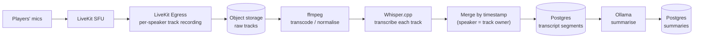

# Recording, Transcription & AI Summaries

Records are a **core** part of the design (decided 2026-11-05), not a plugin. This document is the
design sketch for the whole path: recording → consent cue → transcript → summaries → access.

**Status:** design sketch; nothing here is implemented. Items marked **(open)** are undecided.

## Why server-side

Recording runs on the server (LiveKit Egress), not on the DM's client, because:

- Whisper.cpp, ffmpeg and the summarising LLM all live on the server anyway — the audio has to get
  there, and recording where it already is avoids an upload step.
- A client recorder dies with the DM's laptop, sleep, or crash. A server recorder doesn't care who
  is online.
- The server sees every participant's track; a client sees only what it is subscribed to.

The cost is that the server needs disk and CPU. That is the same server that already runs the SFU,
so it is a sizing note in [DEPLOYMENT-AND-TRANSPORT.md](DEPLOYMENT-AND-TRANSPORT.md), not a new class of thing.

## Pipeline

1. **Per-speaker tracks, not a mixed file.** Mixing destroys the one thing that makes diarisation
   free: if each track is one person, "who said it" is known without an ML diarisation step. It also
   lets us drop a single participant's audio (e.g. a player who asks not to be recorded, or a
   whisper) without re-processing everyone.
2. **Transcode** to a Whisper-friendly format (16 kHz mono) and keep a compact archival copy. The
   raw tracks are the retention-controlled artifact (see Retention).
3. **Transcribe each track** with Whisper.cpp, then **merge by timestamp** into one transcript with
   speaker = track owner. Overlapping speech is preserved instead of guessed at.
4. **Summarise** with a local LLM (Ollama). Outputs: session summary, chapter summaries,
   character-specific summaries, DM-only summaries. Long sessions are map-reduce summarised
   (per-chunk, then combined) — local models have small effective context.
5. **Anchors:** summaries reference transcript timestamps. If DM markers stay in scope **(open)**,
   chapter summaries are cut at markers; otherwise at detected topic shifts.

Job orchestration, retries and the queue live in `ai/` (backed by Postgres/Redis). A failed stage
leaves the previous stages' output intact and is retryable from the Admin CLI without re-recording.

## Consent cue

Recording people is a trust matter before it is a technical one. The design is:

- **Start/stop cues.** When recording starts, every client plays "Session recording in progress";
  when it stops, a distinct stop sound.
- **Played locally.** Each client plays the cue itself from the Rust cue player. Consequences, all
  intended: the cue is never in the recording or the transcript; it plays even if the listener is
  muted; and it doesn't depend on the SFU.
- **Late joiners** hear the start cue _before_ their audio is captured — the server holds their
  track out of the recording until the client acknowledges the cue.
- **Rejoin after a network blip does not replay it.** Acknowledgement is tracked per player per
  recording, with a deliberate expiry (so a player who was away for hours hears it again).
- **State is server truth.** `recording: { active, startedAt, id }` lives in room/session metadata;
  clients render and react to it. A client that restarts mid-recording reads the state, not its memory.
- **Always visible.** The tray icon has a distinct recording state, and open panels show an
  indicator. A hidden app must never be ambiguous about whether it is being recorded.
- **Pause/resume (open).** Suggestion: pausing is a stop (cue plays), resuming a start (cue
  plays), so there is never a silent gap or silent re-start.
- Start and stop sounds must be clearly different from soundboard effects.

## Privacy rules (hard)

- **Whispers and private channels are never recorded, transcribed or summarised into a shared
  artifact.** This is enforced where the audio is routed (a private group's track is excluded from
  Egress), not by filtering transcripts afterwards.
- **DM-only summaries are DM-only** at the API level, not just hidden in the UI.
- **Nothing leaves the server by default.** Transcription and summarisation are local. A cloud
  provider (OpenAI Whisper API, a cloud LLM) is an explicit, operator-enabled adapter, and the UI
  says when session content is configured to leave the server.
- Everyone in the room can see that recording is on, and who can read the result.

## Access & retention

- Campaign members read their campaign's transcripts and non-DM-only summaries. Search across
  history is in scope.
- **Retention is operator-controlled** via the Admin CLI (raw tracks are the big files; transcripts
  and summaries are small). Backup/restore/delete exist for recordings, transcripts and summaries
  separately ([CLAUDE.md §7](../../.claude/CLAUDE.md)).
- The DM can delete a campaign's records; the operator can purge by policy.

## Sizing (rough, to be measured in the Stage 2 spike)

| Item                      | Estimate                                                                                                                                                                   | Note                                                                                                                                                          |
| ------------------------- | -------------------------------------------------------------------------------------------------------------------------------------------------------------------------- | ------------------------------------------------------------------------------------------------------------------------------------------------------------- |
| Raw audio, Opus per track | ~30–60 MB per speaker-hour                                                                                                                                                 | 5 players × 4 h ≈ 0.6–1.2 GB per session before transcode                                                                                                     |
| Whisper.cpp               | **Measured 2026-11-07 (8-core desktop, `small` q5_1):** RTF ~0.77 on continuous speech, ~0.13 on a sparse track once silence is skipped. `medium` and GPU not yet measured | Skip silence by segmenting each track ourselves — see [AUDIO-SPIKE-RESULTS.md](AUDIO-SPIKE-RESULTS.md) Finding 4. Per-speaker tracks multiply the audio-hours |
| LLM summary               | Minutes per session on CPU with a small model                                                                                                                              | Run after the session, not live                                                                                                                               |

Processing runs **after** the session by default; "live" summaries are a later enhancement that
depends on measured CPU headroom.

## Open questions

### Decided (Andy, 2026-11-05)

- **A campaign is one continuous entity.** Recording **start / stop / pause** events define the
  session bookmarks; no separate session object. (This supersedes DM markers as the _primary_
  anchors; DM-placed markers can still exist as extras.)
- **Collect rich metadata with every recording**: speaking indicators, mute/unmute, join/leave,
  active character, and other client events, timestamped. Combined with per-speaker tracks, this
  is used to attribute "who said what" and to resolve overlap/crosstalk.
- **No per-speaker opt-out.** Anyone who doesn't want to be recorded leaves the session. The
  consent cue and visible indicator are the whole consent mechanism.
- **Raw audio is deleted once the summary is processed and the DM confirms it.** Transcripts and
  summaries are kept. The DM manages this; the operator CLI can still purge.
- **Stale audio is purged by configurable rules** when the DM never confirms: on the next
  session starting, after an age limit, or when free storage drops below a threshold.

- **Recording status events:** `STARTED | IN-PROGRESS | PAUSED | RESUMED | STOPPED`. Each
  transition has a consent cue (resume replays it). `IN-PROGRESS` is what a late joiner or a
  rejoining client sees; it is a status on the server-owned recording flag, not a lifecycle
  that clients have to keep in sync.

- **Whisper model default depends on hardware:** chosen at setup (GPU detected or not), overridable
  by an environment variable or the CLI. Proposed starting points, to be validated by the
  Stage 2 spike: **CPU-only → `small` (quantised)**, **GPU → `large-v3-turbo`**. (`small` q5_1 on CPU is confirmed workable; the GPU choice is still unmeasured.)
- **Transcribe speech windows, not whole tracks — built** (`ai/src/lib/speechWindows.ts`; measured in AUDIO-SPIKE-RESULTS.md Finding 5, where the problem proved hardware-independent). Segment each track with a silence detector (ffmpeg `silencedetect` gave exact windows in the spike), transcribe the windows, and add each window's start offset. whisper.cpp's own `--vad` produced timestamps that drift by tens of seconds, and whole-track transcription both wastes time on silence and hallucinates text on room noise.
- **Standing consent is collected at account creation** ("you consent that you may be recorded…"),
  stored in Postgres against the user profile with a timestamp and the **version of the consent
  text**. A changed text re-prompts on next sign-in. The per-recording **cue** still plays: sign-up
  consent is the standing agreement, the cue is the in-the-moment notice.

### Capture as built (2026-11-07)

`RecordingCapture` (backend) follows the server's recording flag. On **start** it writes a durable `recordings` row and a `started` bookmark. It records a player's track only **after that player's app has acknowledged the start cue** (the reconciler runs on start, on every acknowledgement, and every 5 s, so late and re-published tracks need no webhooks). **Pause stops every file; resume starts new ones**, so one speaker can have several tracks per recording, each with a start offset relative to the recording. On **stop** it registers every finished file as a `recording_tracks` row and queues one `process-recording` job. LiveKit/Egress trouble is logged and retried; it never changes the recording state clients see. Files are named `<recording>/<account-id>@<time>`; the account id is the speaker, the transcript shows the active character or display name.

### The consent loop as built (2026-11-05)

The **server** owns the recording state (an id plus a status) and the per-player acknowledgements; each **client** plays its own local cue.

1. The DM starts, pauses, resumes or stops a recording (`POST /api/campaigns/:id/recording`, DM only).
2. The server announces `recording.status` (`STARTED` / `PAUSED` / `RESUMED` / `STOPPED`) to everyone subscribed to the campaign.
3. Each client plays the matching cue **locally**. For a start, the client first **closes its capture gate**, plays the cue, and only when it has finished sends `recording.ack` and opens the gate.
4. After every snapshot _or replay_, the server sends `recording.state`: the current state (`IN-PROGRESS` or `PAUSED`) and whether **this viewer** has already acknowledged. A late joiner gets `acknowledged: false`, so they hear the start cue before being captured. A quick reconnect gets `acknowledged: true`, so nothing replays. A reconnect after the expiry gets `false` again.
5. The DM is told who has acknowledged (`recording.ack.update`, DM only).

The acknowledgement lives on the **server** (in memory now; Valkey with a TTL is the plan), not in a file on the player's machine: nothing for a player to lose or fake, and it works across their devices. If a cue can't be played (no speakers), the gate opens anyway so the player isn't locked out of voice, but no acknowledgement is sent — the DM can see they haven't heard it.

What is _not_ built: the durable record of each recording (start/stop/pause timestamps as session bookmarks), the link to LiveKit Egress, and everything downstream of it (Stage 5). Today a recording is a flag and an id in memory.

### Still open

1. Default values for the purge rules, and whether the DM is warned before an automatic purge.
2. The acknowledgement expiry (30 minutes is an assumption; it is one constant) and whether it should be configurable per instance.

## While a recording runs (decided 2026-11-10)

A recording means a game is running, so the app protects it:

- **The DM cannot walk away from it.** While their campaign is recording, the DM cannot switch to another
  campaign (the app refuses, and the switcher says why) or hand over the DM role (the server answers
  `409`). Both wait for Stop. Players come and go freely; each campaign is its own voice room, so
  switching leaves one room and, as always, the player chooses Online to join the next.
- **If the DM's app drops, the recording carries on.** Nothing changes for `RECORDING_GRACE_SECONDS`
  (operator setting, 5 to 3600, default **30**). After that, **any player in the campaign** can pause,
  resume or stop it (never start one); the buttons appear in their top bar and the server enforces the
  same rule. The moment the DM reconnects, control is theirs alone again; a recording a player paused
  stays paused until the DM resumes it. "The DM's connection" means their app's link to the server, not
  voice, so going Offline in voice does not count as being away.
- **If everyone drops, it stops by itself.** When nobody is connected to the campaign for the grace
  period, the server stops the recording and processes it as normal. Anyone who returns inside the period
  keeps it going.
- **Chat in the transcript.** Lines typed into the **public** chat from start to stop (pauses included) are
  kept on the recording's timeline and merged into the transcript and summaries, marked "(typed)", for
  example `[0:42:10] Aria (typed): Anyone smell brine?`. **Whispers, and the DM's private lines, are
  never included**: the server only hands public lines to the recording, and the processing step ignores
  any chat event that names a recipient. Chat outside a recording is not kept for transcripts. Typed lines are
  searchable with the rest (a hit says who typed it and when, marked "(typed)").

## Retention: raw audio is the part that fills the disk (decided and built 2026-11-10)

The transcript and the summaries are text and tiny; the per-speaker audio files are not. So the audio is
what retention removes, and the text is kept for good.

- **By time (automatic):** `RECORDING_RETENTION_DAYS` (set on the worker; blank or 0 keeps audio for ever).
  Every six hours the worker looks for **processed** recordings that stopped more than that many days ago
  and still have audio, and queues one `purge-recording` job each. The job deletes the track files, removes
  the recording's empty folder, and records `purged_at` on each track. It is safe to repeat and does not
  mind a file that is already gone.
- **By hand:** `vtt-admin recording purge <id>` or `recording purge --older-than <days>` queue the same
  jobs (the worker, which can see the audio, does the deleting). A recording that is **not processed
  yet is refused**: its audio is still the input to the transcript.
- **What it never touches:** transcripts, summaries, the recording's timeline, or any file outside the
  recordings folder (the worker refuses a path that is not under `RECORDINGS_DIR`).
- **What it costs you:** after a purge, `recording reprocess --retranscribe` is refused (there is nothing to
  transcribe); redoing only the **summaries** still works, from the kept transcript.
- **Who can see it:** `vtt-admin recording list` shows "audio kept / purged" for each recording, and the
  session history shows the DM "audio deleted". Players are not told.
- **Not built:** the DM confirming a summary before the audio goes (the retention window is the confirmation);
  a disk-usage figure on the status page or in the CLI (use `df -h` and `du -sh` on the recordings volume).
