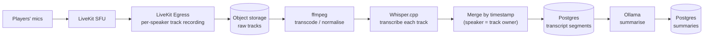

# Recording, Transcription & AI Summaries

Records are a **core** part of the design (decided 2026-11-05), not a plugin. This document is the
design sketch for the whole path: recording → consent cue → transcript → summaries → access.

**Status:** design sketch; nothing here is implemented. Items marked **(open)** are undecided.

## Why server-side

Recording runs on the server (LiveKit Egress), not on the DM's client, because:

- Whisper.cpp, ffmpeg and the summarising LLM all live on the server anyway — the audio has to get
  there, and recording where it already is avoids an upload step.
- A client recorder dies with the DM's laptop, sleep, or crash. A server recorder doesn't care who
  is online.
- The server sees every participant's track; a client sees only what it is subscribed to.

The cost is that the server needs disk and CPU. That is the same server that already runs the SFU,
so it is a sizing note in [DEPLOYMENT-AND-TRANSPORT.md](DEPLOYMENT-AND-TRANSPORT.md), not a new class of thing.

## Pipeline

1. **Per-speaker tracks, not a mixed file.** Mixing destroys the one thing that makes diarisation
   free: if each track is one person, "who said it" is known without an ML diarisation step. It also
   lets us drop a single participant's audio (e.g. a player who asks not to be recorded, or a
   whisper) without re-processing everyone.
2. **Transcode** to a Whisper-friendly format (16 kHz mono) and keep a compact archival copy. The
   raw tracks are the retention-controlled artifact (see Retention).
3. **Transcribe each track** with Whisper.cpp, then **merge by timestamp** into one transcript with
   speaker = track owner. Overlapping speech is preserved instead of guessed at.
4. **Summarise** with a local LLM (Ollama). Outputs: session summary, chapter summaries,
   character-specific summaries, DM-only summaries. Long sessions are map-reduce summarised
   (per-chunk, then combined) — local models have small effective context.
5. **Anchors:** summaries reference transcript timestamps. If DM markers stay in scope **(open)**,
   chapter summaries are cut at markers; otherwise at detected topic shifts.

Job orchestration, retries and the queue live in `ai/` (backed by Postgres/Redis). A failed stage
leaves the previous stages' output intact and is retryable from the Admin CLI without re-recording.

## Consent cue

Recording people is a trust matter before it is a technical one. The design is:

- **Start/stop cues.** When recording starts, every client plays "Session recording in progress";
  when it stops, a distinct stop sound.
- **Played locally.** Each client plays the cue itself from the Rust cue player. Consequences, all
  intended: the cue is never in the recording or the transcript; it plays even if the listener is
  muted; and it doesn't depend on the SFU.
- **Late joiners** hear the start cue _before_ their audio is captured — the server holds their
  track out of the recording until the client acknowledges the cue.
- **Rejoin after a network blip does not replay it.** Acknowledgement is tracked per player per
  recording, with a deliberate expiry (so a player who was away for hours hears it again).
- **State is server truth.** `recording: { active, startedAt, id }` lives in room/session metadata;
  clients render and react to it. A client that restarts mid-recording reads the state, not its memory.
- **Always visible.** The tray icon has a distinct recording state, and open panels show an
  indicator. A hidden app must never be ambiguous about whether it is being recorded.
- **Pause/resume (open).** Suggestion: pausing is a stop (cue plays), resuming a start (cue
  plays), so there is never a silent gap or silent re-start.
- Start and stop sounds must be clearly different from soundboard effects.

## Privacy rules (hard)

- **Whispers and private channels are never recorded, transcribed or summarised into a shared
  artifact.** This is enforced where the audio is routed (a private group's track is excluded from
  Egress), not by filtering transcripts afterwards.
- **DM-only summaries are DM-only** at the API level, not just hidden in the UI.
- **Nothing leaves the server by default.** Transcription and summarisation are local. A cloud
  provider (OpenAI Whisper API, a cloud LLM) is an explicit, operator-enabled adapter, and the UI
  says when session content is configured to leave the server.
- Everyone in the room can see that recording is on, and who can read the result.

## Access & retention

- Campaign members read their campaign's transcripts and non-DM-only summaries. Search across
  history is in scope.
- **Retention is operator-controlled** via the Admin CLI (raw tracks are the big files; transcripts
  and summaries are small). Backup/restore/delete exist for recordings, transcripts and summaries
  separately ([CLAUDE.md §7](../../.claude/CLAUDE.md)).
- The DM can delete a campaign's records; the operator can purge by policy.

## Sizing (rough, to be measured in the Stage 2 spike)

| Item | Estimate | Note |
| --- | --- | --- |
| Raw audio, Opus per track | ~30–60 MB per speaker-hour | 5 players × 4 h ≈ 0.6–1.2 GB per session before transcode |
| Whisper.cpp | CPU `medium`/`small` runs near or below real-time per track on a modest server; a GPU changes everything | The real constraint on old hardware — measure, don't assume |
| LLM summary | Minutes per session on CPU with a small model | Run after the session, not live |

Processing runs **after** the session by default; "live" summaries are a later enhancement that
depends on measured CPU headroom.

## Open questions

### Decided (Andy, 2026-11-05)

- **A campaign is one continuous entity.** Recording **start / stop / pause** events define the
  session bookmarks; no separate session object. (This supersedes DM markers as the *primary*
  anchors; DM-placed markers can still exist as extras.)
- **Collect rich metadata with every recording**: speaking indicators, mute/unmute, join/leave,
  active character, and other client events, timestamped. Combined with per-speaker tracks, this
  is used to attribute "who said what" and to resolve overlap/crosstalk.
- **No per-speaker opt-out.** Anyone who doesn't want to be recorded leaves the session. The
  consent cue and visible indicator are the whole consent mechanism.
- **Raw audio is deleted once the summary is processed and the DM confirms it.** Transcripts and
  summaries are kept. The DM manages this; the operator CLI can still purge.
- **Stale audio is purged by configurable rules** when the DM never confirms: on the next
  session starting, after an age limit, or when free storage drops below a threshold.

- **Recording status events:** `STARTED | IN-PROGRESS | PAUSED | RESUMED | STOPPED`. Each
  transition has a consent cue (resume replays it). `IN-PROGRESS` is what a late joiner or a
  rejoining client sees; it is a status on the server-owned recording flag, not a lifecycle
  that clients have to keep in sync.

- **Whisper model default depends on hardware:** chosen at setup (GPU detected or not), overridable
  by an environment variable or the CLI. Proposed starting points, to be validated by the
  Stage 2 spike: **CPU-only → `small` (quantised)**, **GPU → `large-v3-turbo`**.
- **Standing consent is collected at account creation** ("you consent that you may be recorded…"),
  stored in Postgres against the user profile with a timestamp and the **version of the consent
  text**. A changed text re-prompts on next sign-in. The per-recording **cue** still plays: sign-up
  consent is the standing agreement, the cue is the in-the-moment notice.

### Still open

1. Default values for the purge rules, and whether the DM is warned before an automatic purge.
2. Where the *per-recording* cue acknowledgement lives. Proposed: Redis with a TTL (it is
   ephemeral and expires by design); Postgres keeps only the sign-up consent record.
