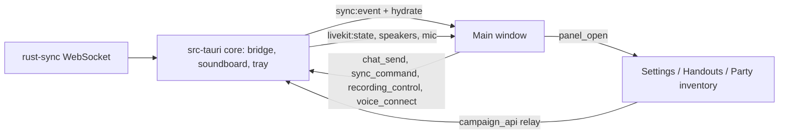

# Table Features (Stage 6)

Server first, then UI (decided by Andy, 2026-11-07). This document records what each table feature
does, the rules that matter for privacy, and what is deliberately not built yet. Decisions marked
**decided** came from Andy; the rest are defaults taken so work could continue, easy to change.

| Feature                                                                                      | State        |
| -------------------------------------------------------------------------------------------- | ------------ |
| Chat and whispers                                                                            | built, below |
| Handouts, maps, images, text snippets                                                        | planned      |
| Loot drops with pickers                                                                      | planned      |
| DM soundboard (a mini [thaumaturgy.app](https://thaumaturgy.app/) with the DM's own library) | planned      |
| Party split                                                                                  | built        |
| Session schedule, RSVP, stored notifications                                                 | planned      |

## Chat and whispers (built)

- **Table chat** goes over the WebSocket (`chat.message`), is stored in Postgres (`chat_messages`), and
  rides the shared replay stream as before. Every line carries a stable `id`, so a client that sees
  the same line from a replay and from history keeps one copy.
- **Whispers** (**decided**): DM↔player and player↔player, **private to the two**. The DM cannot read a
  player-to-player whisper. A whisper is `chat.message` with `to: <userId>`.
  - It is delivered as `chat.whisper` to the sender's and recipient's own sockets only (every device of
    the two people), never broadcast.
  - It is **not in the shared replay stream** — that stream is replayed to every resuming client, so a
    whisper in it would leak. Instead, each viewer gets their own recent whispers (`recentWhispers`) in
    a snapshot, or a `chat.whispers` frame alongside a replay. Clients merge by `id`.
  - Whispering yourself, a non-member or an unknown id gets the same `invalid_recipient` answer, so
    it cannot be used to probe who is in a campaign.
  - Whisper **voice** (private audio) is not built; when it is, its audio must be excluded from
    recording at the routing layer (RECORDING-AND-SUMMARIES.md).
- **History** (`GET /api/campaigns/:id/chat?before=&limit=`) returns the newest page the viewer may
  see. The visibility rule is in the store query (`listChat(campaign, viewer)`), not in callers.
- **Bounded retention:** the newest 5 000 lines per campaign are kept (whispers included); older ones
  are pruned every 50 writes. One constant (`CHAT_RETENTION_MESSAGES`); not yet an operator setting.

## Handouts, maps, images and text snippets (built)

- **What:** a DM prepares handouts as **drafts** (DM-only) and **shows** them to everyone or to chosen
  players; **hide** takes one back to a draft; the DM can delete. A text snippet is a handout with a
  body (≤ 20 000 characters) and needs no file storage.
- **Files** (**decided:** a server volume, metadata in Postgres): `MEDIA_DIR` holds the bytes under the
  file's id; `media_files` and `handouts` (migration 0007) hold everything that decides access.
  - Type is decided from the **bytes**, never the filename or `Content-Type`. Accepted: PNG, JPEG, GIF,
    WebP, PDF. HTML, SVG, scripts and executables are rejected (415), so an upload can never become
    something a browser would run. A PDF sent as an image (or the reverse) is rejected.
  - Limits: 10 MB per file; 1 GB per campaign (413 beyond).
  - Downloads are served only to people allowed to see that handout, with `X-Content-Type-Options:
nosniff` and `Content-Security-Policy: default-src 'none'; sandbox`.
  - The disk store validates ids, so a name can never escape the media directory.
- **Visibility** is applied in the store (SQL for Postgres), not by callers: the DM sees everything;
  others see handouts shown to everyone or to them. A handout you cannot see is `404`, exactly as if it
  did not exist; one reached through another campaign's URL is also `404`.
- **Live:** `handout.shown` goes to exactly the people who may now see it (plus the DM's sockets);
  `handout.removed` goes to everyone when one is hidden or deleted; `handout.changed` (`{campaignId,
handoutId}`, a fact only) goes to the same audience as `handout.shown` when a shown handout is edited,
  so clients read the list again (a DM-only draft edit sends nothing). A reconnecting client re-reads
  `GET /api/campaigns/:id/handouts`.
- **Not built:** sweeping media files when a whole campaign is deleted; thumbnails; image dimension limits.

## Handout kinds (reshaped 2026-11-10)

A handout is **one** of three things, never a mix: a **note** (Markdown), a **set of pictures** (one to twelve,
shown in order), or **one PDF**. Any of them can carry a short **caption** (a note's text is its body; for
the others the body is the caption, up to 300 characters in the form). Maps are pictures.

- In chat the card shows the title and caption above a larger picture, with flip buttons for a set; a PDF
  shows a paperclip, the title and the caption; a note shows the first three lines. Clicking any of them
  opens the **viewer window** (one reusable window): the same flip panel plus zoom (buttons, Ctrl and the
  wheel, drag to move; built for a 5000 by 5000 map), or the PDF drawn page by page (pdf.js, loaded only
  then; previous/next page and zoom). The DM can edit the title and text there; players only read.
- Server: `handout_files` (migration 0019) keeps the ordered files; `POST …/handouts/:id/images` adds a
  picture (DM only, picture handouts only, twelve at most); `GET …/files/:n` serves one (`/file` is the
  first); `DELETE …/files/:n` removes one (never the last; the rest close up); `PUT …/files {order}` reorders; `PATCH` edits title and caption. Each file counts against the campaign's storage.
- **Unverified:** the PDF reader inside the app window (the page's content security policy may need
  `'wasm-unsafe-eval'` for some embedded image types), and flipping through twelve large pictures
  (each is fetched when first shown and kept for the life of the window).

## Loot drops with pickers (built)

Defaults taken (not asked): an item is claimed **whole** by one player (a stack has a quantity but is not
split); the DM cannot claim; the DM can remove an item at any time, claimed or not.

- The DM **drops** an item (name, description, quantity); every member sees it at once (`loot.dropped`).
- A player **claims** it. The claim is one conditional `UPDATE ... WHERE claimed_by IS NULL`, so of any
  number of simultaneous claims exactly one wins and the rest get `409`; who and when are kept
  (`loot.claimed` names the winner). Verified with concurrent requests against real Postgres.
- `loot_items` (migration 0008). Not built: an audit trail of removals, or loot visible to only some
  players.

### Party inventory (decided and built 2026-11-08)

The loot table is the **party inventory**: a shared pool, not a character sheet — players update their
own sheets; the app only records who took what.

- **Grab for yourself or the party:** `POST …/loot/:id/claim {for: 'self' | 'party'}` (default `self`).
  Either way the item is marked with who grabbed it; `party` means they took it for the shared stash.
- **Coin is a kind:** a drop has `kind: 'item' | 'coin'`; for coin `name` is the currency and `quantity`
  the amount.
- **Coin split:** `POST …/loot/:id/split {userIds?}`. The default recipients are **every player in the
  campaign, online or not**; the caller may name a subset (players only — never the DM). Each gets
  `floor(amount / n)`; what does not divide stays in the pool as `remainder`. The DM or any player may
  split; it is one conditional `UPDATE`, so a pile is **claimed or split exactly once**
  (`claimed_for = 'split'`, `split = {shares, remainder}`; migration 0011). Verified on memory and real
  Postgres, including a simultaneous grab-and-split race.
- `loot.claimed` carries `kind`, `claimedFor` and `split`, which is what the chat cards and the
  "taken by …" wording are built from.

### Taking, storing and returning (decided and built 2026-11-10)

Loot cards in chat open (chevron) to show the description and the buttons that fit the person; the
inventory window uses the same rules (`lib/lootActions.ts`), so they cannot disagree:

| Item is                         | Player sees   | DM sees |
| ------------------------------- | ------------- | ------- |
| Unclaimed                       | Take, Store   | Give…   |
| Taken by me, or given to me     | Store, Return | nothing |
| Stored by me (party stash)      | Return        | nothing |
| Someone else's, or a coin split | nothing       | nothing |

- **Take** claims it for yourself; **Store** moves it into the party stash (from the table it claims it
  for the party; from yours it changes `claimed_for` to `party`); **Return** puts it back as unclaimed
  from either state. Whoever took or stored it can return it, nobody else; the DM can still remove an
  item outright.
- The DM can only **give to one named player**, never to the party. Players always see unclaimed loot
  (the inventory window's "Still in the pool").
- Server: `POST …/loot/:id/store` and `…/return` (one conditional `UPDATE` each, so a race has one
  winner; both reuse the `loot.claimed` notice, with nobody holding it after a return). The notice now
  carries the start of the description for the chat card.

## DM soundboard (built)

A mini version of [thaumaturgy.app](https://thaumaturgy.app/), as requested, with **the DM's own library**.
What it borrows: a library of sounds with **several takes** (a button doesn't repeat the same
recording), **boards** of large buttons (one-shot or loop, a note only the DM sees), and **scenes** of up
to 12 **layers** — looping beds (rain) and random drop-ins (drips, footsteps) — that start together.
What it leaves out for now: a shipped sound library, mood/place tags on a shared catalogue, fades and
crossfades, hotkeys, and a public broadcast link (players hear it in the app).

- **The library belongs to the DM's account** and works in any campaign they are DM of (`/api/soundboard/*`,
  migration 0009). Clips are OGG/WAV/MP3/FLAC judged by their bytes, ≤ 5 MB each, ≤ 200 MB per library;
  deleting a sound deletes its clips and removes it from every board and scene.
- **Playing** is a DM-only WebSocket action: `sound.play` (one-shot or loop, optional volume, optional
  list of players who hear it), `sound.stop`, `scene.start` / `scene.stop`, `sound.volume` (master, and
  a gain 0–2 per player). A player's attempt is refused with `forbidden`, not silently ignored; the DM can
  only play their own sounds and scenes.
- **The server picks the take** and tells everyone which one, so all clients hear the same recording.
  **The server also runs random layers** on a timer (not the DM's client), so a scene keeps going if the
  DM's app sleeps, and every client gets identical events.
- **The DM's app plays them, into the call** (changed 2026-11-08 to fix echo; see below). Only the DM's
  client fetches the take (`GET /api/campaigns/:id/sounds/takes/:takeId/file`), mixes it in Rust and sends
  the mix on its own published LiveKit track named `soundboard`, so every player hears effects through the
  call. Other clients ignore `sound.*` frames. **They are never in a recording by default** (an operator can switch `RECORD_SOUNDBOARD=1` on for testing: the track is then saved as its own private file, named `<dm>-effects`, listed as "Sound effects", and never transcribed or shown): the backend skips the
  `soundboard` track (`recordableTracks`), and the recording's timeline instead gets **metadata**
  while audio is being captured: scene changes (name and ambience) by default; character voices, party splits and individual
  effects and loops by name only when the operator lists them in `RECORD_CUES`. A scene change also starts a new chapter in
  the summaries. See [RECORDING-AND-SUMMARIES.md](RECORDING-AND-SUMMARIES.md#the-tables-cues-and-scene-chapters-built-2026-11-13).
- **Catching up:** `sound.state` (running loops you can hear, the scene, master volume, gains) follows every
  snapshot and every replay, so a late joiner or a reconnect hears the same table.
- State is in memory; a server restart ends the scene (the DM starts it again). When the last person
  leaves a table its timers stop.
- **DM side (built):** `src-tauri/src/soundboard.rs` turns each frame into actions (a pure, tested `plan`),
  learns "am I the DM" from the roster (`self_is_dm`), fetches the take (cached on disk by take id), decodes
  it with symphonia to **48 kHz mono** and hands it to `rust-livekit/src/sound/`: a mixer on its own 10 ms
  clock that feeds two places — the **sink** (the published `soundboard` track, via a `NativeAudioSource`)
  and the **monitor** (the DM's own speakers, optional: Settings → Audio). The monitor output is opened
  only while something plays and released ~3 s after the last sound. A stop that arrives while a clip is
  still downloading cancels that play; `sound.state` after a reconnect rebuilds from the server's truth.
- **Why this shape (the echo):** a player's own speaker-playback of effects was invisible to WebRTC's echo
  cancellation, so a player on speakers with an open mic sent every effect back into the call and
  everyone heard it twice. Sent _through_ the call, effects arrive by the same path as voices, which
  WebRTC cancels. **Trade-offs:** effects are heard only if the DM is in voice; per-player gains and
  per-player targets (`to`) no longer apply (one track for everyone, and the DM's group routing still
  decides who hears the DM); the DM on speakers with an open mic can still echo their own effects into
  their own microphone, so the DM should use headphones or turn the monitor off.
- **Verified:** an ignored integration test (`the_soundboard_track_reaches_other_participants`) publishes
  the track against a real `livekit-server`, and a listener (`scripts/dev/listen-soundboard.ts`, a mock
  player) received it at the right level for the right length. Whether it _sounds_ right (pitch steadiness
  after Opus and the jitter buffer, latency, the DM's monitor sync) needs ears.
- **Not built:** the board/scene _editor_ UI (the library is edited through the API for now) and
  uploading clips from the app.

## Session schedule, RSVP and notifications (built)

Defaults taken (not asked): reminders at **24 hours and 1 hour** before; times are stored in UTC and
shown in each viewer's local time; the DM is told when a player RSVPs _can't_ or _late_ (not _yes_).

- **Schedule** (`/api/campaigns/:id/sessions`, migration 0010): the DM schedules, reschedules and
  cancels; every member lists the upcoming sessions and RSVPs **yes / late / no** (changeable), and sees
  the tally and each member's answer. A past or absurdly distant time, or a blank title, is refused.
- **Reminders:** a once-a-minute check sends each reminder **once** (claimed in the database, so a
  restart cannot repeat it) to everyone who has not declined. A reminder whose moment passed more than
  10 minutes ago is skipped rather than sent late; rescheduling makes the reminders apply afresh; a
  cancelled session sends none.
- **Notifications** are stored first and pushed after (`/api/notifications`): scheduled / updated /
  cancelled sessions, reminders, a player's RSVP, and **"summary ready"** (written by the records worker
  when a recording is processed). A relay pushes each stored notification to the owner's live sockets
  exactly once; anyone offline finds their unread ones in the next snapshot (`notifications`). They are
  private to their owner, can be marked read one at a time or all at once, and are the same whichever
  process created them.
- **Not built:** email nudges (need SMTP), "level-up guidance", loot notifications, per-user mute of
  kinds, and pruning of old notifications.

## Party split (built)

**Decided:** one LiveKit room; the **DM is in every group** and hears and is heard by all; **players hear
only their own group**; **every group is still recorded** (Egress records what each person publishes,
whoever is listening). Players not placed in a party are at the "main table" together.

- **Controls** (DM-only WebSocket frames; a player's attempt is refused): `party.create`, `party.rename`,
  `party.delete` (its players return to the main table), `party.move` (a player into a party, or `null`
  for the main table; the DM cannot be moved), `party.reset` (everyone together). At most 8 parties.
  Every change is broadcast as the full `party.state`, which also follows every snapshot and replay, so
  a joiner or a reconnect shows the same table.
- **Enforcement** goes through the LiveKit server API (`updateSubscriptions`): for each listener the
  server unsubscribes them from the tracks of people they must not hear, applies only what changed, and
  re-subscribes them when the split ends. While a table is split it re-checks every 2 seconds, because
  LiveKit auto-subscribes a newly published track and that must be cut off again. Verified against a
  real LiveKit 1.13.5: with the server in debug logging, the SFU closed alice's and bob's cross
  subscriptions (and nobody's subscription to the DM), and re-created them when the split ended.
- **This is cooperative isolation, not a security boundary.** A tampered client could subscribe itself to
  anything, and a new track can be heard for up to ~2 seconds before it is cut. That fits friends at a
  table; it is not a defence against a hostile participant. (Separate rooms per party would be a hard
  boundary but need a reconnect to move; Andy chose the single room.)
- State is in memory: a server restart returns everyone to the main table (the safe direction), and a
  table that everyone has left is forgotten.
- **Not built:** the Rust client side (it must keep LiveKit's default auto-subscribe, and show the groups),
  drag-between-groups UI, and per-party text chat. **There are no voice whispers (decided 2026-11-14).** Players whisper by text.

## Private talk: the DM speaks to one player (built 2026-11-14)

**Decided:** a split group is not private enough, because the DM is heard by every group. For a real aside the DM takes **one player
aside**: those two hear **only each other**; nobody else hears either of them (so the table loses the DM, and the DM hears nothing
from the table: no distractions); everyone else carries on among themselves. **Chat still works** for everyone.

- **Trigger:** the DM **double-clicks a player** on the rail (again to end it; double-clicking someone else switches), or uses
  "Talk privately" in the keyboard menu, or presses **End** on the banner. Server frame: `party.aside` `{ userId }`, `userId: null`
  to end; DM-only, like the other `party.*` frames. One aside per table at a time.
- **Model:** `PartyState.startAside/endAside`; `hears()` lets an aside override the groups. It is enforced by the same
  subscription reconciler as a split (checked every 2 s while a table is split **or** in an aside). `party.state` carries
  `aside: { dmId, playerId } | null`.
- **Indicators, for the whole table:** a strip across the top of the main window (and above the web chat) that says what is
  happening for each person: the DM ("Private talk with Mira. Only they can hear you, and you cannot hear the table"), the player
  ("Private talk with the DM…"), and everyone else ("The DM is speaking privately with Mira. The DM cannot hear the table right now.
  Chat still works."); a lock and ring on the two avatars on the rail.
- **It ends by itself** when the DM or the player goes offline, or drops out of the LiveKit room for 20 seconds (a crashed app),
  so nobody is left hearing nothing. A reset or a player leaving also ends it.
- **Never recorded:** the DM's and the player's files are stopped when it starts and restarted when it ends, so what they say is
  not in the audio, the transcript or any summary. The timeline notes only that it happened and with whom (`aside` event; the
  summaries are told it was not recorded and not to guess). See [RECORDING-AND-SUMMARIES.md](RECORDING-AND-SUMMARIES.md).
- **Note:** the DM's soundboard effects and scene ambience travel on the DM's audio, so they are cut for the table during an aside too.

## Group changes are announced (built 2026-11-14)

When someone is moved into or out of a group, or a split ends, every client shows a line in the chat ("Mira joined Cellar", "Mira
moved from Cellar to Roof", "The table is together again", "The DM took Mira aside for a private talk"), worded once for both apps
(`describePartyChange` in `shared/`). The first `party.state` after connecting is the starting point, not news.

## Client UI: one main window (built 2026-11-08)

The tray client shows these features through **one main window**, not one panel each; occasional tasks
(account, schedule, theme, handouts, party inventory) open as separate windows. Design rationale:
[2026-11-08-main-window-design.md](../superpowers/specs/2026-11-08-main-window-design.md).

Loot and handout events become inline **cards** in chat (`loot.dropped/claimed/removed`,
`handout.shown/removed`), each placed after the chat line it followed; the "taken by" text is the
grabbed indicator. Cards are live notices (retained in the bounded event tail, lost across a full
re-snapshot); the Party inventory window is the source of truth.

## Asking to join a table (built 2026-11-12)

Design and rationale: [CAMPAIGN-JOIN-REQUESTS.md](CAMPAIGN-JOIN-REQUESTS.md). **Allow join** is on by default; a DM turns
it off in campaign settings and the table disappears from the list and takes no requests. A person can have up to 5
open requests, a message up to 280 characters, and may ask again 7 days after a decline. The DM at the moment of the
decision decides; a DM swap moves pending requests to the new DM. The operator can hide all listings with
`campaign-directory off`.
