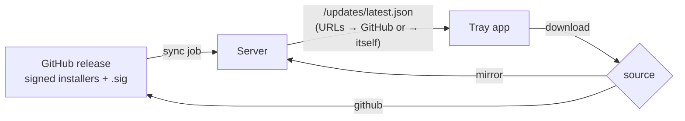

# Versioning and server‑controlled deployment

Decided with Andy 2026‑11‑11. **Status: the rules are in force. Built 2026‑11‑11: the image workflow (`images.yml`, untried until the next tag) and the REST protocol handshake (`PROTOCOL_VERSION`, `x-vtt-protocol`, `426 update_required`, `GET /api/version`). Not built: the WebSocket check, the CI contract guard, the server‑chosen client build and the mirror.** The web onboarding / app sign‑in direction is recorded at
the end as intent only; it needs its own design pass.

## 1. Version numbers (in force now)

One version number per release covers the **server and the desktop app together**: the tag `v0.4.1` means
server 0.4.1 and client 0.4.1, and the container image tag equals it.

| Part      | Means                                                                                                                                                           | Compatibility rule                                       |
| --------- | --------------------------------------------------------------------------------------------------------------------------------------------------------------- | -------------------------------------------------------- |
| **MAJOR** | A significant breaking change: a fundamental architectural change.                                                                                              | Client and server **must** match.                        |
| **MINOR** | Any change to the **API or signalling** between server and client (REST, WebSocket envelope, LiveKit token or metadata shape, recording or consent contracts). | Client and server **must** match.                        |
| **PATCH** | Bug fixes and changes that do not touch the wire: UI, window handling, installers, docs, internal refactors.                                                    | May **drift**: any client patch works with any server patch of the same MAJOR.MINOR. |

Practical consequences:

- **A change to `shared/` wire contracts bumps MINOR**, even if it feels small. If it does not touch the wire, it is
  a patch, however big the feature.
- **Pre‑1.0 (`0.y.z`):** SemVer allows anything to break before 1.0. We treat **`y` as the MAJOR tier** while we
  are on 0.x: a bump of `y` may be an API change _or_ an architectural one, and the match rule applies to `0.y`. From 1.0 the table above applies as written.
- **Pre‑release suffixes** (`-dev.N`, `-rc.N`, `-beta.N`) keep their meaning from
  [RELEASING.md](../guides/RELEASING.md): they sort below the release they lead up to and travel on the dev channel only.
  Compatibility is judged on MAJOR.MINOR alone, so `0.4.0-dev.3` talks to a `0.4.x` server.
- **Never reuse or move a tag.** A bad release is replaced by the next patch.

### The real check: a protocol integer

MAJOR.MINOR is for people. The machine check is a single integer, `PROTOCOL_VERSION`, in `shared/`, sent in the
client's handshake and returned by the server. It is bumped in the same change that changes a wire contract, and a
CI test fails if `shared/` contracts change while it (and therefore MINOR) stays put. Semver MINOR is then derived
from it, not remembered by a human.

**Built so far:** the app sends `x-vtt-protocol` on every REST call; the server answers `426 update_required` (with its version and protocol) on a mismatch and serves `GET /api/version` to anyone. Callers that send no header (browser pages, the admin CLI) are always served. The WebSocket is not yet checked, but the app signs in over REST first, so a mismatched app is stopped before it connects. The CI guard described above is not built: wire contracts live in the backend and `rust-sync` separately, not in `shared/`, so there is nothing single to hash yet; until then bumping `PROTOCOL_VERSION` is a code-review rule (CONTRIBUTING / DEVELOPING).

When they disagree:

- **Client older than the server** (the usual case after a server upgrade): the server answers with an
  _update required_ result naming the build to fetch. The app shows "Your server moved to 0.5: update to
  continue" and offers the update; it never fails silently and never half‑works.
- **Client newer than the server:** the app says the server needs updating and tells the player to ask their
  operator. It does not guess.

## 2. The server decides which client build players use (designed, not built)

Today the operator runs `vtt-admin updates publish` by hand ([CLIENT-UPDATES.md](CLIENT-UPDATES.md)). The target is
that the server works this out itself.

- **Only builds matching the server's own MAJOR.MINOR are offered** (rule 1). The newest patch of that line is the
  one clients are told to use.
- **Patches are approved automatically.** When a new patch of the server's MAJOR.MINOR appears on GitHub the server
  starts offering it. Patches are bug fixes, and waiting for an operator to approve each one would leave players on
  known bugs. A new MAJOR.MINOR is never offered automatically: it is a deliberate server upgrade by the operator,
  and it comes with its own matching server image.
- The player still decides _when_ to install (the app offers, it never restarts mid‑session). The signature check
  in the app is unchanged and remains the trust anchor, so the server and the transport need not be trusted.

### Update source: an operator choice

`UPDATES_SOURCE` in the server config:

| Value              | Behaviour                                                                                                                                       | Why you would pick it                                         |
| ------------------ | ----------------------------------------------------------------------------------------------------------------------------------------------- | ------------------------------------------------------------- |
| `github` (default) | The manifest holds GitHub release URLs; players download from GitHub. Nothing is stored on the server.                                          | Smallest footprint; fine for most groups.                     |
| `mirror`           | A sync job downloads the assets to the server and the manifest points at the server itself.                                                     | Operators who do not want players reaching GitHub, or whose network blocks it; honours self‑host‑first. |
| (existing) `publish` | `vtt-admin updates publish <dir>` stays as the manual path.                                                                                   | Air‑gapped installs, or testing a build that is not on GitHub. |

Why a mirror at all: principle 1 (zero cloud reliance). GitHub is a third party, so the default path depending on
it is acceptable only because the operator can turn it off.

### The mirror sync job

- **Contents:** the Windows, macOS (arm64), AppImage, deb and rpm installers, their `.sig` files and the manifest.
  About six files per version.
- **Trigger:** a scheduled job (default daily) plus `vtt-admin updates sync` on demand.
- **Verify before storing:** each asset is checked against the updater public key (the same key compiled into the
  app) before it is moved into place. A failed or partial download is discarded and never served.
  Files are written to a temp name and renamed, so a half‑finished sync cannot corrupt what players are being served.
- **Scope:** only releases matching the server's MAJOR.MINOR. Dev builds are not mirrored unless the operator turns
  that on, and are pruned harder.
- **Cleanup (so space is not wasted):** after every sync, keep the **newest patch plus one previous patch** (for
  rollback) and delete the rest. `vtt-admin updates status` shows the source, what is kept, the disk used and the last
  sync result. Cleanup never deletes a version the manifest currently points at.

## 3. Container build workflow (designed, not built)

The server is shipped as OCI images built by CI from the same tag as the client.

- A release tag builds and pushes the server image(s) to GHCR tagged with the full version (`0.4.1`) and the line
  (`0.4`). The Compose bundle pins the full version.
- Because MAJOR.MINOR must match, **an operator moving to a new minor moves the whole stack**: the Compose bundle
  and its images together, with the migration notes in that release's CHANGELOG. A patch image can be taken on its own.
- Dev tags build images on a `dev` tag only; they never move `latest` or the line tag.
- Exact image split (one backend image or several), registry settings and the release‑workflow job layout are
  decided when this is built.

## 4. Onboarding and sign‑in through the web app (intent only, needs a design pass)

Recorded so the direction is not lost; do **not** build from this section.

- **Invite link → web page** guides a new player through creating an account, then shows install instructions for
  their OS (detected in the page) and a download from the server's chosen source (§2).
- **The web app owns all auth and account security**, as VS Code and Claude Desktop do: the tray app is signed in by
  a browser hand‑off (a deep link with PKCE, plus a device‑code or QR fallback because deep links are unreliable on
  Linux/Wayland AppImage). The server can then change sign‑in methods (password, email code, OIDC) without a client release.
- **Preconfiguration** cannot be baked into an installer. The page's last step is an "Open VTT Chat" button that
  hands the server URL and a one‑time code to the installed app.
- **Mobile:** open the page, finish setup, manage account security and basic profile (name, avatar) in the browser.
  The install screen shows add‑to‑home‑screen steps for Android or iOS, then explains installing the desktop app
  for actual games.
- Touches [SIGN-IN-OPTIONS.md](SIGN-IN-OPTIONS.md), [JOIN-FLOW.md](JOIN-FLOW.md) and
  [MOBILE-WEB-APP.md](MOBILE-WEB-APP.md); those need reconciling when this is designed.
