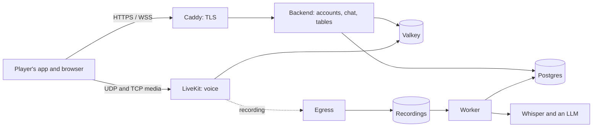

# Operator guide

For the person who runs the server: one machine, your own, no cloud account needed. **Draft (2026-11-10);
the Docker Compose path was followed step by step on a blank project on 2026-11-13 (rehearsal in
[BUILD-STATUS.md](../BUILD-STATUS.md)), by the author standing in for a second person.**
Steps marked **(not yet tried by someone else)** have only been run by the author; nothing here has yet been
followed by a real second human on a real VM with a real domain.

- [1. What you are running](#1-what-you-are-running)
- [2. Before you start](#2-before-you-start)
- [3. Install with Docker Compose (recommended)](#3-install-with-docker-compose-recommended)
- [4. Install natively (advanced)](#4-install-natively-advanced)
- [5. First run](#5-first-run)
- [6. Turn on recording and AI summaries](#6-turn-on-recording-and-ai-summaries)
- [7. Configuration reference](#7-configuration-reference)
- [8. Day-to-day operation](#8-day-to-day-operation)
- [9. Back up and restore](#9-back-up-and-restore)
- [10. Update](#10-update)
- [11. Fix it](#11-fix-it)
- [12. Security checklist](#12-security-checklist)

## 1. What you are running



- **Backend**: sign-in, campaigns, chat, handouts, loot, scheduling, and the records pipeline's control.
- **LiveKit**: the voice rooms (one per campaign). **Egress** records each speaker to a file.
- **Worker + Whisper + an LLM**: turn a recording into a transcript and summaries, after the session.
- **Caddy**: HTTPS in front of everything. **Postgres** is the database; **Valkey** holds short-lived state.

Nothing here needs an outside account. Players' apps talk only to **your** server.

## 2. Before you start

- **A machine you control**: a VM or a spare PC with Ubuntu 24.04 (Docker Compose also works on other
  Linux). 4 GB of memory is enough for voice and chat. **Recording and AI summaries need more**: the
  speech-to-text and the language model are the heavy parts: plan on **8 GB of memory and ~15 GB of disk**
  for them on a CPU-only server (images, models, and audio at ~12–30 MB per player-hour until you delete
  it). Without a GPU, a session is transcribed and summarised in hours, not minutes, and that is by design
  (the work runs after the game). An NVIDIA GPU makes it minutes ([section 6](#6-turn-on-recording-and-ai-summaries)).
- **A domain name** pointing at the machine (for example `vtt.example.com`). Browsers and the app
  need real HTTPS; Caddy gets the certificate for you from Let's Encrypt. To try things on one machine, use
  `localhost`.
- **Ports opened to the internet** (your router or cloud firewall; the installer never touches it):

  | Port                                   | What for                                     |
  | -------------------------------------- | -------------------------------------------- |
  | `80/tcp`, `443/tcp`, `443/udp`         | the website, the app's connection, sign-up   |
  | `7881/tcp`                             | voice over TCP when UDP is blocked           |
  | `50000-50200/udp` (a range you choose) | voice. **Required**; widen it for big groups |

  **Everything else must stay closed from the internet.** LiveKit and Egress run host-networked in the
  Compose bundle, so their own ports listen on every interface of the machine, not just the ones above.
  Forward nothing else, and if the machine has a public address, block these on its firewall (`ufw` or your
  cloud's security group):

  | Port        | Who                | Reachable from                                                                   |
  | ----------- | ------------------ | -------------------------------------------------------------------------------- |
  | `7880/tcp`  | LiveKit signalling | this machine only (Caddy and the backend use it); not forwarded, blocked outside |
  | `18180/tcp` | Egress health      | this machine only (the Compose healthcheck); not forwarded, blocked outside      |
  | `6379/tcp`  | Valkey             | loopback only (`VALKEY_HOST_PORT`; LiveKit and Egress use it)                    |
  | `3000/tcp`  | backend            | loopback only (Compose publishes it on `127.0.0.1`)                              |
  | `5432/tcp`  | Postgres           | not published at all                                                             |

  Port 7880 is how Caddy reaches LiveKit, so on a home network "not forwarded" is enough; on a machine with a
  public IP, add the firewall rule. The Egress health port is `18180` rather than its default `8080` so it does
  not collide with a native Whisper and is not a well-known port; it answers a plain "is it up" and nothing
  private. (Ports above were read from `infra/compose/compose.yml` and `livekit.yaml`; the firewall rules are
  not tested on a live public machine.)

  Behind a home router, forward the ports in the first table to the machine. **Cloudflare Tunnel cannot carry voice**; it can
  only front the web part. Players on very restrictive networks (hotel, school, some workplaces) may be
  unable to use UDP voice at all; LiveKit's built-in TURN is the fix and is off by default
  ([DEPLOYMENT-AND-TRANSPORT.md](../architecture/DEPLOYMENT-AND-TRANSPORT.md)).

- **Time to spend**: about half an hour for voice and chat, plus the model downloads if you add recording.

## 3. Install with Docker Compose (recommended)

### The one-command install (easiest)

On a **blank Ubuntu Server** (22.04 or 24.04), after you have pointed your domain's DNS "A" record at the machine,
SSH in and run:

```bash
curl -fsSL https://raw.githubusercontent.com/AndyProsser/vtt-chat-app/main/infra/get.sh | sudo bash
```

It asks for your domain and your email, then does everything: installs Docker if needed, downloads the server
bundle for the newest release into `/opt/vtt-chat`, writes fresh secrets, starts the stack, opens the needed ports in
`ufw` if it is active, makes you the first Admin and prints a **sign-in code** and what to do next. It checks your DNS
first and tells you if the record is missing, points elsewhere, or is a **Cloudflare proxied record** (orange cloud:
switch it to **DNS only**, because voice cannot pass through Cloudflare's proxy).

After it finishes, `vtt-admin` works from any directory (`vtt-admin status`, `vtt-admin user code <email> signin`,
`vtt-admin settings show`, `vtt-admin help`). Machine commands work the same way: `vtt-admin logs [service]`, `vtt-admin restart [service]`,
`vtt-admin ps`, `vtt-admin backup`, `vtt-admin restore <folder> --yes` and `vtt-admin update`. `update` (or running the
install command again) moves to the newest release of your **current line** (`0.4.x`); data and settings are kept, and a new
minor (`0.5`) is only installed when you ask for it with `--version`.

Everything it asks can be a flag, for a pasted one-liner: `... | sudo bash -s -- --domain vtt.example.com --email you@example.com --name "You" --with-records --yes`.
Other flags: `--version 0.4.0` (a specific release; a dev build needs its full name), `--public-ip` (behind NAT),
`--dir`, `--dry-run` (shows the plan), `--skip-docker-install`, `--skip-firewall`. You still open the same ports at your
router or cloud firewall (the table above); the script cannot do that part. Prefer to read it first? It is
[`infra/get.sh`](../../infra/get.sh), one file.

**(Rehearsed on a workstation with Docker already installed, against the published images; the Docker-install and
`ufw` steps and the Let's Encrypt certificate are written but not yet run on a blank VM.)** The manual steps follow.

### Or step by step

```bash
sudo apt-get install -y docker.io docker-compose-v2 git   # or Docker's own packages
git clone https://github.com/AndyProsser/vtt-chat-app.git
cd vtt-chat-app/infra/compose
./setup.sh vtt.example.com                    # your domain; add your public IP as a second argument if behind NAT
docker compose pull                           # the published images (no build, no compiler needed)
docker compose up -d --wait
curl https://vtt.example.com/api/health       # {"status":"ok"}
```

(To build the images from the checkout instead, for an unreleased commit: `docker compose up -d --build --wait`.)

**Which images.** `setup.sh` prints the version it pinned (`images: …`) and writes it to `.env` as `VTT_VERSION`.
On a checkout of a release tag that is the release line (`0.4`: the newest patch, never a new minor); on a checkout
whose newest tag is a **dev build** (`v0.4.0-dev.5`) it is that exact version, because a dev tag publishes only its own
tag and a line like `0.4` does not exist until `0.4.0` is released. To pin something else, run
`VTT_VERSION=0.4.0-dev.5 ./setup.sh vtt.example.com` (or edit `.env`) before `docker compose pull`. If the pull
says `not found`, that tag is not published (or the GitHub package is still private).

**Ports already in use.** `setup.sh` warns when 80, 443, 7880 or 7881 are taken on the machine (Caddy and LiveKit
need them; find the culprit with `ss -ltnp`), and picks a free loopback port for Valkey (`VALKEY_HOST_PORT`, from 6379 up)
and for the backend's local probe port (`BACKEND_PORT`, from 3000 up) if the defaults are busy; both are written to `.env`.

What `setup.sh` does: writes `.env` and `livekit.yaml` with **fresh random secrets** (never printed, mode
600, never committed). Re-running it leaves them alone. `--force` regenerates them, which **signs everyone
out** and, because Postgres keeps the password it first started with, also means
`docker compose down -v`, **which deletes the database**. Do not use `--force` on a live server.

Check it worked:

```bash
./vtt-admin status          # accounts, signups, database, Valkey and LiveKit should all say ok
```

(`./vtt-admin` runs the CLI inside the `backend` container of the Compose project named in `.env` or the current
directory's default; run it from `infra/compose`. If you run several instances on one machine, set
`COMPOSE_PROJECT_NAME` to tell them apart.)

Also open `https://vtt.example.com/status`: a public status page with the same checks, which is handy to
give your players.

**Behind NAT?** Pass your public IP: `./setup.sh vtt.example.com 203.0.113.7`, and forward the ports above.

**To try it on one machine first**: `./setup.sh localhost`. Caddy then uses its own certificate, so a
browser warns once. The desktop app uses the system certificate store, so install Caddy's CA there first:
`./trust-local-ca.sh` (Linux; asks for sudo once), then restart the app. On Windows or macOS, import the
CA's `root.crt` (`docker compose cp caddy:/data/caddy/pki/authorities/local/root.crt .`) as a trusted root.

## 4. Install natively (advanced)

For people who do not want Docker. Ubuntu **24.04 LTS only** (it needs that release's `valkey-server`
and `caddy` packages).

```bash
git clone https://github.com/AndyProsser/vtt-chat-app.git && cd vtt-chat-app
sudo infra/install.sh --domain vtt.example.com [--public-ip 203.0.113.7] [--with-records]
```

It installs Postgres, Valkey and Caddy from apt, Node.js and LiveKit as checksum-verified downloads,
builds the backend, writes secrets to `/etc/vtt/vtt.env` (mode 640, never printed), and creates hardened
systemd units: `vtt-backend`, `vtt-livekit` (and `vtt-whisper`, `vtt-ollama`, `vtt-worker` with
`--with-records`). Re-running is safe and keeps your secrets and data. `--dry-run` shows the plan;
`--no-start` installs without starting.

Two limits to know: it **does not install LiveKit Egress** (the recorder ships only as a container), so
native recording needs the Compose `egress` service next to it; and it does **not open ports** for you.
LXC containers are possible but unsupported ([DEPLOYMENT-AND-TRANSPORT.md](../architecture/DEPLOYMENT-AND-TRANSPORT.md)).

## 5. First run

1. **Create the first account: it becomes the Admin.** The app has no sign-up screen (accounts are made on
   the browser join page from an invite), so the very first account is made on the server:

   ```bash
   ./vtt-admin user create you@example.com --name "Your Name" --accept-consent
   ./vtt-admin user code you@example.com signin      # a one-time code
   ```

   Then sign in with that code. **In a browser** (nothing to install): open `https://your-domain/`, choose Sign in,
   then "I have a sign-in code". **In the desktop app**: choose your server and type the code in its Connect screen.
   Set a password afterwards if you want one (the codes work once and expire in about 15 minutes; ask for another
   with the same command). `--accept-consent` records that the person has agreed to the recording notice (for the first account, that is
   you). The first account is the Admin; add `--admin` to make a later one an Admin too. **(`user create` is new,
   2026-11-10, and has not yet been tried by someone else.)** The first Admin also gets a starter campaign with a
   randomly chosen dry-humour name (for example "Several Goblins Short of a Plan") and is its DM, created at sign-in
   (and by `user create`), so the app has somewhere to go straight away. Rename it, or make more, in the app.

2. **Decide who may create campaigns:** `./vtt-admin settings set campaign-creation closed` (only Admins) or
   `open` (any signed-in player). Default is set when the instance is created; `settings show` lists it.
3. **Give players a download.** Nothing to do on a stock install: the update sync (below) records the installers
   of the release it offers (Windows setup, macOS `.dmg`, Linux AppImage plus `.deb`/`.rpm`) in
   `$UPDATES_DIR/downloads.json`, and the front page, join page and status page show them (a button for the visitor's
   OS, the others as links). Always GitHub links, in both `github` and `mirror` mode (the mirror holds only the
   signed updater files). To send players somewhere else, set `CLIENT_URL_WINDOWS`, `CLIENT_URL_MACOS`,
   `CLIENT_URL_LINUX` in `.env` (any of them; they are shown only to signed-in accounts, so to share the app with someone who has no account yet, give them an invite or account first): if any is set, those are used **instead of** the synced file. Until
   the first sync finishes (or with `UPDATES_SOURCE=off`) and with no `CLIENT_URL_*`, the page says to ask the DM.
4. **Invite a table.** In the app, the DM creates an invite (an emailed link, a code, or a QR code). Anyone
   with the code joins; invites expire (default set by `invite-expiry-days`) and can be used by the whole
   group. See [JOIN-FLOW.md](../architecture/JOIN-FLOW.md).
5. **No email server?** That is fine. When someone forgets a password or needs a first sign-in code:
   `./vtt-admin user code them@example.com signin` (or `reset`). The code is valid for a short time;
   pass it on by chat or phone.

6. **Which tables people can ask to join (on by default).** A signed-in person can see the campaigns whose DM has
   **Allow join** on (name, DM name, player count, nothing inside) and ask to join; the **DM** approves, not you. To
   hide every listing and allow invites only: `./vtt-admin settings set campaign-directory off`. Pending requests stay
   visible to the DM, marked closed, until it is on again.

7. **Let visitors ask for an account (optional, off by default).** People without an invite can request one from the front page:

   ```bash
   ./vtt-admin settings set signup.requests on
   ./vtt-admin signup list                      # pending requests: id, time, name, email, message
   ./vtt-admin signup approve <id|email>        # makes the account, prints a one-time code (ABCD-EFGH)
   ./vtt-admin signup reject <id|email>
   ```

   Approving creates the account (no password, not an Admin) and prints a code valid for about 15 minutes. **Hand it over
   on a side channel** (a message, in person), not by replying to the address on the request: the code is the proof that
   the person you contacted is the person who asked. They enter it under "I have a sign-in code" on the front page or in the app's
   Connect screen and accept the recording notice then. If the code expires first, `user code <email> signin` issues another.
   `status` shows how many requests are waiting. At most 200 stay open at once and each address gets 5 submissions an hour,
   so the form cannot be flooded; turn the setting back off to close it (existing requests stay listed). See
   [SIGN-IN-OPTIONS.md](../architecture/SIGN-IN-OPTIONS.md).

Sign-in options (password, emailed code, single sign-on) are in [SIGN-IN-OPTIONS.md](../architecture/SIGN-IN-OPTIONS.md).

## 6. Turn on recording and AI summaries

Recording is a **profile** you add to the same stack:

```bash
cd infra/compose
docker compose --profile records up -d --wait
```

This adds **Egress** (about 4 GB of image), **Whisper** (speech to text; about 190 MB model),
**Ollama** (a language model, about 2 GB for the default `llama3.2:3b`) and the **worker** that runs the
jobs. The first start downloads the models; give it time (`docker compose logs -f models-init ollama-pull`).

**What to expect on a CPU-only server** (measured on an 8-core desktop, 2026-11-12): Whisper `small` takes
about 0.3 × the length of each player's speech, and each summary 1–2 minutes with `llama3.2:3b`. A 4-hour
session with five players is a few hours of work, done after the game; nothing is lost if it takes all night.
Memory while it runs: Whisper about 0.5 GB, the language model about 3 GB.

### With an NVIDIA GPU (including GTX 10-series)

Add the GPU override. It builds Whisper for your card once (about 30 minutes, a ~6 GB image; upstream's
CUDA image does not run on GTX 10-series cards) and runs Whisper and Ollama on the GPU:

```bash
nvidia-ctk cdi list | grep nvidia.com/gpu=all    # the NVIDIA Container Toolkit with CDI must be set up
echo 'COMPOSE_FILE=compose.yml:compose.gpu.yml' >> .env   # so every docker compose command includes it
docker compose --profile records up -d --build --wait
```

Defaults for an 8 GB card: Whisper **`large-v3-turbo`** (q5_0, ~574 MB download, ~1 GB of VRAM, ~27×
faster than real time) and **`qwen3:8b`** for the summaries (~5.2 GB download, ~5.5 GB of VRAM, ~15 s a
summary on a GTX 1080). On a 4–6 GB card set `WHISPER_MODEL_FILE=ggml-small-q5_1.bin` and
`OLLAMA_MODEL=llama3.2:3b` in `.env`. `CUDA_ARCHS` (default `61;75;86;89`) picks which card generations
the build supports. **The GPU is free between jobs:** Whisper stops after `WHISPER_IDLE_SECONDS` (60) without
work and Ollama unloads its model after `OLLAMA_KEEP_ALIVE` (2m), so a machine that is also a gaming PC
gets its VRAM back a minute or two after the summaries are written. The worker runs Whisper and the
language model one after the other, never together.

**Disk:** Egress image ~4 GB, Whisper CUDA image ~6 GB (CPU image ~1.7 GB), Ollama image ~8.5 GB, models as
above, and audio at about 12–30 MB per player-hour (deleted when the DM confirms the summary, or by the
retention rules in section 8).

### Check it works: the end-to-end smoke test

From a checkout of the repository on the server (Node and `npm install` needed), with the records profile
up, `node infra/records-smoke/compose-e2e.ts` plays a four-minute scripted scene with four synthetic
players, records it, waits for the worker and checks the result through the API: who said what, typed
lines, nothing from whispers or `/ooc` anywhere, all four kinds of summary, DM-only kept from players,
search, a worker killed mid-job, and (`--fallback`) the fallback from an unreachable remote AI. It makes its
own `@example.com` accounts and campaign. Setup (a small text-to-speech program) and options:
[infra/records-smoke/README.md](../../infra/records-smoke/README.md#the-compose-end-to-end-test-compose-e2ets-run-it-after-an-install).

How it behaves, so you can explain it to your players:

- The **DM** starts, pauses, resumes and stops a recording in the app. Every player's app plays a clear
  "recording" cue, and **a player's voice is only recorded after their app has played it**.
- Each speaker is recorded separately. Whispers and private lines are **never** recorded or transcribed.
- Lines typed into the public chat during a recording go into the transcript, marked "(typed)".
- Sound effects from the DM's soundboard are **not** recorded (unless you switch on `RECORD_SOUNDBOARD=1`, for
  testing: they are then saved as a separate, never-transcribed file). What the session's timeline notes about the table
  is names only, never audio, and **by default only scene changes** (a scene change starts a new chapter in the
  summaries, and the summaries are told about it as a cue). To note more, set `RECORD_CUES` in `.env`, for example
  `RECORD_CUES=scene,voice,groups` (`voice` is the DM's character voice, `groups` party splits and merges, `sounds`
  individual effects and loops; `all` and `none` also work).
- If the DM's app disconnects, the recording carries on. After `RECORDING_GRACE_SECONDS` (default 30)
  any player can pause, resume or stop it. If **everyone** is gone for that long, it stops by itself.
  The DM cannot switch campaigns or hand over the DM role while a recording runs. Details:
  [RECORDING-AND-SUMMARIES.md](../architecture/RECORDING-AND-SUMMARIES.md#while-a-recording-runs-decided-2026-11-10).

**Where the AI runs** is your choice. By default everything runs on your server (slow on a CPU, nothing
leaves the machine). To send transcription or summaries to a stronger machine you own (for example a gaming
PC with a GPU) use `vtt-admin settings keys` to see the `ai.*` settings; jobs wait for that machine and
fall back to the local CPU after a time you set. A **cloud** AI service is possible but means session audio
or text leaves your server: it needs an explicit setting, and the app tells players.

**Recommended for a CPU-only server with a gaming PC on the network** (measured on a GTX 1080; see
[RECORDING-AND-SUMMARIES.md](../architecture/RECORDING-AND-SUMMARIES.md)). A 4-vCPU, 16 GB VM with no GPU can run the
whole system, but its AI is slow: Whisper `small` takes about 0.3x the length of the audio, so a four-hour session
transcribes in roughly 80 minutes, and a summary on the CPU takes minutes and, with the small model, can invent
details. A GPU PC does the same work in minutes with the better models. So:

1. On the gaming PC run Ollama and a Whisper server that speaks the OpenAI-compatible API (the repo's
   `infra/compose/whisper-cuda.Dockerfile` builds one for GTX 10-series and newer cards), pull `qwen3:8b`, and let
   them listen on the LAN (for Ollama set `OLLAMA_HOST=0.0.0.0`; allow the ports only from the VM, never the internet).
2. On the VM, point the worker at it, with the VM's own CPU as the fallback:

   ```bash
   ./vtt-admin settings set ai.transcription.kind remote
   ./vtt-admin settings set ai.transcription.url http://gaming-pc:8080
   ./vtt-admin settings set ai.transcription.model large-v3-turbo
   ./vtt-admin settings set ai.llm.kind remote
   ./vtt-admin settings set ai.llm.url http://gaming-pc:11434
   ./vtt-admin settings set ai.llm.model qwen3:8b
   ./vtt-admin settings set ai.fallback.enabled true
   ./vtt-admin settings set ai.fallback.after-seconds 600
   ```

3. Keep the local fallback ready on the VM: `small` Whisper and `llama3.2:3b` (the defaults for a CPU-only server).
   If the PC is off, a job waits ten minutes and then runs locally, slower and rougher but never lost.

Sessions are about weekly, so a slow fallback is acceptable. Expanding the VM's CPUs helps the fallback a little but
is not worth much: even eight cores need about 150 seconds for one qwen3:8b summary on the CPU.

## 7. Configuration reference

Everything is set by environment variables: in `infra/compose/.env` for Compose, or `/etc/vtt/vtt.env`
natively. Restart the backend after changing them (`docker compose up -d`, or
`sudo systemctl restart vtt-backend`).

| Variable                                                                  | Default                                         | What it does                                                                                                                                                                                                                                                                                                                                                                                                                               |
| ------------------------------------------------------------------------- | ----------------------------------------------- | ------------------------------------------------------------------------------------------------------------------------------------------------------------------------------------------------------------------------------------------------------------------------------------------------------------------------------------------------------------------------------------------------------------------------------------------ |
| `SITE_ADDRESS`                                                            | (set by `setup.sh`)                             | The domain players use                                                                                                                                                                                                                                                                                                                                                                                                                     |
| `PUBLIC_URL`                                                              |                                                 | The address used in links the server sends (emails, invites)                                                                                                                                                                                                                                                                                                                                                                               |
| `DATABASE_URL`, `VALKEY_URL`                                              | (set for you)                                   | Postgres and Valkey connections                                                                                                                                                                                                                                                                                                                                                                                                            |
| `LIVEKIT_URL`, `LIVEKIT_API_URL`, `LIVEKIT_API_KEY`, `LIVEKIT_API_SECRET` | (set for you)                                   | How the backend talks to LiveKit                                                                                                                                                                                                                                                                                                                                                                                                           |
| `RECORDINGS_DIR`                                                          | (set in records profile)                        | Where Egress writes audio; setting it turns recording on                                                                                                                                                                                                                                                                                                                                                                                   |
| `RECORDING_GRACE_SECONDS`                                                 | 30                                              | Seconds the DM may be disconnected before players can step in; also the time with nobody connected before a recording stops (5 to 3600)                                                                                                                                                                                                                                                                                                    |
| `RECORD_CUES`                                                             | `scene`                                         | Which table cues are noted (names only, never audio) in a recording's timeline: any of `scene`, `voice`, `groups`, `sounds`, or `all` / `none`. Scene changes start chapters                                                                                                                                                                                                                                                               |
| `RECORD_SOUNDBOARD`                                                       | off                                             | `1`: also save the DM's sound effects as a separate file and note each effect by name in the timeline (testing only)                                                                                                                                                                                                                                                                                                                       |
| `MEDIA_DIR`                                                               | (set for you)                                   | Where handouts, pictures and sound clips are stored. Needs disk space                                                                                                                                                                                                                                                                                                                                                                      |
| `SMTP_URL`, `MAIL_FROM`                                                   | off                                             | Send sign-in codes by email (optional; the CLI can hand out codes without it)                                                                                                                                                                                                                                                                                                                                                              |
| `OIDC_ISSUER`, `OIDC_CLIENT_ID`, `OIDC_CLIENT_SECRET`                     | off                                             | Sign in through your own identity provider (Authelia and similar)                                                                                                                                                                                                                                                                                                                                                                          |
| `DDB_SYNC`, `DDB_SYNC_HOURS`                                              | off, 12                                         | `1`: keep linked D&D Beyond characters fresh (contacts dndbeyond.com)                                                                                                                                                                                                                                                                                                                                                                      |
| `CLIENT_URL_WINDOWS` / `_MACOS` / `_LINUX`                                | none (the update sync supplies them)            | Download links on the signed-in download page (visible only to signed-in accounts); when any is set, it replaces the synced list                                                                                                                                                                                                                                                                                                           |
| `UPDATES_DIR`                                                             | (set for you)                                   | Where signed app updates are published                                                                                                                                                                                                                                                                                                                                                                                                     |
| `UPDATES_SOURCE`                                                          | `github`                                        | `github`, `mirror` or `off`: where app updates come from (see "Updating players' apps")                                                                                                                                                                                                                                                                                                                                                    |
| `UPDATES_INCLUDE_DEV`                                                     | (off)                                           | `1` or `true` also offers dev builds of your release line to players who opted in                                                                                                                                                                                                                                                                                                                                                          |
| `WEB_DIR`, `STATUS_DIR`                                                   | (set for you)                                   | The join page, the phone app (`/app`) and the status page                                                                                                                                                                                                                                                                                                                                                                                  |
| `PORT`                                                                    | 3000                                            | The backend's port (loopback only in Compose)                                                                                                                                                                                                                                                                                                                                                                                              |
| `TRUST_PROXY`                                                             | `loopback` (`loopback, uniquelocal` in Compose) | Which proxies may report the player's real address (`X-Forwarded-For`): `loopback`, `linklocal`, `uniquelocal`, addresses or subnets, comma-separated, or a number of hops. Under Compose Caddy reaches the backend from the bridge network, so without `uniquelocal` every player shares one rate-limit bucket and the device-approval page shows Caddy's address. Anything unreadable falls back to `loopback` with a warning in the log |

Runtime settings (no restart) live in the database: `./vtt-admin settings show`.

## 8. Day-to-day operation

**The admin command** (`./vtt-admin` in `infra/compose`; natively `node backend/dist/cli/main.js`):

| Command                                                                          | Use                                                                                                |
| -------------------------------------------------------------------------------- | -------------------------------------------------------------------------------------------------- |
| `status`                                                                         | Is everything up? Exits 1 if not (good for monitoring)                                             |
| `settings show` / `keys` / `set <key> <value>`                                   | Campaign creation, offline limit, invite expiry, AI backends                                       |
| `user list`, `user admin <email> grant\|revoke`                                  | See accounts; make or remove an Admin                                                              |
| `user code <email> [signin\|reset]`                                              | One-time code for someone locked out                                                               |
| `signup list [state]`, `signup approve <id\|email>`, `signup reject <id\|email>` | Handle visitor account requests (needs `signup.requests on`); approve prints a code to hand over   |
| `user revoke-sessions <email>`                                                   | Sign a person out everywhere (lost laptop)                                                         |
| `jobs list [state]`, `jobs retry <id>`                                           | Look at the summary queue; retry a failed job                                                      |
| `recording list`, `recording reprocess <id> [--retranscribe]`                    | Redo a recording's summaries (or transcript) from the kept audio                                   |
| `recording purge <id>` or `--older-than <days>`                                  | Delete the raw audio of processed recordings (transcript and summaries stay)                       |
| `updates sync`, `updates status`, `updates publish …`                            | Sync the update feed from GitHub now; see the source and what players are offered; publish by hand |

**Logs:** Compose: `docker compose logs -f backend` (also `livekit`, `egress`, `worker`, `caddy`).
Native: `journalctl -u vtt-backend -f` (also `vtt-livekit`, `vtt-worker`, `caddy`).

**Watching it:** `https://your-domain/status` shows backend, database, LiveKit and the records queue,
the number of connected players and whether a recording is active. It is public and shows nothing private.

**Disk:** recordings and uploads grow, and the raw audio is by far the biggest part. Set
`RECORDING_RETENTION_DAYS` (for example `60`) in `.env` and the worker deletes the audio of processed
recordings that old, keeping the transcript and summaries; or do it yourself with
`./vtt-admin recording purge --older-than 60`. `./vtt-admin recording list` shows which recordings still have
their audio. `./vtt-admin storage` shows what the recordings folder holds, the free space on its disk, and the
database size. The public status page shows "Recording storage: N% free" and turns amber under 10%, so a
filling disk is noticed before it stops recordings (built 2026-11-10; the figures come from the real disk, but
no one has yet watched it cross the threshold on a live server). Do not purge a recording you may want to
**re-transcribe** with a better model: once the audio is gone only the summaries can be redone.

Two more things delete raw audio. **The DM** can delete a processed session's audio from the session history
once they have read the summary. And **when the recordings disk falls below 10% free** the worker (checking
hourly) warns the DM of the oldest unconfirmed recordings (a stored notification, and a note in the history),
then deletes that audio three days later; below 3% free it does not wait. At most two recordings are handled per
check. Set `AUDIO_DISK_PURGE=0` in `.env` to switch the disk rule off (the age rule and the DM's button stay).
(Built 2026-11-10; tested with fakes and a real Postgres, not yet watched on a filling disk.)

A fourth rule, **off by default**: `./vtt-admin settings set audio-purge-next-session on`. When a recording
**starts** in a campaign, the raw audio of that campaign's _earlier_ recordings is purged, but only those that
are fully processed (transcript and summaries done) and still hold audio. Anything queued, processing or
failed is left alone, and so is every other campaign. The text stays. It is the "the DM never pressed delete"
rule: the DM's button is the only confirmation there is, so a recording the DM has not deleted counts as
unconfirmed. The worker does the deleting and logs each one (`docker compose logs worker`); `recording list`
then shows "audio purged". Turn it back off with `... audio-purge-next-session off`.

**Worker restarts:** the worker has a stable name, `WORKER_ID` (the Compose bundle sets `worker-1`; natively it
defaults to the hostname). If the worker is killed mid-job, the restarted one takes its own job back at once
instead of waiting out the 5-minute lease. A lease held by a worker with a different name is still honoured.
Never give two workers running at the same time the same `WORKER_ID`.

**Health you can rely on:** the app reconnects itself after network loss, sleep or a server restart. A
recording survives the DM's app crashing (see section 6). A **server** restart during a recording marks
that recording interrupted; the audio already written is kept and can be reprocessed.

## 9. Back up and restore

**Compose** has two scripts (`infra/compose`):

```bash
./backup.sh                  # database + uploaded files + your .env and livekit.yaml, into ./backups/vtt-backup-<date>
./backup.sh --audio          # also the recorded audio (large; the transcripts are in the database anyway)
./backup.sh --to /mnt/usb    # somewhere else
```

Each run makes one folder (mode 700) with `database.sql.gz`, `media.tar.gz`, `config/` (the **secrets**) and a
`MANIFEST.txt`. **Copy it off the machine** (another disk, another computer): a backup on the same disk
does not survive that disk. Do it on a schedule, for example a weekly cron job:
`0 4 * * 0  cd /path/to/vtt-chat-app/infra/compose && ./backup.sh --to /mnt/backups`.

**To restore** (on a fresh install, or to go back in time):

```bash
./restore.sh ./backups/vtt-backup-20261110-040000 --yes             # replaces the database and uploads here
./restore.sh <folder> --yes --with-config                           # on a brand-new machine: also the saved .env and livekit.yaml
./vtt-admin status
```

`restore.sh` stops the backend, replaces the database and the uploaded files, clears the live-chat replay buffer in
Valkey, then starts everything (on a new machine that includes pulling the images, so allow a few minutes). It
refuses without `--yes`. A restore needs the **same secrets** the data was made with: the saved `.env` holds
the database password and the keys that sign players in, which is why `--with-config` exists. On a
machine that already runs, **take a fresh backup first**.

What to expect afterwards (all seen in the 2026-11-13 rehearsal):

- **Sessions travel with the database.** Players who were signed in at backup time stay signed in (their browser
  cookie or the app's token still matches); anyone who signed in **after** the backup is signed out and must sign in
  again, and chat lines written after the backup are gone, as is expected when you go back in time.
- **Reconnecting clients get a fresh snapshot**, not a replay, so nobody sees a line the restored database lacks.
- **With `localhost` as the site address Caddy makes a new certificate authority** on a new machine (its volume is not
  in the backup), so re-trust it (`./trust-local-ca.sh`, or re-import `root.crt`). With a real domain Caddy simply
  gets a new Let's Encrypt certificate (mind its rate limits if you restore repeatedly).
- Not in the backup, by design: Caddy's certificates, Valkey (short-lived state), the Whisper and Ollama model
  volumes (downloaded again), and the downloaded update feed (the sync refills it).
- `backups/` is git-ignored; it holds your secrets, so keep it out of any repository and off this machine.

Tested **2026-11-10** against a real Postgres and volume, and **2026-11-13** end to end on a blank Compose
project: backup (with `--audio`), every volume destroyed, a new bundle on a "new machine" with no `.env`,
`restore.sh --yes --with-config` (about 25 s plus the image pull), then accounts and passwords, chat history,
whispers, a handout's exact bytes, a schedule with an RSVP, profile edits and settings all checked back, plus an
in-place restore that kept old sessions and dropped newer ones. **Still not tested:** `--audio` with real
multi-gigabyte recordings, and a restore onto a machine with a different CPU architecture.

**Native install** has its own pair, with the same folder shape and flags:

```bash
sudo infra/backup-native.sh [--audio] [--to /mnt/backups]       # database, /var/lib/vtt/media, /etc/vtt/vtt.env
sudo infra/restore-native.sh <folder> --yes [--with-config]     # stops vtt-backend and vtt-worker, replaces, starts them
```

They read `DATABASE_URL`, `MEDIA_DIR` and `RECORDINGS_DIR` from `/etc/vtt/vtt.env`, so they need no database
superuser. Tested 2026-11-10 against a real Postgres with `--no-services` (data and files destroyed, restored,
compared). **Not tested:** the systemd stop and start, and a restore on a brand-new machine.

Keep Postgres on local or block storage, **never on NFS** (file locking over NFS can corrupt a database).

## 10. Update

```bash
cd vtt-chat-app && git pull
cd infra/compose
./backup.sh --to /mnt/backups                  # first: migrations only move forward
grep VTT_VERSION .env                          # which images are pinned (edit it to move to a new patch or line)
docker compose pull && docker compose up -d --wait   # add --profile records if you use it
./vtt-admin status
```

(A line like `VTT_VERSION=0.4` follows its newest patch on every `pull`. A pinned dev build such as `0.4.0-dev.5`
stays until you edit `.env`. To build from the checkout instead of pulling: `docker compose up -d --build --wait`.)

The backend applies database changes (migrations) when it starts; they only move forward, so **take a
backup first** and do not roll the code back to an older version afterwards. Natively: `git pull`, then
`sudo infra/install.sh --domain …` again (it is safe to re-run).

**Updating players' apps (automatic):** the server keeps its update feed current by itself. It watches the GitHub
releases and offers players the **newest patch of your server's own MAJOR.MINOR** (a 0.3.x server offers 0.3.x
apps, never 0.4). Patches are bug fixes, so there is nothing to approve. A new MAJOR.MINOR is a deliberate upgrade
of the whole stack (pull the new images), after which the feed follows the new line. Choose where players
download from with `UPDATES_SOURCE` in `.env`:

- `github` (the default): players download from GitHub. Nothing is stored on your server.
- `mirror`: your server downloads the installers, checks each against the app's update key (a file that does not
  verify is refused and never served), and serves them itself, so players never touch GitHub. It holds about six files per
  version and keeps only the newest patch plus one previous for rollback, deleting older ones.
- `off`: only what you publish by hand (below).

`UPDATES_INCLUDE_DEV=1` (or `true`) also offers dev builds of your line to players who opted in. `vtt-admin updates sync` runs
a sync now; `vtt-admin updates status` shows the source, what players are offered and what the mirror holds. It syncs
shortly after the server starts and every 6 hours.

**Updating players' apps (by hand, for air-gapped servers or your own build):** build signed installers, then `vtt-admin updates publish <folder> --version
X.Y.Z --base-url https://your-domain/updates --notes "…"`. A version like `0.4.0-dev.2` is a dev build: only players who turned on "Include dev builds" are offered it, and a plain `0.4.0` goes to everyone ([RELEASING.md](RELEASING.md)). Players see a banner ("Version X.Y.Z is
ready") and update when they click; the app never restarts by itself mid-game. Keep the signing key
(`~/.tauri/vtt-chat-updater.key`) safe and backed up: if it is lost, installed apps can never update again
([CLIENT-UPDATES.md](../architecture/CLIENT-UPDATES.md)).

## 11. Fix it

| Symptom                                                     | Likely cause and what to do                                                                                                                                                                                                                                                                                                                                |
| ----------------------------------------------------------- | ---------------------------------------------------------------------------------------------------------------------------------------------------------------------------------------------------------------------------------------------------------------------------------------------------------------------------------------------------------- |
| Players can sign in and chat but **no voice**               | UDP is blocked. Check the port range is forwarded to the **server** (not just open), `7881/tcp` too, and `use_external_ip`/public IP in `livekit.yaml` if behind NAT. `./vtt-admin status` shows LiveKit                                                                                                                                                   |
| Voice works for some players, not on one network            | That network blocks UDP (school, hotel, work). Try another network; the lasting fix is LiveKit's TURN                                                                                                                                                                                                                                                      |
| Green padlock missing / certificate error                   | The domain does not point at the server yet, or ports 80/443 are closed (Caddy cannot get a certificate). `docker compose logs caddy`                                                                                                                                                                                                                      |
| `./vtt-admin status` says Postgres is down                  | `docker compose ps`; `docker compose logs postgres`. After `setup.sh --force` the password no longer matches the old database volume (see section 3)                                                                                                                                                                                                       |
| A player cannot sign in and email is not set up             | `./vtt-admin user code <email> signin` and give them the code                                                                                                                                                                                                                                                                                              |
| Locked out as Admin                                         | Another Admin can run `user admin <you> grant`; with none, `user code <your email> signin` from the server                                                                                                                                                                                                                                                 |
| Recording button does nothing / no audio files              | The records profile is not running (`docker compose --profile records ps`), or `RECORDINGS_DIR` is unset. A player's voice is only recorded after their app played the start cue                                                                                                                                                                           |
| Summaries never appear                                      | `./vtt-admin jobs list failed`; read the worker's log (`docker compose logs worker`); `jobs retry <id>`. The first run is slow on a CPU. A remote AI that is off waits, then falls back to local                                                                                                                                                           |
| Disk full                                                   | Old recordings and uploads. Move or delete files in the recordings/media volumes; set `RECORDING_RETENTION_DAYS` for an automatic purge of audio (section 8), and check `vtt-admin storage`                                                                                                                                                                |
| After an update the app says it needs a newer server        | Update the server first (section 10), then the apps                                                                                                                                                                                                                                                                                                        |
| `docker compose up` says a port is **already in use**       | Something else listens there. For 80, 443, 7880, 7881: stop it (`ss -ltnp` names it); Caddy and LiveKit use those fixed ports. For Valkey or the backend's local port, set `VALKEY_HOST_PORT` / `BACKEND_PORT` in `.env` to a free one (`setup.sh` does this for you) and re-run `docker compose up -d`                                                    |
| `docker compose pull` says `manifest unknown` / `not found` | `VTT_VERSION` in `.env` names a tag that is not published: a release line such as `0.4` exists only after `0.4.0` is released; a dev build is pinned exactly (`0.4.0-dev.5`). Edit `.env` (section 3)                                                                                                                                                      |
| `./vtt-admin storage` says `cannot read /out`               | The records profile is not on this instance, so there is no recordings volume to measure. Harmless until you enable recording (section 6)                                                                                                                                                                                                                  |
| `./vtt-admin updates sync` says `offering no release`       | The newest release of your line is a dev build and `UPDATES_INCLUDE_DEV` is not set (set `UPDATES_INCLUDE_DEV=1` in `.env` to offer dev builds to players who opted in), or that release lacks an installer (the sync waits until the Windows, macOS **and** Linux files are all uploaded; `v0.4.0-dev.5` has no Linux files), or nothing is published yet |
| `docker compose restart backend` takes 10 s (older bundles) | The backend does not handle the stop signal itself; bundles from 2026-11-13 on run it under Docker's init (`init: true`), which makes a stop immediate. Either way clients reconnect and resume                                                                                                                                                            |
| Everything is slow after a long uptime                      | `docker stats`; restart one service at a time (`docker compose restart backend`). Players reconnect on their own                                                                                                                                                                                                                                           |

When you report a problem, include `./vtt-admin status`, the relevant log lines, and what the player saw.

## 12. Security checklist

- Keep `.env`, `livekit.yaml` and `/etc/vtt/vtt.env` private; they are the keys to your server. Do not
  paste them into chat or issues.
- Open only the ports in section 2. Postgres and Valkey stay on the machine.
- Keep the machine updated (`apt upgrade`) and update this software when new versions come out.
- Back up before updating; test a restore once.
- Players are asked to consent to being recorded when they join; if you change the consent text, bump
  `consent-version` and everyone is asked again.
- Anything that sends session audio or text off your server (a cloud AI, D&D Beyond sync) is **off**
  until you turn it on, and the app says so where it applies.
