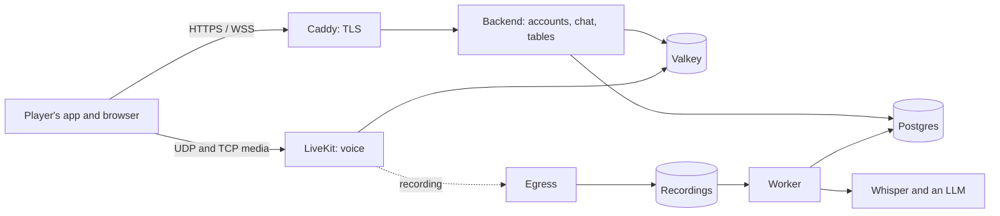
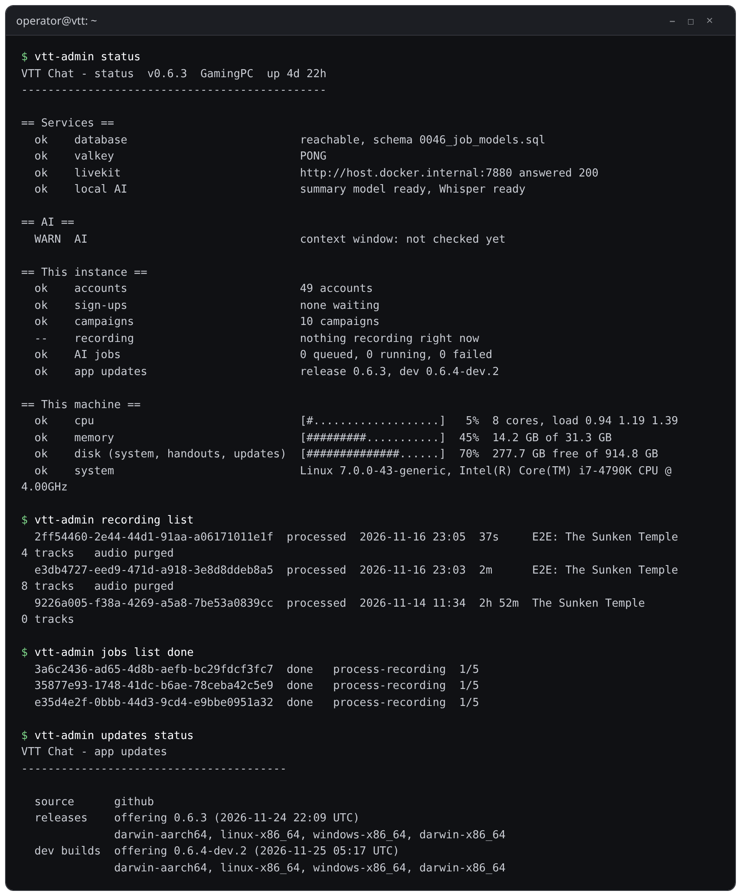
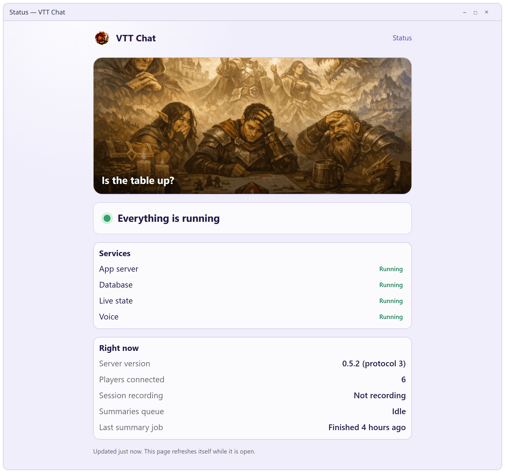

# Operator guide

For the person who runs the server: one machine, your own, no cloud account needed. **Draft (2026-11-10);
the Docker Compose path was followed step by step on a blank project on 2026-11-13 (rehearsal in
[BUILD-STATUS.md](../BUILD-STATUS.md)), by the author standing in for a second person.**
Steps marked **(not yet tried by someone else)** have only been run by the author; nothing here has yet been
followed by a real second human on a real VM with a real domain.

- [1. What you are running](#1-what-you-are-running)
- [2. Before you start](#2-before-you-start)
- [3. Install with Docker Compose (recommended)](#3-install-with-docker-compose-recommended)
- [4. Install natively (advanced)](#4-install-natively-advanced)
- [5. First run](#5-first-run)
- [6. Turn on recording and AI summaries](#6-turn-on-recording-and-ai-summaries)
- [7. Configuration reference](#7-configuration-reference)
- [8. Day-to-day operation](#8-day-to-day-operation)
- [9. Back up and restore](#9-back-up-and-restore)
- [10. Update](#10-update)
- [11. Fix it](#11-fix-it)
- [12. Security checklist](#12-security-checklist)

## 1. What you are running



- **Backend**: sign-in, campaigns, chat, handouts, loot, scheduling, and the records pipeline's control.
- **LiveKit**: the voice rooms (one per campaign). **Egress** records each speaker to a file.
- **Worker + Whisper + an LLM**: turn a recording into a transcript and summaries, after the session.
- **Caddy**: HTTPS in front of everything. **Postgres** is the database; **Valkey** holds short-lived state.

Nothing here needs an outside account. Players' apps talk only to **your** server.

## 2. Before you start

- **A machine you control**: a VM or a spare PC with Ubuntu 24.04 (Docker Compose also works on other
  Linux). 4 GB of memory is enough for voice and chat. **Recording and AI summaries need more**: the
  speech-to-text and the language model are the heavy parts: plan on **8 GB of memory and ~15 GB of disk**
  for them on a CPU-only server (images, models, and audio at ~12–30 MB per player-hour until you delete
  it). Without a GPU, a session is transcribed and summarised in hours, not minutes, and that is by design
  (the work runs after the game). An NVIDIA GPU makes it minutes ([section 6](#6-turn-on-recording-and-ai-summaries)).
- **A domain name** pointing at the machine (for example `vtt.example.com`). Browsers and the app
  need real HTTPS; Caddy gets the certificate for you from Let's Encrypt. To try things on one machine, use
  `localhost`.
- **Ports opened to the internet** (your router or cloud firewall; the installer never touches it):

  | Port                                   | What for                                     |
  | -------------------------------------- | -------------------------------------------- |
  | `80/tcp`, `443/tcp`, `443/udp`         | the website, the app's connection, sign-up   |
  | `7881/tcp`                             | voice over TCP when UDP is blocked           |
  | `50000-50200/udp` (a range you choose) | voice. **Required**; widen it for big groups |

  **Everything else must stay closed from the internet.** LiveKit and Egress run host-networked in the
  Compose bundle, so their own ports listen on every interface of the machine, not just the ones above.
  Forward nothing else, and if the machine has a public address, block these on its firewall (`ufw` or your
  cloud's security group):

  | Port        | Who                | Reachable from                                                                   |
  | ----------- | ------------------ | -------------------------------------------------------------------------------- |
  | `7880/tcp`  | LiveKit signalling | this machine only (Caddy and the backend use it); not forwarded, blocked outside |
  | `18180/tcp` | Egress health      | this machine only (the Compose healthcheck); not forwarded, blocked outside      |
  | `6379/tcp`  | Valkey             | loopback only (`VALKEY_HOST_PORT`; LiveKit and Egress use it)                    |
  | `3000/tcp`  | backend            | loopback only (Compose publishes it on `127.0.0.1`)                              |
  | `5432/tcp`  | Postgres           | not published at all                                                             |

  Port 7880 is how Caddy reaches LiveKit, so on a home network "not forwarded" is enough; on a machine with a
  public IP, add the firewall rule. The Egress health port is `18180` rather than its default `8080` so it does
  not collide with a native Whisper and is not a well-known port; it answers a plain "is it up" and nothing
  private. (Ports above were read from `infra/compose/compose.yml` and `livekit.yaml`; the firewall rules are
  not tested on a live public machine.)

  Behind a home router, forward the ports in the first table to the machine. **Cloudflare Tunnel cannot carry voice**; it can
  only front the web part. Players on very restrictive networks (hotel, school, some workplaces) may be
  unable to use UDP voice at all; LiveKit's built-in TURN is the fix and is off by default
  ([DEPLOYMENT-AND-TRANSPORT.md](../architecture/DEPLOYMENT-AND-TRANSPORT.md)).

- **Time to spend**: about half an hour for voice and chat, plus the model downloads if you add recording.

## 3. Install with Docker Compose (recommended)

### The one-command install (easiest)

On a **blank Ubuntu Server** (22.04 or 24.04), after you have pointed your domain's DNS "A" record at the machine,
SSH in and run:

```bash
curl -fsSL https://raw.githubusercontent.com/AndyProsser/vtt-chat-app/main/infra/get.sh | sudo bash
```

It asks for your domain and your email, then does everything: installs Docker if needed, downloads the server
bundle for the newest release into `/opt/vtt-chat`, writes fresh secrets, starts the stack, opens the needed ports in
`ufw` if it is active, makes you the first Admin and prints a **sign-in code** and what to do next. It checks your DNS
first and tells you if the record is missing or points somewhere else. If the name goes through **Cloudflare's proxy** (orange
cloud) that is fine and recommended for the website: the installer finds this machine's real public address and tells voice to
use it ([voice and Cloudflare](#voice-and-cloudflare)).

A **minimal** Ubuntu install may lack `curl` itself, which the one-liner needs: run `sudo apt-get update && sudo apt-get install -y curl` first (as root, leave `sudo` off). Docker itself comes from Docker's own apt repository (set up for you, so `sudo apt-get update && sudo apt-get upgrade` keeps it current; do that between sessions, because restarting Docker drops a live call), and the user who ran the installer is added to the `docker` group (it takes effect at their next login). The installer then installs whatever else is missing (`tar`, `openssl`, `gnupg`, `iproute2`, `nano`), asks apt no questions, and keeps its output in `/var/log/vtt-install.log`. On Ubuntu releases newer than Docker's own repository knows, it uses the distribution's Docker packages.

After it finishes, `vtt-admin` works from any directory (`vtt-admin status`, `vtt-admin user code <email> signin`,
`vtt-admin settings show`, `vtt-admin help`). `vtt-admin help` lists every command in groups, wrapped to your terminal, and `vtt-admin <group>` (for example `vtt-admin campaign`) shows just one group. Machine commands work the same way: `vtt-admin logs [service]`, `vtt-admin restart [service]`,
`vtt-admin ps`, `vtt-admin config show|set`, `vtt-admin voice-address`, `vtt-admin backup`, `vtt-admin restore <folder> --yes` and `vtt-admin update`. `update` (or running the
install command again) moves to the newest release of your **current line** (`0.4.x`); data and settings are kept, and a new
minor (`0.5`) is only installed when you ask for it with `--version`. An update also deletes the images of
older VTT Chat versions once the new one is healthy, keeping the version it replaced (add `--keep-images` to keep them all).

Everything it asks can be a flag, for a pasted one-liner: `... | sudo bash -s -- --domain vtt.example.com --email you@example.com --name "You" --with-records --yes`.
Other flags: `--version 0.4.0` (a specific release; a dev build needs its full name), `--public-ip` (behind NAT),
`--dir`, `--dry-run` (shows the plan), `--skip-docker-install`, `--skip-firewall`. You still open the same ports at your
router or cloud firewall (the table above); the script cannot do that part. Prefer to read it first? It is
[`infra/get.sh`](../../infra/get.sh), one file.

**(Rehearsed on a workstation with Docker already installed, against the published images; the Docker-install and
`ufw` steps and the Let's Encrypt certificate are written but not yet run on a blank VM.)** The manual steps follow.

### HTTPS without opening 80/443 (the DNS challenge)

Caddy normally proves it owns the domain over ports 80 and 443. If those are not reachable (a home line, or a Cloudflare Tunnel in front),
use Cloudflare's **DNS challenge** instead: install with `--cloudflare-dns` and a Cloudflare API token (create one at Cloudflare, My Profile,
API Tokens, with **Zone, DNS, Edit** on your zone). The installer reads it from `CLOUDFLARE_API_TOKEN` or asks for it with your typing hidden
(never as an option, so it is not left in your shell history), writes it to `.env` (mode 600) and gives Caddy a `tls.d/cloudflare.caddy`.
The certificate is real, so **everything can be HTTPS, even inside your network**: point a tunnel at `https://<this machine>:443` with the
origin server name set to your domain, and nothing needs to skip certificate checks. Needs the `vtt-chat-caddy` image, which is Caddy with
the Cloudflare DNS module (published with each release).

### No domain, or another port: `--http` and `--port`

You do not need a registered domain. A **free DDNS name** (DuckDNS, No-IP and the like) is an ordinary domain to the installer: give it as
`--domain`, and with ports 80 and 443 reachable you get a normal certificate. Two flags cover the cases that do not fit that:

- **`--port 8443`**: serve on another port (forward it on your router, and open it in the firewall; the installer does the latter).
  Let's Encrypt can only check ports 80 and 443, so a **valid certificate on a non-standard port needs the DNS challenge**
  (`--cloudflare-dns`, above). Without it the site still runs but the certificate will not be valid; the installer says so.
- **`--http`** (with `--domain` set to an IP address or any name that reaches the machine, and optionally `--port`): **plain HTTP, no
  certificate.** Passwords and sign-in codes cross the network unencrypted, so use it **only on a network you trust** (a LAN, or a VPN such as
  WireGuard or Headscale). Browsers also withhold features that need HTTPS. In the desktop app, players type the whole address, for example
  `http://192.168.1.20:8080`. Voice works the same (it signals over `ws://` and its media ports are separate).

Both are remembered: a later plain run of the installer (or `vtt-admin update`) keeps the scheme and port. They are written to `.env` as
`PUBLIC_ORIGIN`, `LIVEKIT_PUBLIC_URL`, `CADDY_SITE`, `CADDY_HTTP_PORTS` and `CADDY_HTTPS_PORTS` (Caddy listens on the port in its site address,
so that is the port published; its other port is kept on this machine's loopback). A self-signed certificate with the app pinning it is a
possible later mode ([ROADMAP Stage 18](../../ROADMAP.md)).

### Behind a Cloudflare Tunnel (a line that blocks 80/443)

Most home connections block inbound 80 and 443, so Let's Encrypt and Cloudflare's proxy cannot reach the server. Use a **Cloudflare
Tunnel** for the website instead: the server connects **out** to Cloudflare and nothing needs to be opened for it. Install with
`--behind-tunnel`: Caddy then serves plain HTTP on port 80 (Cloudflare holds the certificate) and trusts `CF-Connecting-IP` for the
visitor's address. Then give the tunnel a **public hostname** for your domain with the service `http://<this machine's address>:80`
(Cloudflare dashboard: Zero Trust, Networks, Tunnels), or run the tunnel from this server: set `CLOUDFLARE_TUNNEL_TOKEN` with
`vtt-admin config set CLOUDFLARE_TUNNEL_TOKEN <token>` (a token is a secret: type it yourself, do not paste it into a chat) and
`docker compose --profile tunnel up -d` (use the service `http://caddy:80` for that one). Voice does not use the tunnel; forward
`7881/tcp` and `50000-50200/udp` to the machine and see "Voice and Cloudflare" below. A page that answers `error code: 502` from
Cloudflare means the tunnel's service address is wrong or unreachable.

### Where settings live

Three places, each for a different kind of setting:

| Where                                                                                          | What                                                                                                                                                                                                                                          | How to change it                                                                                                                         |
| ---------------------------------------------------------------------------------------------- | --------------------------------------------------------------------------------------------------------------------------------------------------------------------------------------------------------------------------------------------- | ---------------------------------------------------------------------------------------------------------------------------------------- |
| **`.env`** beside `compose.yml` (`/opt/vtt-chat/.env`; `/etc/vtt/vtt.env` on a native install) | Things the server reads at start: the domain, `VTT_VERSION`, `RECORD_CUES`, `SMTP_URL`, `OIDC_*`, `UPDATES_SOURCE`, `COMPOSE_PROFILES` (records on/off), `VOICE_ADDRESS`, the secrets. `compose.yml` passes each one into the right container | `vtt-admin config show` (secrets hidden), `vtt-admin config set KEY VALUE` (applies it), or edit the file and run `docker compose up -d` |
| **The database**, through `vtt-admin settings`                                                 | Things you may change while it runs: sign-up requests, campaign creation, offline limit, AI backends and models, purge rules                                                                                                                  | `vtt-admin settings show`, `settings keys`, `settings set <key> <value>`; no restart                                                     |
| **`livekit.yaml`** (generated)                                                                 | LiveKit's keys, ports and the voice address                                                                                                                                                                                                   | `vtt-admin voice-address …`; do not hand-edit the keys                                                                                   |

### Voice and Cloudflare

Chat, sign-in and the website travel over `https://your-domain` (ports 80 and 443). Voice does not: LiveKit sends each player
the address and ports for the **media** (UDP `50000-50200`, and `7881/tcp` as a fallback) **after they connect**, so those go
straight to your machine and never touch port 443 or Cloudflare. That means:

- The website can sit **behind Cloudflare's proxy** (SSL/TLS mode **Full (strict)**). The installer then also tells Caddy to trust
  Cloudflare's ranges and read `CF-Connecting-IP`, so rate limits and the device-approval page see the visitor, not Cloudflare.
- Voice needs only the real address of the machine. The installer detects it; set it yourself with `--voice-address <ip or name>`
  at install or later with `vtt-admin voice-address <ip | dns-name | auto>` (`auto` lets LiveKit ask a STUN server; a name is
  resolved to an IP when you run the command, so on a changing address run it again, for example from cron).
- A residential line that blocks 80/443 inbound cannot serve the website itself (Cloudflare's proxy still needs to reach your
  origin on 443); that needs a tunnel instead, which is not built in yet. Voice is unaffected, because it does not use 443.

### Or step by step

```bash
sudo apt-get install -y docker.io docker-compose-v2 git   # or Docker's own packages
git clone https://github.com/AndyProsser/vtt-chat-app.git
cd vtt-chat-app/infra/compose
./setup.sh vtt.example.com                    # your domain; add your public IP as a second argument if behind NAT
docker compose pull                           # the published images (no build, no compiler needed)
docker compose up -d --wait
curl https://vtt.example.com/api/health       # {"status":"ok"}
```

(To build the images from the checkout instead, for an unreleased commit: `docker compose up -d --build --wait`.)

**Which images.** `setup.sh` prints the version it pinned (`images: …`) and writes it to `.env` as `VTT_VERSION`.
On a checkout of a release tag that is the release line (`0.4`: the newest patch, never a new minor); on a checkout
whose newest tag is a **dev build** (`v0.4.0-dev.5`) it is that exact version, because a dev tag publishes only its own
tag and a line like `0.4` does not exist until `0.4.0` is released. To pin something else, run
`VTT_VERSION=0.4.0-dev.5 ./setup.sh vtt.example.com` (or edit `.env`) before `docker compose pull`. If the pull
says `not found`, that tag is not published (or the GitHub package is still private).

**Ports already in use.** `setup.sh` warns when 80, 443, 7880 or 7881 are taken on the machine (Caddy and LiveKit
need them; find the culprit with `ss -ltnp`), and picks a free loopback port for Valkey (`VALKEY_HOST_PORT`, from 6379 up)
and for the backend's local probe port (`BACKEND_PORT`, from 3000 up) if the defaults are busy; both are written to `.env`.

What `setup.sh` does: writes `.env` and `livekit.yaml` with **fresh random secrets** (never printed, mode
600, never committed). Re-running it leaves them alone. `--force` regenerates them, which **signs everyone
out** and, because Postgres keeps the password it first started with, also means
`docker compose down -v`, **which deletes the database**. Do not use `--force` on a live server.

Check it worked:

```bash
./vtt-admin status          # every service should say ok
```

(`./vtt-admin` runs the CLI inside the `backend` container of the Compose project named in `.env` or the current
directory's default; run it from `infra/compose`. If you run several instances on one machine, set
`COMPOSE_PROJECT_NAME` to tell them apart.)

Also open `https://vtt.example.com/status`: a public status page with the same checks, which is handy to
give your players.

**Behind NAT?** Pass your public IP: `./setup.sh vtt.example.com 203.0.113.7`, and forward the ports above.

**To try it on one machine first**: `./setup.sh localhost`. Caddy then uses its own certificate, so a
browser warns once. The desktop app uses the system certificate store, so install Caddy's CA there first:
`./trust-local-ca.sh` (Linux; asks for sudo once), then restart the app. On Windows or macOS, import the
CA's `root.crt` (`docker compose cp caddy:/data/caddy/pki/authorities/local/root.crt .`) as a trusted root.

## 4. Install natively (advanced)

For people who do not want Docker. Ubuntu **24.04 LTS only** (it needs that release's `valkey-server`
and `caddy` packages).

```bash
git clone https://github.com/AndyProsser/vtt-chat-app.git && cd vtt-chat-app
sudo infra/install.sh --domain vtt.example.com [--public-ip 203.0.113.7] [--with-records]
```

It installs Postgres, Valkey and Caddy from apt, Node.js and LiveKit as checksum-verified downloads,
builds the backend, writes secrets to `/etc/vtt/vtt.env` (mode 640, never printed), and creates hardened
systemd units: `vtt-backend`, `vtt-livekit` (and `vtt-whisper`, `vtt-ollama`, `vtt-worker` with
`--with-records`). Re-running is safe and keeps your secrets and data. `--dry-run` shows the plan;
`--no-start` installs without starting.

Two limits to know: it **does not install LiveKit Egress** (the recorder ships only as a container), so
native recording needs the Compose `egress` service next to it; and it does **not open ports** for you.
LXC containers are possible but unsupported ([DEPLOYMENT-AND-TRANSPORT.md](../architecture/DEPLOYMENT-AND-TRANSPORT.md)).

## 5. First run

1. **Create the first account: it becomes the Admin.** The app has no sign-up screen (accounts are made on
   the browser join page from an invite), so the very first account is made on the server:

   ```bash
   ./vtt-admin user create you@example.com --name "Your Name" --accept-consent
   ./vtt-admin user code you@example.com signin      # a one-time code
   ```

   Then sign in with that code. **In a browser** (nothing to install): open `https://your-domain/`, choose Sign in,
   then "I have a sign-in code". **In the desktop app**: choose your server and type the code in its Connect screen.
   Set a password afterwards if you want one (the codes work once and expire in about 15 minutes; ask for another
   with the same command). `--accept-consent` records that the person has agreed to the recording notice (for the first account, that is
   you). The first account is the Admin; add `--admin` to make a later one an Admin too. **(`user create` is new,
   2026-11-10, and has not yet been tried by someone else.)** The first Admin also gets a starter campaign with a
   randomly chosen dry-humour name (for example "Several Goblins Short of a Plan") and is its DM, created at sign-in
   (and by `user create`), so the app has somewhere to go straight away. Rename it, or make more, in the app.

2. **Decide who may create campaigns:** `./vtt-admin settings set campaign-creation closed` (only Admins) or
   `open` (any signed-in player). Default is set when the instance is created; `settings show` lists it.
3. **Give players a download.** Nothing to do on a stock install: the update sync (below) records the installers
   of the release it offers (Windows setup, macOS `.dmg`, Linux AppImage plus `.deb`/`.rpm`) in
   `$UPDATES_DIR/downloads.json`, and the front page, join page and status page show them (a button for the visitor's
   OS, the others as links). Always GitHub links, in both `github` and `mirror` mode (the mirror holds only the
   signed updater files). To send players somewhere else, set `CLIENT_URL_WINDOWS`, `CLIENT_URL_MACOS`,
   `CLIENT_URL_MACOS_INTEL`, `CLIENT_URL_LINUX` in `.env` (any of them; they are shown only to signed-in accounts, so to share the app with someone who has no account yet, give them an invite or account first): if any is set, those are used **instead of** the synced file. Until
   the first sync finishes (or with `UPDATES_SOURCE=off`) and with no `CLIENT_URL_*`, the page says to ask the DM.
4. **Invite a table.** In the app, the DM creates an invite (an emailed link, a code, or a QR code). Anyone
   with the code joins; invites expire (default set by `invite-expiry-days`) and can be used by the whole
   group. See [JOIN-FLOW.md](../architecture/JOIN-FLOW.md).
5. **No email server?** That is fine. When someone forgets a password or needs a first sign-in code:
   `./vtt-admin user code them@example.com signin` (or `reset`). The code is valid for a short time;
   pass it on by chat or phone.

6. **Which tables people can ask to join (on by default).** A signed-in person can see the campaigns whose DM has
   **Allow join** on (name, DM name, player count, nothing inside) and ask to join; the **DM** approves, not you. To
   hide every listing and allow invites only: `./vtt-admin settings set campaign-directory off`. Pending requests stay
   visible to the DM, marked closed, until it is on again.

7. **Let visitors ask for an account (optional, off by default).** People without an invite can request one from the front page:

   ```bash
   ./vtt-admin settings set signup.requests on
   ./vtt-admin signup list                      # pending requests: id, time, name, email, message
   ./vtt-admin signup approve <id|email>        # makes the account, prints a one-time code (ABCD-EFGH)
   ./vtt-admin signup reject <id|email>
   ```

   Approving creates the account (no password, not an Admin) and prints a code valid for about 15 minutes. **Hand it over
   on a side channel** (a message, in person), not by replying to the address on the request: the code is the proof that
   the person you contacted is the person who asked. They enter it under "I have a sign-in code" on the front page or in the app's
   Connect screen and accept the recording notice then. If the code expires first, `user code <email> signin` issues another.
   `status` shows how many requests are waiting. At most 200 stay open at once and each address gets 5 submissions an hour,
   so the form cannot be flooded; turn the setting back off to close it (existing requests stay listed). See
   [SIGN-IN-OPTIONS.md](../architecture/SIGN-IN-OPTIONS.md).

Sign-in options (password, emailed code, single sign-on) are in [SIGN-IN-OPTIONS.md](../architecture/SIGN-IN-OPTIONS.md).

## 6. Turn on recording and AI summaries

Recording is a **profile** you add to the same stack:

```bash
cd infra/compose
docker compose --profile records up -d --wait
```

This adds **Egress** (about 4 GB of image), **Whisper** (speech to text; about 190 MB model),
**Ollama** (a language model, about 3.3 GB for the default `qwen3.5:4b`) and the **worker** that runs the
jobs. The stack is up in seconds; the **first start then downloads the two models in the background** (the Whisper
container fetches its own, the worker asks Ollama for the summary model). You can record straight away: a
recording made before the models are there waits for them. Watch it with `./vtt-admin status` (the `local AI`
line says "downloading (43%)", "ready", or why it failed) or `./vtt-admin logs whisper worker`; the status page
shows a "Summary model" row while it downloads. A download that fails (no route out, a mistyped model name) is
\1

**More than one table.** A server can record **several tables at once**: each table has its own voice room, recording,
chat and memory, and one table never sees another's records. How many may record at the same time is
`vtt-admin settings set recording.max-tables <n>` (default **2**; `0` means no limit). It only refuses the **start** of a
recording past the limit, with a message to the Game Master; a table already recording is never interrupted, and chat,
voice and processing are unaffected. **Processing is one job at a time, in the order the jobs were queued**, and this
version runs **one worker** (a second worker stands by until the first stops; running several is a future stage). Two
tables recording at once therefore queue their processing one after the other. Within one table the queue keeps the
sessions **in the order they were recorded**: if a session's job fails, the table's later sessions wait for it (so the
campaign memory and tales stay in order) until you `jobs retry` it, or `jobs release <id>` it to let the later ones go
ahead without it. `jobs list` says what a waiting job is waiting for, and in its **models** column which models did the work (the
transcriber, then the scribe and the storyteller, such as `large-v3-turbo (remote), qwen3:8b (remote)`), with a note when a remote one was
unreachable and the local one finished the job; `status` shows the same for the **last tale**, so a tale's quality can be traced to the
model that wrote it. A job that ran before this was added shows none.

**What the summaries are.** A recording is summarised in two passes. A _scribe_ reads the transcript once and writes
down what happened, big and small. A _bard_ then tells it, from the scribe's notes, as a short heroic tale with dry
wit: one for the session, one for each part when it was paused or the scene changed, and one for each hero. The
Game Master also gets a plain brief (secrets, hooks, promises, what to prepare). The tale takes small liberties with
how things happened, never with what happened. Players read the tales only; the Game Master also reads the
scribe's notes, and can read and search the transcript in the desktop app with "Include dev builds" on.
`OLLAMA_MODEL` plays both roles; set `OLLAMA_STORY_MODEL` in `.env` to give the bard a different model.

**What to expect on a CPU-only server** (measured on a 4-core 2014 desktop, 2026-11-16): Whisper `small.en` takes
about 0.25 × the length of each player's speech, and with `qwen3.5:4b` the notes take a minute or two for each ten minutes of talk, then about a minute for each tale. The Whisper default is
**English only**: for another language set `WHISPER_MODEL_FILE=ggml-small-q5_1.bin` in `.env` and the language with
`vtt-admin settings set ai.transcription.language <code>`. A 4-hour
session with five players is a few hours of work, done after the game; nothing is lost if it takes all night.
Memory while it runs: Whisper about 0.5 GB, the language model about 3 GB.

**Whisper uses every core**, at low CPU priority, so voice and the app stay responsive while a recording is transcribed (whisper-server on its own uses at most 4). On an 8-vCPU 2010 Xeon VM this took `small.en` from 1.71 to 1.26 × the length of the speech. To leave cores free for something else on the machine, set `WHISPER_THREADS` in `.env` (for example `WHISPER_THREADS=4`).

### What the AI storyteller may write: length, content and who tells it

Three settings keep the tales suitable for your server. The Game Master picks only a storyteller's style; these are yours, and nothing in the app changes them. | Setting | Values | Use it for |
| ----------------------- | ----------------------------- | --------------------------------------------------------------------------------------------------------------------------------------------------------------------------------------------------------------------------------------------------------------------------------------------------------------------------------------------------------------------- |
| `ai.tale.length` | `short`, `default`, `long` | The ceiling on a tale's length. **Short** suits a CPU-only server, where a long tale costs minutes of model time; **long** suits a GPU or a cloud model. The tale also follows what happened in the session, so a quiet night stays short either way. |
| `ai.tale.content` | `clean`, `default`, `graphic` | How strong the language and violence may be. **Clean** suits family or school groups; **graphic** tells both plainly. The installer asks, or takes `--content`. |
| `ai.storyteller.<name>` | `on`, `off` | Which storytellers your server offers: `dry`, `drunken` (the Tipsy Minstrel, which may let Game Master secrets slip), `sarcastic`, `bored`. **The Tavern Bard (`tavern`) cannot be turned off:** it is the default, and a campaign whose storyteller you turn off is told by it until the Game Master picks another. The picker in the app shows only what you offer. |

```bash
vtt-admin settings set ai.tale.length short
vtt-admin settings set ai.tale.content clean
vtt-admin settings set ai.storyteller.drunken off
```

### Names, notes and memory: three more settings for the AI workflow

| Setting                     | Values                                 | What it does                                                                                                                                                                                                                                                    |
| --------------------------- | -------------------------------------- | --------------------------------------------------------------------------------------------------------------------------------------------------------------------------------------------------------------------------------------------------------------- |
| `ai.transcription.glossary` | `corrections`, `prompt`, `both`, `off` | Uses the campaign's own names (the Game Master's glossary, characters, players, scene, handout and loot titles) to fix what Whisper misheard (`corrections`, the default), and/or to tell Whisper the names up front (`prompt`, which is off until you try it). |
| `ai.memory.enabled`         | `true`, `false`                        | Campaign memory: after each session one more model call keeps a list of the people, places, groups, quests and items the party has met, so the tale can say "once again". On by default; turn it off on a very slow CPU-only server to save that call.          |

`vtt-admin memory show <campaign-id>` lists what a campaign remembers; `vtt-admin memory forget <campaign-id> <name>` removes a wrong entry (a later session may learn it again if its notes mention it). Memory is kept only from what was said and typed at the table, never from whispers or private audio. It is **not** part of a `.vttcampaign` export, and deleting a session does not remove what it taught; deleting the campaign does.

### With an NVIDIA GPU (including GTX 10-series)

Add the GPU override. It builds Whisper for your card once (about 30 minutes, a ~6 GB image; upstream's
CUDA image does not run on GTX 10-series cards) and runs Whisper and Ollama on the GPU:

```bash
nvidia-ctk cdi list | grep nvidia.com/gpu=all    # the NVIDIA Container Toolkit with CDI must be set up
echo 'COMPOSE_FILE=compose.yml:compose.gpu.yml' >> .env   # so every docker compose command includes it
docker compose --profile records up -d --build --wait
```

Defaults for an 8 GB card: Whisper **`large-v3-turbo`** (q5_0, ~574 MB download, ~1 GB of VRAM, ~27×
faster than real time) and **`qwen3:8b`** for the summaries (~5.2 GB download, ~5.5 GB of VRAM, ~15 s a
summary on a GTX 1080). On a 4–6 GB card set `WHISPER_MODEL_FILE=ggml-small.en-q5_1.bin` and
`OLLAMA_MODEL=qwen3.5:4b` in `.env`. `CUDA_ARCHS` (default `61;75;86;89`) picks which card generations
the build supports. **The GPU is free between jobs:** Whisper stops after `WHISPER_IDLE_SECONDS` (60) without
work and Ollama unloads its model after `OLLAMA_KEEP_ALIVE` (2m), so a machine that is also a gaming PC
gets its VRAM back a minute or two after the summaries are written. The worker runs Whisper and the
language model one after the other, never together.

**Disk:** Egress image ~4 GB, Whisper CUDA image ~6 GB (CPU image ~1.7 GB), Ollama image ~8.5 GB, models as
above, and audio at about 12–30 MB per player-hour (deleted by the
retention rules in section 8, or by you with `vtt-admin recording purge`).

### Check it works: `vtt-admin test`

A quick way to see that everything is connected, in 10 to 30 seconds. Each line says `ok`, `WARN` (works, with something to look at) or
`FAIL`, and the last line says whether everything looks good. It exits with 1 only when something failed, so a script can use it.

| Command                            | What it proves                                                                                                                                                                    |
| ---------------------------------- | --------------------------------------------------------------------------------------------------------------------------------------------------------------------------------- |
| `vtt-admin test ai`                | The speech-to-text and the summary model each answer, and how long they took. It tests **what is configured**; for a remote model it also reads the window the server is serving. |
| `vtt-admin test ai --local`        | The local Whisper and Ollama, whatever is configured. `--remote` tests the configured remote ones. `--cloud` tests the configured Claude or OpenAI model. Flags combine.          |
| `vtt-admin test voice`             | LiveKit is up, accepts this server's keys, the recorder (Egress) answers so a session can be recorded, and the address players are given is a public one.                         |
| `vtt-admin test reach`             | From **outside** your network (see below): that plain HTTP, HTTPS and the voice TCP port 7881 are reachable.                                                                      |
| `vtt-admin test full [--external]` | `ai` and `voice` together; `--external` adds `reach`.                                                                                                                             |

**Cloud AI is never called unless you ask.** A test of Claude or OpenAI is a real, billable call (a fraction of a cent). If a cloud model is
configured and you run `test ai` with no flag, the local model is tested instead and the output says so; add `--cloud` to test the cloud one.

**What these tests are, and are not.** They are connection tests: Whisper is given a short test tone and the model one word. They prove
"this is connected and answers", not that a tale will be any good (that is the end-to-end test below). On a Compose install `test ai` runs
inside the worker's container, where the AI addresses and keys are, so the records worker has to be running.

**`test reach` follows how your server is really set up.** It reads the site's address and port from `PUBLIC_URL` (so a `--port 8443` or
`--http` install is checked on its own port, not on 443 and 80), and checks voice's TCP port at the **voice address** (`vtt-admin voice-address`),
which can be a different machine or name from the website: with the web address behind Cloudflare and voice pointed directly at your
server, the web rows prove Cloudflare answers, and the voice row checks your own address. If your voice TCP port is not 7881 (you changed
`tcp_port` in `livekit.yaml`), set `VOICE_TCP_PORT` with `vtt-admin config set VOICE_TCP_PORT <port>`. Behind a Cloudflare Tunnel there is
no inbound 80 or 443 at all, so the web rows prove the tunnel, not your router; voice still needs its own direct address and forwarded ports.

**`test reach` also looks for CGNAT.** Many home ISPs share one public IPv4 address between customers (carrier-grade NAT), and then nothing
outside can reach the server however you forward ports. The test asks a STUN server (Google's, which LiveKit already uses) what address the
server appears as, checks that your DNS names point at it, and when nothing outside can get in it says CGNAT is likely. The test also **asks your router** for its own internet address over UPnP or NAT-PMP (from the host's network, even in Docker): if the router reports a shared address, or one different from what the internet sees, that **proves** CGNAT. Many routers have both switched off, and then the test says it could not ask. To confirm by hand, compare the
WAN IP on your router's admin page with the address the test shows: if they differ, or the router shows `100.64.x.x` to `100.127.x.x`, you are
behind CGNAT. **The best fix is to ask your ISP to take you off CGNAT**; if they will not, the server needs to run somewhere with a public address. This project only detects and warns. See [Behind CGNAT?](../architecture/DEPLOYMENT-AND-TRANSPORT.md#behind-cgnat-the-servers-side).

**`test reach` uses check-host.net**, a free public service that opens the connections from several countries (one of them near your server, found from its address; it has none in Australia or New Zealand, so Singapore or Indonesia stand in), because nothing inside your
network can see how it looks from outside. It is only ever run when you ask for it by name (or `--external`); it is told your server's host
name (public anyway) and nothing else, and nothing depends on it. It is a free service with its own fair-use limits: if it refuses or is down,
the test says so and you try again later. Voice's **UDP** is proved too: LiveKit opens a media port only for a call in progress, so the test starts a short-lived echo listener on a free port in the media range (50000-50200), has check-host.net send UDP to it, and a reply proves the router forwards the range to this machine. A failure means forward UDP 50000-50200. (A phone off your Wi-Fi joining a call remains the final end-to-end proof.) `test voice` checks your server's side and `test reach` the TCP fallback port.

### Check it works end to end: the smoke test

From a checkout of the repository on the server (Node and `npm install` needed), with the records profile
up, `node infra/records-smoke/compose-e2e.ts` plays a four-minute scripted scene with four synthetic
players, records it, waits for the worker and checks the result through the API: who said what, typed
lines, nothing from whispers or `/ooc` anywhere, all four kinds of summary, DM-only kept from players,
search, a worker killed mid-job, and (`--fallback`) the fallback from an unreachable remote AI. It makes its
own `@example.com` accounts and campaign. Setup (a small text-to-speech program) and options:
[infra/records-smoke/README.md](../../infra/records-smoke/README.md#the-compose-end-to-end-test-compose-e2ets-run-it-after-an-install).

How it behaves, so you can explain it to your players:

- The **DM** starts, pauses, resumes and stops a recording in the app. Every player's app plays a clear
  "recording" cue, and **a player's voice is only recorded after their app has played it**.
- Each speaker is recorded separately. Whispers and private lines are **never** recorded or transcribed.
- Lines typed into the public chat during a recording go into the transcript, marked "(typed)".
- Sound effects from the DM's soundboard are **not** recorded (unless you switch on `RECORD_SOUNDBOARD=1`, for
  testing: they are then saved as a separate, never-transcribed file). What the session's timeline notes about the table
  is names only, never audio, and **by default only scene changes** (a scene change starts a new chapter in the
  summaries, and the summaries are told about it as a cue). To note more, set `RECORD_CUES` in `.env`, for example
  `RECORD_CUES=scene,voice,groups` (`voice` is the DM's character voice, `groups` party splits and merges, `sounds`
  individual effects and loops; `all` and `none` also work).
- If the DM's app disconnects, the recording carries on. After `RECORDING_GRACE_SECONDS` (default 30)
  any player can pause, resume or stop it. If **everyone** is gone for that long, it stops by itself.
  The DM cannot switch campaigns or hand over the DM role while a recording runs. Details:
  [RECORDING-AND-SUMMARIES.md](../architecture/RECORDING-AND-SUMMARIES.md#while-a-recording-runs-decided-2026-11-10).

**Where the AI runs** is your choice. By default everything runs on your server (slow on a CPU, nothing
leaves the machine). To send transcription or summaries to a stronger machine you own (for example a gaming
PC with a GPU) use `vtt-admin settings keys` to see the `ai.*` settings; jobs wait for that machine and
fall back to the local CPU after a time you set. A **cloud** AI service is possible but means session audio
or text leaves your server: it needs an explicit setting, and the app tells players.

**Recommended for a CPU-only server with a gaming PC on the network** (measured on a GTX 1080; see
[RECORDING-AND-SUMMARIES.md](../architecture/RECORDING-AND-SUMMARIES.md)). A 4-vCPU, 16 GB VM with no GPU can run the
whole system, but its AI is slow: Whisper `small` takes about 0.3x the length of the audio, so a four-hour session
transcribes in roughly 80 minutes, and a summary on the CPU takes minutes and, with the small model, can invent
details. A GPU PC does the same work in minutes with the better models. So:

1. On the gaming PC run Ollama and a Whisper server that speak the OpenAI-compatible API. The repo has a ready-made Compose
   file for the Whisper half (and Ollama, if it is not already installed there): [`infra/compose/remote-ai/`](../../infra/compose/remote-ai/README.md)
   (its CUDA image covers GTX 10-series and newer cards). Pull `qwen3:8b`, and let them listen on the LAN address only (a host-installed
   Ollama needs `OLLAMA_HOST` set and `OLLAMA_CONTEXT_LENGTH=8192`; allow the ports only from the VM, never the internet).

   **Raising that window takes two steps, both needed.** `OLLAMA_CONTEXT_LENGTH` (in `.env` for the Compose
   service, or the host-installed Ollama's own environment) is what Ollama actually serves — bigger costs
   VRAM and speed. The OpenAI-compatible API the app actually talks to when generating has no way to ask
   Ollama what that number is (the worker's own separate check below can, through Ollama's native API —
   that is how `--tune`, next, learns it), so it also has to be told directly, with
   `./vtt-admin settings set ai.llm.context`. **Never set that number higher than
   `OLLAMA_CONTEXT_LENGTH`**: the app would then trust a window Ollama doesn't actually have, and condense
   too late, which is silent truncation, not a safe mistake. Lower is the safe direction: the app just
   condenses earlier than it needs to and some VRAM goes unused.

   **Easier: let the app check and set it for you.** `./vtt-admin status` has an **AI** section that
   compares the configured number against what Ollama is actually serving (checked by the worker
   periodically, for `local` and `remote` alike) and against the model's own maximum — a mismatch that risks
   truncation shows as a failure, not just a warning; unused headroom (the model could serve more than is
   configured) shows as a warning with both numbers. `./vtt-admin status --tune` writes `ai.llm.context`
   for you, from what Ollama is actually serving right now — no need to copy `OLLAMA_CONTEXT_LENGTH`'s
   number by hand. For `remote` it never guesses from the model's maximum (nothing confirms the remote
   server would actually serve that much); it uses what the server reports for the loaded model. **Ollama only
   reports a window for a loaded model, so when the remote model is idle the worker loads it once** (an empty
   request that generates nothing, kept in memory for 30 seconds, so a gaming PC's GPU is not held), reads the
   window, and **keeps that reading for a day** (the status line says how old it is), reading it afresh whenever
   a job has the model loaded anyway. Right after the worker starts, or after you change the remote model or
   address, give it up to 15 minutes, then run `--tune`. Until a window has been read, `--tune` has nothing
   to apply (and says so), and Claude/OpenAI are never affected — Claude's real window comes from a built-in table, OpenAI has no table and always shows as
   unknown.

2. On the VM, point the worker at it, with the VM's own CPU as the fallback:

   ```bash
   ./vtt-admin settings set ai.transcription.kind remote
   ./vtt-admin settings set ai.transcription.url http://gaming-pc:8080
   ./vtt-admin settings set ai.transcription.model large-v3-turbo
   ./vtt-admin settings set ai.llm.kind remote
   ./vtt-admin settings set ai.llm.url http://gaming-pc:11434
   ./vtt-admin settings set ai.llm.model qwen3:8b
   ./vtt-admin settings set ai.fallback.enabled true
   ./vtt-admin settings set ai.fallback.after-seconds 600
   ```

   **Or use Claude for the summaries (opt-in, off-site).** Claude writes the notes, tales and brief; Whisper stays where
   it is, so no audio ever leaves your server, only the transcript text does (never a whisper or private line). The
   players are told: the app and the status page show the off-site notice as soon as this is on. It is billed per token on
   an account at console.anthropic.com (a Claude subscription does not cover the API); a five-hour session on Sonnet is
   about thirty cents.

   ```bash
   # in the Compose .env (never in the database), then: ./vtt-admin restart
   ANTHROPIC_API_KEY=sk-ant-...
   ./vtt-admin settings set ai.llm.kind claude
   ./vtt-admin settings set ai.llm.model claude-sonnet-5-5   # the default; claude-haiku-5-5 is cheapest, claude-opus-5-5 the best
   ```

   With no key set, or when Anthropic is unreachable for `ai.fallback.after-seconds`, or if Claude declines a request,
   the job finishes on the local model; it is never lost. `./vtt-admin jobs list` shows each job's tokens and an
   estimated cost (from a dated price table, so check it against the console).

   **Or use OpenAI the same way** (also opt-in and off-site, with the same notice and the same local fallback). OpenAI
   changes its model names and prices often, so nothing is built in: you name the model, and give its prices if you
   want a dollar figure in `jobs list` (without them it shows tokens only).

   ```bash
   # in the Compose .env: OPENAI_API_KEY=sk-...   then: ./vtt-admin restart
   ./vtt-admin settings set ai.llm.kind openai
   ./vtt-admin settings set ai.llm.model <the model id from platform.openai.com>
   ./vtt-admin settings set ai.llm.price-in 0.40     # US dollars per million input tokens (optional)
   ./vtt-admin settings set ai.llm.price-out 1.60    # and output tokens
   ```

   `openai` always means api.openai.com. For any other OpenAI-compatible server (Ollama, vLLM, a gateway) use `remote`.
   Transcription is unchanged: only text leaves the server.

3. **No local AI on the VM (an old CPU, or you simply do not want it)?** Local Whisper and the LLM need a CPU with **AVX** (anything from
   about 2012 on; some old servers, such as a 2010 Xeon, lack it and the Whisper container dies with an illegal instruction). Install
   with `--records-remote` (the installer picks it by itself when it finds no AVX): the Compose profile `records-remote` runs recording
   (Egress) and the worker but not Whisper or Ollama, and the AI must be remote: set the keys above and
   `./vtt-admin settings set ai.fallback.enabled false`, so a job waits for the PC instead of trying a local service that is not there.
   Keep the PC on during the hours after a session.
   If you would rather try it locally anyway, `COMPOSE_FILE=compose.yml:compose.compat.yml` in `.env` swaps in a Whisper built without AVX
   (`vtt-chat-whisper-compat`). Whisper copes: measured on a 2010 Xeon (8 vCPU), `small.en` takes about **1.3 to 1.7 times
   the length of each player's speech**, so a session is transcribed overnight. **The summary model does not:** Ollama runs
   without AVX but very slowly (`qwen3.5:4b` read 3.2 and wrote 1.8 tokens a second on that Xeon, against roughly 50–100 and
   8–12 on a modern CPU), so one session's summaries would take many hours and a single request can run past the
   worker's one-hour limit. On a CPU like that, send summaries to a remote LLM (step 2) even if Whisper stays local.
4. Otherwise keep the local fallback ready on the VM: `small.en` Whisper and `qwen3.5:4b` (the defaults for a CPU-only server).
   If the PC is off, a job waits ten minutes and then runs locally, slower and rougher but never lost.

Sessions are about weekly, so a slow fallback is acceptable. Expanding the VM's CPUs helps the fallback a little but
is not worth much: even eight cores need about 150 seconds for one qwen3:8b summary on the CPU.

## 7. Configuration reference

Everything is set by environment variables: in `infra/compose/.env` for Compose, or `/etc/vtt/vtt.env`
natively. Restart the backend after changing them (`docker compose up -d`, or
`sudo systemctl restart vtt-backend`).

| Variable                                                                  | Default                                         | What it does                                                                                                                                                                                                                                                                                                                                                                                                                               |
| ------------------------------------------------------------------------- | ----------------------------------------------- | ------------------------------------------------------------------------------------------------------------------------------------------------------------------------------------------------------------------------------------------------------------------------------------------------------------------------------------------------------------------------------------------------------------------------------------------ |
| `SITE_ADDRESS`                                                            | (set by `setup.sh`)                             | The domain players use                                                                                                                                                                                                                                                                                                                                                                                                                     |
| `PUBLIC_URL`                                                              |                                                 | The address used in links the server sends (emails, invites)                                                                                                                                                                                                                                                                                                                                                                               |
| `DATABASE_URL`, `VALKEY_URL`                                              | (set for you)                                   | Postgres and Valkey connections                                                                                                                                                                                                                                                                                                                                                                                                            |
| `LIVEKIT_URL`, `LIVEKIT_API_URL`, `LIVEKIT_API_KEY`, `LIVEKIT_API_SECRET` | (set for you)                                   | How the backend talks to LiveKit                                                                                                                                                                                                                                                                                                                                                                                                           |
| `RECORDINGS_DIR`                                                          | (set in records profile)                        | Where Egress writes audio; setting it turns recording on                                                                                                                                                                                                                                                                                                                                                                                   |
| `RECORDING_GRACE_SECONDS`                                                 | 30                                              | Seconds the DM may be disconnected before players can step in; also the time with nobody connected before a recording stops (5 to 3600)                                                                                                                                                                                                                                                                                                    |
| `RECORD_CUES`                                                             | `scene`                                         | Which table cues are noted (names only, never audio) in a recording's timeline: any of `scene`, `voice`, `groups`, `sounds`, or `all` / `none`. Scene changes start chapters                                                                                                                                                                                                                                                               |
| `RECORD_SOUNDBOARD`                                                       | off                                             | `1`: also save the DM's sound effects as a separate file and note each effect by name in the timeline (testing only)                                                                                                                                                                                                                                                                                                                       |
| `STARTER_SOUNDS`                                                          | off                                             | `1`: load the shared starter sounds (scenes and stingers every DM can use, from `backend/assets/sounds`). Off in 0.5.0 while the pack is finished; the default changes in 0.5.1                                                                                                                                                                                                                                                            |
| `MEDIA_DIR`                                                               | (set for you)                                   | Where handouts, pictures and sound clips are stored. Needs disk space                                                                                                                                                                                                                                                                                                                                                                      |
| `GM_NOTES_MAX_MB`                                                         | 100                                             | The largest single picture or PDF the Game Master may attach to their notes, in megabytes. A ceiling so one upload cannot fill the disk; notes themselves have no limit. Uses `MEDIA_DIR`                                                                                                                                                                                                                                                  |
| `SMTP_URL`, `MAIL_FROM`                                                   | off                                             | Send sign-in and password-reset **links** by email (optional; needs `PUBLIC_URL`; the CLI can hand out codes without it). Example for a LAN relay: `SMTP_URL=smtp://10.0.20.105:25`, `MAIL_FROM="VTT Chat <noreply@example.com>"`                                                                                                                                                                                                          |
| `OIDC_ISSUER`, `OIDC_CLIENT_ID`, `OIDC_CLIENT_SECRET`                     | off                                             | Sign in through your own identity provider (Authelia and similar)                                                                                                                                                                                                                                                                                                                                                                          |
| `DDB_SYNC`, `DDB_SYNC_HOURS`                                              | off, 12                                         | `1`: keep linked D&D Beyond characters fresh (contacts dndbeyond.com)                                                                                                                                                                                                                                                                                                                                                                      |
| `CLIENT_URL_WINDOWS` / `_MACOS` / `_LINUX`                                | none (the update sync supplies them)            | Download links on the signed-in download page (visible only to signed-in accounts); when any is set, it replaces the synced list                                                                                                                                                                                                                                                                                                           |
| `UPDATES_DIR`                                                             | (set for you)                                   | Where signed app updates are published                                                                                                                                                                                                                                                                                                                                                                                                     |
| `UPDATES_SOURCE`                                                          | `github`                                        | `github`, `mirror` or `off`: where app updates come from (see "Updating players' apps")                                                                                                                                                                                                                                                                                                                                                    |
| `DEV_MODE`                                                                | (off)                                           | `1` or `true` lets a Game Master delete a session of any length from the app (their app needs dev builds on too). Off: only sessions under 30 minutes                                                                                                                                                                                                                                                                                      |
| `UPDATES_INCLUDE_DEV`                                                     | (off)                                           | `1` or `true` also offers dev builds of your release line to players who opted in                                                                                                                                                                                                                                                                                                                                                          |
| `WEB_DIR`, `STATUS_DIR`                                                   | (set for you)                                   | The join page, the phone app (`/app`) and the status page                                                                                                                                                                                                                                                                                                                                                                                  |
| `PORT`                                                                    | 3000                                            | The backend's port (loopback only in Compose)                                                                                                                                                                                                                                                                                                                                                                                              |
| `TRUST_PROXY`                                                             | `loopback` (`loopback, uniquelocal` in Compose) | Which proxies may report the player's real address (`X-Forwarded-For`): `loopback`, `linklocal`, `uniquelocal`, addresses or subnets, comma-separated, or a number of hops. Under Compose Caddy reaches the backend from the bridge network, so without `uniquelocal` every player shares one rate-limit bucket and the device-approval page shows Caddy's address. Anything unreadable falls back to `loopback` with a warning in the log |

Runtime settings (no restart) live in the database: `./vtt-admin settings show`.

## 8. Day-to-day operation



_The operator's console: real `vtt-admin` output from a test server (listings cut to their last lines)._

**The admin command** (`./vtt-admin` in `infra/compose`; natively `node backend/dist/cli/main.js`). On a terminal it draws in colour with status marks and usage bars; add `--plain` anywhere (or pipe it, or set `VTT_ADMIN_PLAIN=1`) for plain ASCII with the same layout, and `NO_COLOR=1` keeps the layout without colour:

| Command                                                                            | Use                                                                                                                                                                                                                                                                                                                                                  |
| ---------------------------------------------------------------------------------- | ---------------------------------------------------------------------------------------------------------------------------------------------------------------------------------------------------------------------------------------------------------------------------------------------------------------------------------------------------- |
| `status`                                                                           | Is everything up? Each service, what the instance is doing (sign-ups waiting, a live recording, AI jobs, app updates) and the machine's CPU, memory and disks. Exits 1 if a service is down (good for monitoring); a full disk or a failed job is a warning, not a failure                                                                           |
| `settings show` / `keys` / `set <key> <value>`                                     | Campaign creation, offline limit, invite expiry, AI backends                                                                                                                                                                                                                                                                                         |
| `user list`, `user admin <email> grant\|revoke`                                    | See accounts; make or remove an Admin                                                                                                                                                                                                                                                                                                                |
| `user code <email> [signin\|reset]`                                                | One-time code for someone locked out                                                                                                                                                                                                                                                                                                                 |
| `signup list [state]`, `signup approve <id\|email>`, `signup reject <id\|email>`   | Handle visitor account requests (needs `signup.requests on`); approve prints a code to hand over                                                                                                                                                                                                                                                     |
| `user revoke-sessions <email>`                                                     | Sign a person out everywhere (lost laptop)                                                                                                                                                                                                                                                                                                           |
| `test ai\|voice\|reach\|full`                                                      | Prove the AI, the voice server and the outside route work (see _Check it works_)                                                                                                                                                                                                                                                                     |
| `jobs list [state]`, `jobs retry <id>`, `jobs release <id>`                        | Look at the summary queue; retry a failed job; let a table's later sessions go ahead without a failed one                                                                                                                                                                                                                                            |
| `settings set recording.max-tables <n>`                                            | How many tables may record at once (default 2; 0 = no limit). Only the start of a recording is refused past it                                                                                                                                                                                                                                       |
| `recording list`, `recording reprocess <id> [--retranscribe]`                      | Redo a recording's summaries (or transcript) from the kept audio                                                                                                                                                                                                                                                                                     |
| `recording purge <id>` or `--older-than <days>`                                    | Delete the raw audio of processed recordings (transcript and summaries stay)                                                                                                                                                                                                                                                                         |
| `recording delete <id>`                                                            | Remove a whole session: its audio, transcript and summaries (the worker does it)                                                                                                                                                                                                                                                                     |
| `campaign export <id> <file> [--accept-loss]`, `campaign import <file> [--as-new]` | Save one campaign to a `.vttcampaign` file, a zip (text, handout files, transcripts, summaries; **not** the audio, which the server backup holds) and bring it back, here or on another server. An export stops and lists any session with no transcript yet; `--accept-loss` goes ahead without them. [Details](../architecture/CAMPAIGN-EXPORT.md) |
| `campaign list`, `campaign delete <id> [--yes]`                                    | Remove a campaign for good: its sessions and audio, chat, handouts and their files. Shows what would go without `--yes`                                                                                                                                                                                                                              |
| `updates sync`, `updates status`, `updates publish …`                              | Sync the update feed from GitHub now; see the source and what players are offered; publish by hand                                                                                                                                                                                                                                                   |

**Logs:** Compose: `docker compose logs -f backend` (also `livekit`, `egress`, `worker`, `caddy`).
Native: `journalctl -u vtt-backend -f` (also `vtt-livekit`, `vtt-worker`, `caddy`).



**Watching it:** `https://your-domain/status` shows backend, database, LiveKit and the records queue,
the number of connected players and whether a recording is active. It is public and shows nothing private.

**Disk:** recordings and uploads grow, and the raw audio is by far the biggest part. Set
`RECORDING_RETENTION_DAYS` (for example `60`) in `.env` and the worker deletes the audio of processed
recordings that old, keeping the transcript and summaries; or do it yourself with
`./vtt-admin recording purge --older-than 60`. `./vtt-admin recording list` shows which recordings still have
their audio. `./vtt-admin storage` shows what the recordings folder holds, the free space on its disk, and the
database size. The public status page shows "Recording storage: N% free" and turns amber under 10%, so a
filling disk is noticed before it stops recordings (built 2026-11-10; the figures come from the real disk, but
no one has yet watched it cross the threshold on a live server). Do not purge a recording you may want to
**re-transcribe** with a better model: once the audio is gone only the summaries can be redone.

**Audio is yours to manage, not the Game Master's** (since 0.5.4): there is no delete-audio button in the app. A Game
Master can delete a **short test session** (under 30 minutes, from the History panel): the
worker removes its audio files and its notes together. A longer session can be deleted from the app only if you set
`DEV_MODE=1` (default off) **and** the Game Master's app has dev builds on; you have the final say. Everything else is the retention rules above and `vtt-admin`.
One more thing deletes raw audio: **when the recordings disk falls below 10% free** the worker (checking
hourly) warns the DM of the oldest unconfirmed recordings (a stored notification, and a note in the history),
then deletes that audio three days later; below 3% free it does not wait. At most two recordings are handled per
check. Set `AUDIO_DISK_PURGE=0` in `.env` to switch the disk rule off (the age rule stays).
(Built 2026-11-10; tested with fakes and a real Postgres, not yet watched on a filling disk.)

A fourth rule, **off by default**: `./vtt-admin settings set audio-purge-next-session on`. When a recording
**starts** in a campaign, the raw audio of that campaign's _earlier_ recordings is purged, but only those that
are fully processed (transcript and summaries done) and still hold audio. Anything queued, processing or
failed is left alone, and so is every other campaign. The text stays. With the Game Master no longer able to delete audio (since 0.5.4), this is the simplest "tidy up after the last session" rule: the audio of one session is kept until the next one begins. The worker does the deleting and logs each one (`docker compose logs worker`); `recording list`
then shows "audio purged". Turn it back off with `... audio-purge-next-session off`.

**Worker restarts:** the worker has a stable name, `WORKER_ID` (the Compose bundle sets `worker-1`; natively it
defaults to the hostname). If the worker is killed mid-job, the restarted one takes its own job back at once
instead of waiting out the 5-minute lease. A lease held by a worker with a different name is still honoured.
Never give two workers running at the same time the same `WORKER_ID`.

**Health you can rely on:** the app reconnects itself after network loss, sleep or a server restart. A
recording survives the DM's app crashing (see section 6). A **server** restart during a recording marks
that recording interrupted; the audio already written is kept and can be reprocessed.

## 9. Back up and restore

**Compose** has two scripts (`infra/compose`):

```bash
./backup.sh                  # database + uploaded files + your .env and livekit.yaml, into ./backups/vtt-backup-<date>
./backup.sh --audio          # also the recorded audio (large; the transcripts are in the database anyway)
./backup.sh --to /mnt/usb    # somewhere else
```

Each run makes one folder (mode 700) with `database.sql.gz`, `media.tar.gz`, `config/` (the **secrets**) and a
`MANIFEST.txt`. **Copy it off the machine** (another disk, another computer): a backup on the same disk
does not survive that disk. Do it on a schedule, for example a weekly cron job:
`0 4 * * 0  cd /path/to/vtt-chat-app/infra/compose && ./backup.sh --to /mnt/backups`.

**To restore** (on a fresh install, or to go back in time):

```bash
./restore.sh ./backups/vtt-backup-20261110-040000 --yes             # replaces the database and uploads here
./restore.sh <folder> --yes --with-config                           # on a brand-new machine: also the saved .env and livekit.yaml
./vtt-admin status
```

`restore.sh` stops the backend, replaces the database and the uploaded files, clears the live-chat replay buffer in
Valkey, then starts everything (on a new machine that includes pulling the images, so allow a few minutes). It
refuses without `--yes`. A restore needs the **same secrets** the data was made with: the saved `.env` holds
the database password and the keys that sign players in, which is why `--with-config` exists. On a
machine that already runs, **take a fresh backup first**.

What to expect afterwards (all seen in the 2026-11-13 rehearsal):

- **Sessions travel with the database.** Players who were signed in at backup time stay signed in (their browser
  cookie or the app's token still matches); anyone who signed in **after** the backup is signed out and must sign in
  again, and chat lines written after the backup are gone, as is expected when you go back in time.
- **Reconnecting clients get a fresh snapshot**, not a replay, so nobody sees a line the restored database lacks.
- **With `localhost` as the site address Caddy makes a new certificate authority** on a new machine (its volume is not
  in the backup), so re-trust it (`./trust-local-ca.sh`, or re-import `root.crt`). With a real domain Caddy simply
  gets a new Let's Encrypt certificate (mind its rate limits if you restore repeatedly).
- Not in the backup, by design: Caddy's certificates, Valkey (short-lived state), the Whisper and Ollama model
  volumes (downloaded again), and the downloaded update feed (the sync refills it).
- `backups/` is git-ignored; it holds your secrets, so keep it out of any repository and off this machine.

Tested **2026-11-10** against a real Postgres and volume, and **2026-11-13** end to end on a blank Compose
project: backup (with `--audio`), every volume destroyed, a new bundle on a "new machine" with no `.env`,
`restore.sh --yes --with-config` (about 25 s plus the image pull), then accounts and passwords, chat history,
whispers, a handout's exact bytes, a schedule with an RSVP, profile edits and settings all checked back, plus an
in-place restore that kept old sessions and dropped newer ones. **Still not tested:** `--audio` with real
multi-gigabyte recordings, and a restore onto a machine with a different CPU architecture.

**Native install** has its own pair, with the same folder shape and flags:

```bash
sudo infra/backup-native.sh [--audio] [--to /mnt/backups]       # database, /var/lib/vtt/media, /etc/vtt/vtt.env
sudo infra/restore-native.sh <folder> --yes [--with-config]     # stops vtt-backend and vtt-worker, replaces, starts them
```

They read `DATABASE_URL`, `MEDIA_DIR` and `RECORDINGS_DIR` from `/etc/vtt/vtt.env`, so they need no database
superuser. Tested 2026-11-10 against a real Postgres with `--no-services` (data and files destroyed, restored,
compared). **Not tested:** the systemd stop and start, and a restore on a brand-new machine.

Keep Postgres on local or block storage, **never on NFS** (file locking over NFS can corrupt a database).

## 10. Update

```bash
cd vtt-chat-app && git pull
cd infra/compose
./backup.sh --to /mnt/backups                  # first: migrations only move forward
grep VTT_VERSION .env                          # which images are pinned (edit it to move to a new patch or line)
docker compose pull && docker compose up -d --wait --remove-orphans   # add --profile records if you use it
./vtt-admin status
```

(A line like `VTT_VERSION=0.4` follows its newest patch on every `pull`. A pinned dev build such as `0.4.0-dev.5`
stays until you edit `.env`. To build from the checkout instead of pulling: `docker compose up -d --build --wait`.)

The backend applies database changes (migrations) when it starts; they only move forward, so **take a
backup first** and do not roll the code back to an older version afterwards. Natively: `git pull`, then
`sudo infra/install.sh --domain …` again (it is safe to re-run).

**Updating players' apps (automatic):** the server keeps its update feed current by itself. It watches the GitHub
releases and offers players the **newest patch of your server's own MAJOR.MINOR** (a 0.3.x server offers 0.3.x
apps, never 0.4). Patches are bug fixes, so there is nothing to approve. A new MAJOR.MINOR is a deliberate upgrade
of the whole stack (pull the new images), after which the feed follows the new line. Choose where players
download from with `UPDATES_SOURCE` in `.env`:

- `github` (the default): players download from GitHub. Nothing is stored on your server.
- `mirror`: your server downloads the installers, checks each against the app's update key (a file that does not
  verify is refused and never served), and serves them itself, so players never touch GitHub. It holds about six files per
  version and keeps only the newest patch plus one previous for rollback, deleting older ones.
- `off`: only what you publish by hand (below).

`UPDATES_INCLUDE_DEV=1` (or `true`) also offers dev builds of your line to players who opted in. `vtt-admin updates sync` runs
a sync now; `vtt-admin updates status` shows the source, what players are offered and what the mirror holds. With dev builds on, the sync also keeps the dev build's installers for the download page, which the app opens with `?dev=1` for players who opted in (a `.deb` or `.rpm` cannot update itself, so this is how it gets a dev build). It syncs
shortly after the server starts and every 6 hours.

**Updating players' apps (by hand, for air-gapped servers or your own build):** build signed installers, then `vtt-admin updates publish <folder> --version
X.Y.Z --base-url https://your-domain/updates --notes "…"`. A version like `0.4.0-dev.2` is a dev build: only players who turned on "Include dev builds" are offered it, and a plain `0.4.0` goes to everyone ([RELEASING.md](RELEASING.md)). Players see a banner ("Version X.Y.Z is
ready") and update when they click; the app never restarts by itself mid-game. Keep the signing key
(`~/.tauri/vtt-chat-updater.key`) safe and backed up: if it is lost, installed apps can never update again
([CLIENT-UPDATES.md](../architecture/CLIENT-UPDATES.md)).

## 11. Fix it

| Symptom                                                                                                                   | Likely cause and what to do                                                                                                                                                                                                                                                                                                                                                                                                                                                                                                                                                                                                                                                                                                                                                                                                                             |
| ------------------------------------------------------------------------------------------------------------------------- | ------------------------------------------------------------------------------------------------------------------------------------------------------------------------------------------------------------------------------------------------------------------------------------------------------------------------------------------------------------------------------------------------------------------------------------------------------------------------------------------------------------------------------------------------------------------------------------------------------------------------------------------------------------------------------------------------------------------------------------------------------------------------------------------------------------------------------------------------------- |
| Players can sign in and chat but **no voice**                                                                             | UDP is blocked. Check the port range is forwarded to the **server** (not just open), `7881/tcp` too, and `use_external_ip`/public IP in `livekit.yaml` if behind NAT. `./vtt-admin status` shows LiveKit                                                                                                                                                                                                                                                                                                                                                                                                                                                                                                                                                                                                                                                |
| Voice works for some players, not on one network                                                                          | That network blocks UDP (school, hotel, work). Try another network; the lasting fix is LiveKit's TURN                                                                                                                                                                                                                                                                                                                                                                                                                                                                                                                                                                                                                                                                                                                                                   |
| Green padlock missing / certificate error                                                                                 | The domain does not point at the server yet, or ports 80/443 are closed (Caddy cannot get a certificate). `docker compose logs caddy`                                                                                                                                                                                                                                                                                                                                                                                                                                                                                                                                                                                                                                                                                                                   |
| `./vtt-admin status` says Postgres is down                                                                                | `docker compose ps`; `docker compose logs postgres`. After `setup.sh --force` the password no longer matches the old database volume (see section 3)                                                                                                                                                                                                                                                                                                                                                                                                                                                                                                                                                                                                                                                                                                    |
| A player cannot sign in and email is not set up                                                                           | `./vtt-admin user code <email> signin` and give them the code                                                                                                                                                                                                                                                                                                                                                                                                                                                                                                                                                                                                                                                                                                                                                                                           |
| Locked out as Admin                                                                                                       | Another Admin can run `user admin <you> grant`; with none, `user code <your email> signin` from the server                                                                                                                                                                                                                                                                                                                                                                                                                                                                                                                                                                                                                                                                                                                                              |
| Recording button does nothing / no audio files                                                                            | The records profile is not running (`docker compose --profile records ps`), or `RECORDINGS_DIR` is unset. A player's voice is only recorded after their app played the start cue                                                                                                                                                                                                                                                                                                                                                                                                                                                                                                                                                                                                                                                                        |
| Summaries never appear                                                                                                    | `./vtt-admin jobs list failed`; read the worker's log (`docker compose logs worker`); `jobs retry <id>`. The first run is slow on a CPU. A remote AI that is off waits, then falls back to local                                                                                                                                                                                                                                                                                                                                                                                                                                                                                                                                                                                                                                                        |
| Summary jobs keep failing with `token repeat limit` / `prediction aborted`, on every call, even a trivial one-line prompt | Not your settings and not the content — the model's loaded GPU/runtime state on that Ollama host has degraded under sustained serving, to the point it aborts on everything until it is reloaded (seen 2026-11-26 with `qwen3.5:9b` on a remote GPU box, after a run of real summary jobs; a fresh `curl <ollama-url>/api/chat` with a one-line prompt confirmed it failed on _that_ too, not just the recording). `repeat_penalty` and a re-pull of the model do not fix this — only a reload does. Force one: `curl <ollama-url>/api/generate -d '{"model":"<model>","keep_alive":0}'` (unloads it), then make any request to load it fresh; confirm with the one-line prompt before `jobs retry <id>`. If it recurs within one job, the Ollama build on that host likely has a KV-cache/runtime bug worth reporting upstream (version seen: 0.40.17) |
| Disk full                                                                                                                 | Old recordings and uploads. Move or delete files in the recordings/media volumes; set `RECORDING_RETENTION_DAYS` for an automatic purge of audio (section 8), and check `vtt-admin storage`                                                                                                                                                                                                                                                                                                                                                                                                                                                                                                                                                                                                                                                             |
| After an update the app says it needs a newer server                                                                      | Update the server first (section 10), then the apps                                                                                                                                                                                                                                                                                                                                                                                                                                                                                                                                                                                                                                                                                                                                                                                                     |
| `docker compose up` says a port is **already in use**                                                                     | Something else listens there. For 80, 443, 7880, 7881: stop it (`ss -ltnp` names it); Caddy and LiveKit use those fixed ports. For Valkey or the backend's local port, set `VALKEY_HOST_PORT` / `BACKEND_PORT` in `.env` to a free one (`setup.sh` does this for you) and re-run `docker compose up -d`                                                                                                                                                                                                                                                                                                                                                                                                                                                                                                                                                 |
| `docker compose pull` says `manifest unknown` / `not found`                                                               | `VTT_VERSION` in `.env` names a tag that is not published: a release line such as `0.4` exists only after `0.4.0` is released; a dev build is pinned exactly (`0.4.0-dev.5`). Edit `.env` (section 3)                                                                                                                                                                                                                                                                                                                                                                                                                                                                                                                                                                                                                                                   |
| `./vtt-admin storage` says `cannot read /out`                                                                             | The records profile is not on this instance, so there is no recordings volume to measure. Harmless until you enable recording (section 6)                                                                                                                                                                                                                                                                                                                                                                                                                                                                                                                                                                                                                                                                                                               |
| `./vtt-admin updates sync` says `offering no release`                                                                     | The newest release of your line is a dev build and `UPDATES_INCLUDE_DEV` is not set (set `UPDATES_INCLUDE_DEV=1` in `.env` to offer dev builds to players who opted in), or that release lacks an installer (the sync waits until the Windows, macOS **and** Linux files are all uploaded; `v0.4.0-dev.5` has no Linux files), or nothing is published yet                                                                                                                                                                                                                                                                                                                                                                                                                                                                                              |
| `docker compose restart backend` takes 10 s (older bundles)                                                               | The backend does not handle the stop signal itself; bundles from 2026-11-13 on run it under Docker's init (`init: true`), which makes a stop immediate. Either way clients reconnect and resume                                                                                                                                                                                                                                                                                                                                                                                                                                                                                                                                                                                                                                                         |
| Everything is slow after a long uptime                                                                                    | `docker stats`; restart one service at a time (`docker compose restart backend`). Players reconnect on their own                                                                                                                                                                                                                                                                                                                                                                                                                                                                                                                                                                                                                                                                                                                                        |

When you report a problem, include `./vtt-admin status`, the relevant log lines, and what the player saw.

## 12. Security checklist

- Keep `.env`, `livekit.yaml` and `/etc/vtt/vtt.env` private; they are the keys to your server. Do not
  paste them into chat or issues.
- Open only the ports in section 2. Postgres and Valkey stay on the machine.
- **HTTPS only (HSTS).** When the installer has seen your domain answer with a valid certificate, it writes
  `tls.d/hsts.caddy`, which tells browsers to use HTTPS only for that hostname for the next 30 days. It does not do
  this for `localhost`, for a site behind a Cloudflare Tunnel (turn HSTS on in Cloudflare there), or for a step-by-step
  install. To turn it off, delete the `header` line but keep the file, then `docker compose restart caddy`; browsers
  that already saw it remember for up to 30 days.
- **Containers run with as little privilege as they need** (Compose): no Linux capabilities except the few a service
  names in `compose.yml`, and no gaining privileges inside a container. Nothing to set.
- **Whisper, Ollama and cloudflared run at fixed versions**, the ones each release was tested with, so an update never
  brings in an untested build. To run a different one, set `WHISPER_IMAGE`, `OLLAMA_VERSION` or `CLOUDFLARED_VERSION`
  in `.env` (the same way `LIVEKIT_VERSION` and `EGRESS_VERSION` work).
- **The firewall rule for port 7880** (the installer's `ufw` rules) admits Docker's private ranges, `172.16.0.0/12` and
  `192.168.0.0/16`, because Caddy and the backend reach LiveKit from a Docker network that can sit in either. On a home
  network that uses `192.168.x.x`, machines on your LAN can therefore reach 7880 as well. That is LiveKit's
  signalling, which accepts nothing without a token signed by your server; players never use it directly (the app
  goes through 443). Left as it is on purpose: narrowing it risks cutting Caddy off from LiveKit.
- Keep the machine updated (`apt upgrade`) and update this software when new versions come out.
- Back up before updating; test a restore once.
- Players are asked to consent to being recorded when they join; if you change the consent text, bump
  `consent-version` and everyone is asked again.
- Anything that sends session audio or text off your server (a cloud AI, D&D Beyond sync) is **off**
  until you turn it on, and the app says so where it applies.
