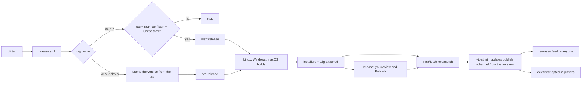

# Releasing the desktop app

For whoever cuts a release (today, Andy). Players never download from GitHub to update: they update
from **their own server** ([CLIENT-UPDATES.md](../architecture/CLIENT-UPDATES.md)). The pipeline builds the
signed installers; each operator then publishes them to their server.

## The release cycle

Two channels, told apart by the tag's **name** alone.

| Tag                                | Channel       | What the pipeline does                                                                                                                                           | Who gets it                                     |
| ---------------------------------- | ------------- | ---------------------------------------------------------------------------------------------------------------------------------------------------------------- | ----------------------------------------------- |
| `v0.4.0`                           | **release**   | Checks the tag matches `tauri.conf.json` and `Cargo.toml`, builds, attaches installers to a **draft** GitHub release. Nothing is public until you press Publish. | Every player                                    |
| `v0.4.0-dev.2`, `-rc.1`, `-beta.1` | **dev build** | Stamps the version from the tag (no commit needed), builds, attaches installers to a **pre-release** that is public at once.                                     | Only players who turned on "Include dev builds" |

A normal cycle: work on `main`, tag `v0.4.0-dev.1`, `-dev.2`… as you want testers to try things, then when it
is ready bump the version files to `0.4.0`, tag `v0.4.0`, review the draft and publish it. Dev builds sort
below the release they lead up to (`0.4.0-dev.9` is older than `0.4.0`), so a dev-build player moves up to the
release automatically.

## One-time setup

1. **Add the updater key as a repository secret.** Settings → Secrets and variables → Actions:
   `TAURI_SIGNING_PRIVATE_KEY` (the contents of `~/.tauri/vtt-chat-updater.key`) and, if it has one,
   `TAURI_SIGNING_PRIVATE_KEY_PASSWORD`. The workflow refuses to build without the key, because an
   unsigned installer can never be installed by an existing app.
2. **Give the key a password and back it up** before the first real release (see CLIENT-UPDATES.md).
   Changing the key means every installed app must be reinstalled by hand.

## Cutting a dev build

1. `git tag v0.4.0-dev.1 && git push origin v0.4.0-dev.1`. No version commit is needed.
2. The three builds attach their files to a public **pre-release**. Windows ships the NSIS `-setup.exe`
   only and Linux the `.AppImage` and `.deb` (an MSI and an RPM cannot carry a `-dev.1` label, so those two are for releases only).
3. To put it in front of testers on a server: `infra/fetch-release.sh v0.4.0-dev.1 ./release`, then
   `vtt-admin updates publish ./release --version 0.4.0-dev.1 --base-url https://play.example.com/updates`.
   The `-dev` version sends it to the dev channel on its own; `vtt-admin updates status` shows both.

## Cutting a release

0. **Write the changelog.** In [CHANGELOG.md](../../CHANGELOG.md) turn what is under `## [Unreleased]` into
   `## [X.Y.Z] - YYYY-MM-DD` and make it complete: Added, Changed, Fixed, Security and Known limits, written for
   players and operators. Check `git log vLAST..HEAD` so nothing user-visible is missing. The section becomes the
   release notes, and the workflow refuses a release without one (`tauri-client/scripts/changelog-notes.sh X.Y.Z`
   prints it so you can read it first).
1. Set the same version in `tauri-client/src-tauri/tauri.conf.json` and `tauri-client/Cargo.toml`
   (`[workspace.package]`), run `cargo update --workspace` in `tauri-client/`, commit.
   `tauri-client/scripts/release-version.sh vX.Y.Z` checks all three agree; the workflow runs it first.
2. `git tag vX.Y.Z && git push origin vX.Y.Z`. (To rebuild an existing tag: Actions → Release → Run workflow.)
3. Wait for the three builds. They attach `.AppImage`, `.deb`, `.rpm`, `-setup.exe`, `.msi`, `.dmg`,
   `.app.tar.gz` and a `.sig` beside each updater artifact to a **draft** release. Open it, check the
   notes and the file list, and publish it (tick "Set as the latest release", or `gh release edit vX.Y.Z --draft=false --latest`).
4. On each server: `infra/fetch-release.sh vX.Y.Z ./release` then
   `vtt-admin updates publish ./release --version X.Y.Z --base-url https://play.example.com/updates --notes "…"`.
5. For the join page's download buttons, point `CLIENT_URL_WINDOWS`, `CLIENT_URL_MACOS`, `CLIENT_URL_LINUX`
   at the release's files (or at your own copies). Point them at releases, not dev builds.

## What is not done yet

- **First run: v0.3.0 (2026-11-11).** It built on all three systems. The one fix needed was clang 21 on
  Linux, because libwebrtc's own libc++ refuses clang 18 (the runner's default). No installer has been run on a clean machine yet.
- **No OS-level code signing, by choice.** Windows shows SmartScreen's "unknown publisher" warning and
  macOS blocks a first launch until an Authenticode certificate and an Apple Developer ID are added (both cost
  money every year). Players get past it with the steps in
  [INSTALLING-THE-APP.md](INSTALLING-THE-APP.md); give that page to anyone you invite. The updater
  signature is separate and is what protects updates.
- **Linux ships `.AppImage`, `.deb` and `.rpm`.** Only the AppImage self-updates through the server; the
  `.deb` and `.rpm` are for people who prefer their package manager and are updated by installing the new file.
- **macOS builds Apple silicon only** (the runner's architecture). Intel Macs need a second matrix entry.
- **Linux builds on Ubuntu 24.04**, so the AppImage needs a glibc at least that new.
