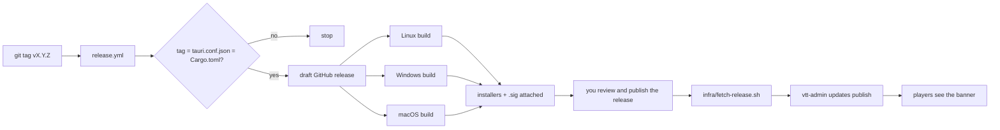

# Releasing the desktop app

For whoever cuts a release (today, Andy). Players never download from GitHub to update: they update
from **their own server** ([CLIENT-UPDATES.md](../architecture/CLIENT-UPDATES.md)). The pipeline builds the
signed installers; each operator then publishes them to their server.

## One-time setup

1. **Add the updater key as a repository secret.** Settings → Secrets and variables → Actions:
   `TAURI_SIGNING_PRIVATE_KEY` (the contents of `~/.tauri/vtt-chat-updater.key`) and, if it has one,
   `TAURI_SIGNING_PRIVATE_KEY_PASSWORD`. The workflow refuses to build without the key, because an
   unsigned installer can never be installed by an existing app.
2. **Give the key a password and back it up** before the first real release (see CLIENT-UPDATES.md).
   Changing the key means every installed app must be reinstalled by hand.

## Each release

1. Set the same version in `tauri-client/src-tauri/tauri.conf.json` and `tauri-client/Cargo.toml`
   (`[workspace.package]`), run `cargo update --workspace` in `tauri-client/`, commit.
   `tauri-client/scripts/release-version.sh vX.Y.Z` checks all three agree; the workflow runs it first.
2. `git tag vX.Y.Z && git push origin vX.Y.Z`. (To rebuild an existing tag: Actions → Release → Run workflow.)
3. Wait for the three builds. They attach `.AppImage`, `.deb`, `-setup.exe`, `.msi`, `.dmg`,
   `.app.tar.gz` and a `.sig` beside each updater artifact to a **draft** release. Open it, check the
   notes and the file list, and publish it.
4. On each server: `infra/fetch-release.sh vX.Y.Z ./release` then
   `vtt-admin updates publish ./release --version X.Y.Z --base-url https://play.example.com/updates --notes "…"`.
5. For the join page's download buttons, point `CLIENT_URL_WINDOWS`, `CLIENT_URL_MACOS`, `CLIENT_URL_LINUX`
   at the release's files (or at your own copies).

## What is not done yet

- **Not run.** The workflow has never executed; the first tag is the test. Expect to fix something
  (the Windows and macOS builds of the LiveKit Rust SDK are the likeliest).
- **No OS-level code signing.** Windows will show SmartScreen's "unknown publisher" warning and macOS
  Gatekeeper will block a first launch (right-click → Open) until an Authenticode certificate and an
  Apple Developer ID are added. The updater signature is separate and is what protects updates.
- **macOS builds Apple silicon only** (the runner's architecture). Intel Macs need a second matrix entry.
- **Linux builds on Ubuntu 24.04**, so the AppImage needs a glibc at least that new.
