# User guide

For players and Dungeon Masters (DMs) of a table that runs on VTT Chat App. **Draft (2026-11-10).** Some
steps have only been tried by the author; where a screen may look different from what is written, trust the
screen and tell us.

> **About the pictures.** The screenshots in this guide are **simulated**: the real screens, drawn from a test
> table ("The Sunken Temple", a Game Master and five players) and placed in a plain window or phone outline. Your
> window's title bar will look like your own computer's. The tales, the DM brief and the scribe's notes shown are
> real output of the local AI on a short test recording. They are made by [`scripts/screenshots/`](../../scripts/screenshots/README.md).

- [1. Get the app and join a table](#1-get-the-app-and-join-a-table)
- [2. Your first minutes](#2-your-first-minutes)
- [3. Status: Online, Away, Offline](#3-status-online-away-offline)
- [4. Voice](#4-voice)
- [5. Chat and whispers](#5-chat-and-whispers)
- [6. Handouts](#6-handouts)
- [7. Loot and the party inventory](#7-loot-and-the-party-inventory)
- [8. Recording and summaries](#8-recording-and-summaries)
- [9. Sessions and reminders](#9-sessions-and-reminders)
- [10. Your character and settings](#10-your-character-and-settings)
- [11. For the DM](#11-for-the-dm)
- [12. When something is wrong](#12-when-something-is-wrong)

## 1. Get the app and join a table

Your DM (or whoever runs the server) sends you an **invite**: a link, a short code, or a QR code to scan
with your phone.

1. **Open the invite link** in a browser. It shows the table's name and asks you to **agree to the recording
   notice** (the table may be recorded; see [section 8](#8-recording-and-summaries)), then create your account
   (or sign in, if you already have one).
2. The page then shows a **download for your computer** (Windows, macOS or Linux). Install it and open it (Windows and macOS warn about an unknown publisher the first time; [installing the app](INSTALLING-THE-APP.md) shows how to get past it).
3. In the app, enter your server's address (the page shows it, for example `vtt.example.com`), and sign in with
   the same email and password. The table appears.

**Forgot your password, or no email arrives?** Ask the person who runs the server for a **one-time code**,
and choose "sign in with a code". Some servers offer "Sign in with" a company or group account; use that
button if you see it.

> **Good to know: the animated dragon.** On a wide browser window, the server's home page plays a short looping
> clip behind its headline. It stays a still picture if your window is narrower than about 700 pixels (screen
> scaling counts), on a phone, in a data-saving mode, or when your computer asks for **reduced motion**. On
> Windows that last one is the setting **Settings → Accessibility → Visual effects → Animation effects**: with it
> off, browsers (Edge, Chrome, Firefox) show the still picture. Nothing is wrong; turn the setting on and
> reload if you would like to see it move.

> **Good to know: Windows with animations off.** Some Windows machines have **Animation effects** switched off
> by policy (a school or work computer, for example) and you cannot change it. The app respects that setting: the
> home page stays a still picture, and anything that would slide or move is skipped. Things that fade still fade
> (a loot item you or someone else takes dims out of the list over about half a second instead of sliding away),
> so nothing is lost, it just looks plainer. Before 0.5.4 a loot item could vanish at once with its gap closing a
> second later on such a machine; that was a bug and is fixed.

The app lives in your **system tray** (the little icons by your clock). Click its icon to open the window; the
icon shows whether you are connected and whether the table is being recorded. On some Linux desktops the
tray needs an extension (GNOME: "AppIndicator"); without it the app still works, you just open it from your
applications menu. [Fixing a missing tray icon](INSTALLING-THE-APP.md#linux-i-cannot-see-the-tray-icon).

## 2. Your first minutes

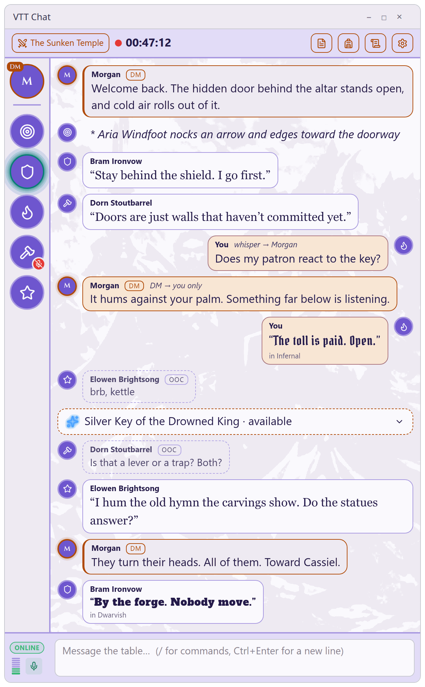

_A player's window in light mode: Bram is talking (the ring), Dorn is muted, and a recording is running._

The window has, from top to bottom:

- **The bar**: the campaign (click to switch), a red **recording timer** (a dot and the time) when a session is being recorded, then
  small buttons for handouts and the party inventory (and, for the DM, groups and sound effects) and **session history**, then a **Settings** cog (a dot shows when join requests are waiting). It drops the Settings panel down; it includes a **Players** tab (each person's volume; the DM also sees each player's connection). There is no Quit button in the window: the app is meant to keep running, so quit from the **tray icon**. Your **status** is the coloured pill above the microphone button (ONLINE green, AWAY amber, OFFLINE grey): click it to change it.
- **The rail** (the round portraits on the left): everyone at the table. Their portrait glows while they
  speak. Hover over one for a card with their character, small icon chips for armour class, hit points and special senses (when their character is linked to D&D Beyond), and a **Details** button for the full breakdown; for the DM it also shows how good their connection is. On the phone web app, tap a portrait.
- **The chat** (middle): messages, whispers, and cards for handouts and loot.
- **The bottom bar**: your **microphone button**, a **level meter**, and the message box.

Nothing joins voice by itself. The app opens **Offline**; choose Online when you want to talk
([section 3](#3-status-online-away-offline)).

**While the window is closed or behind others**, the tray icon gets an **orange dot** when something new
arrived (hover for the count; opening the window clears it). Public chat gives the dot. During a game
(you are in voice and a recording is running), whispers and shared handouts also give the dot and a
desktop notification; outside a game, whispers wait for you in the chat. Session reminders and changes, and
"summary ready", always pop up. Details: [NOTIFICATIONS.md](../architecture/NOTIFICATIONS.md).

## 3. Status: Online, Away, Offline

One switch says whether you are at the table. It is the **dot beside the Settings button**, the **Status**
item in the tray menu, and **Settings → Profile → Status**.

| Status      | You are…                                                            |
| ----------- | ------------------------------------------------------------------- |
| **Online**  | in voice, with your microphone as you left it                       |
| **Away**    | in voice but your microphone is closed (it reopens when you return) |
| **Offline** | out of voice. Chat still works                                      |

- **Away happens by itself** when your screen locks or the screensaver starts, and after 10 minutes with no
  keyboard or mouse (change it in Settings → Profile; "Never" turns it off). When you unlock or use the
  computer, you are back. If you pick Away yourself, it stays until you change it.
- **Unmuting while Away** means you are back: you go Online.
- If you press **unmute while Offline**, the app asks "Connect to Voice Channel?". Say yes to join with your
  microphone on.
- Everyone at the table sees your status on your portrait: green (Online), amber (Away), grey (Offline), or a
  faint ring (**Disconnected**: your app is closed or you are signed out).

## 4. Voice

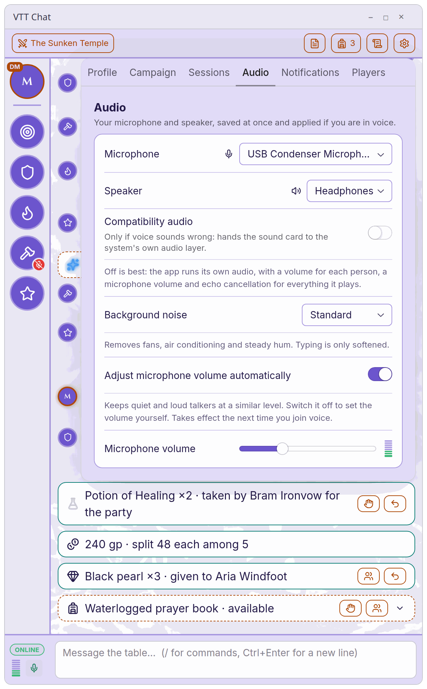

- **Mute and unmute**: click the microphone button, or press **Ctrl+Shift+M**. While muted, **hold Left
  Ctrl to talk** (push to talk). The tray icon and the button show whether your microphone is live. Muting also lets go of your microphone, so your computer's "microphone in use" light goes out.
- **Meter**: green is normal talking, amber is loud, red is too loud. It shows what the table hears after
  the app has cleaned your sound, so typing and fans you have filtered out do not show.
- **Echo and noise**: if people hear an echo of themselves, wear headphones. In **Settings → Audio**
  you can pick your microphone and speakers, set your **microphone volume**, and choose a **Background
  noise** level: Off, Light, Standard (removes fans and air conditioning), or Strong (also hides typing and
  mouse clicks between words; adds a very small delay). If your voice gets clipped on Strong, use Standard.
- **Automatic volume** keeps quiet and loud talkers at a similar level; switch it off to set your volume
  yourself.
- **Each person's volume**: hover their portrait and use the slider, or open **Settings → Players** to set everyone in one place (up to 400%, with a reset button). It is remembered for that person on this computer, so a quiet microphone only needs fixing once.
- **Compatibility audio** (Settings → Audio): leave it off. The app runs its own audio, which is what gives you
  the volumes above and echo removal for everything the app plays. If voice sounds wrong on your computer
  (crackling, no sound, the wrong device), switch it on and join voice again: the system's own audio layer takes
  over, without each person's volume, the microphone volume, or echo removal for character voices. If the app
  cannot open your sound card it uses compatibility audio for that call by itself.
- **Each campaign is its own voice room.** If you switch campaigns, you leave one room; choose Online to join
  the next.

## 5. Chat and whispers

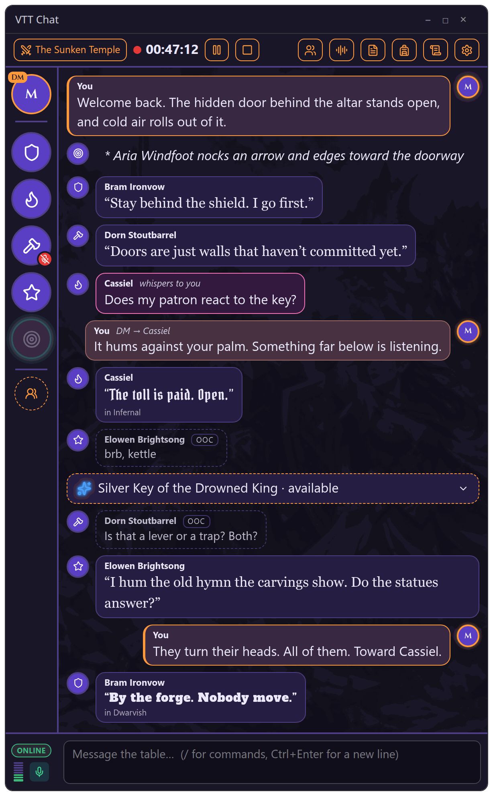

_The DM's window: speech in character, an action (`/me`), two languages, out-of-character lines, and a whisper with Cassiel that nobody else sees._

Type in the message box and press **Enter** to send. **Ctrl+Enter** (or Cmd+Enter, or Shift+Enter) starts a new line, so a message can run to several lines. On a phone the on-screen Enter key always makes a new line, and the Send button sends. **Type `/` to see the commands**:
a list opens above the box. Up and Down move, Tab or Enter completes, Esc closes (or tap a row). A plain line is
**in character**; the commands are for the exceptions and for style.

| Type                         | What it does                                                                                                                                                    |
| ---------------------------- | --------------------------------------------------------------------------------------------------------------------------------------------------------------- |
| `/say words`                 | What your character says aloud: shown in quotes in a serif face                                                                                                 |
| `/say-elvish words`          | The same, in a language (Elvish, Dwarvish, Draconic and the rest of the D&D set): styled to suit, with a small "in Elvish" caption. The words are never changed |
| `/do action` (or `/me`)      | What your character does: shown as _Thorin raises his axe_                                                                                                      |
| `/ooc words`                 | Out of character: small and muted with an OOC tag. **Never recorded**                                                                                           |
| `/tell name words` (or `/w`) | Whisper to one person at the table. The name completes as you type                                                                                              |
| `/dm words`                  | Whisper to the DM                                                                                                                                               |
| `/late [note]`               | Posts "running late" (OOC) **and** marks you late for the next session                                                                                          |
| `/cant [note]`               | Posts "can't make it" (OOC) **and** marks you as not coming                                                                                                     |
| `/work`                      | Posts "still at work" (OOC) and marks you late                                                                                                                  |
| `/brb`, `/afk`, `/back`      | A ready-made OOC note. No RSVP change                                                                                                                           |
| `/loot`, `/take`             | Open the party inventory (desktop app)                                                                                                                          |
| `/voice name` (DM only)      | Change your character voice (desktop app)                                                                                                                       |

- A line starting with `/` that is not a command is sent as plain text; if it looks like a typo you are warned
  first, and pressing send again posts it as text.
- Out-of-character lines stay visible to the table but are **never recorded, never in a transcript or a
  summary, and never found by search**. Everything else you type in public is part of the story.
- Your own messages are on the right with a warm tint; the DM's public messages have a gold edge and a
  "DM" tag. Whispers are coloured differently and say who they are between.
- **Whispers are private** to the two people. The server stores them for those two only, they are never
  recorded and never appear in a transcript or summary.
- Chat history stays when you reconnect. Missed whispers come back after you reconnect.

## 6. Handouts

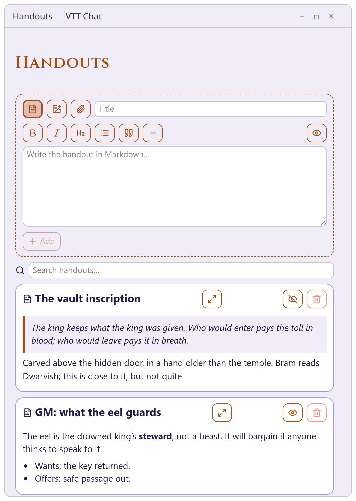 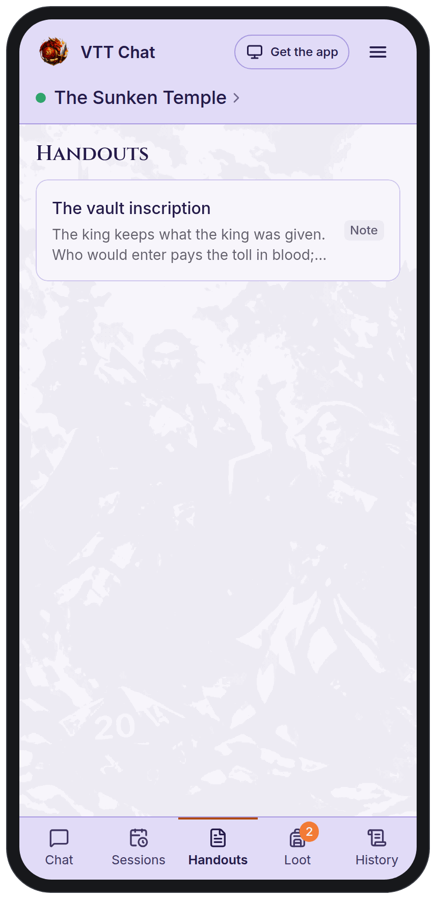

The DM shares **handouts**: a **note** (text), a **set of pictures** (one to twelve, for example a map), or
a **PDF**. Each can have a short caption.

- They appear in the chat as a card. A note shows its first three lines; a picture shows a larger picture
  with arrows to flip through a set; a PDF shows a paperclip.
- **Click a card** to open it big, in its own window you can place beside the game. Pictures have **zoom**
  buttons (also Ctrl + the mouse wheel; drag to move around), which is useful for a large map. A PDF is
  read page by page inside the window.
- Only the DM can edit a handout (open it and press the pencil). For a set of pictures the pencil also shows a
  strip to move a picture earlier or later, remove one (never the last), or add another. The handouts button in the bar lists
  everything shared with you.

## 7. Loot and the party inventory

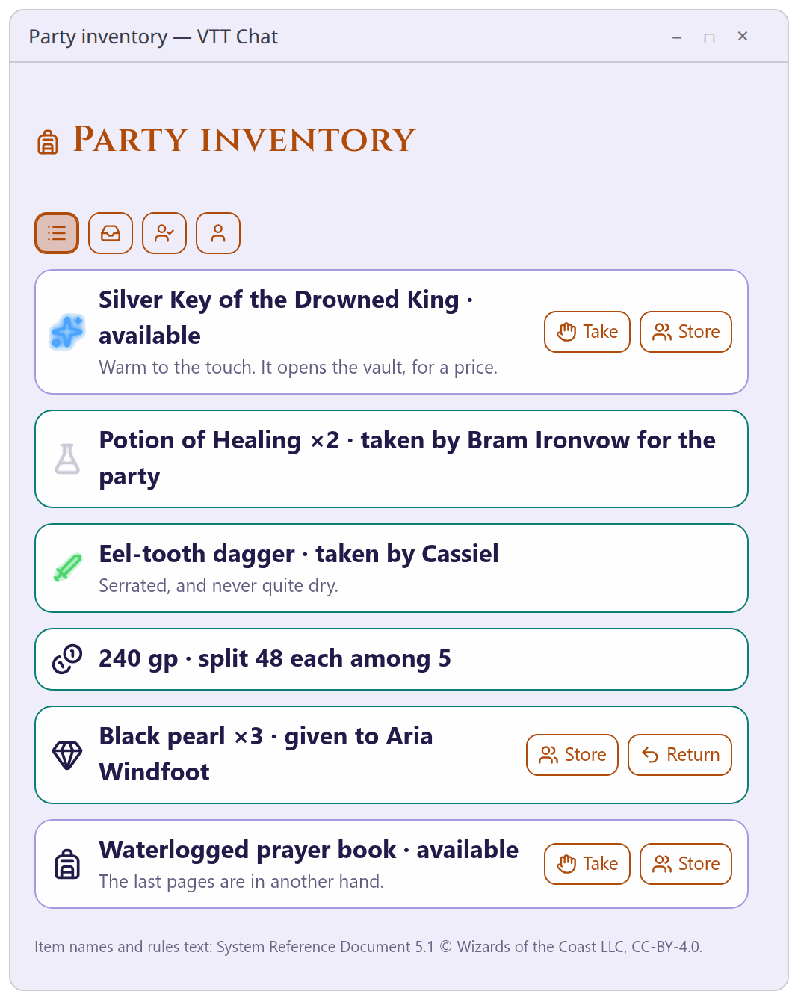 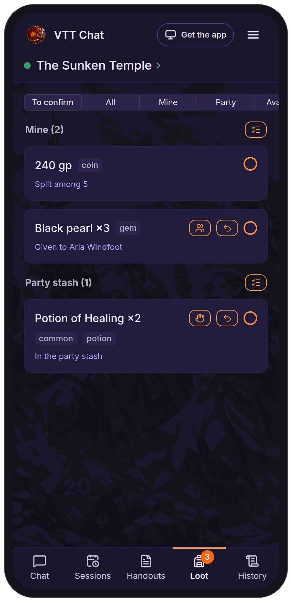

The DM drops items and coin into the **party inventory**, and a card appears in the chat.

- **Click the card** to open it: you see the description and what you can do.
  - A free item: **Take** it for yourself, or **Store** it in the party stash.
  - Something you took or were given: **Store** it for the party, or **Return** it to the table.
  - Something you stored: **Return** it.
  - Coin can be **split** equally among chosen players (in the inventory window).
- The DM can only **give** an item to one named player, never to the party.
- Everyone can always see what is still unclaimed (the inventory window, "Still in the pool").
- **Re-drop** (DM): an item still on the table can be posted into the chat again; the card **moves** to the bottom (there are never two cards for one item).
- **Added to my sheet** (since 0.6.0): a small round check box at the right of an item you hold, the party stash and your share of split coin. Tick it once the item is on your real game sheet. It unticks itself whenever the item moves, only you see your own ticks (the DM never does), and while it is ticked the item's take, store and put-back buttons are greyed out: untick it first to move it.
- **To confirm** is the list you open on: what still needs adding to your sheet, in two groups, **Mine** (what you took, were given or share) and **Party stash**, each with an icon at the right of its heading that ticks the whole group. The Loot icon shows how many are waiting. The buttons are icons: hover (or long-press) for what each does.

## 8. Recording and summaries

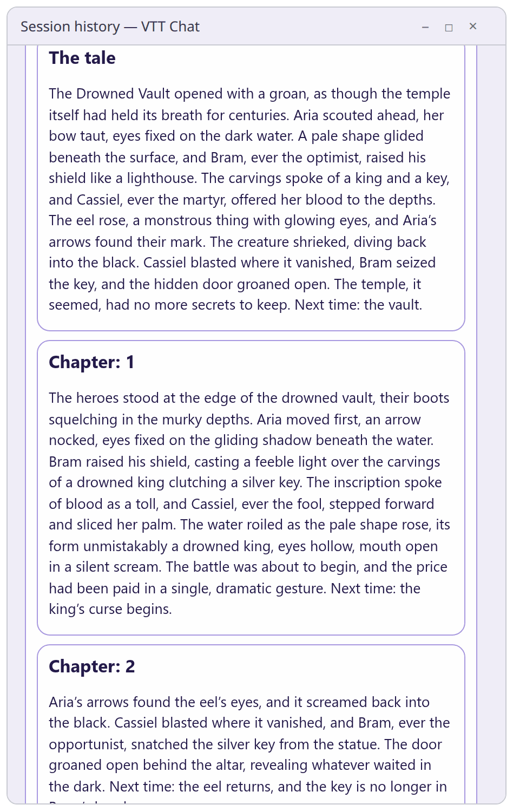 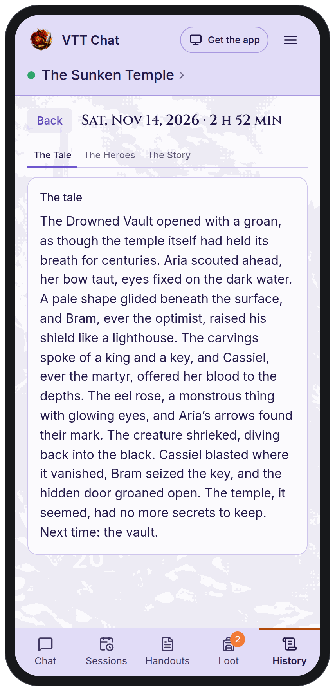

_The tale of a session, in the app and on a phone. This one is real output from a two-minute test recording._

When the DM starts a recording, **every app plays a clear "recording" cue** and the **recording timer** shows in the
bar and on the tray icon. Your voice is only recorded **after your app has played the cue**; if you join late
you hear it first.

- Each person is recorded separately; the server turns it into a **transcript** and **summaries** after the
  session. Lines typed in the **public chat** during a recording are included, marked "(typed)".
- **Never recorded or transcribed:** whispers, sound effects from the DM's soundboard, and anything private.
- **Who tells the tale** (Game Master): **Settings, Campaign, Storyteller** picks one of the storytellers the server offers (on the phone: tap the table's name, then pick one under **Storyteller**) (the Tavern Bard by default). Everyone can see who it is. Your server's operator decides which storytellers, how long the tales may be and how strong the language may be.
- **Read them later** with the **session history** button: the tale of the session, its heroes and its chapters as tabs (**The Tale, The Heroes, The Story**, and for the Game Master **The Notes**), and a search across them. On the desktop the pop-out button beside the tabs opens a session in a window of its own.
  The DM also sees a private brief, and can open the scribe's notes (the plain list of what happened that the tales were told from) with a button. The word-for-word transcript is not shown to players; a DM can read it in the desktop app after turning on **Settings → App → Include dev builds**.
- **If the DM drops** (their computer crashes or their network goes), the recording carries on for a short
  grace period (30 seconds by default). After that **any player** can pause, resume or stop it from the top
  bar. If everyone disconnects, it stops by itself.
- While a recording runs the DM cannot switch campaigns or hand over the DM role; stop it first.

## 9. Sessions and reminders

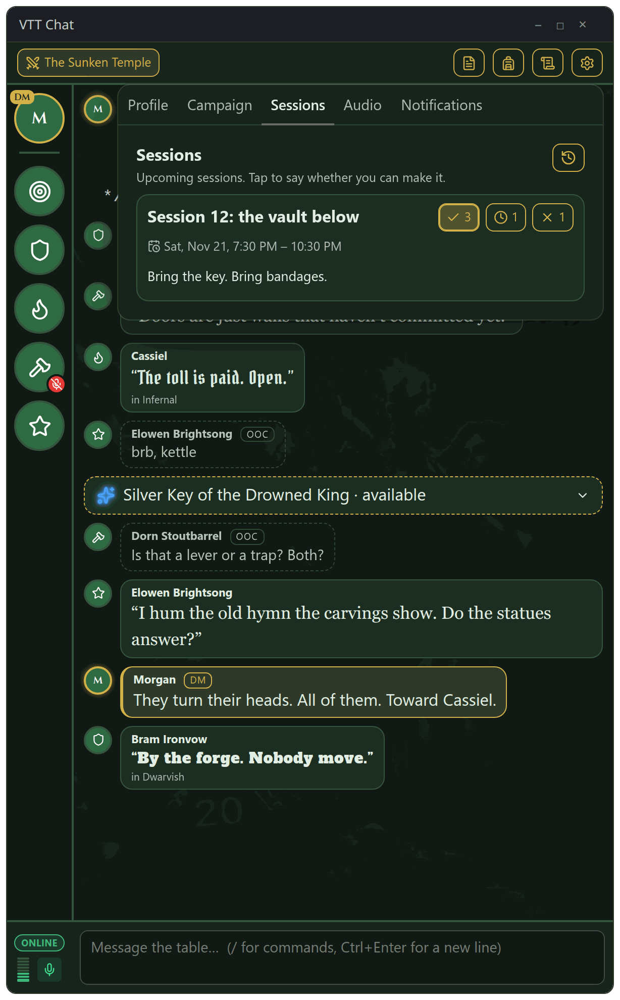 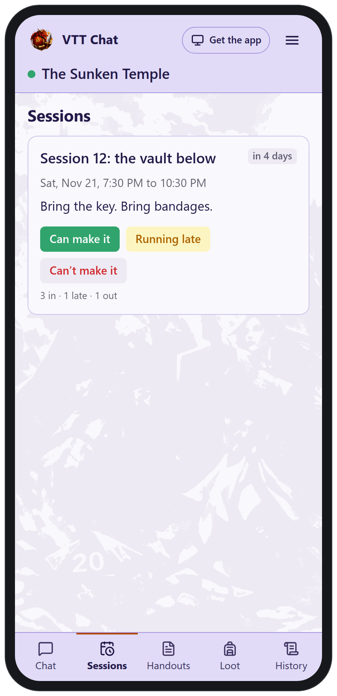

The DM schedules sessions (date, time, length). You see the next one in **Settings → Sessions**, and you can
answer **Can make it / Late / Can't**. The server sends reminders 24 hours and 1 hour before. They also show as a desktop notification, even when the app is hidden. Choose what you want to hear about, and set **quiet hours** (no pop-ups, for example overnight), in **Settings → Notifications**.

### On your phone

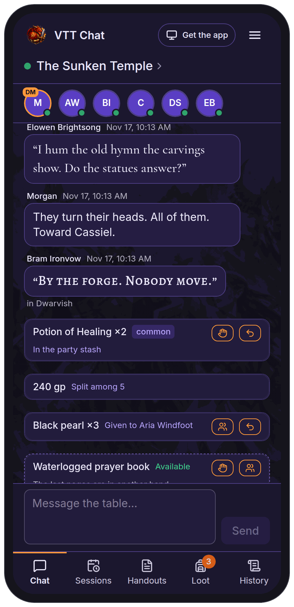

Open `https://<your server>/app` in your phone's browser and sign in with your email and password, or with a
one-time code. You get five tabs: **Chat** (the table's chat and your whispers; you can reply or whisper to one
person), **Sessions** (when the next one is, and your answer), **Handouts** (what the DM has shown you), **Loot** (the party's inventory: take what the DM drops, store it for the party, put it back; the DM can give an item to a player) and
**History** (summaries and transcripts of past sessions). There is **no voice** on the phone: use the desktop
app for that. It does not buzz you when closed; the desktop app does that. **Menu → Sign out** when you are on
someone else's phone.

**The table's page.** Tap the table's name at the top: you read its description and who tells its tales; the DM edits the name and description there, and a player can leave the table. The DM's **menu → Invite** makes the invite link, with a **QR code** another phone can scan. If your browser is too old for the app (Safari before 16.2, for example) you see a notice asking for a newer one.

## 10. Your character and settings

Open **Settings** (the cog). It has five tabs:

- **Profile**: your photo and player name. **Click your photo to change it** (a small X on its corner removes it).
  **Click your name**, which has a dotted underline, to rename it: Enter saves, Escape cancels. The sign-out icon is
  at the top right. Below are your **status** and when to go Away, your **theme** (light or dark follows your
  computer), and an **App** section at the bottom with the app and server versions, **updates** (with the
  include-dev-builds switch) and **start with the computer**.
- **Campaign**: leave the campaign; create invites (DM); **hand over the DM role** (DM: you and a player swap
  places in one step); your **character**: name, picture, and an optional **D&D Beyond link**. Paste your
  public character's link and the app keeps your name, race, class, level and the numbers under your name up to
  date (only if the server's operator turned this on; if not, the box says so). **Sync now** forces a refresh.
  **While a character is linked, its name, race, class, level and picture come from D&D Beyond and cannot be edited here**: change them
  on the sheet and Sync, or Unlink to edit them yourself. A linked character shows its armour class, hit points,
  passive perception and six abilities as tiles, its classes with their subclasses ("Monk 5 (Way of the Open Hand) / Cleric 4 (Life Domain)") and any special senses (Darkvision, Tremorsense and so on, with their range). The bin button deletes a character (only from this campaign; your D&D Beyond sheet is not touched). A row of portraits at the top lets you look at each character (click one); **Activate** on the card, after a confirmation, makes it the one the table sees
  and the plus adds another; with the sync on, adding starts from a pasted sheet link (read first, so a private or wrong link leaves nothing behind), and a button fills it in by hand.
  Activating a character switches who the table sees you playing, on every screen at once. Characters belong to one campaign, so to use the same sheet in two campaigns add it in each. The same is on the phone
  web app: menu, **My characters**.
- **Sessions**: upcoming sessions and your answer. The DM schedules a session with the calendar-plus icon at the
  top right.
- **Audio**: microphone, speakers, engine, noise filter, volume, and, for the DM, **hear sound effects myself**.
- **Notifications**: what you are told about (chat, whispers, handouts and loot, sessions) and **quiet hours**.

**Finding a table.** If you are not in a campaign yet, or want to join another, open Settings, then Campaign, then
**Find another table** (it also shows on the Profile tab when you are in no campaign). Tables that are open to requests
are listed with their DM and player count. Choose **Request to join**, add a short note if you like (up to 280
characters) and send it. The card then reads **Request sent**, and you can **Withdraw** until the DM answers. If the DM
says no, the card reads **Not this time** and shows the date you can ask again, a week later. You get a pop-up when
the DM answers, and if you are already in another campaign a strip appears with a **Switch** button. An invite link
still works as before.

**Letting people ask (DM).** In Settings, then Campaign, the **Join requests** section has an **Allow join** switch.
Public means other players can find your table and ask to join; Private hides it. Invite links work either way. Waiting requests show the person's name, their
note and how long ago they asked; **Approve** adds them as a player and **Decline** sends a no. A number on the Campaign
tab and a dot on the Settings cog show that someone is waiting. Turn the pop-ups on or off in Settings, then
Notifications.

By default you only get finished releases. To try early versions, turn on **Settings → Profile → App → Include dev
builds**; they may be rough. When a new version is available a banner says so; it installs only when you click
"Restart to update", and never in the middle of a game on its own. If a banner says the app and your server are on
different versions, update the app, or ask your DM to update the server if the app is the newer one.

## 11. For the DM

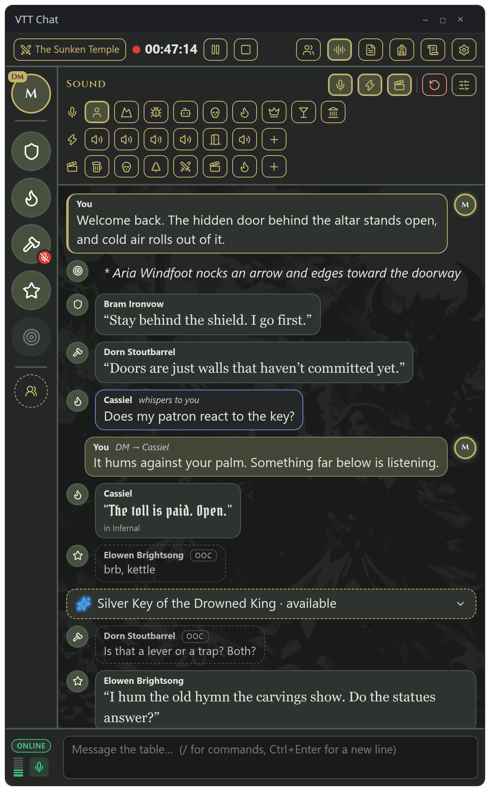 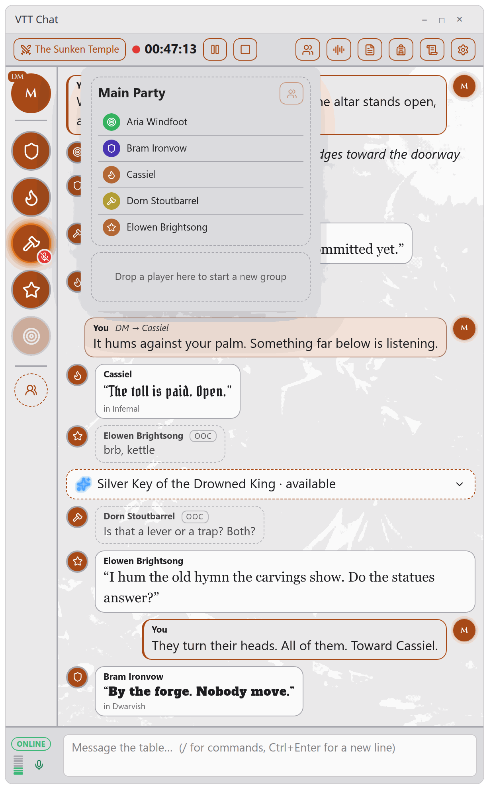

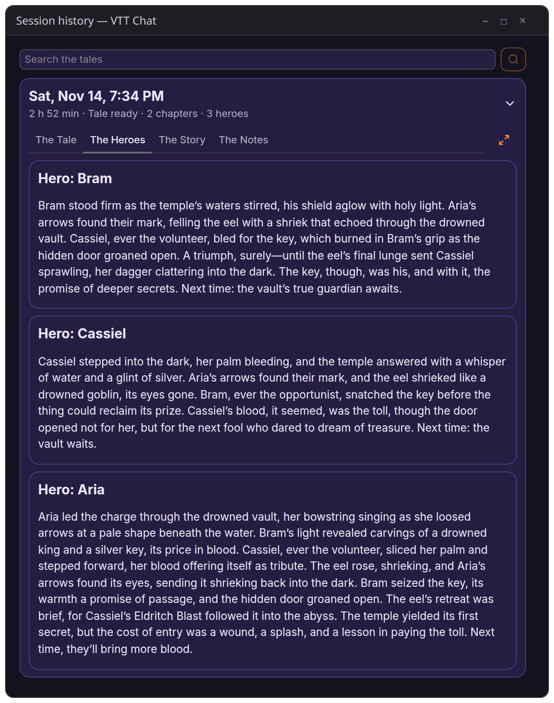 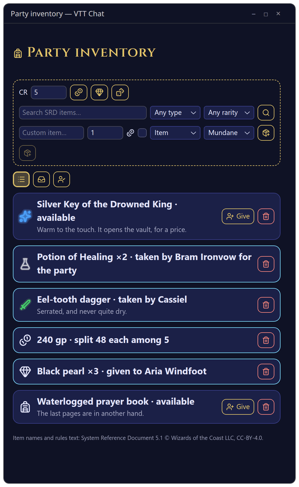 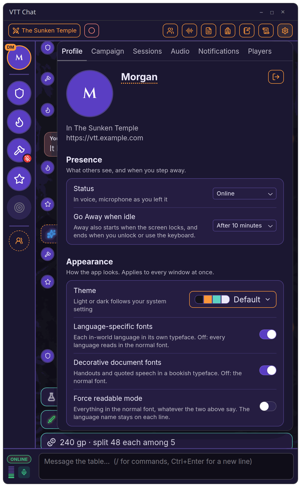

_Top: the sound drawer (voices, stingers, scenes) and voice groups. Bottom: the DM brief with the scribe's notes folded behind their button, the inventory with the DM's drop tools, and each player's connection quality (Elowen's link is the slow one). The campaign's own settings (invites, handing over the DM role, join requests) are in Settings → Campaign:_

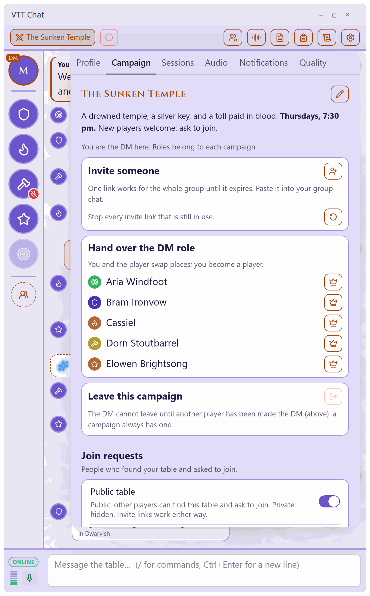 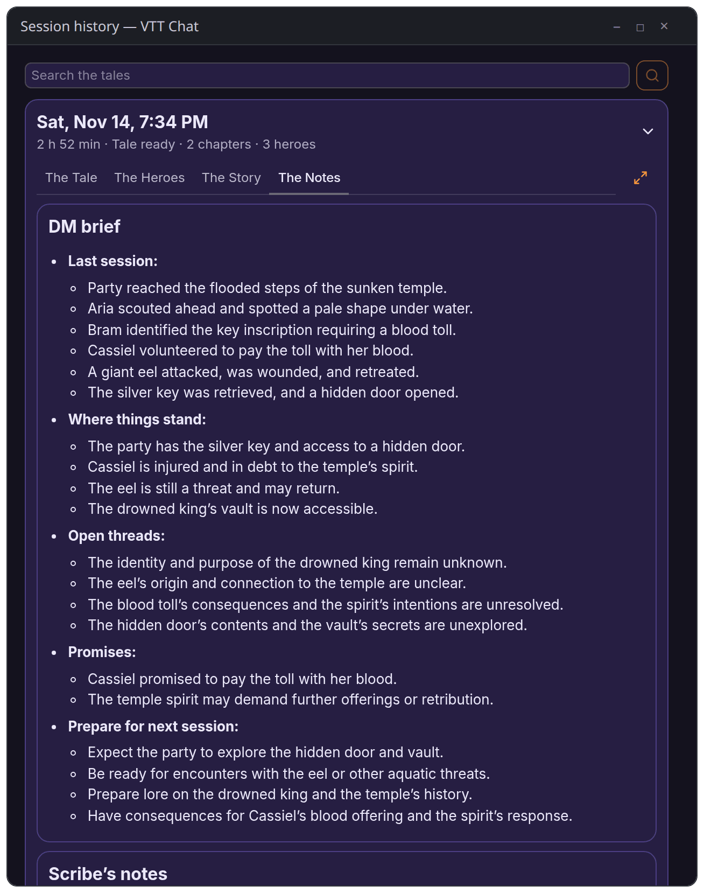

**GM notes and the glossary**

- The notes button in the top bar (a notebook and pen; yours only) opens a window with two tabs. **Notes** is one page of
  Markdown for the whole campaign: secrets, non-player characters, places, whatever you need. A new page starts with a few
  headings to prompt you; delete any you do not want. **Reading** shows the page with a list of its headings on the right
  (click to jump) and the attachments under it (click one to preview a picture or PDF). **Editing** (the pencil) is the
  Markdown editor, where you can also attach pictures and PDFs. Links open in your normal browser, never inside the app.
  **On the phone** the Game Master has the same page (menu, **Game Master notes**): read it, tap the pencil to edit, jump to a
  heading, and attach or open pictures and PDFs. The glossary is the desktop app's.
- **Glossary** is your campaign's words: names, places, items, spells, with the other ways each is said. Players never see
  either tab, and the server refuses them if they ask.
- The notes and attachments are part of a campaign's export. The server's operator sets how large one attachment may be.

**Start and end a session**

- **Record**: the record button in the bar starts, pauses, resumes and stops. A recording protects the
  session: you cannot switch campaigns or hand over the role until it stops.
- **Audio is the server operator's to clean up, not yours.** The raw recordings are large, so whoever runs your server
  decides how long they are kept and clears them by a schedule (and warns you on the session before the disk runs short).
  The transcript and summaries always stay. The one thing you can delete yourself is a **short test session**: a session shorter than **30 minutes** has a bin button on its card that removes
  it, its audio and its notes for everyone. A longer session shows the button only with "Include dev builds" on (Settings → App), and
  then only works if your server's operator has put the server in dev mode; otherwise the server refuses and the operator removes it.
- The first time, **invite your players**: Settings → Campaign → **Invite someone** makes one link for the whole group. Press **Copy invite message** and paste it into your group chat. If a link leaks, **Reset invite links** stops them all. Write a short description of the campaign first (the pencil next to its name): new players see it on the invite page.

**Voices and groups**

- **Character voices**: pick one in the effects drawer (the wave button) or type `/voice giant`. Choices:
  normal, giant, imp, robot, demon, dragon, god, drunk, authoritative. They change only your outgoing voice.
  Echo cancellation still works with them; headphones are best.
- **Voice groups**: the groups button splits the table into rooms (a split party). Drag portraits between
  groups, or focus one and press Enter for a menu. You are in every group.
- **Talk to one player privately**: **double-click** their portrait on the rail (double-click again, or press **End** in the banner, to stop). Only you and that player hear each other; the rest of the table cannot hear either of you, and you cannot hear the table, so there are no distractions. Chat still works. Everyone sees a banner saying what is happening, so nobody wonders why you went quiet. It is **not recorded**, and it ends by itself if either of you disconnects.
- **Everyone sees group changes**: when someone is moved into or out of a group, a line appears in the chat.

**The soundboard and scenes** (the effects drawer)

- **Sounds and boards**: your own library of clips (several takes each), as big buttons: one-shot or looping.
- **Scenes**: looping beds (rain) plus random drop-ins (chains, creaks, drips, a rat), started together. **Stingers** are short effects.
- **The deck holds 8 stingers and 8 scenes** (since 0.6.1): the plus button finds any sound or scene, and once a row is full its add buttons grey out until you remove one. A new deck starts with the **Unease** board (chains, footsteps, rats, bats, rockfall, a distant shriek, a water drip, a metal scrape) for background noises that keep the table on edge. A scene you start from the picker that is not on the deck joins it with a **dashed outline** and leaves when it stops.
- **Volume** (everyone, since 0.6.0): **Settings, Players** has a slider for each person (up to 400%), saved on that machine, for a quiet microphone.
  Players hear them through the call. They are **not** recorded; the recording's timeline just notes what played.
- **Your own sounds** (since 0.5.4): the cog in the sound drawer, tab **My sounds**. **Add** a clip (OGG, WAV, MP3 or
  FLAC, up to 5 MB), name it and say whether it is an effect, ambience or music. An **effect** appears under Stingers by
  itself (on a board called "My sounds"); ambience and music are chosen when you make a **scene**. Each sound can take
  **another take** (so a button does not repeat), be **renamed** or **deleted**. The sounds that ship with the server are
  not listed there: they are not yours to change.
- **Bulk import** with `npm run sounds:import -- --from <folder> --category ambience` (operators and DMs who run the
  repository); ask your operator.

**Handouts and loot**

- **Handouts** button → add a note, pictures or a PDF; **show** it to everyone or hide it. Click a handout
  card in the chat to read or edit it.
- **Party inventory** → drop items from the SRD catalogue, roll treasure, or write your own; **give** to a
  named player, **split** coin, **remove** anything.

**From your phone (the web app)**: you can run the table's notes and schedule from `/app` too. On **Handouts**, tap
**+** (New note) to write a note with a title and Markdown text; the **Preview** switch shows what players will read.
A new note is a draft only you can see, unless you switch on **Show it to the table now**. Open any handout to **Show**
or **Hide** it, and a note to **Edit** it; **Delete** asks you to press again. On **Sessions**, tap the calendar button
(Schedule a session) to set a title, date and time (in your phone's time zone, which the form names), a length and
optional notes; each upcoming session has **Edit** and **Cancel session**. Players are notified as usual. Adding
pictures and PDFs is still done in the desktop app.

**Connection screen**: the activity button shows each player's delay, jitter and loss, to see who is struggling.

## 12. When something is wrong

| Problem                                    | Try                                                                                                             |
| ------------------------------------------ | --------------------------------------------------------------------------------------------------------------- |
| I cannot hear anyone / they cannot hear me | Check your status is **Online** and you are not muted; choose the right devices in Settings → Audio             |
| There is an echo                           | Wear headphones; check that Settings → Audio → Compatibility audio is off                                       |
| Typing or fan noise is heard               | Settings → Audio → Background noise (Standard or Strong)                                                        |
| I cannot connect at all                    | Check the server address; ask your operator whether the server is up (`/status` page)                           |
| Voice works for others but not me          | Your network may block voice; try another network or a phone hotspot                                            |
| I cannot see the tray icon (Linux)         | Install and turn on the AppIndicator extension: [steps](INSTALLING-THE-APP.md#linux-i-cannot-see-the-tray-icon) |
| I forgot my password                       | Ask the server's operator for a one-time code                                                                   |
| The window is blank for a second           | Windows open with a "Loading…" screen and fill in; if it never does, close and reopen it                        |
| A picture or map is too small to read      | Click its card, then use zoom                                                                                   |

If something looks broken, tell your DM or operator what you were doing and what you saw.
