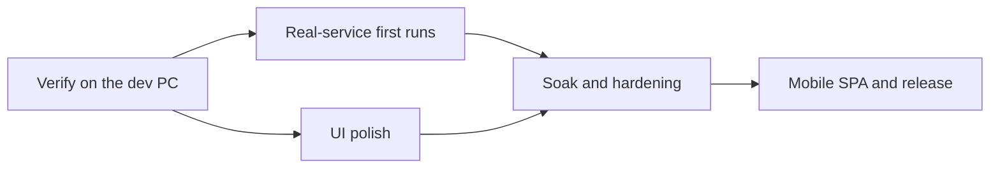

# Progress log to 2026-11-18: where we were, and what shipped when

> **Moved from [ROADMAP.md](../../ROADMAP.md) on 2026-11-21, kept as written.** The roadmap's "Where we are and what is next" section as it stood on 2026-11-18, with the 2026-11-09 build queue and the stock-takes before it. History, not a plan. The roadmap keeps a one-line summary of this stage; this file is the detail: the design, the decisions and who made them, and the build record. What has really run is in [BUILD-STATUS.md](../BUILD-STATUS.md). Index: [README.md](README.md).

## Where we are and what is next

### Stages 0 to 8 are closed (2026-11-15)

Everything through Stage 8 is built and has been used for real: the one-command install on a real Ubuntu VM behind Cloudflare, the
desktop app and an iPhone against it, a recording with human voices through the local AI, the update feed against live GitHub,
and two clients' voice. From here, a problem found in any of these stages is a **bug** (fixed in a patch release), and new work
belongs to a future stage (9 onwards). A few checks were never run on their own hardware (Windows, macOS, Android, a second person's
install); if one fails it is a bug report, not an open stage.

| Stage                  | State                                                                                                                                  |
| ---------------------- | -------------------------------------------------------------------------------------------------------------------------------------- |
| 0, 0.5, 1              | 🟢 Closed                                                                                                                              |
| 2 Audio spike          | 🟢 Closed; measured on the dev PC                                                                                                      |
| 3 Server core          | 🟢 Closed; both install tiers, chat persistence                                                                                        |
| 3b Deployment buildout | 🟢 Closed; images, handshake, updates (including the live GitHub feed), web onboarding, Devices, the real-VM run                       |
| 4 Tray client          | 🟢 Closed; used on Linux against the real server                                                                                       |
| 5 Records and AI       | 🟢 Closed; a real recording with human voices on the VM's CPU AI works (slow; the GPU PC is the fast path)                             |
| 6 Table features       | 🟢 Closed. **Voice whispers are dropped** (decided 2026-11-14): players whisper by text; the DM speaks to one player in a private talk |
| 7 Web app              | 🟢 Closed; checked in a headless browser and on an iPhone                                                                              |
| 8 Operations           | 🟢 Closed; Admin CLI, status page, backup and restore                                                                                  |

**Done 2026-11-12 to 14 (since the last stock-take):** the browser Account page (profile, recording notice, collapsed password,
Devices with revoke); **request to join** a campaign (opt-in directory, DM approves); the DM's notes and schedule in the web
chat; a typeface for each `/say-<language>` line; Enter sends and Ctrl+Enter makes a new line in both apps; web layout that
scales; **scene changes start chapters** and the summaries are told what the table heard (`RECORD_CUES`, names only, scene
changes by default); a recommended CPU-only setup with a gaming PC as the fast path; the blank-install rehearsal, backup and
restore, and a 90-minute soak; a graceful server shutdown; `.rpm` for real releases; and the **one-command operator install**
(`infra/get.sh`) with `vtt-admin logs/restart/ps/backup/restore/update`.

**Releases:** 0.4.1 to 0.4.5 shipped from what the real VM and real use found (0.4.0 and 0.4.4 were tagged but never published as
releases; the 0.4.5 changelog covers both).

**Next** (re-planned 2026-11-18, after 0.5.3; stages 13 to 16 re-planned 2026-11-21):

0. **0.5.4 (released 2026-11-19):** no wire change. The DM can no longer delete audio and may delete only a short (under 30 minute) test session, with dev builds on; operators get `vtt-admin campaign delete` and `recording delete`, and handout files are swept; a character linked to D&D Beyond keeps what the sheet says; the desktop shows the D&D Beyond box when sync is off; the phone web app has **My characters**; the audio mixer has **My sounds** (upload, takes, rename, delete); the web login form offers single sign-on when the server has it (a quiet link under "I have a sign-in code"); campaign export and import (`.vttcampaign`); a redesigned character screen in both apps (portrait switcher, stat tiles, D&D Beyond first, its portrait shrunk and kept while linked); pressing Play now updates every screen. Tested by Andy in dev builds `0.5.4-dev.1` to `-dev.3`. **Nothing else is planned for 0.5.x**: what is left is the release prep (a full CHANGELOG section and the tag, when Andy asks) and bug fixes; classes with subclasses, senses, the detail popup and the roster sheet wait for 0.6.0. See [BUILD-STATUS](../BUILD-STATUS.md#built-2026-11-18-for-054-clean-up-rules-characters-your-own-sounds-on-main).
1. **Bug fixes** as they turn up, in 0.5.x patch releases.
2. **Stages 9 and 10 are closed for building.** Their unfinished parts (what needs Windows, a real recorded session on the VM, soak, signing, the release pipeline, a second person's install) are checks, and move to Stage 11.
3. **[Stage 11](STAGE-11-PROTOCOL-4.md#stage-11--protocol-4-and-verification-060-and-061-planned-2026-11-18):** **0.6.0 (released 2026-11-20)** was the one bump to protocol 4 (loot re-drop and the confirmed flag, the soundboard, and the wire for the AI work: persona setting, GM Notes, glossary, off-site notice); **0.6.1 (released 2026-11-20)** added the sound deck, the phone table page and the macOS Intel build. **Closed for building 2026-11-21:** every check it still held moved to Stage 13.
4. **[Stage 12](STAGE-12-STORYTELLING.md#stage-12--storytelling-roles-personas-and-campaign-memory-idea-2026-11-17-scheduled-2026-11-18):** the AI workflow, **0.6.2 onwards. Closed for building 2026-11-21.** Built: the Claude and OpenAI connectors (CL), a glossary into Whisper and corrections (B, C), a scribe that picks out what happened (D), the Chronicler (E), campaign memory (F) and five storytellers (G). All of it is unit-tested and **none of it has met a real session or a real cloud API**; that is Stage 13. Step H (memory in the glossary, lore import, DDB backstories) needs a wire change and moved to Stage 15.
5. **[Stage 13](../../ROADMAP.md#stage-13--quality-validation-closed-2026-11-24):** **Quality validation.** Everything built and not yet run for real, tested as far as it can be end to end, led by a long synthetic session: 30 to 60 minutes of real multi-voice dialogue (one Game Master, four or more players) played through the whole system. Design: [QUALITY-VALIDATION.md](../architecture/QUALITY-VALIDATION.md). Runs on protocol 4, so what it finds ships as 0.6.x patches.
6. **[Stage 15](../../ROADMAP.md#stage-15--protocol-5-and-070-planned-2026-11-21):** **0.7.0, the next protocol bump (protocol 5):** every wire change that is waiting (step H first), in one bump, after Stage 13 has settled what protocol 4 does.
7. **[Stage 16](../../ROADMAP.md#stage-16--linux-package-repositories-served-by-the-server-idea-2026-11-19-not-scheduled):** `.deb` and `.rpm` repositories served by the server, behind an operator switch (an idea, not scheduled; the manual install works).
8. **[Stage 17](../../ROADMAP.md#stage-17--a-self-signed-certificate-the-app-can-pin-idea-2026-11-19-not-scheduled):** a self-signed HTTPS mode the desktop app can pin (an idea, not scheduled; `--http` covers trusted networks today).
9. The open design topics in [.claude/intent.md](../../.claude/intent.md).

| Area                        | What shipped                                                                                                                                                                                                              |
| --------------------------- | ------------------------------------------------------------------------------------------------------------------------------------------------------------------------------------------------------------------------- |
| **One web app**             | A landing page at `/`, `/download` (per-OS steps, sign-in required), `/full-app`, and the chat web app at `/app` as the same product on phones and desktops; one 640px column, the Default look, light/dark               |
| **Sessions in the browser** | A secure, long-lived cookie (HttpOnly, SameSite, `__Host-`) that slides with the operator's offline limit; Origin checks on cookie writes and the WebSocket; OIDC fits later without rework                               |
| **Getting an account**      | Visitor sign-up requests (off by default, approved in `vtt-admin signup`), short typeable `ABCD-EFGH` codes, a starter campaign for the first Admin                                                                       |
| **Chat commands**           | `/say`, `/say-<language>`, `/do`, `/ooc`, `/tell`, `/w`, `/dm`, `/late`, `/cant`, `/work`, `/brb`, `/afk`, `/back` with autocomplete in **both** apps; OOC never recorded; one shared parser                              |
| **Web chat**                | Members rail with status and hover/tap details, burger menu and "Get the app" promo, icon tabs matching the desktop                                                                                                       |
| **Desktop app**             | New Default theme (violet, ember, teal) matched in the web; connect screen in the web look; system certificate store trusted; Settings reorganised (Profile with theme, photo, version and updates; Audio; Notifications) |
| **Design and tooling**      | Artwork banners and a faint chat watermark; `npm run app`; `trust-local-ca.sh`; a headless-browser layout check; a palette drift test between web and desktop                                                             |

**Still to do, in the order I would take it:**

1. **A second person, on a blank VM** (Stage 3b #6 and the Stage 3 "done when"): the real test of the images, the operator
   guide, `wss://` through Caddy with a real certificate, LiveKit audio over UDP, and the new landing and download pages.
2. **See it running.** The web screens were exercised in a real headless browser on 2026-11-12 (about 330 checks, seven bugs
   fixed; `web/e2e/ui-smoke.mjs`). Still unseen in a real window: the desktop app's new screens (connect, Settings, rail,
   chat commands, join requests). On the list: a real phone and iOS Safari, deep links on
   Windows and macOS and the Linux AppImage, voice over `https://localhost` with the trusted CA, the Windows and macOS builds.
3. **Close the version and sign-in gaps:** done 2026-11-12 are the WebSocket protocol check, the CI guard that fails an
   unrecorded wire change, and signing out an expired `/app` tab (Stage 3b #3). The web **Account page** (profile, password, devices
   with revoke, recording notice) is built 2026-11-13 (#8) but not yet seen in a real browser.
4. **Decide the undecided:** how a signed-in person with **no campaign** gets into one (request-to-join from an opt-in list,
   DM approves in the app); whether quick-reply commands should be customisable; per-character languages and polyglot
   masking (needs server-side masking; only designed as a seam).
5. **Recording and AI: proven end to end on 2026-11-12** on the Compose stack with synthetic speech (66 of 66 checks: consent, per-speaker
   attribution, typed lines in, OOC and whispers out, DM-only summaries, search, a killed worker, the remote-AI fallback;
   [BUILD-STATUS.md](../BUILD-STATUS.md)). Still to do there: real human voices and room noise, a multi-hour session, a CPU-only
   server, and the second-person deploy.
6. **The old list below** (listening tests, the 4-hour soak, D&D Beyond on
   real sheets, Windows and macOS away detection) still stands and is unchanged.

**As of 2026-11-09 the player experience was essentially complete:** sign in, join, talk, chat, whisper, loot, RSVP, hear the DM's scenes and stingers, browse past sessions, with recording and consent working end to end. What was left then, and still is, is **verification on real machines**, a few UI/UX refinements, and release work.

**Built 2026-11-09 (unverified in a real window or against real services):**

- **D&D Beyond character sync** ([DDB-SYNC.md](../architecture/DDB-SYNC.md)): link on the Campaign → Character screen, "Sync now", hourly refresh of name, race, class, level and portrait. Off unless `DDB_SYNC=1`. **Never run against the live service**; the parser is the one place to adjust.
- **Session history window**: recordings, summaries (DM-only ones only for the DM), transcript, search, DM delete.
- **Public status page** at `/status` and `/api/status`, built and served in both install tiers.
- **Mixer audio engine** ([AUDIO-MIXER.md](../architecture/AUDIO-MIXER.md)): our own capture and playback around WebRTC's echo cancellation, **the default since 0.5.2** (the platform path is the fallback: Settings → Audio → Compatibility audio, or `VTT_AUDIO_BACKEND=platform`). Gives per-person volume, microphone volume, a real level meter, and echo cancellation that still works with a character voice and for sounds the app plays itself. Used on Linux and Windows; latency, drift, CPU and Bluetooth/USB headsets are not measured.
- **Polish:** four new DM voices (Dragon, God, Drunk, Authoritative: **tuned by tests on synthetic tones, not by ear**), a keyboard way to move people between groups (Enter on a focused person in the rail), `--category` and `ambience/` or `music/` folders in the sound importer, and a daily sweep of portraits nobody uses.
- **Emailed sign-in codes** (`SMTP_URL`), **single sign-on** (OIDC) and a **code sign-in** in the app ([SIGN-IN-OPTIONS.md](../architecture/SIGN-IN-OPTIONS.md)). SSO was tested against a fake provider only.

**Guides (started 2026-11-10):** an [Operator guide](../guides/OPERATOR-GUIDE.md) (install, first run, configure, operate, back up, update, fix) and a [User guide](../guides/USER-GUIDE.md) (players and DMs) are drafted in [docs/guides/](../guides/README.md). They describe what is built; the steps nobody but the author has run are marked. **They are kept true in the same commit as any feature that changes them**, and the second-person deploy test (Stage 3) is also the test of the operator guide.

**Build queue (worked through 2026-11-10 onward, one commit each, tests first):**

| #   | Item                                                                                                                                                                                     | Why now                                                                                          | Status                                             |
| --- | ---------------------------------------------------------------------------------------------------------------------------------------------------------------------------------------- | ------------------------------------------------------------------------------------------------ | -------------------------------------------------- |
| A   | **First-run bootstrap:** `vtt-admin user create <email> --name … [--admin]`                                                                                                              | The operator guide needs a way to make the first account; today it takes a hand-written API call | built                                              |
| B   | **Closed-window experience:** unread badge on the tray icon, OS notifications while the window is hidden (whispers only while in voice with a recording active), session reminders shown | Players keep the app hidden ~90% of the time                                                     | built                                              |
| C   | **Storage and purge (disk figures done 2026-11-10; purge done earlier):** disk use on the status page and in `vtt-admin`, and a purge of raw audio once a summary is confirmed           | Recordings fill a disk with no warning                                                           | built                                              |
| D   | **Backup and restore scripts** (Compose and, from 2026-11-10, native: `infra/backup-native.sh`, `infra/restore-native.sh`)                                                               | The guide currently says "use pg_dump by hand"                                                   | built                                              |
| E   | **Handouts:** remove or reorder a picture after creation                                                                                                                                 | Today a set is deleted and rebuilt                                                               | built                                              |
| F   | **Search finds typed chat lines** from recordings                                                                                                                                        | Typed lines are in transcripts but not searchable                                                | built                                              |
| G   | **Away on Windows and macOS:** screen-lock detection (only the idle timer works there)                                                                                                   | Parity with Linux                                                                                | built, unverified on Windows/macOS                 |
| H   | **Noise filter follow-ups:** a hum notch filter; decide the default level after listening; PipeWire/PulseAudio backends                                                                  | Needs your ears first for the default                                                            | built (default level and backends need the dev PC) |

**Next steps, in order:**

0. **Deployment buildout ([Stage 3b](STAGES-0-TO-8.md#stage-3b--deployment-buildout-added-2026-11-11)):** published images, version handshake, server-chosen client builds, then web onboarding. This comes first: the goal is a deployable system to test end to end before refining.

1. **On the dev PC:** run the app and try everything listed above plus unmute, rail drag, portrait upload, device switching and the scene editor. Link a real public D&D Beyond sheet and read what comes back. Point SMTP and an Authelia at the backend once.
2. **UI/UX fine-tuning** from what step 1 turns up, starting with **listening to the four new voices** and the importer's ambience and music loops (run `npm run sounds:import -- --from <dir> --category ambience`).
3. **Purge rules (built 2026-11-10):** age-based retention, the DM's "delete the audio" button, and a disk-low rule with a 3-day warning. Purge at the next session start built 2026-11-13 (operator setting, off by default). Then the recorded 4-hour soak (Stage 9). The server-restart-mid-recording drill is done (2026-11-10).
4. **Second-person deploy test** from the docs on a blank VM (Stage 3).
5. **Mobile SPA** (Stage 7): built, with history search, a handout viewer (flip and zoom) and an install manifest added 2026-11-10; open it on a real phone (`/app`) and try it on iOS Safari.
6. **D&D Beyond:** AC, passive perception, max HP and ability scores are built (2026-11-10, worked out by us); one real sheet compared 2026-11-11 (fixed Draconic Resilience HP and AC); compare a Barbarian or Monk next. Later: saves, skills.
7. **Audio engine default: decided 2026-11-17, the mixer** (used on Linux and Windows). The platform path stays as "Compatibility audio". Still to do: measure latency, CPU, hour-long drift, Bluetooth and USB headsets; remove the platform path once a few real sessions have not needed it.
8. **Try the optional sound-card backends and RNNoise** once the mixer is validated: cpal 0.18's `pipewire`, `pulseaudio` and `jack` cargo features (off today; Linux uses ALSA, which PipeWire serves; they need the PipeWire/PulseAudio dev libraries in the Docker image and CI), (RNNoise itself is built: [AUDIO-MIXER.md](../architecture/AUDIO-MIXER.md); it needs a listening test; the 50/60 Hz hum notch filters are built ahead of it). cpal is now 0.18.2 (decided 2026-11-09); see [AUDIO-MIXER.md](../architecture/AUDIO-MIXER.md).
9. **Status (Online, Away, Offline) is built** ([STATUS-AND-PRESENCE.md](../architecture/STATUS-AND-PRESENCE.md), 2026-11-10): tray submenu, a dot beside the settings cog, Settings → Profile, automatic Away from screen lock or idle, shared with the table, and no voice join at launch. Still to do: try it on the dev PC, the Windows and macOS screen-lock signals.
10. **Closed-window experience and the full soak.** A 21 h debug-build run with the window open (2026-11-10) held steady memory, threads and file handles, with 0-20% CPU from chat and speaking indicators; that is working load, not idle. The tray unread badge and OS notifications while the window is closed are built, with per-kind switches and quiet hours in Settings (2026-11-10; decided 2026-11-10: whisper notifications fire only while the player is connected to voice and a recording is active, i.e. in-game). Still to do: measure true idle (window closed, chat quiet) in a release build as part of a full soak under varied conditions.
