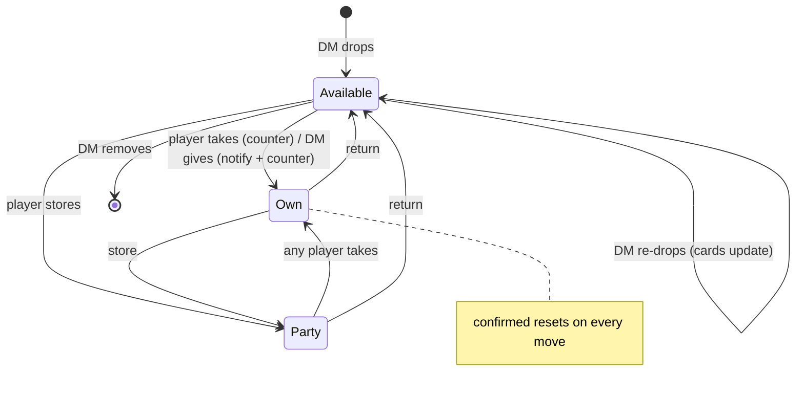

# Stage 10: optional integrations, loot and chat history

> **Moved from [ROADMAP.md](../../ROADMAP.md) on 2026-11-21, kept as written.** Closed for building 2026-11-18. Includes the loot and chat-history spec. The roadmap keeps a one-line summary of this stage; this file is the detail: the design, the decisions and who made them, and the build record. What has really run is in [BUILD-STATUS.md](../BUILD-STATUS.md). Index: [README.md](README.md).

## Stage 10 — Optional Integrations (Advanced Users)

**Status:** 🟢 **Closed for building, 2026-11-18** (Andy). What was built is marked below; the unverified parts move to [Stage 11](STAGE-11-PROTOCOL-4.md#stage-11--protocol-4-and-verification-060-and-061-planned-2026-11-18). The rest is a **list of ideas, not scheduled**.
**Depends on:** Stage 5; none of it is on the critical path

**Moved to Stage 11 (0.6.1) for testing:** the release pipeline (never run), D&D Beyond sync against live pages, OIDC against a real provider.

**Reachability audit, 2026-11-18 (Andy: "many items not built or deployed in Stage 10 that we have missed").** Two of the built items could not be reached by a player: **D&D Beyond** was hidden in the desktop unless the operator had set `DDB_SYNC=1` (off by default) and there was no screen at all in the phone web app; **single sign-on** had no button on the browser login. Both are fixed for 0.5.4 (the box now says it is off; a character screen and an SSO button on the web). Still not reachable or not run: DDB wins always: Andy decided 2026-11-19 that numbers cannot be overridden (Stage 11 item 9 dropped); the DDB sync and OIDC have never met a real service; SSO ends in a code to paste rather than a direct sign-in. The other items on this list are ideas, not built, so there is nothing to reach; the release pipeline is built and never run. **This audit looked at DDB and OIDC only**: the rest of Stage 10 and the earlier stages were not re-checked for the same fault (built, but no way in), which is worth a pass in 0.6.1.

Each item is independent, off by default, and must never be assumed by application code:

- **Release pipeline** (`.github/workflows/release.yml`, [RELEASING.md](../guides/RELEASING.md)): a `v*` tag builds signed installers for Linux, Windows and macOS (Apple silicon) into a draft release; `infra/fetch-release.sh` hands them to `vtt-admin updates publish`. **Never run;** no OS code signing yet.
- **Package-manager distribution** (winget, AUR, Homebrew tap, signed APT/DNF repos): **a future idea, not started or decided**. Options, effort and the questions to settle first are in [PACKAGE-DISTRIBUTION.md](../architecture/PACKAGE-DISTRIBUTION.md)
- D&D Beyond character sync from public pages (`ddb/`) — **built, unverified** ([DDB-SYNC.md](../architecture/DDB-SYNC.md)); extra stats built 2026-11-10, also unverified
- Cloudflare TURN (extra ICE server); Cloudflare Realtime SFU as an alternative to LiveKit (a large design of its own); Cloudflare Pages for static hosting
- Cloud transcription / LLM providers beyond Stage 5's first adapters
- **Web push for the phone web app (Apple Push and the other browsers' push services)**: **a future idea, not started.** Notifications while the web app is closed, for players who have added it to their home screen (iOS 16.4 or later needs the home-screen install; Android and desktop browsers can do it from a tab). It needs a service worker, server-side VAPID keys, a subscription store and a permission prompt, and it reuses the notification kinds the server already stores (session reminders, join decisions, whispers). The catch to settle first: delivery goes through Apple's and Google's push services, a third party in the path, so it must be opt-in per operator and never assumed (principle 2); the tray app stays the no-third-party answer. See [MOBILE-WEB-APP.md](../architecture/MOBILE-WEB-APP.md).
- OIDC/Authelia SSO — **built, tested against a fake provider only** ([SIGN-IN-OPTIONS.md](../architecture/SIGN-IN-OPTIONS.md))
- Remote AI backends (Whisper/LLM on another machine, e.g. a GPU PC) are a Stage 5 provider-interface concern, not Stage 10

### Loot management and chat history (asked by Andy, 2026-11-17)

**Status:** 🟢 Parts 1 to 3 and 6 **released in 0.5.3** (2026-11-18). **Parts 4 and 5 move to [Stage 11](STAGE-11-PROTOCOL-4.md#stage-11--protocol-4-and-verification-060-and-061-planned-2026-11-18), built as 0.6.0** (they change the wire). Andy's requests from real use of the 0.5.2 loot panel and chat; written up, and Andy answered the open questions the same day (listed at the end). It sits here rather than in a new stage, and unlike the rest of Stage 10 it is **not optional**: it fixes and extends Stage 6 table features. Next step: a build plan.

#### 1. Chat survives a server restart, and older chat loads on scroll

**What happens now:** after a server restart the desktop chat is empty. **Why (found 2026-11-17):** the server already keeps chat in Postgres (`chat_messages`, trimmed to `CHAT_RETENTION_MESSAGES` = 5000 per campaign) and has a paged `GET /api/campaigns/:id/chat?before=…`, which the phone web app uses. But the desktop fills its chat from the WebSocket snapshot's `recentChat`, which is read from the **replay buffer** (`hub.ts` `snapshot()`, last 50 events), and the replay buffer is short-lived by design. The loot and handout cards in chat come from the same buffer, so they vanish too.

- The snapshot's recent chat comes from **Postgres**, not the replay buffer: the last **50** messages the viewer may see.
- Scrolling up asks for older messages **50 at a time** (the existing `before` cursor), until there are no more.
- Loot and handout cards are rebuilt from their own tables with the chat they sit in, so a restart keeps them in place.
- **Done when:** restart the server mid-session; every client shows the same recent chat and cards afterwards, and can scroll back past 24 hours.

#### 2. Give: a simple picker, not an inline list

- **Give** opens a small drop-down menu of the campaign's players: avatar, then character name with the player's name beside it. Picking one gives the item. It does not unfold a list inside the row (today it does, first screenshot).
- The **same Give control** is on the loot card in chat, and it shows on the **collapsed** card, to the left of the expand arrow (today it shows only when the card is expanded).

#### 3. Filters and what each person sees

| Who    | Filters, in order                                 | Default       | Sees                                                                        |
| ------ | ------------------------------------------------- | ------------- | --------------------------------------------------------------------------- |
| DM     | Available \| Taken \| All                         | Available     | everything, but **not** the confirmed flags (part 5)                        |
| Player | Not confirmed \| All \| Own \| Party \| Available | Not confirmed | **only** available, party-stash and their own items; never another player's |

- Give, take, store, split and return update the open list straight away, with no manual refresh. On the DM's Available view an item that was just given or split **fades out** (rather than vanishing at once) so the DM can see it went.
- **Players can take from the party stash.** Today only the player who stored an item can move it again; any player of the campaign may take a party item for themselves.
- **Players are in charge of loot.** The DM gives only to a **named player**, never to the party stash, and only for the items that must go to one person. The DM can still **remove** unclaimed loot.
- The player's **Not confirmed** view lists their own and the party's items not yet ticked (part 5). If it is empty the panel says so and points to Available.

#### 4. Re-drop available loot into chat

- The DM can **re-drop** an item that is still **Available**, posting its card into chat again for anyone who missed it. An item that is held (by a player or the party) **cannot** be re-dropped.
- An item is one thing however many times it is dropped: when it is given, taken or returned, **every** card for it in chat updates.

#### 5. "Added to my sheet": notification and confirmed flag

The confirmed flag means **"I've added this to the real game sheet"** (e.g. the D&D Beyond character sheet, or the party inventory sheet most tables keep). It is the players' tool, not the DM's: a player who never adds an item cannot use it in the game (an attuned item's bonuses and feats only appear on a DDB sheet once it is added), and that is between them and their sheet. The DM needs to know only that something was claimed.

- **Every held item has a confirmed flag:** a player's own items, **each player's share of split coin**, and **party-stash items** (ticked by any player once it is on the party's shared sheet).
- **The flag resets whenever the item moves:** own → party, party → own, or back to available (returned or dropped).
- **The DM never sees the flags.** They add nothing to the DM's load.
- **An unconfirmed counter** sits on the loot icon, as a small badge, in **both** the desktop app and the phone web app: the number of the player's own and party items not yet confirmed. It is the main reminder, for the player who forgot or was away.
- **Given by the DM:** a notification ("The DM gave you …, add it to your sheet"), stored like the other notifications so a player who was not in the session sees it next time, **plus** the counter.
- **Taken, stored or split by a player:** **no notification**; the counter going up is the only sign (the player did it themselves).

#### 6. Loot on the recording timeline, for the AI (asked by Andy, 2026-11-17)

**Built 2026-11-17 for `0.5.3-dev.2`** ([RECORDING-AND-SUMMARIES.md](../architecture/RECORDING-AND-SUMMARIES.md#loot-on-the-timeline-built-2026-11-17)). Andy decided: the GM's brief gets every detail, the players' tale only notable items.

While a recording is open, every loot event goes into the recording's timeline (`recording_events`), the way
typed chat, scene changes and sound cues already do (`capture.ts`): **dropped** (what, how many), **given** by
the DM to a player, **taken** by a player (for themselves or the party stash), **stored**, **returned**,
**split** (who got how much) and **removed**. The worker turns them into cues the scribe and the bard can use
("The DM gave the Black pearl ×3 to Aria Windfoot"; "Bram, Cassiel and Dorn split 240 gp"), so story events
and the Game Master's summary sheets can say who got what. The DM always keeps the full record of who holds
what in the inventory window; players' chats may not (part 1's known limit), and Andy accepted that.

- Server and worker only: a migration adds `loot` to the event check, one `onLoot` hook beside `onChat`, and
  the worker's cue builder learns it. No change between server and app, so it fits a **0.5.x** patch.

#### Release fit

Parts 1 to 3 change no wire contract (the server reads chat from a different place; the paged REST call exists; filters and the picker are client-side; letting any player take from the party is a server rule) and can ship in a **0.5.x** patch. Parts 4 and 5 add to the wire (a re-drop event, a confirmed field and its call, a new notification kind), and the Not confirmed filter and the counter need that field, so they are a `shared/` contract change and ride the **0.6.0 / protocol 4** bump Stage 11 already plans. Both apps (desktop and phone web) get the same behaviour. [LOOT.md](../architecture/LOOT.md) and [TABLE-FEATURES.md](../architecture/TABLE-FEATURES.md) are updated with the build.

#### Loot decisions (Andy, 2026-11-17)

1. **Party-stash items are confirmed too.** Most tables keep a shared party inventory sheet (DDB has one); the flag says it has been copied there.
2. **Each share of split coin has its own flag**, for the same reason: "I've added this to my sheet".
3. **The DM gives to named players only**, never to the party stash. Players are in charge of loot most of the time; the DM gives the specific items that must go to one player, and can remove unclaimed loot.
4. **The DM does not see the flags.** The DM has enough to manage; all they need to know is that something was claimed. Players get a **Not confirmed** filter (their default) and an **unconfirmed counter** on the loot icon in both apps.
5. **A player who takes an item gets no notification**; the counter is the only sign. A DM give notifies.
6. **Chat loads 50 messages, then 50 per scroll-up.**
