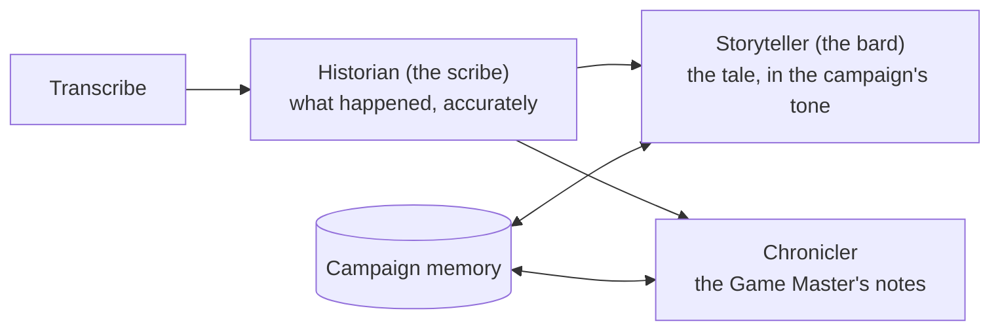

# Stage 12: storytelling, roles, personas and campaign memory

> **Moved from [ROADMAP.md](../../ROADMAP.md) on 2026-11-21, kept as written.** Closed for building 2026-11-21. Step H moved to Stage 15; the real-session tests moved to Stage 13. The roadmap keeps a one-line summary of this stage; this file is the detail: the design, the decisions and who made them, and the build record. What has really run is in [BUILD-STATUS.md](../BUILD-STATUS.md). Index: [README.md](README.md).

## Stage 12 — Storytelling: Roles, Personas and Campaign Memory (idea, 2026-11-17; scheduled 2026-11-18)

**Moved on again (Andy, 2026-11-21): the measuring items (the Windows microphone clipping retest, a long recorded session with timings and CPU, headsets and latency, the 8+ hour soak, OIDC against a real provider) and every real-session test of this stage are [Stage 13](../../ROADMAP.md#stage-13--quality-validation-closed-2026-11-24).** Their results go in [BUILD-STATUS.md](../BUILD-STATUS.md).

**Status:** 🟢 **Closed for building, 2026-11-21** (Andy). **CL and B to G are built** (B to G in `0.6.2-dev.2`, CL after it), server and worker only, unit-tested with fakes. **Not yet run on a real session or against a real cloud API: that is [Stage 13](../../ROADMAP.md#stage-13--quality-validation-closed-2026-11-24)** (the vault session, two sessions in a row for memory, each storyteller, Whisper name accuracy, Sonnet and the OpenAI model on a real recording, the Postgres queries for migrations 0042 and 0043). **Step H needs a wire change and moved to [Stage 15](../../ROADMAP.md#stage-15--protocol-5-and-070-planned-2026-11-21) (0.7.0).** If Stage 13 shows a built step is wrong, it is fixed as a bug in a 0.6.x patch.
**Depends on:** Stage 11 (0.6.0 carries every wire change this stage needs); Stage 5 (the records pipeline); builds on the scribe and bard split of 0.5.2 ([RECORDING-AND-SUMMARIES.md](../architecture/RECORDING-AND-SUMMARIES.md))

The pipeline becomes a line of named roles, each with its own job and its own persona, each reading the one before it:

- **Historian (today's scribe):** the accurate record of the session. Accuracy lives here, as now.
- **Storyteller (today's bard):** tells the tale. **Its persona is chosen by the Game Master** to suit the tone of the campaign (today there is one fixed voice: heroic, dryly funny).
- **Chronicler:** writes the Game Master's notes (today's GM brief is the nearest thing).
- **Persistent campaign memory:** what the campaign has already met (places, non-player characters, creatures) is kept between sessions, so the Storyteller can notice that the party has been here or met this person before, and refer back to it.

### What this is for (Andy, 2026-11-17): the test every part of it must pass

**Playing the game comes first.** The summaries add flavour, humour and texture; they are not a second job. Three things follow, and any feature here that fails them is cut or hidden:

- **Do not overwhelm the Game Master or the players** with options or with content. Few choices, good defaults, one tale. More output is not better output.
- **Keep the table connected to the story.** Many tables go weeks between sessions; the tale and the memory are what carry everyone back in.
- **Give the Game Master superpowers of recall.** The obscure fact, the name and trade of the throwaway NPC: "Gary the Grumpy Gnome", invented on the spot, whom the players go looking for five sessions later. Finding Gary is the measure of the campaign memory.

### Andy's notes (two memos, 2026-11-17)

More detail from Andy's own notes ("VTT Chat Chronicler" and "VTT Chat Transcription Tweaks"). Still ideas, recorded so the design starts from them.

**The roles, and what each hands on**

| Role                               | Job                                                                                                                          | Hands on                                                                                                                                            |
| ---------------------------------- | ---------------------------------------------------------------------------------------------------------------------------- | --------------------------------------------------------------------------------------------------------------------------------------------------- |
| **Listener** (Whisper)             | Capture what was said, accurately and neutrally. Never interprets.                                                           | The timed transcript                                                                                                                                |
| **Scribe, the campaign historian** | Work out what actually happened. "Arguably the most important AI in the chain." Dry and factual: no story, no embellishment. | **Structured facts**: events, decisions, combat outcomes, NPC interactions, new locations, loot, quests, secrets revealed, character development    |
| **Bard, the storyteller**          | Retell it. Reads the scribe's facts, never the transcript (as today).                                                        | The tale, in a chosen persona                                                                                                                       |
| **Chronicler**                     | What the Game Master needs to run the next session. A role of its own, not a bard.                                           | NPCs, open plot threads, items obtained, locations discovered, future hooks, **continuity warnings** ("the party promised to return within 7 days") |

**Bard personas** (several may retell the same session): the Tavern Bard (grandiose, makes the heroes legendary), the Dry Historian (accurate, like a record), the Tipsy Minstrel (an unreliable narrator: forgets, jokes, credits the wrong hero), the Wry Jester (dry, pokes fun at the players' decisions), the Bored Court Scribe (understates everything).

**Campaign memory:** one store per campaign of characters, NPCs, locations, factions, quests and magic items. The scribe updates it after every session; the bard is given the relevant parts before it writes, so weeks later it can say "once again the party crossed paths with Lord Ravenshade".

**Better hearing of fantasy words, without fine-tuning Whisper** (CPU-only, low overhead):

- A **glossary per campaign**: characters, NPCs, locations, spells, monsters, deities, homebrew terms, with aliases.
- **Whisper's starting prompt built from the glossary**: short, relevant, most-used terms first.
- **Vocabulary learning**: recurring names found in transcripts are offered for the glossary, and added only when a person approves.
- **Corrections after transcription**: dictionary replacements and fuzzy matching for misheard terms.
- **`small.en` against `medium.en`** for accuracy and CPU cost on old Xeons.

**Andy's order of work:** (1) better Whisper terminology, (2) a strong scribe extraction step, (3) persistent campaign memory, (4) several bard personas. A larger model comes last: "the architecture will improve the storytelling far more than moving from a 4B model to an 8B or 14B".

**Where this meets what is built** (Claude's reading, 2026-11-17; to check when the work starts):

- Half of the chain exists since 0.5.2: one reading of the transcript by a scribe, tales by a bard from the notes only, a Game Master brief from the same notes. The notes are **plain lines today, not structured facts**.
- Whisper is given **no vocabulary today**. The server already knows each campaign's character names, player names, scene titles, loot and handout titles, so a first glossary costs nothing to collect. Whether the Whisper server takes a starting prompt per request has to be checked before promising it.
- The scribe already receives who the Game Master is and the scene cues; the prompts already tell it to keep names as spoken.

### Decided by Andy, 2026-11-17

1. **A persona never changes the facts; it may embellish them.** The Tipsy Minstrel bends this a little further and may make up a few things to make events sound more interesting, but **the essence of the truth is always there**.
   **Relaxed by Andy, 2026-11-20:** in a tale creativity beats accuracy. Every bard keeps **close to the facts**, but a little invention is no problem (the scribe's notes and the DM brief stay factual). The **Tipsy Minstrel** is **pure chaos with nods to the truth**: it stays close to what happened, but may stretch the truth for the story, or add a fact because it is more fun. **Length, for every storyteller: 300 to 800 words, longer if the story needs it.** (Not yet in the prompts: that is the persona work in 0.6.4. A very short session still keeps its tale shorter than its notes, so a 40-second test does not become a dungeon crawl.)
   **Decided by Andy, 2026-11-20: tale length, detail and content are not a Game Master setting.** The Game Master picks only the storyteller's style, as now. The rest is the system's job, with **no protocol change**:
   - **Length and detail follow what happened.** A long session is not a busy one: a night of talk with little action should get a short tale. The storyteller is told to adjust, from loose signals in the content: how many events the scribe's notes record, scene changes, fights, loot, how much of the transcript is discussion against action, and the session's length. 300 to 800 words is the usual range, longer when the story demands it, and a tiny session still keeps its tale shorter than its notes. The signals are code-based rules, with the final call left to the storyteller; tune them by reading real tales.
   - **The operator controls resources and content**, as server settings (`vtt-admin settings`), not in the app: a ceiling on tale length (a slow CPU-only server), which storytellers the server offers (an operator can switch off the Tipsy Minstrel, which may leak Game Master secrets), and a content setting for strong language and violence (for a family or school group). The picker shows only what the operator allows.
   - **Built 2026-11-20 for 0.6.1 (the controls, not their effect):** `ai.tale.length` (`short` CPU-only, `default`, `long` GPU or cloud), `ai.tale.content` (`clean`, `default`, `graphic`; the installer asks, or takes `--content`) and `ai.storyteller.<name> on|off` (the Tavern Bard cannot be turned off and is always the fallback). The picker shows only the offered storytellers (a new read-only route, no protocol bump), a turned-off pick is refused, and a campaign whose storyteller is turned off is told by the Tavern Bard. The prompts that use the length and content settings arrive with the persona work (0.6.4).
2. **The scribe's output does not have to be strict**, only readable by the next step; the more structured the better. Worth testing with it: Whisper `medium.en` and the summary model `qwen3.5:8b` (the test VM was raised to 8 vCPU and 24 GB of memory for this).
3. **Game Master secrets are kept from the table, unless the Game Master picks the Tipsy Minstrel.** With every other persona nothing Game-Master-only reaches a tale. With the drunkard **any secret may slip**: the Game Master chose that persona, so they have decided it is fine. It decides who reads the tales and how closely: what did the drunkard let slip, and what did they make up? "The drunkard is an agent of chaos with an insider's view." The persona picker must say this plainly where it is chosen.
4. **GM Notes: a plain Markdown notebook for the Game Master** (optional). A background notebook and ideas board: plot hooks, key NPCs and events. **Unstructured by design**, so each Game Master makes it their own, with some **starter headings** to prompt a novice. **Attachments allowed: pictures and PDFs.** It is where the secrets live.
5. **One tale per session, one bard.** Most sessions end with the party back at the tavern: "The Bard" is telling the tale of mighty adventures, and the heroes just happen to be sitting at one of the tables.

6. **GM Notes waits for 0.6.** No stop-gap view over private handouts in 0.5.x.
7. **When the scribe's output cannot be read by the next step, retry**, up to making the scribe read the transcript again. The scribe's data is what makes the rest of the pipeline rich, so it is worth the model time; a weaker fallback is not.

### Build order (re-planned 2026-11-18)

Andy's rule (2026-11-17) was to do everything with no wire change in 0.5.x first. On 2026-11-18 he moved the whole AI workflow after the protocol bump: **every wire change this stage needs is built first, as 0.6.0 in [Stage 11](STAGE-11-PROTOCOL-4.md#stage-11--protocol-4-and-verification-060-and-061-planned-2026-11-18)** (the persona setting, GM Notes, the glossary, the off-site notice), so the work below is **server and worker only**, ships in patches from **0.6.2**, and builds on a settled protocol. The 0.5.x line carries bug fixes only.

| Release | Step | What                                                                                                                                                                                                                                                                                                                                                                                                                                                                                                                                                                                                                                                                                                                                                                                    | Done when                                                                                                                                                      |
| ------- | ---- | --------------------------------------------------------------------------------------------------------------------------------------------------------------------------------------------------------------------------------------------------------------------------------------------------------------------------------------------------------------------------------------------------------------------------------------------------------------------------------------------------------------------------------------------------------------------------------------------------------------------------------------------------------------------------------------------------------------------------------------------------------------------------------------- | -------------------------------------------------------------------------------------------------------------------------------------------------------------- |
| (0.5.3) | A    | ✅ **Measured `medium.en` and `qwen3.5:9b`** (2026-11-17): neither earns the default. Found and fixed instead: the summary model ran on its own sampling defaults, which wrecked long notes; Whisper used only 4 cores. A CPU without AVX needs a remote LLM. Released in 0.5.3.                                                                                                                                                                                                                                                                                                                                                                                                                                                                                                        | Done                                                                                                                                                           |
| 0.6.2   | CL   | ⚙️ **Built 2026-11-21, not yet run against the real API** (`ai/src/lib/providers/claude.ts`; tested with a fake client). **Claude connector** (and, 2026-11-21 at Andy's request, an **OpenAI connector** beside it: `ai.llm.kind openai`, model and prices named by the operator, LLM only) (Andy, 2026-11-17): `ai.llm.kind claude`, Sonnet 5.5 suggested, key in `.env`, failover to local as for any remote. Each job's tokens and estimated cost in `vtt-admin jobs list`. The off-site notice (built in 0.6.0) switches on when Claude or a public-host remote is configured; a gaming PC on the LAN stays "local only". Design: [RECORDING-AND-SUMMARIES.md](../architecture/RECORDING-AND-SUMMARIES.md#the-claude-connector-built-2026-11-21-not-yet-run-against-the-real-api). | A real recording summarised by Sonnet on the VM; the cost in `jobs list` matches the Anthropic console; with no key or no network, the job falls back to local |
| 0.6.2   | B    | ⚙️ **Built 2026-11-20, not yet measured** (`ai.transcription.glossary prompt`, off by default until the spoken test scene shows it helps). **Glossary into Whisper**: the names the server already holds (characters, players, scene titles, loot and handout titles) plus the Game Master's own glossary from 0.6.0, as Whisper's starting prompt. First check the Whisper server takes one per request. **Kept only if it helps:** an earlier name prompt made accuracy worse (93% against 98%).                                                                                                                                                                                                                                                                                      | Measured on the spoken test scene: names right more often, accuracy not lower                                                                                  |
| 0.6.2   | C    | ⚙️ **Built 2026-11-20, on by default, not yet run on a real recording** (`ai/src/lib/vocabulary.ts`; vocabulary learning, which fills the suggested terms, is not built). **Corrections after transcription** from the same glossary (dictionary, then fuzzy matching). Likely the bigger win of the two.                                                                                                                                                                                                                                                                                                                                                                                                                                                                               | Misheard names in the test transcript corrected, nothing else changed                                                                                          |
| 0.6.3   | D    | ⚙️ **Built 2026-11-20, not yet read on a real session** (`ai/src/lib/notes.ts`; the vault session and a long one still to run on the VM). **A scribe that picks out what happened**: notes under headings (events, decisions, combat, NPCs, locations, loot, quests, secrets, character moments) plus **memorable quotes**, at most about 3,000 words for a whole session. Unreadable output is retried, up to re-reading the transcript (decision 7).                                                                                                                                                                                                                                                                                                                                  | The vault session and a long one: notes under the headings, within the size, the key facts kept                                                                |
| 0.6.3   | E    | ⚙️ **Built 2026-11-20, not yet read on a real session** (`buildChroniclerPrompt`; the test is the vault session). **Chronicler replaces the GM brief's content**: 200 to 300 words under headings (NPCs, open threads, items, locations, hooks, continuity warnings), reading the GM Notes. The tale stays one, 300 to 500 words.                                                                                                                                                                                                                                                                                                                                                                                                                                                       | Gary, the three nights and Pim's lantern are in the brief                                                                                                      |
| 0.6.4   | F    | ⚙️ **Built 2026-11-20, not yet run on two real sessions** (Andy, 2026-11-20: a step of its own, named entries with a one-line gist, server-only with `vtt-admin memory`; migration 0042, `ai/src/lib/memory.ts`). **Campaign memory, kept by the server**: the scribe updates it, the bard and the Chronicler read it.                                                                                                                                                                                                                                                                                                                                                                                                                                                                  | Two sessions in a row: the second tale knows the party has met Gary before                                                                                     |
| 0.6.4   | G    | ⚙️ **Built 2026-11-20, not yet read on a real session** (`STYLES` in `ai/src/lib/prompts.ts`; also makes `ai.tale.length` and `ai.tale.content` act). **Personas**: the five voices written and tested, used through the per-campaign setting from 0.6.0 (an operator default for campaigns that have not chosen).                                                                                                                                                                                                                                                                                                                                                                                                                                                                      | Each persona tells the vault session in its own voice, facts intact (the drunkard: the essence intact, and it may slip what is in the GM Notes)                |
| 0.7     | H    | **Moved to [Stage 15](../../ROADMAP.md#stage-15--protocol-5-and-070-planned-2026-11-21) (2026-11-21):** memory in the glossary and lore import, designed 2026-11-21 and not built; it needs a wire change, so it rides the protocol 5 bump. The full design is in Stage 15.                                                                                                                                                                                                                                                                                                                                                                                                                                                                                                             | See Stage 15                                                                                                                                                   |

**Why this order:** hearing first (B, C), then the scribe that everything else reads (D, E), then memory, then voices, as Andy ordered. The Claude connector leads 0.6.2 because it is the lever a CPU-only server needs today. Steps can move between patches; each ships by itself. A correction screen for campaign memory is not here: see Stage 11's open point.

**The drunkard has secrets to leak from the start:** GM Notes exists from 0.6.0, so when the persona work arrives (G) the drunkard's "insider's view" is real, not limited to the Chronicler's guesses and private handouts.

Still open (ask Andy before designing):

- ~~What a persona is~~ Decided 2026-11-18: the Bard's persona, a preset list, per campaign, one bard following the party around (Stage 11).
- What campaign memory holds, who can read and correct it (the models will get names wrong), and how it stays small enough for a CPU-only server.
- Whether memory is written by the Historian, the Chronicler, or a step of its own, and how it treats private audio and whispers (never recorded today; that rule stays).
- How the Chronicler differs from today's GM brief, and what happens to the brief and the scribe's notes.
- Cost on the default CPU install: every extra role is more model time per session.
