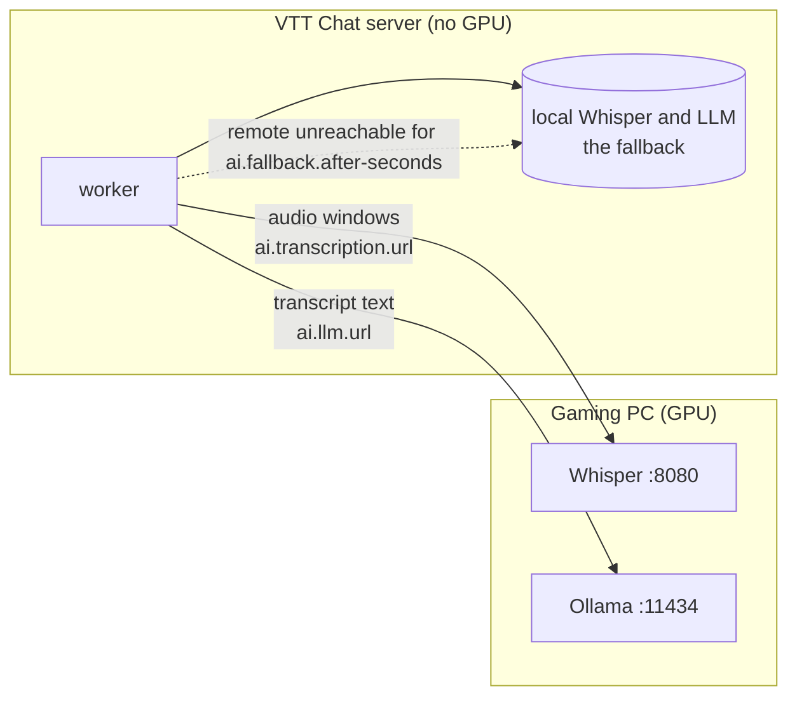

# AI on another machine

Runs **Whisper** (and optionally **Ollama**) on a machine with a GPU, for a VTT Chat server without one. Why you would: a CPU-only
server transcribes at roughly real time or slower, and on a 2010-era CPU much slower; a gaming PC's GPU does a session in minutes
(Whisper large-v3-turbo about 27x real time on a GTX 1080). Why you might not: the session's audio and text then travel to that
machine (your own, on your own network; it never leaves your control). The setup and settings are in the header of
[`compose.yml`](compose.yml) and in the [operator guide](../../../docs/guides/OPERATOR-GUIDE.md).

Each half is independent: offload Whisper, the LLM, or both. The server's own CPU is always the fallback unless
`ai.fallback.enabled false`.

## Things that matter

- **Bind to the LAN address, allow the server only.** Neither service has a password. `AI_BIND` in `.env` is the address they listen on.
- **Ollama's window.** The server reaches Ollama through its OpenAI-compatible API, which uses the **server's** `OLLAMA_CONTEXT_LENGTH`
  (the records pipeline is written for 8,192 tokens), not a per-request setting. The compose file sets it; a host-installed Ollama needs
  it set in its service environment.
- **Ollama may already be installed on the machine** (it often is). Then run only Whisper and point `ai.llm.url` at the host install.
- **The GPU is shared with whatever else the machine does.** Whisper stops its server after a minute idle, and Ollama unloads its model
  after `OLLAMA_KEEP_ALIVE`, so the card is free between sessions; during processing it is not.
