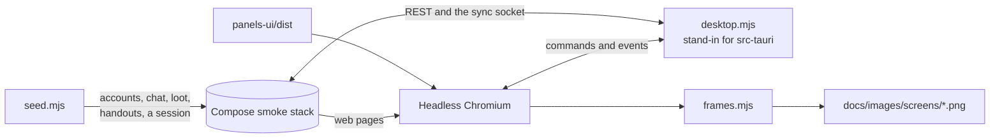

# Documentation screenshots

Makes the pictures in `docs/images/screens/` (used by the README, the user guide and the operator guide). They are
**simulated**, and the docs say so: the real screens, drawn from a seeded test table, set in a plain window or phone
outline that copies no operating system.

| What                                  | How it is made                                                                                                                                                                                                                                            |
| ------------------------------------- | --------------------------------------------------------------------------------------------------------------------------------------------------------------------------------------------------------------------------------------------------------- |
| Phone web app, home, download, status | The real pages, served by a local Compose smoke stack, in headless Chromium.                                                                                                                                                                              |
| Desktop app (main window, popups)     | The built panels (`tauri-client/panels-ui/dist`) in headless Chromium, with a **stand-in for the Rust side** (`tauri-stub.js` in the page, `desktop.mjs` in Node) that answers the panels' commands from the same smoke stack, the way `src-tauri` would. |
| Operator's console                    | Real `vtt-admin` output from the smoke stack, drawn in a terminal frame.                                                                                                                                                                                  |



## Why a stand-in, and what it does not show

The desktop panels only run inside the Tauri app; there is no browser mode. Driving the real app would need a display, a
sound card and a way to click it, on every platform. The panels are a cache of Rust's state
([STATE-AND-RESILIENCE.md](../../docs/architecture/STATE-AND-RESILIENCE.md)), so answering the same commands with the
same data gives the same pixels. What is **not** real in a desktop shot:

- Anything about audio and the operating system is a fixed answer: device names, the microphone level, who is speaking,
  the running recording and its timer, "Start with my computer".
- The session's chat is sent to the page again by the tool (`catchUp` in `shoot.mjs`): the server keeps only a short tail
  of chat for replay, does not replay whispers to a new window, and announces a loot drop once.
- The recorded session's summaries are copied from a records end-to-end run (`infra/records-smoke`), so the text is real
  model output, but this tool does not run the pipeline. The recording's date and length are made up.
- The window frame, the tray icon and anything Windows or macOS draws.

So these pictures show layout and content. They are not evidence that a feature works: `docs/BUILD-STATUS.md` is.

## Run it

Needs: the smoke stack up at `https://localhost` with the records end-to-end test run once
([operator guide](../../docs/guides/OPERATOR-GUIDE.md#check-it-works-the-end-to-end-smoke-test)), `/usr/bin/chromium`,
Node 24 or newer, `python3` with Pillow (to shrink the files), and `puppeteer-core` installed **outside the repo**, as
for `web/e2e`:

```bash
mkdir -p ~/scratch/ui-tests && cd ~/scratch/ui-tests && npm init -y && npm i puppeteer-core

cd <repo>
npm run build -w @vtt-chat-app/panels-ui            # the desktop shots use the built panels
cd scripts/screenshots
export NODE_PATH=~/scratch/ui-tests/node_modules
export NODE_EXTRA_CA_CERTS=/path/to/caddy-root.crt   # Node checks the stack's certificate; never disable that

# Once: the table. SOURCE_RECORDING is a processed recording of the end-to-end run (vtt-admin recording list).
SOURCE_RECORDING=<recording id> node seed.mjs

node shoot.mjs                      # every screenshot, into docs/images/screens/
node shoot.mjs desktop-table-gm     # or just some
```

Env: `BASE` (default `https://localhost`), `COMPOSE_DIR`, `CHROMIUM`, `OUT` (where the PNGs go), `WORK` (default
`~/scratch/vtt-screenshots`: the generated passwords of the throwaway accounts, mode 0600, never printed), and for
`seed.mjs` also `BRIEF_FILE` (a text file that replaces the copied DM brief).

It creates six `shots-*@example.com` accounts and the campaign "The Sunken Temple". **Local smoke stack only: do not
point it at a server you care about.** `seed.mjs` writes to the stack's database directly (the copied summaries).

## Files

- `lib.mjs`: the cast, sign-in, the API and socket helpers.
- `seed.mjs`: the table's content; safe to run again.
- `shots.mjs`: **the list of screenshots**. Add one here: a name and a function that returns a PNG.
- `shoot.mjs`: puts everyone online, opens pages, runs the list, compresses.
- `desktop.mjs`, `tauri-stub.js`: the stand-in for the Rust side.
- `frames.mjs`: the window, phone and terminal frames. `compress.py`: 256-colour PNGs (about a fifth of the size).

When a panel starts calling a new Tauri command, add its answer to `desktop.mjs` (commands with no answer return
`null`, which is right for anything that only changes a setting).
